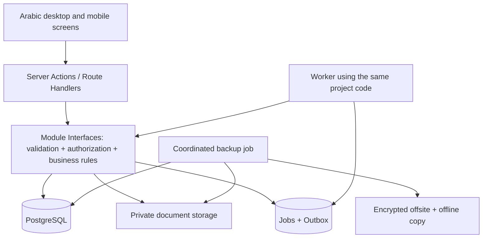
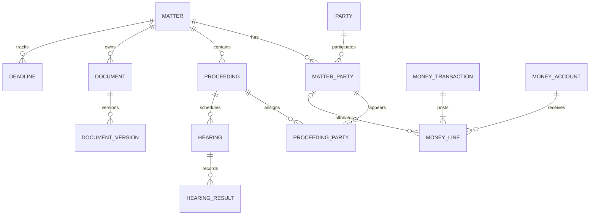

# Architecture and implementation choices

## 1. Proposed approach

One `Modular Monolith`, one repository, and one PostgreSQL database. Desktop and mobile use the same application: an installable PWA that is online-first in V1. Kubernetes, microservices, and a vector database are not required.

| Area | Decision | Rationale and limits |
|---|---|---|
| Web | Next.js App Router + TypeScript strict | One language for business logic and UI; Server Components for reads |
| UI | Tailwind CSS + shadcn/ui + Lucide; a locally hosted Arabic font | Components can be adapted for Arabic and keyboard use; the design reference governs presentation |
| Validation | Zod at the server Interface, with equivalent input constraints in forms | Browser validation improves usability but is insufficient protection |
| Data | PostgreSQL + Prisma 7 with a compatible driver adapter | Relations, constraints, and transactions without mixing ORM version interfaces |
| Auth | Better Auth + Prisma adapter + TOTP and recovery codes | Established session management; no custom password/MFA protocol |
| Files | Private filesystem volume outside `public/`, accessed through the Documents module | Simple for a small initial deployment; move to private S3-compatible storage later if needed |
| File scanning | Local ClamAV through a private service with updated definitions | No document uploads to external scanning sites; failed scans or stale definitions prevent READY |
| Jobs | Worker process from the same project; PostgreSQL jobs/outbox + leases | Reminders and file scanning without adding Redis merely because a worker exists |
| Printing | HTML print layouts + server-side Playwright PDF generation | Consistent Arabic CSS and a local font; queueing and resource limits for large reports |
| Deployment | Docker Compose for app/worker/PostgreSQL/ClamAV + HTTPS through Tailscale Serve; Caddy if public access is selected | Document the access choice before production; database, documents, and scanner remain unexposed |
| Tests | Vitest + integration tests with real PostgreSQL + Playwright E2E | Verify financial rules, persistence, and transactions, then actual user journeys |
| Backup | PostgreSQL dump + immutable file snapshot + restic | Consistent off-device recovery rather than copying a live volume alone |

**Compatibility constraint checked on November 10, 2026:** Better Auth's Prisma adapter documentation stated support for Prisma 7 and no support for the Prisma 8 interface at review time. M0 therefore pins compatible CLI, Client, and driver adapter major versions rather than blindly using `latest`. Source: [Better Auth Prisma adapter](https://better-auth.com/docs/adapters/prisma). If support changes before implementation, Codex reviews the evidence and updates the decision; Gemini does not independently replace the stack.

Better Auth provides TOTP and recovery codes. Recovery configuration, secret encryption, and session-revocation tests remain implementation work; installing the library does not complete them. Source: [2FA](https://better-auth.com/docs/plugins/2fa).

## 2. Dependency direction



Screens do not call Prisma directly. Each Module's Interface is the surface used by callers and tests and hides implementation details. Data access runs server-side only and returns limited DTOs. Every mutation verifies the session and authorization even when its page is protected. This follows [Next.js data security](https://nextjs.org/docs/app/guides/data-security).

### Core relationships

This diagram is abbreviated. DATA_MODEL specifies financial tables, document tables, and linking constraints in detail.



The diagram does not fully express party-owned general `Document` records or alternative financial dimensions. The written reference governs constraint implementation.

## 3. Proposed Modules and Interfaces

These names are design contracts, not executable implementation. DATA_MODEL and WORKFLOWS specify fields and behavior.

| Module | Small Interface | Rules hidden behind it |
|---|---|---|
| Identity | `requireActor`, `authorize` | Sessions, roles, MFA, re-authentication |
| Parties | `saveParty`, `searchParties`, `getClientProfile` | Search normalization, duplicate identity handling, contact information |
| Matters | `openMatter`, `attachProceeding`, `archiveMatter`, `getMatter` | File codes, party relationships, court instances, archiving checks |
| Scheduling | `scheduleHearing`, `recordHearingResult`, `rescheduleHearing`, `confirmDeadline` | Result transactions, date-only values, conflicts, reminders |
| Documents | `beginUpload`, `finalizeUpload`, `authorizeDownload`, `addVersion` | Size, signatures, scanning, storage location, read authorization |
| Finance | `postTransaction`, `reverseTransaction`, `getClientStatement` | Balanced lines, allocations, EGP currency, immutable posted entries |
| Productivity | `createTask`, `completeTask`, `listAgenda` | Task completion versus legal action completion, overdue display |
| Operations | `previewImport`, `commitImport`, `exportMatter`, `getHealth` | Import stages, reports, operational metrics |

Do not expose a generic Interface allowing screens to write arbitrary tables. Do not create a Repository abstraction for every Model merely for abstraction's sake. Introduce an Adapter at a Seam with real variation, such as current storage and upload-failure testing. Inject clocks and identifier generation where needed for tests; database details remain inside the Module.

File scanning and PDF generation consume memory and must be measured. The initial integrated-test recommendation is `2 vCPU / 8 GB RAM`, not a guaranteed minimum. Backup design includes field-encryption and MFA key recovery and a restore mode that prevents jobs, sending, and cleanup until checks complete. See SECURITY_OPERATIONS.

## 4. Shared rules

- Sensitive commands accept `actor`, `input`, `idempotencyKey`, and `expectedVersion` for updates. Never trust an actor supplied by the browser.
- Idempotency scope = actor identity + command type + key, with a payload hash. Reject the same key with different data. Repeated requests return the saved result.
- Expected errors use clear codes such as `VALIDATION_ERROR`, `CONFLICT`, `FORBIDDEN`, `DOCUMENT_NOT_READY`, and `ALREADY_POSTED`, with appropriate Arabic messages. Do not expose server internals.
- Business writes, audit records, and outbox entries share one database transaction. Audit failure fails the sensitive command. External sending happens after commit.
- Reminder logic uses explicit date/time sources, expiring leases, backoff, attempt limits, and a failed queue that can be retried.
- Concurrent desktop/mobile updates use optimistic versions. Show conflicting versions or require reload and review; never silently overwrite.
- Preserve original names and numbers. Arabic search normalization happens only in derived fields, including Arabic/Latin digit normalization. Search does not change the client's original name.

## 5. Proposed project layout after M0

```text
src/app/                 routes and thin server entry points
src/modules/identity/    auth policy and actor context
src/modules/parties/
src/modules/matters/
src/modules/scheduling/
src/modules/documents/
src/modules/finance/
src/modules/productivity/
src/modules/operations/
src/components/          shared accessible UI primitives
src/lib/                 small shared technical helpers
src/worker/              DB jobs runner
prisma/                  reviewed schema and SQL migrations
tests/integration/       isolated real PostgreSQL database
tests/e2e/               browser journeys
ops/                     compose, backup, restore, health runbooks
docs/                    canonical plan and later review reports
```

This is a planned layout, not an implemented scaffold. Do not accumulate domain rules in a large `utils` directory or duplicate financial calculations across UI, PDF, and API paths.

## 6. UI efficiency

Default to Server Components for reads and Client Components for forms and interaction. Paginate lists with stable ordering and parallelize independent reads after authorization. Aggregate the dashboard server-side; lazy-load previews and heavy calendar code. Do not share confidential caches across users or send a complete Model to the browser to display two fields. The hosting documentation recommends a reverse proxy for self-hosting: [Next.js self-hosting](https://nextjs.org/docs/app/guides/self-hosting).

## 7. Offline decision

V1 is installable without promising offline operation. If a service worker exists, cache only public shell/assets, never authentication, matter, or document responses. On lost connectivity, show the Arabic message “الاتصال انقطع، البيانات لسه ما اتحفظتش” (connection lost; data has not been saved). Unsubmitted form input stays only in the current page's memory. Financial retries reuse the same key. PWA behavior varies by device/browser and must be tested on office devices: [Next.js PWA guide](https://nextjs.org/docs/app/guides/progressive-web-apps).
