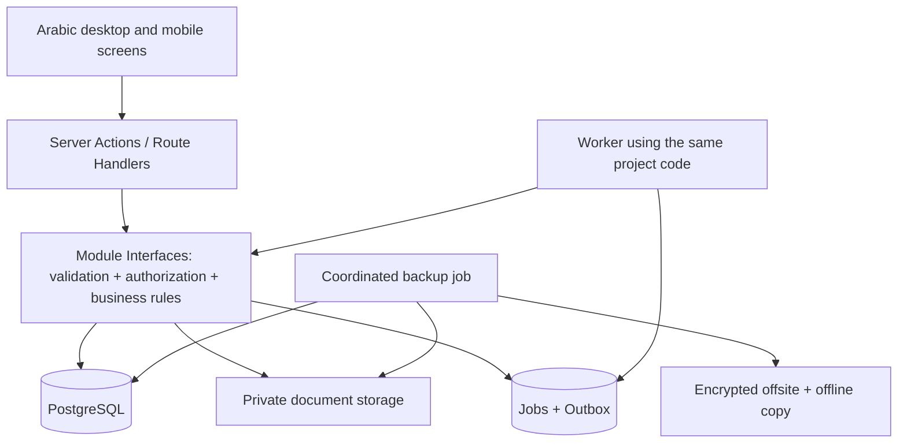
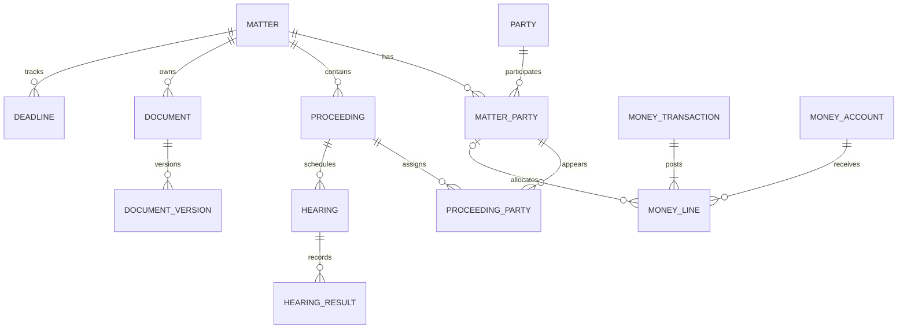

# LawOffice OS — Complete Implementation and Review Plan

November 10, 2026 — Planning documentation only. Codex plans and reviews; Gemini implements incrementally. Local links point to canonical project references. The described targets and tests have not yet been executed. Documentation is in English; the intended application remains Arabic RTL.

---

Source: `README.md`

# LawOffice OS

Implementation plan for a private system serving the project owner's father's law office in Egypt: one lawyer, varied legal work, a paper-based workflow today, and desktop/mobile use. Current status: **planning documents only**. No application has been built or deployed, and no operational acceptance tests have passed.

## Start here

1. Read [PRODUCT](../PRODUCT.md), then [PRD](../docs/PRD.md) and [GLOSSARY](../GLOSSARY.md).
2. Understand journeys and screens in [SCREENS](../docs/SCREENS.md), and the visual direction in [DESIGN](../DESIGN.md).
3. For implementation: [ARCHITECTURE](../docs/ARCHITECTURE.md), [DATA_MODEL](../docs/DATA_MODEL.md), and [WORKFLOWS](../docs/WORKFLOWS.md).
4. For operations: [SECURITY_OPERATIONS](../docs/SECURITY_OPERATIONS.md), [DATA_LIFECYCLE](../docs/DATA_LIFECYCLE.md), and [MIGRATION](../docs/MIGRATION.md).
5. For delivery management: [ROADMAP](../docs/ROADMAP.md) and [REVIEW_PROTOCOL](../docs/REVIEW_PROTOCOL.md).
6. Open this workspace in Antigravity, read [the skill setup](../docs/ANTIGRAVITY.md), then give the implementer **only [T01](../docs/tasks/T01.md)**. [PROMPTS](../docs/PROMPTS.md) indexes all 23 task-specific cards; each names its required local skills.

Codex plans and reviews; Gemini 3.8 Flash implements, using the model name requested by the project owner. No automatic integration between the tools is assumed. Production environment, budget, and device decisions remain open; they do not prevent starting with synthetic data.

## Milestone order

`M0 Environment → M1 Identity and UI → M2 Matters → M3 Hearings → M4 Documents → M5 Finance → M6 Printing and migration tools → M7 Operations and recovery → M8 Office pilot`.

There are 21 main task numbers, initially divided into 23 delivery assignments after splitting T15. Acceptance criteria and review gates apply before dependent work proceeds. The MVP remains experimental until security, recovery, and the lawyer's pilot have been completed.

## Plan status and limits

Estimates, colors, sizes, and resource figures are recommendations to validate. The lawyer reviews legal deadlines and real data. No VPS provider, location, or offsite backup service has been selected. Paper records and originals are not automatically retired.

Canonical references live at the repository root and in `docs/`. [outputs](.) contains derived reading and handoff packages. The current plan review is in [PLAN_REVIEW](../docs/PLAN_REVIEW.md) and is updated as checks are completed.

The documentation is in English. The product remains an Arabic RTL application for an Egyptian law office.

## Agency specialists during implementation

Every task card selects one Agency lead and relevant supports alongside its LawOffice skills. [The routing registry](../docs/AGENCY_AGENT_ROUTING.json) maps 23 tasks to 14 profiles and native definitions in `.agents/agents/`; profiles are selected from 155 project-local copies. [The complete catalogue](../docs/AGENCY_AGENT_CATALOG.md) separates scheduled roles, general/specialized technical roles, and business/professional/creative roles. After this policy is integrated, the next assignment requires actual delegated sessions for the lead and every support, with distinct invocation IDs, checkpoint SHAs, and returned results. Same-session role passes are not a substitute. Read [AGENCY_AGENTS](../docs/AGENCY_AGENTS.md); unavailable native execution is `BLOCKED_NATIVE_AGENTS`. Prepared definitions and static validation do not prove execution or Codex acceptance. Preserve extra installed profiles; the managed-skill validator checks only its seven LawOffice skills.

## GitHub workflow

Canonical repository: [MohamedAlksas/LawyerOS](https://github.com/MohamedAlksas/LawyerOS). `main` holds the stable integration baseline. The initial plan is published on `docs/project-plan-and-git-workflow`; merge its reviewed PR before starting T01 from `origin/main`. Each task card names its own `feature/` branch, and subsequent checkpoint commits are pushed to that same branch and PR. Read [GIT_WORKFLOW](../docs/GIT_WORKFLOW.md). Codex reviews; a push does not itself approve or merge a task.

For each new clone, enable the local accidental-main-push guard with `git config core.hooksPath .githooks`. This is a local convenience, not a GitHub branch-protection guarantee.

Regenerate and validate the maintained package with PowerShell 7:

```powershell
pwsh -File scripts/Add-TaskGitInstructions.ps1
pwsh -File scripts/Update-AgencyAgentPrompts.ps1
pwsh -File scripts/Build-TaskPromptIndex.ps1
pwsh -File scripts/Validate-AntigravityKit.ps1
pwsh -File scripts/Validate-AgencyAgentRouting.ps1
pwsh -File scripts/Build-PlanningKit.ps1
```

The planning validation GitHub Actions workflow checks the instructions and generated text deliverables; application CI is implemented later in T02. `work/`, credentials, and runtime client files are excluded from Git. Project skills and generated planning deliverables are tracked.

Locally, `pwsh -File scripts/Validate-AgencyAgentRouting.ps1 -VerifyInstalled` additionally checks the named global profile files/frontmatter/hashes. CI runs portable checks only; a successful portable check does not prove Antigravity loaded a profile. Global Agency installations are not modified or copied by this package.

---

Source: `PRODUCT.md`

# LawOffice OS — Product context

<!-- impeccable:product-schema 1 -->

## Platform

web

## Users

The primary user is the project owner's father: a lawyer in Egypt who works alone, handles varied case types, and currently relies on paper. The project owner is responsible for setting up and maintaining the system; this does not automatically grant access to the contents of every matter.

## Product Purpose

Organize the whole office: clients, internal matter files, court case numbers, hearings, documents, assignments, fees, and expenses. Provide access from desktop and mobile while maintaining links to the paper files.

## Operating Context

The desktop is used to enter files, review accounts, and print. The mobile is used to check today's schedule, record a hearing result, and photograph a document. This is a private office system; opening a client portal or selling subscriptions to other offices is outside the first version.

## Capabilities and Constraints

- Planning documents and implementation instructions are in English. The intended application remains in simple Egyptian Arabic with an RTL interface, with technical terms and codes isolated in LTR direction.
- One matter may involve multiple clients and opponents, as well as multiple court instances and court case numbers.
- Legal deadlines are entered or reviewed by the lawyer; the application does not determine them independently.
- Paper remains in use during the transition, and its location is part of the matter's data.
- Fees, judicial expenses, office expenses, and client money received for future spending are separate accounts.
- The current request assigns planning and review to Codex and implementation to Gemini 3.8 Flash, using the model name specified by the project owner. Model availability, operation, and file access have not been tested.

## Stack

The planning proposal continues the previous conversation: Next.js, TypeScript, PostgreSQL, Prisma, and Docker Compose. Selecting, pinning, and testing compatible versions is an M0 task, before implementing real features. The final hosting choice must be resolved before transferring real data; no deployment or service purchase has taken place.

## Evidence on Hand

The previous conversation, "اقتراحات نظام محاماة" (law office system suggestions), has been reviewed. No actual case files, documents, visual identity, or operating figures have been supplied. Names, amounts, and dataset sizes in the plan are illustrative, and speed targets are estimates that must be measured.

## Product Principles

1. Find all information about the work through its matter file without mixing court instances.
2. Recording a hearing result on mobile matters more than the number of available options.
3. Correct deadlines, accurate accounts, and successful data recovery are actual operating requirements.
4. Migrate paper gradually, starting with upcoming hearings.
5. Any later AI or OCR produces suggestions for review and never automatically changes approved information.

## Open Decisions

The hosting and offsite backup provider and location, archive size, external notification channel and its budget, and actual printers and devices remain open. These decisions do not prevent implementing a trial version with synthetic data.

---

Source: `GLOSSARY.md`

# LawOffice OS

Shared language for planning, implementation, and review. The Arabic term shown to the lawyer takes precedence over the implementation's table name.

## Language

**Matter — “ملف الشغل”**:
The internal file bringing together the office's work on one subject, including its parties, documents, finances, and related court proceedings.
_Avoid_: Using “case” to cover every instance of litigation without distinction.

**Proceeding — “القضية القضائية”**:
A court procedure with its own identity before a court and a specific type, year, and number; it may link to an earlier proceeding, as an appeal does.
_Avoid_: Office file; an appeal represented as an unlinked additional number.

**Party — “الطرف”**:
A person or organization associated with the work, who may be a client in one matter and an opponent in another.
_Avoid_: Treating every registered person as a client.

**Client — “الموكل”**:
A party who has engaged the office; being a client does not by itself determine that party's legal capacity within a proceeding.
_Avoid_: User; account holder.

**Party role — “صفة الطرف”**:
The person or organization's relationship to the office within a matter: client, opponent, or other party, defined per association.
_Avoid_: A fixed attribute of the person across all matters; confusing it with legal capacity.

**Legal capacity — “الصفة القضائية”**:
A party's position within a specific court proceeding, such as plaintiff, defendant, accused, or appellant; it may differ between first instance and appeal.
_Avoid_: Equating it with the client/opponent role in the office's matter.

**Hearing — “الجلسة”**:
A specific event in a court proceeding's schedule, with a date and possibly a time, location, and result.
_Avoid_: Task; legal deadline.

**Deadline — “الميعاد القانوني”**:
The last date for an action, determined or confirmed by the lawyer together with its source and basis.
_Avoid_: An automatically calculated reminder presented as a legal determination.

**Task — “المهمة”**:
Work to be performed, possibly linked to a matter, hearing, or deadline, such as preparing a memorandum.
_Avoid_: Treating a task as proof that the legal action was completed.

**Reminder — “التذكير”**:
A notification concerning a hearing, task, or deadline; delivery does not prove the user saw it or performed the required action.
_Avoid_: Guaranteed delivery; completion.

**Fees — “أتعاب”**:
The agreed consideration for the lawyer's work, separate from expense reimbursement and client funds supplied for spending.
_Avoid_: Treating every incoming amount as fee income.

**Reimbursable expense — “مصروف قابل للاسترداد”**:
A cost funded by the office for a matter that the client is expected to reimburse under the agreement.
_Avoid_: Fees; general office expense.

**Client advance — “أموال موكل للصرف”**:
Money received by the office for the client's expenses; the unused portion remains owed to the client.
_Avoid_: Office profit; automatic fee collection.

**Posting — “ترحيل مالي”**:
Approving a financial transaction in the ledger so corrections are made through documented opposing entries.
_Avoid_: Editing the balance manually.

**Physical location — “مكان الأصل الورقي”**:
The paper's storage location, condition, and current holder, whether in the office or received from an authority or client.
_Avoid_: Treating a digital image as the paper original.

---

Source: `docs/PRD.md`

# PRD — LawOffice OS

Plan version 1.0 — 10 November 2026. Status: ready to begin phased implementation; this is not evidence that the application has been implemented or reviewed. Terminology reference: [GLOSSARY](../GLOSSARY.md).

## 1. Desired outcome

The project owner's father opens the system in the morning to see his hearings and required work, returns from court to record the outcome and next date, and accesses the file's paper location and account from the same place. Start with one office and one lawyer, separating maintenance access from the lawyer's use. A full multiemployee design is deferred until there is an actual request.

## 2. Product priorities

| Priority | Scope | Reason for ordering |
|---|---|---|
| P0 before live operation | Secure login, clients and parties, matters and proceedings, hearings, tasks and manually entered deadlines, private archive, basic search and printing, basic accounts, audit trail, tested backup | The minimum needed to organize the office and protect its data |
| P1 after the pilot stabilizes | Push or email with approval, document templates, broader import, advanced reports, QR codes for files | Saves time once the data is stable |
| P2 later | Arabic OCR, proposed AI summaries with source pages, assistants and matter-level permissions, integrations | Requires accuracy and privacy evaluation and new scope |

Outside V1: calculating appeal periods from general rules, automatic submissions to court platforms, a client portal, an accredited tax or electronic invoicing system, multioffice SaaS, a native application, or offline synchronization of confidential data.

## 3. Functional requirements

| ID | Requirement | Acceptance evidence |
|---|---|---|
| FR-01 | One securely provisioned owner account, no public registration, with MFA and recovery | Login, logout, revocation of a stolen session, and a recovery trial |
| FR-02 | Manage people and organizations, with different capacities in each matter and proceeding | The same party is a client here and an opponent elsewhere without a global role change |
| FR-03 | An internal matter with a code and paper location, containing separate linked proceedings | First instance and appeal with separate hearings and documents inside one matter |
| FR-04 | Record a hearing, its result, adjournment, and preparation tasks | One operation prevents partial saves or duplication on a poor connection |
| FR-05 | Manually entered legal deadline with a source and approval status | A draft appears as unapproved and is never presented as a calculated legal deadline |
| FR-06 | Private uploads from mobile and desktop, versions, and paper-original metadata | Unauthorized document links are rejected, and failed uploads do not appear complete |
| FR-07 | Daily and weekly schedules, a calendar, and search | Searching by an Arabic name or Arabic/Latin digits returns the expected matter |
| FR-08 | Separate fees, expenses, reimbursements, and client money | An illustrative 15000/5000/1200 statement matches the accounting rules |
| FR-09 | Print hearing lists, matter summaries, administrative receipts, and account statements | Correct Arabic PDF, reasonable page breaks, and matching totals |
| FR-10 | In-app reminders distinguishing overdue and failed items | Restarting the worker does not generate the same internal reminder twice |
| FR-11 | Reusable export and batch import | Preview, error review, and batch replay without duplication |
| FR-12 | Audit trail for edits and sensitive changes | Correcting a result or reversing a payment records who, when, and why |
| FR-13 | Consistent database and file backups with isolated restoration | A matter, hearing, document, and financial transaction are actually restored |

## 4. Non-functional requirements

- `NFR-01` Native Arabic RTL presentation, with `lang=ar` and isolation of codes, numbers, and English text. Display clear Gregorian dates without day/month ambiguity; the office timezone is `Africa/Cairo`.
- `NFR-02` The interface works at 390, 768, and 1440 pixels, with keyboard use, 200% text zoom, visible focus, and errors announced and written. WCAG AA contrast is a target; do not claim it has been achieved before testing.
- `NFR-03` Plan initially for test data of 2000 matters, 20000 hearings, 30000 document records, and 100000 financial transactions/lines. These are test dataset sizes, not a description of the father's office.
- `NFR-04` Target list search below two seconds P95 in the agreed measurement environment, and opening today's schedule below 3 seconds on a mobile with a stable connection. Large-image transfers are excluded and measured separately. Record the device, dataset size, and connection rather than claiming absolute speed.
- `NFR-05` Safe retry for sensitive operations, and concurrent-edit conflicts shown to the user instead of silently overwriting an edit.
- `NFR-06` Initial operating targets: RPO up to 24 hours, and RTO up to 4 hours after a suitable replacement environment becomes available. These become accepted figures only after a documented restore drill.
- `NFR-07` No case data saved in browser storage, log files, or external analytics services by default. Live operation requires a backup plan and successful recovery.

## 5. Core user stories

1. As a lawyer, I record a client and matter even before the court case number is known, so I can organize the paper from the start of the engagement.
2. I add first instance and appeal to the same matter and identify which case number each hearing belongs to.
3. On mobile, I record "تأجيل لتقديم مذكرة" (adjourned for submission of a memorandum) and enter the next hearing and preparation task on the same screen.
4. I photograph a document and check its legibility and association before accepting it into the archive.
5. I see separate amounts answering the UI questions "الموكل عليه كام أتعاب؟ عليه كام مصروفات؟ لسه معايا كام من فلوسه للصرف؟" (what fees does the client owe, what expenses do they owe, and how much client money do I still hold for spending?).
6. I produce the week's hearing list and identify the location of each paper file I need to take.
7. After a device problem, I restore a consistent backup and verify that the documents linked to its data are present.

## 6. Boundaries and evidence

The dashboard displays actual database data; any demo data is clearly labeled and never mixed with live records. API success or a successful build is insufficient evidence of usability. The project owner's father must try the daily journeys, and the project owner must review the accounts and recovery.

Before selecting an external storage location or sending a document to an AI service, the father reviews confidentiality, applicable legal and contractual obligations, and the processing location. The plan does not assume any provider automatically satisfies those obligations.

## 7. Open questions and their management

| Decision | Current working assumption | Latest resolution point |
|---|---|---|
| Hosting | Local trial with synthetic data, then a VPS with private access is recommended | Before M7 and use of real data |
| Notifications outside the app | Deferred; today's schedule and printing are the MVP foundation | After the pilot or before relying on them |
| Document sizes | 25 MB per file as an adjustable initial limit | M4 with actual photography trials |
| Identity data | Optional and collected only when needed | M2 form review |
| Gemini name | Implementation model name as requested by the user; no reliance on assumed capabilities | When opening the implementation session |
| Time and budget | No fixed duration or price promise; measure the first two tasks | After M1 |

---

Source: `docs/SCREENS.md`

# LawOffice OS — Journeys, screens, and fields

Version: implementation plan 1, 10 November 2026. Visual reference: [DESIGN.md](../DESIGN.md). Detailed relationship and financial rules: [DATA_MODEL.md](../docs/DATA_MODEL.md) and [WORKFLOWS.md](../docs/WORKFLOWS.md). Field notation: **required** for final saving; **optional** may be completed later. Missing migration data has an explicit draft path, rather than invented defaults.

## Core journeys

| Journey | Steps | Success evidence |
|---|---|---|
| Start of the day | Login → "النهارده" (today) → today's hearings → open matter → document checklist → print agenda | Hearings without a specified time are visible, and confirmed legal deadlines are separate from tasks |
| New client and matter | Search for an existing person → add/select client → matter → court proceeding if available → specify paper location | Stable internal code, multiple clients supported, and a matter may begin as a consultation before any court case number exists |
| After court | Hearing → "تسجيل النتيجة" (record result) → decision → optional next hearing → optional tasks → review and save | The result, new hearing, and tasks all appear together, or none are saved |
| Mobile upload | Matter → "رفع مستند" (upload document) → photograph/select → preview image legibility → brief metadata → send | Scan status is clear, and the file is unavailable before upload and scanning finish |
| Collection | Matter → "تسجيل دفعة" (record payment) → select payer and classification → amount and allocation → review → post and issue receipt | Fees, expenses, and client money remain separate accounts |
| Appeal | Matter → "إضافة رقم قضائي مرتبط" (add linked court case number) → select previous proceeding and instance → court details | Each court case number has its own hearings and documents, with earlier history preserved |
| Month end | Accounts → period → collections/expenses/client balances → detailed statement → export | Total cash is not presented as office profit |

## Page map

| ID | Title and proposed route | Content and primary action |
|---|---|---|
| S01 | Login `/login` and `/verify` | Login, additional verification, recovery |
| S02 | Today `/today` | Hearings, confirmed deadlines, tasks, operating alerts |
| S03 | Matters `/matters` and `/matters/new` | Search, filters, and matter creation |
| S04 | Matter file `/matters/:id` | Summary and tabs for all related work |
| S05 | Court proceeding `/proceedings/:id` | One court case number, its instance, and hearings |
| S06 | Hearing `/hearings/:id` and `/hearings/:id/result` | Appointment, result, and adjournment |
| S07 | Agenda `/agenda` | List, week, month, and printing |
| S08 | Tasks and deadlines `/tasks` and `/deadlines` | Work follow-up and a distinct legal deadline |
| S09 | Parties `/parties` and `/parties/:id` | Clients, opponents, and contact details |
| S10 | Documents `/documents` and `/documents/:id` | Upload, preview, versions, and original location |
| S11 | Accounts `/finance` | Payments, expenses, client money, and statements |
| S12 | Search `/search` | Categorized results and secure links |
| S13 | Reports `/reports` | Hearing list, matter summary, client account, period report |
| S14 | Settings `/settings` | Office, account, security, reference lists, operations |
| S15 | Paper migration `/imports` | Trial import, review, and approval |

## S01 — Login and recovery

Login fields: registered email **required** `email`, password **required** `password`. There is no public registration; the office owner is set up through a defined bootstrap process. Additional verification: **required** `TOTP` code or a single-use recovery code; active device names, last use, and a terminate-device action. Failed-login messages do not reveal whether an email exists. Account recovery follows a documented operations procedure, with no backdoor button that bypasses MFA. Settings explain how to keep recovery codes outside the server and phone before accepting the account setup.

## S02 — Today

Order: today's date, today's hearings, legal deadlines needing confirmation or approaching, overdue tasks, then a weekly summary. Each hearing shows the matter name, court case number/year, court and circuit, time or "غير محددة" (not specified), required work and preparation, and a record-result action. Overlapping hearing times generate a warning for review but do not prevent saving. The owner sees a late-backup alert. Pressing "تمت" (done) does not close a legal deadline; each item type has its own explicit action.

## S03 and S04 — Matter list and matter file

**Matter list:** matter name, code, primary client with the number of others, type, status, next hearing, and paper location. Filters: active/archived, type, court, client, hearing date range, incomplete data. Search preserves filters when returning from details. Sort by the next hearing while clearly identifying matters without an appointment.

**Matter form:**

| Field | Type and requirement | Validation / default |
|---|---|---|
| Matter title | Text, required | Readable description; proposed limit of 200 characters |
| Matter code | Display-only, generated | Stable and unique; not the court case number |
| Matter `kind` | Selection, required | Litigation `LITIGATION` / consultation `CONSULTATION` / contract `CONTRACT` / other `OTHER` |
| Case/work category | Selection, optional | Civil/criminal/family/commercial/administrative/other; manageable reference list, separate from matter kind |
| Clients | Multiple selection, required for an approved matter | Existing party or add during the journey; identify the primary contact |
| Opponents and other parties | Multiple, optional | May be added later; party role and legal capacity are separate |
| Subject summary | Long text, optional | Prefer understandable wording; no unsafe HTML |
| Status | Selection, required | Default "نشط" (active); archiving has a separate path |
| Paper file location | Selection/text, optional at creation | Cabinet/shelf/number; required before approving paper migration |
| Date the office opened the matter | Date, required | Today suggested and editable; separate from the court case year |
| Notes | Text, optional | With an edit history |

Matter details use the literal tabs "نظرة عامة، الأرقام القضائية، الجلسات، المستندات، المهام والمواعيد، الحسابات، سجل الإجراءات" (overview, court case numbers, hearings, documents, tasks and deadlines, accounts, activity history). The latest action and next hearing are derived values. The chronological timeline identifies the author and source; editing a note is different from changing the original event. QR support is **deferred to P1**: it opens the matter link after login, includes no client name, national ID, or access authorization, and is not a V1 delivery condition.

## S05 — Court proceeding and links

Fields: matter **required**; proceeding type and instance **required**; court case number **required to approve a complete registration**, stored as text; year `yearLabel` **required with the number**, as reference text that is not always assumed to be a Gregorian year; court **required even for a draft proceeding to identify the hearing's court**; registration/docket type **required to approve a complete registration**; circuit **optional**; parent proceeding **optional**; proceeding status **required**; parties' legal capacities in the proceeding **optional for completing the file**. Prevent self-parenting and parent/child cycles. Similar number, year, court, and registration type produce a review warning, never automatic deletion or merging. If the number is still unknown, record an explicit draft proceeding with missing fields, without `0000`. If the court itself is unknown, save the matter only and defer the proceeding; never select a default court.

Actions: add hearing, upload a document for this proceeding, add an appeal/linked proceeding, view the sequence. "محجوز للحكم" (reserved for judgment) applies to the proceeding; completing one proceeding does not archive the entire matter.

## S06 — Hearing and result

**Create appointment:** proceeding **required**; hearing date **required**; time **optional with no default**; court and circuit shown from the proceeding, with the hearing location recorded if different; purpose/required work **optional**; attendance location **optional**; optional reminders following office settings; hearing roll number **optional as text**. A past appointment may be added for historical migration with a warning; there is no blanket prohibition.

**Record result:** decision/result **required**; summary of what happened **optional**; is there a new date? **required**, with yes/no/not yet determined choices; new date **required if yes**, with optional time; required-work list **optional**, each task having a title and a due date if known; decision document **optional**; proceeding-status update **explicit and optional**. A new date before the current hearing date is a potential error requiring correction, while the appropriate path still allows documenting a historical date correction. Do not calculate an appeal deadline from the decision.

Before saving, show the literal summary "هتسجل النتيجة، وتضيف جلسة بتاريخ…، و… مهام" (you will record the result, add a hearing on…, and… tasks). Correcting a saved result shows the previous version and reason. Changing an appointment for a hearing that has not taken place is labeled "تعديل الموعد" (change appointment), not "إثبات انعقاد" (record that the hearing took place). Preserve the previous appointment reference and create the replacement according to WORKFLOWS without deleting change history. Cancelling a hearing records the reason and updates its reminders.

## S07 and S08 — Agenda, tasks, and legal deadlines

The agenda begins with a simple mobile list, with week/month as alternatives. Provide court/type filters and printing for selected days. A hearing, legal deadline, and task have distinct symbols and labels. Daily view groups appointments with no specified time separately, not at midnight.

**Task:** title **required**; linked matter/proceeding **optional**; description **optional**; priority **required**, default normal; due date **optional**; status **required**, default open; checklist **optional**; reminder **optional**. It does not automatically create a legal deadline.

**Legal deadline:** title **required**; matter **required**; proceeding **optional**; final date **required for approval**; time **optional**; source of the deadline/review notes **required for approval**; source document **optional**; status **required**, using "مسودة تحتاج مراجعة/مؤكد/تم الإجراء/ألغي" (draft requiring review/confirmed/action completed/cancelled). Approval requires the explicit action "راجعت الموعد واعتمده" (I reviewed and approve the deadline), with the approver's name and timestamp. Changing the date after approval invalidates the previous confirmation and requires a new review with a reason. Completion requires a description of what was done and optional evidence; a reminder is not proof of execution.

## S09 — Parties and client profile

Person/organization type **required**; name **required**; phone numbers **optional**, with a primary number; email **optional**, in a valid format; address **optional**; national ID/organization identifier **optional and sensitive**, never a prerequisite for entry; contact relationship **optional**; notes **optional**. Client/opponent role is assigned within the matter, so the same person can have a different role elsewhere. Similar names/phone numbers suggest opening an existing record but do not prohibit distinct people with similar information.

Party tabs: details, matters, powers of attorney, general documents, communication, account statement. Power of attorney: number, year, and issuing office **required when recording it as complete data**; issue date **optional**; scope/description **optional**; document copy **optional**; review status **required**. Expiry is not inferred automatically from a general date. Communication record: date **required**; channel **required**; summary **required**; linked matter **optional**; follow-up **optional**.

## S10 — Documents

Digital file **required**; title **required**, suggested from the filename; type **required**; link to a matter or party **required**, with proceeding/hearing **optional** and consistent with the matter; document date **optional**; paper-original location **optional**; is the original in the office? **optional**, with yes/no/unknown choices; description **optional**; sensitivity **required**, default confidential.

Upload accepts the formats and size defined by security, showing limits before selection. Start with PDF, JPEG, and PNG and a proposed 25 MB limit per version. V1 permits selecting or capturing an image when supported by the browser, previewing legibility before sending, and previewing PDF pages after upload. Cropping, rotating, reordering images, and combining them into a multipage document are **optional enhancements outside the V1 delivery condition**; a mobile scanner can produce a ready PDF. Preserve the uploaded original. Literal states: "بيترفع، جاري الفحص، جاهز، مرفوض، الرفع غير مكتمل" (uploading, scanning, ready, rejected, incomplete upload). A rejected file shows a safe reason and retry action; a new version never silently replaces the original. Preview and download require authorization every time. A matching file hash produces a duplication warning. No `OCR` or approved extracted text in the MVP.

## S11 — Accounts

The interface has four clear literal sections: "الأتعاب، مصاريف القضايا، أموال الموكل، مصاريف المكتب" (fees, matter expenses, client money, office expenses). Reports distinguish "المستحق" (due), "المحصل" (collected), and "المتاح بالصندوق" (available cash).

| Form | Core fields |
|---|---|
| Fee agreement | Matter and responsible client, agreement description, EGP amount, and date required; installments with amounts and dates optional; change a posted agreement using an adjustment entry with a reason |
| Receive money | Payer, date, amount, payment method, cash/account, classification, and allocation required; transfer reference and note optional; allocated total equals the amount |
| Matter expense | Matter, date, amount, description/category, funding source, and whether reimbursable by the client required; receipt and linked proceeding optional |
| Client advance / expense deposit | Client and matter, amount, date, and collection method required; balance is client money, not fee revenue |
| Office expense | Date, amount, category, account, and description required; document optional; not charged to a client's receivable |
| Full transaction reversal | Original transaction, date, and reason required; display-only amount matches the entire original, with no partial edit; preview reversal effects and dependencies before posting; prohibit repeated reversal |
| Actual refund | Original transaction/source of money, beneficiary, refund amount, date, disbursement method, and reason required; may be partial within available limits; show whether it reopens a receivable or reduces an advance according to the original type |

Review before posting shows the effect on fees, expenses, and client money. A reversal corrects the accounting record and does not itself prove that money was actually returned; returning money is a separate disbursement operation linked to the original. Detailed rules and dependencies are in WORKFLOWS. If an allocation exceeds fees due, the excess never automatically becomes revenue; require explicit classification. Posted documents are read-only, receipt numbers are sequential and never reused, and printed copies remain linked to the original and any reversal. Do not describe the receipt as an accredited tax document.

## S12 and S13 — Search and reports

Unified search by name, matter code, court case number/year, court, and document title, with result-type filters. Results never reveal an unauthorized document or amount. Scanned-PDF contents are not searchable in the MVP; only their metadata is searchable.

Reports: hearings within a period, matter summary, client statement showing each category and its balance, period collections and expenses, and matters with incomplete data. Report fields: period **required where applicable**; matter/client/court **optional depending on the report**; include financial details **optional according to authorization**. Preview before printing/export, with generation time, filters, and creator. Arabic PDF text is readable, properly joined, and correctly directed. CSV exports UTF-8 and handles cells that could become formulas.

## S14 and S15 — Settings and migration

Settings: office name **required**; contact information **optional**; EGP currency and Cairo timezone for display; reminder policies; management of courts, circuits, types, and paper locations; security-session management; backup status and latest restore test. Reference entries already in use are disabled rather than deleted in a way that breaks earlier matters. Server restoration belongs in operations, not a dangerous button in the daily interface.

Migration: select CSV template → upload → map columns → preview and review errors → approve valid rows → report what was recorded. Source fields: row code/identifier, matter title, parties, case number/year/court where available, next hearing, paper location, review source. Ambiguous dates stop for review rather than being guessed. Replaying the same batch does not duplicate matters. The incomplete-data screen shows "البيانات لسه محتاجة مراجعة" (the data still needs review), who reviewed it and when. Upcoming cases are checked against paper with the project owner's father before approval.

## Pilot acceptance scenario with the project owner's father

Use synthetic data: one client with two matters, one matter with two clients, first instance and appeal, a hearing without a time, a 20-page document, a long title, and an allocated payment. The father opens the matter, records a result and adjournment, uploads an image, and records a payment without continual help. Test loss of connectivity during saving, opening the same matter on two devices, and navigating away from an unsaved form. Speed targets in DESIGN.md are provisional; actual acceptance requires accurate data, clear failure handling, and no duplication before speed.

---

Source: `DESIGN.md`

# LawOffice OS — Interface design reference

Version: preliminary implementation design plan, 10 November 2026. These are proposed planning specifications; no interface has been implemented or visually tested against them yet.

## Experience direction

The interface is a daily working tool for an Egyptian lawyer working alone. Success means the project owner's father can identify his hearings, find the file, and record what happened without learning a complicated system. The usage mode is `Operate`: clarity, readability, and familiar controls take priority over display. A marketing page, courthouse photography, decorative scales of justice, entrance effects, or large statistics competing with today's hearings are not required.

The core concept is the office agenda and case file: the first screen starts with due work, and the matter file brings the information together. This borrows a familiar information order, rather than imitating paper through textures or decoration.

## Language and direction

- The application document uses `lang="ar-EG"` and `dir="rtl"` throughout. The interface uses clear, approachable Arabic, with literal labels such as "تسجيل نتيجة الجلسة" (record hearing result), "حفظ" (save), "المطلوب قبل الجلسة" (required before the hearing), and "فلوس معانا للموكل" (client money held by us), with the financial term explained. Do not expose table names or database errors.
- Arabic names and text follow natural RTL flow. Phone numbers, email addresses, links, the file code `LO-2026-001`, and mixed numbers belong in `bdi`; a number/year group has explicit `ltr` direction. Do not reverse the text itself or add arbitrary spaces to repair direction.
- Use one consistent number format for display, accepting both `٠١٢٣٤٥٦٧٨٩` and `0123456789` on input. The currency label is "ج.م"; pound amounts have at most two decimal places, giving precision of one piastre. Court case and power-of-attorney numbers are reference text, not numeric values that lose leading zeros.
- All displayed dates follow `Africa/Cairo`, and a date without a time stays date-only. For example, display "الثلاثاء، 10 نوفمبر 2026" (Tuesday, 10 November 2026) instead of an ambiguous numeric date. An unknown optional hearing time displays "الساعة غير محددة" (time not specified); never insert 9 a.m. independently.
- Search filters use a normalized search copy of digits and some letter variants, while preserving the name exactly as entered. Never merge people automatically because their names resemble one another.

## Proposed visual system

All values below are proposals that may be adjusted after the first trial with the project owner's father; implement them as shared tokens.

| Element | Value / rule |
|---|---|
| Application font | Locally hosted `Noto Sans Arabic` with its license, falling back to `Tahoma, Arial, sans-serif` |
| Base text | `1rem`, line height `1.65`; input text no smaller than `1rem` |
| Sizes | `0.875rem` supporting text, `1rem` base, `1.125rem` group heading, `1.5rem` page heading; no essential text smaller than `0.875rem` |
| Page / content | `#F4F6F7` / `#FFFFFF` |
| Text / secondary text | `#172A35` / `#4D606A` |
| Dividers | `#D5DFE3`; input borders sufficiently darker to make the control clear |
| Primary | `#14566B`, with white text; for the primary action and current selection only |
| Success / warning / danger | `#176449` / `#7A4A00` / `#A4262C`, with text and an understandable icon |
| Focus indication | Visible `2px` ring with a `2px` gap, remaining distinct from backgrounds |
| Spacing | Steps of `4, 8, 12, 16, 24, 32px`; clear separation between form groups |
| Corners and shadow | `6px` corners, a light shadow for floating menus only; no unnecessary nested cards |
| Touch | Actual target area of at least `44×44px` for important buttons and selections |
| Motion | `150–200ms` for feedback only, respecting `prefers-reduced-motion` |

Measure contrast during implementation against WCAG AA; color names or visual inspection alone do not establish compliance. State must not rely on color alone. An unfamiliar icon has a text label, and a dangerous operation cannot rely on a tooltip for explanation.

## Page structure

**Desktop 1440px:** a right-hand navigation panel approximately `232px` wide, a top bar for search and quick actions, and content using the remaining space. Forms are grouped and may use two columns when their fields are independent. The case list uses a real table, and the detail view has a stable title and clear tabs. Do not put every client detail in the table.

**Tablet 768px:** navigation becomes a drawer, and forms use one or two columns depending on field width. Tables reduce their columns in favor of important information and a details action. Names, case numbers, and hearing details must not be truncated without a way to read the full text.

**Mobile 390px:** bottom navigation uses the literal labels "النهارده، الملفات، البحث، المزيد" (today, files, search, more). An "إضافة" (add) button opens clear creation options. Creation forms are full screens rather than a small dialog over another dialog. Lists become cards or rows showing the name, number, court, next hearing, and required action. Matter tabs become a section selector when space is limited, rather than disappearing offscreen. A sticky save button is allowed if it does not cover a field or its error message when the keyboard is open.

Quick actions use "نتيجة جلسة" (hearing result), "رفع مستند" (upload document), "تسجيل دفعة" (record payment), and "مهمة جديدة" (new task). They appear inside the matter with its details preselected, or from the home screen with matter selection first. Use one primary action per context, keeping delete/cancel away from save.

## States and interaction

- **Loading:** use a skeleton matching the content structure; do not show a zero balance or "مافيش جلسات" (no hearings) before the request completes.
- **Empty:** show "لسه مافيش ملفات. أضف أول ملف شغل" (no files yet; add your first matter) with a clear action. Empty filtered results offer "غيّر الفلاتر" (change the filters), rather than encouraging accidental creation of new data.
- **Saving:** the button shows "جارٍ الحفظ" (saving) and prevents duplicate submission; final confirmation appears only after the server responds. A lost connection after submission shows "بنتأكد إذا العملية اتسجلت" (checking whether the operation was recorded) and queries with the same operation key. Pressing again must not create another hearing or receipt.
- **Error:** provide a summary above the form and a message beside each field, moving focus to the first error. Valid entries remain in page memory for the duration of the session. They are not automatically stored in `localStorage` or `IndexedDB`.
- **Disconnected:** a persistent banner says "النت مقطوع. التعديلات مش محفوظة" (connection lost; changes are not saved). The MVP requires connectivity, and PWA means home-screen installation; do not promise synchronization, document access, or a confidential agenda without a connection. An open page may remain visible in memory until closed; this is not a supported offline mode.
- **Edit conflict:** show "البيانات اتعدلت من شاشة تانية" (the data was changed from another screen), compare the newer version, and allow the edit to be reapplied. Do not silently overwrite the newer data.
- **Permission/session expiry:** show a clear login screen, then return to the requested page. Check a sensitive operation's status before resubmitting it. Locking the view clears sensitive data from the screen and requires reauthentication.
- **Archiving:** explain the effects and prevent hiding a future hearing or an open confirmed legal deadline; explicitly resolve the appointment first. Only receivables and noncritical tasks may continue with a reason and ongoing visibility in their reports. Posted financial operations offer "عكس العملية" (reverse operation) with a reason; there is no edit-value action for a posted entry.

## Accessibility and reading

Use semantic HTML and actual labels, Tab order matching reading order, visible focus, Escape to close the appropriate layer, and return focus to the control that opened it. The date picker allows typing and keyboard dismissal, and every day has a readable accessible name. A dialog traps focus without obstructing screen-reader use. Saving and error updates are announced to screen readers without excessive interruptions.

Test `200%` text zoom and `320px` as an additional reflow check: no loss of save actions or field readability. Horizontal scrolling is limited to tables that genuinely need it, inside a clearly identified region. PDF viewing permits an authorized download of the original when preview is unsupported.

## Verification required before interface acceptance

Review the implementation through screenshots and actual interaction at `390/768/1440px`, including empty, long-text, error, and network-failure states. Test keyboard use and text zoom, rather than relying on a desktop screenshot alone. Use Egyptian synthetic data labeled "بيانات تجريبية" (test data); never use actual client names or real national ID numbers in tests.

Initial trial targets with the project owner's father: identify the next hearing within 15 seconds, find a document within 30 seconds, and record a simple hearing result in roughly one minute after becoming familiar with the interface. These are product trial targets, not achieved measurements. If an operation requires continual explanation, revisit screen order and wording before adding features.

---

Source: `docs/DATA_MODEL.md`

# LawOffice OS — Data Model

Document status: implementation plan, version 1.0 dated 10 November 2026. The English names are the domain names the implementation must follow. These details support management of the father's office; they are not rules for calculating legal deadlines or a tax-accounting system.

## 1. The model's organizing principle

`Matter` is the internal work file, whether for litigation, a consultation, or a contract. `Proceeding` is a specific court registration within that file, with its own number, year, court, and instance. An appeal is a new registration linked to the earlier one, not an edit to its number. A hearing belongs to `Proceeding`; documents and finances belong to `Matter` and may also be linked to a particular registration.

A person or organization is recorded once in `Party`. Being a client or opponent is a role within a matter or proceeding, not a permanent attribute of the person. The same person may be a client in one matter and an opponent in another. Client user accounts and a client portal are outside version one.

## 2. Rules shared by all tables

- Identifiers are `UUID`. Operational records carry `createdAt`, `updatedAt`, `createdById`, `updatedById`, and an integer `version` that increases on updates. Posted financial entries and audit records are immutable rather than edited.
- Actual timestamps use `timestamptz`, stored as absolute instants and displayed in `Africa/Cairo`. Hearing days and legal deadlines use `date`; an optional `time` is separate so UTC conversion cannot shift the day. A calculated reminder instant uses `timestamptz`.
- The court year, `yearLabel`, is a short string; do not assume it is always a Gregorian year. The case number, `numberText`, is text preserving leading zeros, letters, and hyphens. Additional normalized search values do not alter the original value.
- Arabic and Western digits are normalized for search. Name search normalizes spaces and some forms of Arabic alef and ya while retaining the name as entered. Similarity produces a warning, not an automatic merge.
- Amounts are Egyptian pounds only: `amountPiastres` is a positive integer `bigint`, and `currency = EGP`. The API transmits an amount as a numeric string. Arithmetic uses `BigInt` or a precisely configured decimal type; floating point is forbidden for balances.
- Conditional updates use `id + expectedVersion`. A conflict returns `CONFLICT` and requires reloading; silently overwriting another device's changes is forbidden.
- Ordinary deletion means archiving. Accounting identifiers, posted financial records, and hearing results are not erased. Actual data removal is a separate owner action after reviewing obligations and retained backups.
- One office only: no `tenantId` or SaaS multitenancy in version one. Authorization must still distinguish people's permissions on every read and write.

## 3. Identity, matters, and parties

| Entity | Main fields | Relationships and constraints |
|---|---|---|
| `OfficeSettings` | Office name, phone, address, `timezone`, reminder settings, print header | One record; changing the time zone does not reinterpret historical dates |
| `User` and related records | Login details, user status, role, devices, sessions, and additional authentication factors | Identity and session tables belong to the selected Auth solution; do not reinvent password storage |
| `Party` | `kind: PERSON/ORGANIZATION`, name, search name, primary and optional additional phone, email, address, notes, `archivedAt` | Name required; phone optional; neither name nor phone is unique because both may be shared |
| `PartyIdentity` | `partyId`, identification type, `ciphertext`, `keyId`, `encryptionVersion`, final digits for display | Optional, with a specific read permission; a national ID is not required to register a client; the encryption key is a deployment secret outside the database and repository, with a separately encrypted recovery copy under the operations procedure; historical keys needed to decrypt retained copies must remain recoverable |
| `Matter` | `fileCode`, title, `kind: LITIGATION/CONSULTATION/CONTRACT/OTHER`, practice area, summary, `status`, opening and closing dates, `storageLocationId`, notes, `archivedAt` | `fileCode` is unique and never reused; title and matter type required; a court registration is not required to create a draft |
| `MatterParty` | `matterId`, `partyId`, `role: CLIENT/OPPONENT/OTHER`, description, `billingEnabled`, `isPrimaryContact` | Unique on `(matterId, partyId, role)`; at most one optional primary contact per matter; a financial debtor must be an active CLIENT link; changing the link does not transfer debts automatically |
| `StorageLocation` | Cabinet, shelf, box, description/code | Physical location optional; warn if an active matter has no known location |
| `Court` | Name, type, governorate, address, access directions, active/inactive | Manageable lookup; deactivation prevents new selections while preserving historical ones |
| `Proceeding` | `matterId`, `courtId`, `numberText`, `yearLabel`, `registerType`, circuit, `instance`, `parentProceedingId`, `status`, `archivedAt?` | A complete registration requires number/year/court/register type; the parent belongs to the same `Matter`; appeal cycles forbidden; archiving unavailable while a linked SCHEDULED hearing or open CONFIRMED deadline exists |
| `ProceedingParty` | `proceedingId`, `matterPartyId`, `legalCapacity`, notes | Both links belong to the same matter; legal capacity, such as plaintiff or appellant, uses text/an extensible list |
| `PowerOfAttorney` | `partyId`, authorization number, year, notarization office, type, issue date, validity/review, `documentId` | Dates and notes optional; validity is reviewed by a person, not inferred automatically |
| `MatterAuthorization` | `matterId`, `powerOfAttorneyId`, scope of use, notes | One authorization may serve multiple matters, provided its holder is linked to each matter as a client |
| `CommunicationNote` | `partyId`, `matterId?`, communication time, channel, summary, follow-up | Concise and structured; no automatic copying of calls or personal conversations |

`Matter` statuses: `DRAFT`, `ACTIVE`, `ON_HOLD`, `CLOSED`, `ARCHIVED`. `Proceeding` statuses: `DRAFT`, `ACTIVE`, `AWAITING_JUDGMENT`, `DECIDED`, `CLOSED`. A draft registration may lack a number, year, or register type; the court is required to identify where hearings take place. Activating a registration requires number/year/court/register type. A draft may have a known hearing date and must always display the UI label “الرقم غير مستكمل” (registration number incomplete); this allows a real paper-record appointment to be transferred without inventing a number. Changing either status does not close the other automatically. The composite court identity `(courtId, registerType, numberNormalized, yearLabel, circuitNormalized)` produces a duplicate warning for review, not an absolute prohibition, because registration details may be incomplete or similar.

`Matter.kind` classifies the form of work, while `practiceArea` identifies the specialty (civil/criminal/family, etc.); they are not one field with two different lists. `PracticeArea` is a small lookup: code, Arabic name, active/inactive. In V1, circuit and register type are length-limited strings with suggestions; a separate lookup table is not required for every label. Migrated records carry `verificationStatus: UNREVIEWED/VERIFIED/DISPUTED` and `verifiedById/verifiedAt` as appropriate to the imported entity. This data-verification status is separate from matter activity.

`Matter.ACTIVE` must have at least one CLIENT link; an unknown client leaves it DRAFT. Archiving `Matter` is forbidden while any child proceeding has a SCHEDULED hearing or an open CONFIRMED Deadline. Obligations must be handled explicitly before removing the matter from the agenda. Noncritical tasks and debts may remain with a recorded reason and must remain visible in their reports.

## 4. Hearings and follow-up

| Entity | Fields | Important rules |
|---|---|---|
| `Hearing` | `proceedingId`, `hearingDate`, `hearingTime?`, `timeConfirmed`, location/room, `rollNumber?` as text, hearing purpose, `status`, `supersedesHearingId?` | Status `SCHEDULED/COMPLETED/CANCELLED/RESCHEDULED`; an empty time displays the UI label “الساعة غير محددة” (time unspecified) |
| `HearingResult` | `hearingId`, court decision as entered by the lawyer, summary, attendance, notes, `nextDateDisposition: KNOWN/NONE/UNDETERMINED`, `decisionDocumentId?`, `recordedAt`, `revision`, `supersedesResultId?` | One current version per hearing; a correction is a new version with a reason, not an edit to the previous decision; KNOWN requires a linked next hearing, and the document belongs to the same matter |
| `HearingLink` | `fromHearingId`, `toHearingId`, `relation: ADJOURNED_TO/RESCHEDULED_TO` | Cross-matter links and cycles forbidden; adjourning a completed hearing creates a new hearing without changing the previous day |
| `Task` | `matterId?`, `proceedingId?`, `hearingId?`, `deadlineId?`, title, details, `dueDate?`, `dueTime?`, priority, status, `assignedUserId` | `OPEN/IN_PROGRESS/DONE/CANCELLED`; date optional; a time cannot be entered without a day; links, when present, belong to the same matter; a title is enough to create a general task |
| `TaskChecklistItem` | `taskId`, title, order, `completedAt?` | Simple optional items; they do not create independent tasks/deadlines |
| `Deadline` | `matterId`, `proceedingId?`, action description, `dueDate?`, `dueTime?`, deadline source, `sourceDocumentId?`, reason/manual-calculation notes, `status`, reviewer and review date, completion description and date | `DRAFT/CONFIRMED/COMPLETED/CANCELLED`; confirmation requires a date, source, and owner review; changing the date returns it to DRAFT; a reminder does not turn a draft into an approved deadline |
| `ReminderRule` | Event type, day offset, reminder time, channel, enabled | Proposed defaults: 7, 3, and 1 days, configurable; an appointment without a known time is not assigned a default hearing time |
| `ReminderDelivery` | `sourceType`, `sourceId`, `sourceVersion`, `ruleId`, `scheduledAt`, `channel`, `recipientUserId`, `status`, `deliveredAt?`, `readAt?`, `jobRunId?` | Unique on source, version, rule, channel, and recipient; `PENDING/PROCESSING/SENT/FAILED/CANCELLED`; SENT for in-app delivery means visible in the notification inbox, not read by the user |

`nextHearing` is read from the nearest `SCHEDULED` hearing; it is not user-editable. Overdue status is calculated in the query from the current day rather than stored where it can become stale. Two hearings on the same day are allowed and produce a conflict warning, including when one time is unknown.

## 5. Documents

| Entity | Fields | Rules |
|---|---|---|
| `Document` | `matterId` or `partyId`, `proceedingId?`, `hearingId?`, title, type, document date, description, tags, original location, `originalPresent: YES/NO/UNKNOWN`, `sensitivity: CONFIDENTIAL/RESTRICTED`, `currentVersionId`, `archivedAt` | One clear owner: a matter or a party's general document; optional hearing and proceeding belong to the same matter; if both are present their proceeding must match; default sensitivity CONFIDENTIAL; no public URL |
| `DocumentVersion` | `documentId`, `versionNumber`, `objectKey`, original filename, detected MIME, size, `sha256`, `uploadStatus`, `scanStatus`, `createdById` | Unique document/version number and unique `objectKey`; version contents immutable; `UPLOADING/QUARANTINED/READY/REJECTED/FAILED` |
| `UploadAttempt` | `uploadId`, `documentId?`, `idempotencyRecordId`, expected size, status, expiry | A retry resumes an identified attempt or explicitly starts another; an incomplete upload never appears as a ready document |

`currentVersionId` advances only after upload completion, scanning, and metadata approval. Earlier versions remain available subject to authorization. File compatibility is checked from contents, not the extension alone. The proposed starting limit is 25 MB per version with a clear message. Start with PDF, JPEG, and PNG; DOCX follows later after a safe download/scanning path. Future OCR is derived data with review and confidence, not a replacement for the original.

## 6. Finances: a limited, balanced management subledger

These finances support internal management. The meaning is agreed/collected fees, not a tax revenue declaration or statutory financial statement. A client may pay fees, reimburse an expense funded on their behalf, or provide funds for future spending; these are three different transactions.

| Entity | Fields | Rules |
|---|---|---|
| `FeeAgreement` | `matterId`, `clientMatterPartyId`, description, amount in piastres, date, charging method, agreement copy, status | One debt charge or `FeeCharge` installments; changing an agreement does not rewrite posted-entry history |
| `FeeCharge` | `feeAgreementId`, installment description, due day, amount, `receivableLineId` | Each charge links to one posted debit line; installment totals match the approved agreement |
| `Expense` | `expenseGroupId`, `matterId?`, `proceedingId?`, `clientMatterPartyId?`, description, category, day, amount, `funding: LAWYER/CLIENT_ADVANCE/OFFICE`, reimbursable, `evidenceDocumentId?`, `transactionId` | A reimbursable expense requires a matter and client; office expenses have no client; mixed funding creates two parts sharing group, transaction, and evidence, unique on `(expenseGroupId, funding)`; their sum matches the confirmed amount without duplicating the disbursement |
| `MoneyAccount` | `type`, `matterId?`, `clientMatterPartyId?`, `cashMethod?` | Types below are fixed in code; the user does not create a general chart of accounts |
| `MoneyTransaction` | `kind`, `status: DRAFT/POSTED`, transaction day, reference, description, `payerPartyId?`, `payeePartyId?`, `idempotencyRecordId`, `postedById`, `postedAt`, `reversalOfId?`, `refundOfId?`, `reason?` | Unique idempotency association; posted records immutable; one full reversal per transaction followed by a new correction; reversals and refunds retain the original reference; actual payer may differ from debtor |
| `MoneyLine` | `transactionId`, `accountId`, `side: DEBIT/CREDIT`, `amountPiastres`, `matterId?`, `clientMatterPartyId?`, `originalLineId?` | Positive amount; one currency; total debits = total credits before posting; dimensions agree with the account; a refund/reversal line references its original line and cannot exceed it after earlier refunds |
| `MoneyAllocation` | `settlementLineId`, `receivableLineId`, `amountPiastres`, `action: APPLY/RELEASE`, `releasesAllocationId?`, `adjustmentTransactionId?` | Links settlement to a specific debt with the same account type, client, and matter; release references the same allocation and refund/reversal transaction; net allocation cannot exceed either debt or settlement and cannot fall below zero |
| `AdvanceApplication` | `advanceSourceCreditLineId`, `advanceDebitLineId`, `targetLineId`, amount, `reversalOfId?` | Tracks which advance receipt was used; the target is a cash-disbursement or fee-settlement line for the same client and matter; total use and refunds cannot exceed their source; fees are never deducted from advances automatically |
| `Receipt` | `transactionId`, unique sequential number, year, payment source, payer, issue time, immutable header details | Management collection receipt, not described as a tax invoice; cancellation/refund appears through a linked receipt, not deletion of the original |

`MoneyAccount` types: `CASH_CLEARING` for cash/transfers, `FEE_RECEIVABLE` for fee debt, `FEE_BASIS` as the counterpart for recording the management agreement, `EXPENSE_RECEIVABLE` for expenses recoverable from the client, `CLIENT_ADVANCE` for funds supplied for a particular client and matter, `OFFICE_EXPENSE` for nonrecoverable office expenses, and `OPENING_BRIDGE` as the counterpart for opening balances. `CLIENT_ADVANCE` is a liability; its available balance = credits − debits.

`MoneyTransaction.kind` values: `FEE_CHARGE`, `FEE_PAYMENT`, `REIMBURSABLE_EXPENSE`, `EXPENSE_REIMBURSEMENT`, `ADVANCE_RECEIPT`, `ADVANCE_SPEND`, `ADVANCE_TO_FEE`, `OFFICE_EXPENSE`, `MIXED_RECEIPT`, `REFUND`, `REVERSAL`, `OPENING_BALANCE`, `FEE_ADJUSTMENT`. Each kind accepts a defined account combination, not arbitrary journal entries from the UI. Record `REFUND` with its original type and reference so reports distinguish fee refunds from advance refunds.

When someone pays for two clients, `payerPartyId` identifies the payer, while each debt/advance line retains its owner and matter. The receipt displays an immutable allocation. Example: a 3,000 payment includes 2,000 toward client A's fees in matter S and 1,000 toward client B's advance in matter T: debit cash 300,000 piastres, credit A's fees 200,000, and credit B's advance 100,000. Do not split automatically equally, and do not reduce B's debt because A paid. The default UI starts with one client; another allocation is added deliberately.

There is no editable `balance` column on a client or matter. Summaries derive from posted entries and their allocations. Spending or refunding an advance cannot create a negative balance; check and lock within the same transaction. An overpayment prompts a choice: change the amount or explicitly classify the excess as an advance. Hiding it as a negative fee balance is forbidden.

### Example that must produce identical results across all screens

| Transaction | Debit | Credit | Result |
|---|---|---|---|
| Fee agreement of 15,000 EGP | `FEE_RECEIVABLE` 1,500,000 piastres | `FEE_BASIS` 1,500,000 | Fees due 15,000 |
| Collect 5,000 in fees | `CASH_CLEARING` 500,000 | `FEE_RECEIVABLE` 500,000, allocated to the agreement | Remaining fees 10,000 |
| Lawyer funds a reimbursable expense of 1,200 | `EXPENSE_RECEIVABLE` 120,000 | `CASH_CLEARING` 120,000 | Expenses due 1,200, separate from fees |
| Client reimburses the 1,200 | `CASH_CLEARING` 120,000 | `EXPENSE_RECEIVABLE` 120,000 | Expenses due zero; fees still 10,000 |
| Receive 2,000 for later spending | `CASH_CLEARING` 200,000 | `CLIENT_ADVANCE` 200,000 | Advance available 2,000; no fee collection |
| Spend 700 from the advance | `CLIENT_ADVANCE` 70,000 | `CASH_CLEARING` 70,000 | Advance 1,300; no new expense debt |

`CASH_CLEARING` reflects only transactions entered in this system; it is not claimed to be the actual bank balance. Opening balances are not recorded as new collections. An accounting reversal reproduces the original lines with opposite sides. An actual refund is a separate transaction that may reopen debt or return an advance according to its type; it does not cancel the original obligation automatically.

**Preventing duplicate cash movements:** `REVERSAL` corrects an incorrect record, such as a payment recorded twice or one that never occurred. It does not instruct a physical disbursement. If money was actually received and then returned to the client, use `REFUND` once, not `REVERSAL` of the original followed by `REFUND` for the same amount. The counterpart cash line in reversing a fictitious entry removes only its ledger effect. An existing refund, advance usage, or subsequent allocation blocks reversal until its consequences are handled through an explicit path. Version one rejects a complex case rather than generating an automatic correction. Reclassifying an amount already received is a noncash adjustment and requires Codex review of the entry format in T15.

Approved formulas per client/matter: remaining fees = debits to `FEE_RECEIVABLE` − its credits; expenses due = debits to `EXPENSE_RECEIVABLE` − its credits; advance available = credits to `CLIENT_ADVANCE` − its debits. The cash-fee-collection report sums cash collection items allocated to fees and subtracts their refunds, showing fees settled from advances separately. Agreement reductions, opening balances, and expense reimbursements are not new collections. The charge statement uses net allocations for each line, and its total reconciles with the debt account.

## 7. Audit, import, and export

| Entity | Fields and rules |
|---|---|
| `AuditEvent` | User, time, action, entity type/identifier, redacted changed fields, reason, `requestId`; append-only from the application, with no document contents, secrets, or full national ID |
| `IdempotencyRecord` | `actorId`, `commandType`, `key`, `payloadHash`, `status: IN_PROGRESS/COMPLETED`, `resultType/resultId`, creation and completion time; unique on actor, command type, and key; the same key with a different hash is rejected; the stored result is a redacted reference without secrets |
| `ImportBatch` | `sourceNamespace`, source type, filename, hash, status `DRAFT/VALIDATED/COMMITTED/PARTIALLY_COMMITTED/FAILED`, statistics, owner, time; no posting before preview |
| `ImportRow` | Batch, row number, `sourceRowId`, `entityType`, staging data, errors, warnings, `status: PENDING/INVALID/COMMITTED/SKIPPED`, link result; unique on batch, entity type, and source key |
| `ImportSourceLink` | `sourceNamespace`, `entityType`, `sourceRowId`, `targetId`; unique on the first three across all batches; reimporting the source returns the same record; updates require a separate diff path rather than overwrite |
| `ExportJob` | Scope, type, requester, status, file expiry, storage key; export file private and temporary; requests and downloads audited |
| `JobRun` | `type`, `sourceType/sourceId/sourceVersion`, `deduplicationKey`, `payloadVersion`, Schema-validated `payload`, `status: PENDING/RUNNING/SUCCEEDED/FAILED/CANCELLED`, `attemptCount`, `maxAttempts`, `availableAt`, `nextAttemptAt`, `leaseUntil`, `lockedBy`, completion time, redacted error; deduplication key unique; atomic claiming and lease expiry allow retries |
| `BackupRun` | `backupId`, status, start/completion time, application and migration version, `dumpObjectKey`, `manifestObjectKey`, counts, size and checksums, external snapshot reference, latest check/restore, redacted error; no decryption keys stored |
| `BackupFilePin` | `backupId`, `documentVersionId`; unique pair; prevents deletion of a file version required by an in-progress backup; released after successful copying or documented safe cancellation |

In V1, `JobRun` is the durable outbox and queue row itself, not a temporary attempt log added after a transaction succeeds. A separate event-bus table is not required. Create it within the sensitive command's transaction; the worker handles its side effect after Commit. `ReminderDelivery` represents the visible notification and its link to this job; do not record SENT before it is available. Attempt details go to redacted logs, avoiding an unnecessary table per attempt. Payloads contain no document bytes or secrets.

Create `IdempotencyRecord`, the command result, and the domain change in the same transaction. Failure rolls them all back; concurrent requests use uniqueness/locking rather than creating two results. Multistep file uploads retain an upload-attempt identifier and check state at every step. Key retention must cover the period in which a request can be retried. Financial and import keys remain linked to their records and are not deleted by generic cleanup.

Retention, cleanup, key, and export durations follow [DATA_LIFECYCLE.md](../docs/DATA_LIFECYCLE.md). Procedures for retaining and recovering historical encryption keys are in [SECURITY_OPERATIONS.md](../docs/SECURITY_OPERATIONS.md).

## 8. Indexes, constraints, and tests that must not be guessed

1. Index `Matter(fileCode)` and `status/updatedAt`, normalized party names and phone, registration number/year/court, `Hearing(status, hearingDate)`, `Task(status, dueDate)`, and `Deadline(status, dueDate)`.
2. Index `Document(matterId, createdAt)`, `MoneyLine(accountId, transactionId)`, `MoneyAllocation(receivableLineId)`, `AuditEvent(entityType, entityId, createdAt)`, and `ReminderDelivery(status, scheduledAt)`. Use pagination rather than loading the entire office into memory.
3. Foreign keys prevent broken references. Validate matching `matterId` across hearing, document, proceeding, and party inside a transaction, with composite constraints where appropriate; knowing a UUID is not sufficient authorization.
4. Composite operations `openMatter`, `recordHearingResult`, `rescheduleHearing`, `postTransaction`, `reverseTransaction`, and `commitImport` each expose one Module interface through which their rules are tested, following the Interface names in [ARCHITECTURE.md](../docs/ARCHITECTURE.md).
5. `recordHearingResult` commits the result, next hearing, tasks, and outbox generation together or rolls them all back. Recording the same result with the same retry key does not duplicate the hearing.
6. Prevent over-allocation and overspending with transaction locking/isolation and bounded retries on conflicts; UI validation alone is insufficient.
7. Posted finances are not editable through the UI, even by the owner. Reversing a charge with settlements is blocked until allocations are released or settlements reversed first; no silent debt release.
8. Test Cairo clock changes, Arabic/Western digits, duplicate registration numbers in two courts, multiple clients and proceedings, interrupted uploads, concurrent collections, partial refunds, and an archived matter with an open obligation.

---

Source: `docs/WORKFLOWS.md`

# LawOffice OS — Workflows

Document status: implementation plan, version 1.0 dated 10 November 2026. Terminology and references match the [data model](../docs/DATA_MODEL.md). Every workflow defines its expected outcome and failure path. Do not display the success message “تم” until the server confirms persistence.

## 1. Open a matter and link it to paper records

1. The father selects the UI action “ملف جديد” (new matter) and enters a title and practice area. He selects an existing client or registers a party by name; phone and national ID are optional.
2. Before creating a new party, the system shows similar names/numbers. The decision remains human; there is no automatic merge.
3. Generate a unique internal code such as `LO-2026-0001`. This is the office's code, not the court case number.
4. Select the physical file location. An incomplete record can be saved as a draft; activation requires at least one client. A written reason does not bypass this requirement. If the client is unknown, the matter remains `DRAFT`.
5. If litigation exists, add `Proceeding`: court, register type, number, year, circuit, and instance. Opponents and parties' legal capacities belong to the proceeding.
6. Printing a code label is possible. Adding a QR code is optional and deferred to `P1`, outside the MVP acceptance requirement. When implemented, the QR code contains a random-identifier link to a page requiring login, with no client name, access entitlement, or permanent token.

**Success:** one page shows the matter, clients, proceedings, and physical location. **Failure:** repeating the save with the same `idempotencyKey` returns the same matter. Incomplete registration details allow a draft labeled “بيانات غير مكتملة” (incomplete data); the system does not invent a number or court.

## 2. Add an appeal or related proceeding

From the matter, select the UI action “إضافة قيد مرتبط” (add a related proceeding), then select the previous proceeding. Parties are copied for selection and review, not as confirmed facts. Enter the new number, court, year, and legal capacities. The earlier proceeding retains its hearings, judgments, and numbers. Documents or debts are not transferred automatically; general documents remain accessible from the matter with proceeding filters.

**Error prevention:** the parent must belong to the same matter, and cyclic links are forbidden. Changing the first-instance number to the appeal number is not a substitute for this workflow. An accidentally duplicated proceeding is archived after transferring its links under owner review and an audit trail.

## 3. Daily agenda before court

- The home screen starts with the UI section “النهارده” (today), followed by overdue work and upcoming hearings, rather than only general metrics. Show the hearing, client, court, registration number, required preparation, and physical file location.
- The UI action “قائمة تجهيز الجلسة” (hearing preparation checklist) shows designated tasks and documents. Opening a matter or downloading a document does not imply task completion.
- Print the daily/weekly agenda in Arabic on A4 with a clear generation timestamp. A hearing without a time displays “الساعة غير محددة” (time unspecified). Conflicts involving two courts produce a warning.
- If connectivity fails, show the offline state. Version one does not confirm local persistence or deferred financial synchronization. The printed daily agenda is a practical fallback until connectivity returns, followed by entering and reviewing changes.

## 4. Record a hearing result and an adjournment

From the hearing, select the UI action “تسجيل النتيجة” (record result). The form displays its date and proceeding as read-only, followed by the court decision, summary, attendance, and options to add a next hearing, tasks, or a draft legal deadline.

**One atomic transaction:**

1. Check authentication, authorization, `expectedVersion`, and that the hearing remains scheduled.
2. Create `HearingResult` and mark the hearing `COMPLETED`.
3. If the lawyer selects a new date, create a new `Hearing` and an `ADJOURNED_TO` link; do not change the completed hearing's date.
4. Create only the tasks actually selected. Any legal deadline starts as `DRAFT` until explicitly reviewed.
5. Write the audit record, cancel obsolete reminders, create new outbox items, and commit.

If a step fails, roll back the entire save. While the form remains open, the UI retains its inputs in memory and offers retry. If connectivity is lost after commit, repeating the same key returns the saved result without duplicate hearings or tasks. A second device attempting to record a conflicting result is shown the persisted version for review.

**Correction:** correct a completed result through the UI action “تصحيح نتيجة” (correct result), requiring a reason and creating a new version. The subsequent date does not change implicitly. If a next hearing exists, show it for review and let the lawyer choose whether to reschedule it. The previous court-decision text remains in version history.

## 5. Reschedule a hearing before it takes place

Select the UI action “تغيير موعد” (change date), then enter the reason, new day, and time if known. The old hearing becomes `RESCHEDULED`, the new one becomes `SCHEDULED`, and their link and reminders are updated in one transaction. Linked tasks display their current dates and proposed replacements; the user selects what moves. Confirmed legal deadlines never move automatically.

A hearing cancelled without a replacement becomes `CANCELLED` with a reason and leaves the upcoming-hearing list. A hearing that took place and was adjourned uses the result-recording workflow, not rescheduling. Multiple upcoming hearings are allowed, with the nearest clearly identified.

## 6. Legal deadline or follow-up task

**Task:** title, optional due day, priority, and links; it can be completed directly. **Legal deadline:** action description, date entered/reviewed by the lawyer, source, basis notes, then the explicit UI confirmation “راجعت الموعد واعتمدته” (I reviewed and approved the deadline). The system does not calculate appeal deadlines from general rules, nor extract a date through OCR and approve it automatically.

A `DRAFT` deadline appears under the UI section “مواعيد تحتاج مراجعة” (deadlines requiring review). Confirmed deadlines produce reminders before their dates and remain marked overdue afterward if open. Acknowledging a reminder is not completing the legal action. Completion requires an execution date and optional note/document. Changing a confirmed deadline records a reason, returns it to `DRAFT`, and cancels old reminders until reapproval; the previous confirmation does not survive a date change.

The reminder worker initially polls the outbox every minute, using a temporary `lease` and progressive retries. Technical retries do not create two notifications for the same event. A terminal failure appears on the system-health page. Required tested behavior: a successfully generated and saved notification appears when the application opens, together with last-update time and worker status. This is not a guarantee during outages or faults. Push or external email delivery is a later phase and requires testing on a real device. There is no promise of a mobile notification while the device is disconnected.

## 7. Upload a document from mobile or desktop

1. Open the matter → UI action “إضافة مستند” (add document); select an image/PDF, title, type, and optional proceeding. Show filename, size, and case before sending.
2. The server issues an upload attempt with limited duration and permission into quarantine, using a random storage name. The UI displays upload progress.
3. After transmission, the server verifies size, MIME, and hash, then runs scanning. The document displays “جاري الفحص” (scanning) and cannot be downloaded as an approved document.
4. A successful scan activates the version as `READY` and updates `currentVersionId`. Failure shows a general reason and reupload option; the rejected original is not included in the approved archive.
5. Download requires a current server-side authorization check, or a short-lived private link issued after that check. Copying the link does not grant permanent access. Preview uses a safe sandbox, or download uses `Content-Disposition` according to file type.

An interrupted upload must not produce an empty document page labeled successful. Cleanup removes expired, unlinked upload attempts after a grace period. Uploading a new version does not replace old bytes. The original filename is for display only. A duplicate hash produces a warning while allowing an intentional copy. The paper original's location is recorded separately from the image's existence.

## 8. Fee agreement and collection

1. From the matter → UI section “الحسابات” (finances) → “اتفاق أتعاب” (fee agreement), select the responsible client, amount, description, and charging method. With multiple clients, do not assume joint liability or split debt automatically; identify the owner of each charge.
2. Saving a draft does not change a balance. Approving the agreement posts a balanced charge or installments as specified in the data model.
3. The UI action “تسجيل دفعة” (record payment) requests payer, date, payment method, amount, and purpose: fees/expenses/funds for spending. One payment may cover multiple items through explicit allocations totaling the amount paid.
4. The confirmation screen may display the UI example “أتعاب 5,000 — باقي الأتعاب بعد العملية 10,000” (showing the fee payment and remaining fees after the transaction). Posting locks the relevant charges, validates amounts, and records entries, allocations, and receipt number in one transaction.
5. Print an Arabic receipt with the matter, payer, allocation, and issue time. Reprinting uses the same number and does not create another payment.

**Common failure:** double-clicking the UI action “حفظ” (save), or repeating a request after a timeout, returns the same transaction under the same key. Two concurrent payments exceeding the debt are forbidden; the second reloads the balance. An amount above the debt requires explicit consent to allocate the excess as an advance, or a reduced amount.

The payer does not have to be the debtor. If someone pays for two clients, allocate each part to its client, matter, and item type, displaying the breakdown in confirmation and the receipt. Selecting a payer alone does not transfer the clients' debts to that person or combine their balances into one account.

## 9. Matter expense, client advance, and office expense

For the UI action “تسجيل مصروف” (record expense), choose the funding source before posting:

- **Lawyer-funded and recoverable from the client:** an expense linked to a matter and client opens `EXPENSE_RECEIVABLE`. Client reimbursement settles the expense without increasing fee collections.
- **Spending funds supplied by the client:** sufficient advance funds must exist for the same client and matter. Spending reduces `CLIENT_ADVANCE` without creating new expense debt. If the advance is insufficient, explicitly split the expense into an advance-funded part and a lawyer-funded part, or cancel until funding is selected. Implementation records two `Expense` parts sharing one `expenseGroupId` and evidence within one command and transaction. Their total equals the amount on screen, without introducing a general allocation table.
- **Office expense:** internet or office supplies, for example, creates no client debt. It is not allocated to matters automatically.

Receiving 2,000 for expenses and then spending 700 must show: advance 1,300, expense incurred 700, and zero fee collection from these two transactions. Moving part of an advance to fees is a separate action with explanation and internal approval, not a button that hides the movement inside a balance.

## 10. Reversal, refund, and financial correction

Posted finances are not edited. The UI action “عكس تسجيل خاطئ” (reverse an incorrect record) shows the transaction and expected result, requires a reason, and reverses the full transaction without a partial-amount field. It creates opposing lines and releases allocations while retaining the original. This is a ledger correction of a wrong or duplicate record, not instructions for a cash refund. Reversing debt with settlements is blocked until those settlements are handled, preventing incorrect debtor/creditor balances.

The UI action “رد مبلغ فعلي” (refund money actually paid) is different: refunding an advance reduces both advance liability and cash; refunding fees reopens the corresponding debt if the agreement has not been cancelled. If the agreement is reduced together with the refund, record the charge reduction/reversal as well, under a separate reference. A partial refund cannot exceed the refundable portion after previous refunds. Reversing a full payment after a partial refund requires a correction plan that accounts for that refund.

Double-deduction prevention example: receive 5,000 in fees, then refund 1,000 = a 5,000 receipt and a 1,000 `REFUND`. Net cash is 4,000, and debt increases again by 1,000. Do not reverse the 5,000 and add another refund, or create a second refund entry when printing a receipt. If a 5,000 payment was recorded twice but actually received once, reverse only the duplicate record without disbursing money. Misclassifying money actually received between fees and advance is corrected through a noncash reclassification adjustment using an entry format approved in the financial task.

Every correction appears in the statement with its date and references. The matter summary shows four separate amounts: remaining fees, expenses due, available advance, and office expenses if any. The father's UI presents transaction meanings rather than debit/credit account names.

## 11. Close and archive a matter

The UI action “إغلاق” (close) displays scheduled hearings, tasks, open confirmed deadlines, pending documents, debts, and advances. Nothing is deleted or cancelled automatically. Work can be closed with an outstanding financial receivable if a reason is recorded; it remains in the receivables report. A remaining advance requires settlement or confirmation that it is still owed to the client; it does not become revenue.

Archiving removes a matter from daily lists, makes it read-only by default, and keeps it searchable and exportable. A `SCHEDULED` hearing or an open `CONFIRMED` legal deadline blocks archiving the matter or proceeding until each item is handled explicitly: record a hearing result/cancellation/rescheduling, or complete/cancel the deadline with the correct reason. If rescheduling remains inside the same matter, it stays active. Archiving must not hide an upcoming appointment. Noncritical tasks and debts may remain with a reason and must remain visible in their reports. Reopening records the reason and restores transactions without altering earlier history.

## 12. Move from paper and import data

Priority: matters with imminent hearings, then the remaining active matters, then an index of closed matters. For each paper file record its code, name, clients, proceeding numbers, nearest hearing, physical location, and essential documents. Unconfirmed information receives the UI marker “تحتاج مراجعة” (needs review) instead of guessed values.

CSV import starts with a trial batch: preview columns; check dates, names, and numbers; detect duplicates; and link parties. Do not write the entire batch before showing errors. Commit uses stable source keys and can retry without duplication. Large batches are divided into small atomic units with a success/failure report for every row; do not claim all-or-nothing behavior across large files.

After the father's review, historical amounts become opening balances at the cutover date: remaining fees, reimbursable expenses, and advances separately. Do not enter old money as today's collection or recreate undocumented payment history. Continue comparing with the paper register during the trial. The system becomes the appointment reference only after matching active matters and imminent hearings one by one.

## 13. Export a matter and statement

The lawyer selects the matter and scope: summary, hearings, finances, or documents. Preview shows the contents. Execution gathers data from the same logical read point as far as possible. The private output expires after a short period, and downloads are audited. CSV values are processed to prevent spreadsheet applications from treating them as formulas.

ZIP export preserves understandable display names, stable identifiers, and a version manifest with hashes. Output contains no storage keys or secrets. Export is not a backup: system recovery needs the database, documents, and operating configuration with the correct keys.

## 14. End-to-end acceptance scenario

Without step-by-step help, the father adds a client and paper matter; records first-instance and linked appeal proceedings; adds a hearing without a time, a result, an adjournment, and a task; uploads a document from mobile; approves a manually entered deadline; records an agreement of 15,000, collection of 5,000, and a lawyer-funded expense of 1,200 followed by reimbursement; records an advance of 2,000 and spending of 700; and prints the weekly agenda and statement. Expected: fees due 10,000, reimbursable expenses due zero, available advance 1,300, and every action in its correct place with its audit record.

Repeat parts of the scenario with intermittent connectivity, duplicate saves, two devices, a rejected file, and a changed appointment. Passing the happy path alone does not satisfy milestone acceptance.

---

Source: `docs/ARCHITECTURE.md`

# Architecture and implementation choices

## 1. Proposed approach

One `Modular Monolith`, one repository, and one PostgreSQL database. Desktop and mobile use the same application: an installable PWA that is online-first in V1. Kubernetes, microservices, and a vector database are not required.

| Area | Decision | Rationale and limits |
|---|---|---|
| Web | Next.js App Router + TypeScript strict | One language for business logic and UI; Server Components for reads |
| UI | Tailwind CSS + shadcn/ui + Lucide; a locally hosted Arabic font | Components can be adapted for Arabic and keyboard use; the design reference governs presentation |
| Validation | Zod at the server Interface, with equivalent input constraints in forms | Browser validation improves usability but is insufficient protection |
| Data | PostgreSQL + Prisma 7 with a compatible driver adapter | Relations, constraints, and transactions without mixing ORM version interfaces |
| Auth | Better Auth + Prisma adapter + TOTP and recovery codes | Established session management; no custom password/MFA protocol |
| Files | Private filesystem volume outside `public/`, accessed through the Documents module | Simple for a small initial deployment; move to private S3-compatible storage later if needed |
| File scanning | Local ClamAV through a private service with updated definitions | No document uploads to external scanning sites; failed scans or stale definitions prevent READY |
| Jobs | Worker process from the same project; PostgreSQL jobs/outbox + leases | Reminders and file scanning without adding Redis merely because a worker exists |
| Printing | HTML print layouts + server-side Playwright PDF generation | Consistent Arabic CSS and a local font; queueing and resource limits for large reports |
| Deployment | Docker Compose for app/worker/PostgreSQL/ClamAV + HTTPS through Tailscale Serve; Caddy if public access is selected | Document the access choice before production; database, documents, and scanner remain unexposed |
| Tests | Vitest + integration tests with real PostgreSQL + Playwright E2E | Verify financial rules, persistence, and transactions, then actual user journeys |
| Backup | PostgreSQL dump + immutable file snapshot + restic | Consistent off-device recovery rather than copying a live volume alone |

**Compatibility constraint checked on November 10, 2026:** Better Auth's Prisma adapter documentation stated support for Prisma 7 and no support for the Prisma 8 interface at review time. M0 therefore pins compatible CLI, Client, and driver adapter major versions rather than blindly using `latest`. Source: [Better Auth Prisma adapter](https://better-auth.com/docs/adapters/prisma). If support changes before implementation, Codex reviews the evidence and updates the decision; Gemini does not independently replace the stack.

Better Auth provides TOTP and recovery codes. Recovery configuration, secret encryption, and session-revocation tests remain implementation work; installing the library does not complete them. Source: [2FA](https://better-auth.com/docs/plugins/2fa).

## 2. Dependency direction



Screens do not call Prisma directly. Each Module's Interface is the surface used by callers and tests and hides implementation details. Data access runs server-side only and returns limited DTOs. Every mutation verifies the session and authorization even when its page is protected. This follows [Next.js data security](https://nextjs.org/docs/app/guides/data-security).

### Core relationships

This diagram is abbreviated. DATA_MODEL specifies financial tables, document tables, and linking constraints in detail.



The diagram does not fully express party-owned general `Document` records or alternative financial dimensions. The written reference governs constraint implementation.

## 3. Proposed Modules and Interfaces

These names are design contracts, not executable implementation. DATA_MODEL and WORKFLOWS specify fields and behavior.

| Module | Small Interface | Rules hidden behind it |
|---|---|---|
| Identity | `requireActor`, `authorize` | Sessions, roles, MFA, re-authentication |
| Parties | `saveParty`, `searchParties`, `getClientProfile` | Search normalization, duplicate identity handling, contact information |
| Matters | `openMatter`, `attachProceeding`, `archiveMatter`, `getMatter` | File codes, party relationships, court instances, archiving checks |
| Scheduling | `scheduleHearing`, `recordHearingResult`, `rescheduleHearing`, `confirmDeadline` | Result transactions, date-only values, conflicts, reminders |
| Documents | `beginUpload`, `finalizeUpload`, `authorizeDownload`, `addVersion` | Size, signatures, scanning, storage location, read authorization |
| Finance | `postTransaction`, `reverseTransaction`, `getClientStatement` | Balanced lines, allocations, EGP currency, immutable posted entries |
| Productivity | `createTask`, `completeTask`, `listAgenda` | Task completion versus legal action completion, overdue display |
| Operations | `previewImport`, `commitImport`, `exportMatter`, `getHealth` | Import stages, reports, operational metrics |

Do not expose a generic Interface allowing screens to write arbitrary tables. Do not create a Repository abstraction for every Model merely for abstraction's sake. Introduce an Adapter at a Seam with real variation, such as current storage and upload-failure testing. Inject clocks and identifier generation where needed for tests; database details remain inside the Module.

File scanning and PDF generation consume memory and must be measured. The initial integrated-test recommendation is `2 vCPU / 8 GB RAM`, not a guaranteed minimum. Backup design includes field-encryption and MFA key recovery and a restore mode that prevents jobs, sending, and cleanup until checks complete. See SECURITY_OPERATIONS.

## 4. Shared rules

- Sensitive commands accept `actor`, `input`, `idempotencyKey`, and `expectedVersion` for updates. Never trust an actor supplied by the browser.
- Idempotency scope = actor identity + command type + key, with a payload hash. Reject the same key with different data. Repeated requests return the saved result.
- Expected errors use clear codes such as `VALIDATION_ERROR`, `CONFLICT`, `FORBIDDEN`, `DOCUMENT_NOT_READY`, and `ALREADY_POSTED`, with appropriate Arabic messages. Do not expose server internals.
- Business writes, audit records, and outbox entries share one database transaction. Audit failure fails the sensitive command. External sending happens after commit.
- Reminder logic uses explicit date/time sources, expiring leases, backoff, attempt limits, and a failed queue that can be retried.
- Concurrent desktop/mobile updates use optimistic versions. Show conflicting versions or require reload and review; never silently overwrite.
- Preserve original names and numbers. Arabic search normalization happens only in derived fields, including Arabic/Latin digit normalization. Search does not change the client's original name.

## 5. Proposed project layout after M0

```text
src/app/                 routes and thin server entry points
src/modules/identity/    auth policy and actor context
src/modules/parties/
src/modules/matters/
src/modules/scheduling/
src/modules/documents/
src/modules/finance/
src/modules/productivity/
src/modules/operations/
src/components/          shared accessible UI primitives
src/lib/                 small shared technical helpers
src/worker/              DB jobs runner
prisma/                  reviewed schema and SQL migrations
tests/integration/       isolated real PostgreSQL database
tests/e2e/               browser journeys
ops/                     compose, backup, restore, health runbooks
docs/                    canonical plan and later review reports
```

This is a planned layout, not an implemented scaffold. Do not accumulate domain rules in a large `utils` directory or duplicate financial calculations across UI, PDF, and API paths.

## 6. UI efficiency

Default to Server Components for reads and Client Components for forms and interaction. Paginate lists with stable ordering and parallelize independent reads after authorization. Aggregate the dashboard server-side; lazy-load previews and heavy calendar code. Do not share confidential caches across users or send a complete Model to the browser to display two fields. The hosting documentation recommends a reverse proxy for self-hosting: [Next.js self-hosting](https://nextjs.org/docs/app/guides/self-hosting).

## 7. Offline decision

V1 is installable without promising offline operation. If a service worker exists, cache only public shell/assets, never authentication, matter, or document responses. On lost connectivity, show the Arabic message “الاتصال انقطع، البيانات لسه ما اتحفظتش” (connection lost; data has not been saved). Unsubmitted form input stays only in the current page's memory. Financial retries reuse the same key. PWA behavior varies by device/browser and must be tested on office devices: [Next.js PWA guide](https://nextjs.org/docs/app/guides/progressive-web-apps).

---

Source: `docs/SECURITY_OPERATIONS.md`

# LawOffice OS — Security, Operations, and Recovery

Document status: proposed implementation plan, not evidence that the system has already been secured or deployed. The operational time zone is `Africa/Cairo`. Real data must not be introduced before the operational checks in this document pass. The office has one lawyer; a technical maintenance account does not provide routine permission to read client files.

## 1. Hosting decision

| Option | Suitable for | Requirements and limitations | Proposed decision |
|---|---|---|---|
| Ubuntu at home/in the office | Development and testing with synthetic data, followed by a limited pilot | Healthy storage, stable electricity and a UPS, internet access, a machine kept running, and someone monitoring it | Start the pilot through a private network |
| VPS | Daily desktop and mobile use outside the office | Recurring subscription, updates, monitoring, backups outside the server, and review of the data-storage location | Default production choice after reviewing whether it is suitable for the office's files |

The VPS choice is an operational recommendation. It does not decide the hosting country or data processor on the user's behalf. Before introducing real data, your father reviews file confidentiality and retention obligations and any conditions concerning storage outside Egypt or external services. If external hosting is unsuitable, the same application runs locally with an electricity, internet, and recovery plan. Choosing a hosting company is not a certificate of legal compliance.

Initial access path: the desktop and phone join `Tailscale`, and the application is accessed through `Tailscale Serve` using `HTTPS`, with access rules restricted to the required devices. `Serve` shares the service inside the private network; public sharing is a different service, `Funnel`, which is outside this plan. [Tailscale Serve documentation](https://tailscale.com/docs/features/tailscale-serve).

If a public interface on a domain is chosen later, place `Caddy` in front of the application with `HTTPS`, configured headers, and request limits. Server administration stays on the private network. Next.js documentation recommends a reverse proxy for self-hosting; changing the access path requires complete testing, rather than simply opening a port. [Self-hosting documentation](https://nextjs.org/docs/app/guides/self-hosting).

## 2. Runtime layout and resources

`Docker Compose` runs `app`, a `worker` using the same code and release, `postgres`, a local `ClamAV` scanning service, and a separate backup job. `Caddy` is optional for public access; for private access, `Tailscale Serve` provides the HTTPS endpoint. PostgreSQL and the scanner stay on an internal network without internet-published ports. Files live in a private volume that is never served as a static folder.

Kubernetes and Redis are unnecessary initially. Jobs are stored in PostgreSQL with `lease_until`, `attempt_count`, `next_attempt_at`, and a key preventing duplication of the same job. A crashed worker's job can be reclaimed after its lease expires, and every handler must tolerate retries. Write the `outbox` within the business transaction, then let the worker perform side effects afterward; this is not a promise of exactly-once delivery.

Proposed starting resources, subject to measurement: `2 vCPU`, `8 GB RAM`, and an `80–120 GB` SSD for a single-user machine/server running local scanning and PDF generation in jobs with limited concurrency, plus external backup capacity. ClamAV's own documentation specifies `3 GiB` minimum and `4 GiB` preferred for scanning, with additional consumption during virus-signature updates. Therefore, `4 GB` for the entire server is not an automatically acceptable production baseline. [ClamAV Docker resource requirements](https://docs.clamav.net/manual/Installing/Docker.html). These proposed resources are not a performance guarantee. Measure peak consumption during scanning, signature updates, PDF generation, and backups, then increase resources or reduce job concurrency as indicated.

Document volume is the main disk-sizing factor. Illustrative estimate: `20,000` pages averaging `0.5 MB` per page produce approximately `10 GB` of images, before original attachments and versions. Reserve capacity for data, the database, staging, and logs, plus at least 30% free headroom; calculate external backups separately. If the average page size differs, recalculate using an actual sample.

Cost categories: a VPS or electricity/UPS and local storage, external backup capacity, a USB drive for the disconnected copy, an optional domain, and optional monitoring or notification services. Do not fix a monthly price before selecting a provider, capacity, and actual hosting location.

## 3. Authentication and permissions

Use `Better Auth` rather than building a custom password or verification-code system. The proposal is an owner account with a password and `TOTP`, with recovery codes stored away from the device. The library supports TOTP and backup codes, but configuring them and testing account recovery remain implementation tasks. [2FA documentation](https://better-auth.com/docs/plugins/2fa).

| Role | Allowed | Restrictions |
|---|---|---|
| `OWNER` | Office files, documents, finances, exports, and session management | Recovery, full exports, and MFA changes require reauthentication |
| `MAINTAINER` | Operational status, application releases, last-backup time, disk space, and redacted error messages | No case search, document downloads, client statements, or exports |
| Future assistant | Outside V1; requires a clearly defined file scope | Having an account does not grant implicit access |

Technical support begins with system status and redacted data. Any intervention requiring actual production-data access must have a documented reason, duration, and scope approved by the office owner. Application permissions must be distinguished from `root` or database-administrator access: someone with full server administration can technically access its data; hidden buttons and application audit records do not prevent that.

Implementation requirements: disable public registration; create the first owner through a controlled setup tool and then disable it; use login messages that do not reveal whether an account exists; rate-limit login, verification, and recovery attempts; use `HttpOnly` and `Secure` cookies with appropriate `SameSite` settings; and support server-side session revocation. Initial targets: lock after 30 minutes of inactivity and a maximum session duration of 12 hours, testing that these do not obstruct field use. Revoke other sessions after a password change or suspected device compromise.

Every server call checks identity, permission, and record scope, including calls from direct links or Server Actions. Apply Origin/CSRF checks and request validation at the appropriate entry point; hiding a page is not protection. Keep secrets outside Git and example files, restrict read permissions, and never print them in logs or error messages.

### Encryption keys and identity recovery

`PartyIdentity` is optional. If the full identity number is needed, encrypt it in the application using a reviewed cryptographic library and a documented authenticated algorithm, with the key stored outside the database; do not invent an encryption protocol. The record contains `ciphertext`, `keyId`, `encryptionVersion`, and the nonce/tag required by the library. Trailing digits may be displayed as needed; no general index may contain the original number or a normalized copy. Exact-match identity-number search requires a separate decision rather than automatically leaking a searchable copy.

Maintain an operational key register: one current write key and older read keys during rotation. Every backup records the required `keyId` values without publishing the keys. A separate encrypted key-recovery bundle holds field-encryption keys, all Auth decryption secrets/settings required by the pinned Better Auth version, required service keys, and emergency codes under the access policy. The secret that decrypts this bundle must not have its only copy in the same repository or on the same server. The office owner has a documented way to access the emergency bundle when the technical maintainer is unavailable.

Key rotation is not simply replacing an environment variable: install the new key, test reads with old and new keys, re-encrypt in retry-safe batches, and verify before retiring the old key. Keep an old key for as long as a retained backup needs it. Restoring an old backup must demonstrate decryption of a complete synthetic identity value and successful TOTP/recovery login under the library's policy, while revoking old sessions. The presence of ciphertext in the database is not a successful recovery. A missing key or unknown `keyId` blocks acceptance and raises an error; it must not silently turn the identity into an empty value.

## 4. Document and data protection

Uploads pass through `quarantine → validation/scan → available`. Failures leave the file unavailable with a clear message and a retry option. Validate size, the actual content-type signature, and a safely generated storage name. Initially allow PDF, JPEG, and PNG; executables, HTML, SVG, and archives are outside V1. The proposed initial limit is `25 MB` per file, with multiple-image uploads. Changes to this limit must be checked against proxy limits and storage capacity.

The proposed scanner is local `ClamAV`, with `freshclam` for signature updates and `clamd` in an isolated service. The worker sends quarantine content over a private socket without sending documents to an external scanning provider. The `clamd` TCP protocol does not add authentication, so it must not be exposed to the internet or an untrusted network. [ClamAV scanning documentation](https://docs.clamav.net/manual/Usage/Scanning.html). Pin the image version during implementation and monitor signature age. The proposed initial stale-signature threshold is 72 hours, subject to operational review. A timeout, unavailable scanner, inconclusive result, or signatures older than the threshold prevents transition to `READY`; provide a clear retry instead of bypassing scanning. A successful scan does not guarantee that a document is free of every threat; isolation and preview restrictions remain necessary. Test detection with a safe standard test sample, and test scanner outages, timeouts, and signature updates.

Approved originals and versions are immutable, each with a `checksum`. Downloads undergo server-side permission checks. Previews use an explicitly configured content type and an isolated environment; types unsafe for preview are downloaded as attachments. There are no permanent public links and no caching of financial data, files, or case pages in a Service Worker or public CDN. Sensitive responses use a policy preventing caching; the PWA caches only public assets and the offline screen. Removing the mobile application or signing out does not automatically delete files that the user deliberately downloaded to the device; explain this at download time.

Record file creation, modification, and archival; hearing results; financial postings and reversals; data downloads and exports; permission changes; and sensitive authentication attempts. Audit records contain the actor, time, action identifier, reason, and necessary field changes, without passwords, tokens, or complete document text. Application users cannot edit this log; that does not make it immune to a database administrator. If stronger tamper detection is needed later, add an independent logging destination with separate permissions.

Encryption in transit is mandatory. Document disk/provider encryption according to the environment, recognizing that a running server needs to decrypt data. Encrypt backups with a separate key. Disk encryption alone is neither a backup nor protection against deletion by the owner or compromise of the application account.

## 5. Backup policy

Proposed targets are `RPO ≤ 24 hours` and `RTO ≤ 4 hours`: at most one working day of targeted data loss, with recovery targeted within four hours. Establish these through a recovery drill using the actual data volume; they are not guarantees before measurement. If the last healthy backup is older than 24 hours, show a clear failure and start remediation, even if the next scheduled job is not yet due.

Keep three copies including the original: production data, an encrypted daily copy outside the server, and an encrypted weekly copy on a disconnected drive, rotating two drives. A copy on the production disk does not provide the required protection. Initial retention proposal: the latest 14 daily, 8 weekly, and 12 monthly backups. Review this against capacity and the office's approved retention/deletion policy.

### A consistent database-and-file backup

1. Only one job starts, using a distributed lock, with a `backup_id` and trackable status. Display a short maintenance window; pause application writes, upload finalization, and the worker; then wait for in-flight transactions to finish within a defined timeout. If the timeout is exceeded, cancel the attempt, reopen the system, and record failure.
2. Create a `pg_dump` in an appropriate restore format and a manifest of every approved file version referenced at that point, including size and checksum. `pg_dump` supplies a consistent database snapshot, but does not copy application documents stored outside the database. [SQL Dump documentation](https://www.postgresql.org/docs/current/backup-dump.html).
3. Before allowing writes again, pin the listed files against deletion and cleanup until copying completes; their bytes/versions are immutable. Store the pin list with `backup_id` and verify its validity before reopening the system. New files can then be uploaded after the window without changing those required by the backup. If pinning is not implemented, stay in maintenance until a complete staging copy is ready; measure the window instead of calling it short without evidence.
4. Send the package, pinned files, manifest, application release, migrations, and restore instructions to an encrypted external `restic` repository. Include essential runtime configuration under appropriate encryption; keep recovery keys separately. Verify that every required file exists and that checksums match, then approve the backup and release the pins. Temporary and quarantined files are not substitutes for approved documents.
5. Command success alone does not mean backup success: record package sizes/identifiers and file counts/completeness, then perform periodic repository checks and read actual data. `restic check` supports repository-integrity verification; full or partial data reads require appropriate scheduling. [restic repository documentation](https://restic.readthedocs.io/en/stable/045_working_with_repos.html).

Prefer append-only permissions for the daily backup writer, or a policy preventing deletion of previous copies; keep delete/`prune` permission separate. Providers do not all support this in the same way, so do not record it as a fact before testing. The disconnected copy protects against deletion of all backups through a single account. Keep the backup password and recovery codes in a password manager and a sealed recovery copy in a separate location, with clear instructions enabling your father to access them when the technical maintainer is unavailable.

## 6. Monitoring and notifications

| Condition | Check and action |
|---|---|
| Backup failure or last healthy copy older than 24 hours | Immediate technical alert from an off-server monitor, with status visible to the office owner; retry without treating the old copy as current |
| Disk usage reaches 75%, then 85% | Early warning followed by urgent action; never automatically delete client files to free space |
| Application or worker stopped | Periodic external checks and the last job heartbeat; controlled restart followed by investigation |
| Clock out of sync | Alert because TOTP, appointments, and leases depend on time; synchronize with NTP |
| Certificate or private-network access nearing expiration | Alert and test an alternative device before access is lost |

External monitoring receives only general status and a technical identifier. Do not send client names or case numbers in alerts or health-check links. Define daily schedules in local time with the correct zone, prevent duplicate executions when daylight-saving time changes, and record execution timestamps in UTC.

V1 in-app hearing reminders are checked when the application is opened; there is no promise of delivery while it is closed. Show the last refresh clearly and list reminders that became due during downtime. Generic email/push may be added later through explicit opt-in. Denied permission or provider failure appears as failure/retry, and successful sending does not mean the lawyer read the notification. Your father reviews and manually confirms legal deadlines.

## 7. Failure and recovery procedures

**Home electricity/internet outage:** the application shows that it is offline and does not claim an edit was saved. Use a printed hearing list for the coming days; review temporary notes and enter them once when connectivity returns. For a prolonged outage, follow recovery on a replacement machine. Do not allow a second database to accept independent writes and create conflicting histories.

**Suspected compromise/lost phone:** revoke the device's sessions and private-network access, and rotate exposed secrets. Preserve evidence before cleanup and determine the last trusted point in time. If using a backup, select a pre-compromise copy and restore into a clean environment; do not restore a contaminated copy merely because it is the newest. Review the impact on office files with their owner based on the actual facts.

**Full recovery:** prepare clean Ubuntu, block user access, install the release corresponding to the backup, and restore the database, files, essential configuration, and independent key bundle. Review the manifest and all references, case/hearing counts, financial totals, samples of multipage documents, decryption of a synthetic identity value, and authentication/MFA after revoking old sessions. Start the recovery environment in `RESTORE_MODE`, which blocks email/Push/webhook delivery, backups, cleanup, and all automatic jobs until review. Review outbox states and leases, then deliberately lift the block after addressing overdue work, without automatically resending old notifications. Begin with owner login and a read/write test, then reopen use and record elapsed recovery time and the data time gap.

Run a recovery drill before introducing the first real data, then monthly in an isolated environment and after a significant storage/backup change. Check the repository weekly and periodically read the full dataset according to its size. The drill covers total server loss and loss of access to the technical maintainer; restoring a single table is insufficient.

## 8. Production launch gate

- [ ] Choose the hosting location and review its suitability for office files; document the maintainer and contact route.
- [ ] Test login, TOTP, recovery, session/device revocation, and closure of public registration and database ports.
- [ ] Test a document link without login and using the maintenance account: rejection is consistent, with no cache exposing content.
- [ ] Test a forbidden file type, an oversized file, and scanner failure; no document is available before approval completes.
- [ ] Have a consistent off-server backup, a disconnected copy, and a timed full recovery, with the separate key bundle accessible. Synthetic identity decryption and MFA login succeed after recovery; dispatch and jobs remain blocked until review.
- [ ] Test backup failure, a full disk, internet loss, and a stopped worker; confirm actual external-alert delivery.
- [ ] Use pinned system/package releases, retain the previous release image, and take a backup before any production migration; reverting the image does not automatically revert data.
- [ ] Train your father on the daily hearing list, outages, deadline review, and who to contact during a failure.

Mark every untested item `NOT TESTED`; never convert it into a success mark in the delivery report.

---

Source: `docs/DATA_LIFECYCLE.md`

# Data Lifecycle and Staging Files

This policy is a technical proposal for V1, not a determination of the legal retention period for law-office files. Your father establishes the policy for originals and approved data before launch. Never automatically delete a case, approved document, or financial posting to free space.

| Type | Proposal | Implementation and verification |
|---|---|---|
| Ready private export | Expire 24 hours after becoming ready | Check download permission every time; cleanup deletes only the output, retaining the audit record and scope; regenerate on request |
| Original import CSV and raw staging rows | Retain for up to 7 days after the batch is closed or permanently fails | Delete private staging after producing the results report; retain source IDs, hashes, redacted errors, and mapping references without a complete PII copy |
| Abandoned, unapproved import | Expire 7 days after the last modification | Show a warning before expiration and allow re-upload; never accept data automatically |
| Incomplete/expired upload | Clean up 24 hours after the attempt expires | Never delete `READY` files or an object listed in a backup pin; cleanup checks state and identifiers |
| File rejected by scanning | Protected quarantine until 24 hours after the result | No download or external transmission; after cleanup, retain only the hash and redacted reason unless there is an explicit incident hold |
| Orphan file without metadata | A 7-day grace period with reconciliation | Produce a report before deletion; exclude backup-pinned versions and files undergoing finalization; never delete based on filename alone |
| Idempotency for financial operations or hearings | Retain the event reference and key with the record | Never reuse the key; a temporary payload may be removed after 30 days while retaining its hash and result ID to prevent duplicate execution |
| Technical logs | An initial proposal of 30 days | No PII or tokens; rotation, a size limit, and redaction before forwarding |
| Financial and professional audit records | Follow the approved office policy | No automatic cleanup in V1 and no modification by application roles |
| Approved data and documents | Archive in V1 | Permanent deletion is a separate procedure that accounts for relationships, obligations, and backups |

All cleanup periods are configurable through documented operations and are independent of user-session lifetime. The worker uses UTC expiration timestamps, leases, idempotency, retries, and a record of file counts, sizes, and reasons without confidential content. Before approving cleanup, test that it cannot delete an active upload, a backup pin, or current/previous document versions.

Backups may retain older copies of a file that has been removed from staging; do not promise its immediate removal from every backup. Old encryption keys remain recoverable throughout the lifetime of retained backups. Any actual legal erasure requirement is reviewed as a separate procedure, including its effects on backups and their keys.

In `RESTORE_MODE`, all cleanup, dispatch, and jobs are stopped. Review overdue jobs after recovery before releasing them. An old cleanup job must not delete files whose recovered integrity is still being established.

---

Source: `docs/MIGRATION.md`

# Paper Migration and Pilot Operation

## Migration order

1. Start with five files that have hearings within the next two weeks. Give each a clear code and a location label, and review its data against the paper records with your father.
2. Migrate the remaining hearings occurring within 30 days, then the remaining active files in small batches he can review.
3. Closed files initially enter a concise index: client, subject, case numbers, an explicitly marked approximate date, and paper location. Perform full scanning on request or in later batches.
4. Keep paper records and originals. Never discard a document solely because an image exists. Your father determines any retention or destruction policy according to his obligations.

## Source file and entry template

For each row, capture `source_row_id`, `paper_file_code`, file title, client name, contact information if available, work type, court/number/year if known, next hearing date in `YYYY-MM-DD` format, optional time, paper location, review status, reviewer, and review date. Files involving multiple parties or proceedings use separate relationship templates instead of ambiguous lists within one cell.

Add related CSV files as needed: `parties.csv`, `matters.csv`, `matter_parties.csv`, `proceedings.csv`, and `hearings.csv`, using stable source keys. The V1 importer begins with the limited template in T17; extending it to linked batches requires review before implementation. Enter opening financial figures through a dedicated financial workflow, not a balance column that directly changes the balance.

Missing data remains missing with a reason. Do not invent case numbers or dates to complete a form. Similar personal names require review and never trigger an automatic merge. Preview every transformation, especially dates and numbers, before Commit.

## Batch steps

Upload source data → validate formats, relationships, and duplicates → Preview errors and transformations → make an explicit choice between accepting valid rows with a report and correcting the entire batch → Commit using a stable batch key → reconcile row counts and references → obtain human approval of upcoming dates.

Reusing `source_row_id` within the same source type does not create a second copy. Updating existing data is a separate workflow that displays the differences; re-importing is not permission to overwrite. A batch may be canceled under the rules before subsequent work is linked to it. Once new hearings, money movements, or documents exist, use documented corrections rather than Cascade delete.

## Document-scanning priorities

Prioritize the power of attorney and necessary information, the latest decision or judgment, documents required for the next hearing, and current memoranda. Review page order, legibility, image orientation, and completeness before marking a scan as reviewed. Use a practical title such as “First-instance judgment — 2026-10-20” instead of an unclear camera filename. Mark the upload as a copy; the paper original's location and status remain separate.

## Opening balances

Your father reviews, for every client: agreed fees, amounts collected, expenses due, remaining client money held for spending, and any payments whose classification is unresolved. Record a fixed cutover date and source references, and enter balanced opening transactions reflecting the current position. Do not reconstruct an unknown historical collection record.

If the fee and collection history is complete and evidenced, it may be entered as historical transactions instead of an opening balance, but never combine both methods for the same balance. Mark disputed balances as needing review; do not show them as confirmed amounts without distinction. After approval, make corrections through documented adjustments.

## Parallel-running period

Use an initial trial period of 7–14 days, extending it if needed according to the actual number of hearings. The paper hearing diary is the reference for daily reconciliation during migration; compare the system with it each morning and after recording results. Do not maintain two independent financial records after the cutover date. Enter any temporary paper note and mark it as transferred.

Do not rely solely on the digital agenda merely because import is complete. Before adopting it, reconcile 100% of dates within the next thirty days, review a sample of the remaining files, and record who reviewed them and when. Keep a printed list of upcoming hearings as an outage fallback, showing its issue date and time.

## Training your father — short sessions

- Session 1: Open the agenda, search, and find the paper file's location.
- Session 2: Record a result, an adjournment, and a task; correct an error.
- Session 3: Photograph, upload, and review a document; distinguish a copy from an original.
- Session 4: Record fees, an expense, and money held for spending; print a statement showing the differences.
- Session 5: Handle internet loss, an uncertain save, account recovery, and who to contact during a failure.

Use synthetic data or cases he personally reviews for every training session. Success means he performs the actions himself, rather than merely watching an explanation.

## Launch gate

No production data before MFA, download protection, and successful backup/restore. No adoption of the digital schedule before reconciling upcoming dates, and no adoption of the financial figures before reviewing balances. At the end of the pilot, record the number of migrated files, missing information, the latest recovery test, open issues, and the people responsible for updates, backups, and daily review.

If the trial fails, preserve a data snapshot, export upcoming dates and the latest transactions, stop digital writes at a known point, and temporarily continue using the paper reference. On returning, enter subsequent activity once after reconciliation. Never reset the database or automatically merge two databases that have been modified independently.

---

Source: `docs/ROADMAP.md`

# Implementation milestones and Gemini tasks

## Delivery approach

Each milestone contains small tasks, each with references, scope, tests, and a submission. Gemini implements one task at a time; Codex reviews the diff, behavior, and evidence. Do not automatically advance to work that depends on an unreviewed result. If the tools do not share the same folder, the project owner transfers assignments and submissions; this plan assumes no automatic connection between them.

There are 21 main task numbers. T15 is divided into three independent assignments, making 23 initial delivery units. If a task proves too large for a reviewable change, split it before implementation while retaining its number and documenting why.

Task states: `READY → IN_PROGRESS → SUBMITTED → CHANGES_REQUESTED / ACCEPTED`. `BLOCKED` identifies missing information or a dependency, rather than difficulty alone. Requested fixes remain part of the same task. Do not change requirements merely to make a test pass. Product decisions, legal rules, and real data questions return to the project owner and the lawyer when needed.

An initial organizational estimate is 6–10 weeks of part-time work, including user testing and reviews, not a delivery promise. Record implementation/review time for the first two tasks, then re-estimate. Progress means accepted tasks, not files generated or coding speed.

## M0 — Reproducible environment

**Depends on:** the current plan. **Output:** a synthetic-data-only scaffold and a documented version register.

| Task | Allowed work | Submission requirement |
|---|---|---|
| T01 Tool compatibility | Verify a supported Node LTS, Next.js/React, Prisma 7, Better Auth, Tailwind, and Playwright; choose compatible patches | `docs/DEPENDENCIES.md` lists versions, sources, and verification date; one lockfile; install/build from a clean checkout |
| T02 Operational foundation | TypeScript strict project, environment validation, local PostgreSQL, secret-free health endpoint, CI | Clear startup README; synthetic `.env.example`; explicit failure for missing environment variables; CI lint/typecheck/build |

**Stop condition:** if the auth adapter and ORM are incompatible, submit a compatibility report. Do not independently replace the database or authentication. No real data or public ports.

## M1 — Identity and UI shell

| Task | Scope | Submission requirement |
|---|---|---|
| T03 Login and sessions | Secure owner provisioning, public registration disabled, TOTP/recovery, logout/revocation, S14 security section | Direct unauthorized requests, expired sessions, and single-use recovery tested; no default owner with a known password |
| T04 Arabic UI and PWA | Shell, navigation, genuine empty states, manifest/icons, PWA installation, limited DTOs, saving/error/offline feedback | 390/768/1440 widths, keyboard and RTL; local installability followed by HTTPS testing in T18; public-assets-only caching; no fake production data |

**Demo:** secure login, open the home page, revoke the session from another screen. Do not build 15 fake screens before their journeys exist.

## M2 — Parties, matters, and proceedings

| Task | Scope | Submission requirement |
|---|---|---|
| T05 Parties and clients | Party records, client profile, communication, powers of attorney, search, duplicate warnings | Original names preserved; support the same person in different roles as relations are added; no unnecessary mandatory identity data; optional identity numbers encrypted with recoverable keys and versions |
| T06 Matters, proceedings, and settings | Matter, Proceeding, parties, court-instance links; office/court/type/paper-location reference lists in S14 | Matter before a docket number; first instance and appeal; differing party capacities; relationship constraints; disabling a reference item preserves historical records |
| T07 Search and archiving | Normalized search, filters, pagination, rule-based archiving, audit trail | Arabic/Latin digits; no broken links; prevent unjustified archiving with critical open work |

**Demo:** one client with two matters, and one matter with two clients and two proceedings, with explicit incomplete data. Use a real database to test relationships and conflicts.

## M3 — Hearings, deadlines, and agenda

| Task | Scope | Submission requirement |
|---|---|---|
| T08 Hearing and result | Scheduling, a hearing without a time, result/adjournment/tasks in one transaction | Repeated requests do not duplicate; a failed step rolls everything back; corrections require a reason and history |
| T09 Deadlines and tasks | Draft/manually confirmed Deadline, Tasks, agenda | No automatic legal-period calculation; timezone, DST, and overdue behavior correct |
| T10 Reminders | Database jobs/outbox/leases, in-app inbox, monitoring and failure | Safe worker restart; a changed date cancels old reminders; UI explains closed-app notification limits |

**Demo:** record a result on mobile, adjourn, prepare a memorandum, and see the desktop agenda update. Test network failure and concurrent editing.

## M4 — Private document archive

| Task | Scope | Submission requirement |
|---|---|---|
| T11 Upload and preview | Quarantine, allowed formats, checksum, private storage, private ClamAV, download authorization | Reject disguised/oversized files; scanner timeout/failure/stale definitions prevent publication; prevent path traversal; reject unauthorized direct links |
| T12 Versions and paper originals | Immutable versions, paper original/location, Proceeding/Hearing links | Old versions remain; failed finalization/database writes create no broken reference; orphan cleanup respects backup pins |

**Demo:** a mobile photo and a 20-page PDF, re-upload, and download without a session. Before M4 is complete, the application is experimental rather than a trusted archive.

## M5 — Administrative finance

| Task | Scope | Submission requirement |
|---|---|---|
| T13 Ledger and collection | Limited account dictionary, balanced posting, fees/payment/allocation/receipt | 15,000 fees minus 5,000 collected = 10,000 outstanding; no floats or edits to posted entries |
| T14 Expenses and client advances | Lawyer-funded expenses, advances, reimbursement, office expenses | The 1,200 reimbursable expense remains separate; spending an advance reduces the client liability without recording income |
| T15a Reversal | Full reversal of an erroneous entry; release allocations with reason and immutable history | Reverse only once; retain history; no duplicate actual cash outflow |
| T15b Refunds and adjustments | Partial/full refund and fee adjustment with allocations | Refundable-amount limits, one cash movement, no treating reversal as an actual refund, safe concurrency |
| T15c Distribution and statement | Multi-client payments, consolidated statement, restricted opening-balance command for T21, reconciliation | Payer differs from debtor; no over-allocation; opening positions do not count as collection; balances match acceptance examples |

**Special condition:** finance transaction integration tests are required. A correct-looking screen with unbalanced entries is unacceptable. Use examples in DATA_MODEL and WORKFLOWS; review every receipt/disbursement path.

## M6 — Printing, exports, and migration tools

| Task | Scope | Submission requirement |
|---|---|---|
| T16 Printing and export | Hearing list, matter summary, administrative receipt, client statement, private ZIP export | Connected Arabic PDF text and sensible pagination; formula-injection-safe CSV; no unauthorized disclosure |
| T17 Import | Template, preview, validation, documented row acceptance, idempotent import batches | Explain faulty rows; ambiguous dates stop for review; repeated batch does not duplicate; rollback limits before subsequent links are explicit |

**Demo:** import a synthetic batch containing errors and duplicates, print a statement matching the database, and reopen exported documents.

## M7 — Operations and recovery

| Task | Scope | Submission requirement |
|---|---|---|
| T18 Restricted deployment | Production Compose, least privilege, HTTPS/private network, updates and secrets | No public database port; registration disabled; sanitized health checks; mobile smoke test outside the home network |
| T19 Backup/restore | Consistent DB/files backup, current/old recovery keys, offsite/offline copies, monitoring/status in S14 | Independent restore, complete manifest, matching finance/dates/files, test identity decryption and MFA login, old sessions revoked, no job dispatch during restore, measured RPO/RTO |

**Stop condition:** any failed recovery or possible document disclosure blocks production data. Upgrades require a valid backup and a schema-compatible rollback plan; reverting the image alone cannot reverse every migration.

## M8 — Pilot and office handover

| Task | Scope | Submission requirement |
|---|---|---|
| T20 Lawyer pilot | Five near-term matters, then 7–14 days of daily use according to available hearings | User completes core journeys; fix comprehension problems before adding features |
| T21 Migration and go-live | Batches following MIGRATION, one-page lawyer guide, documented responsibilities | Every near-term date checked against paper; opening balances approved; actual backup and restore |

The system is not accepted merely because it builds or shows a dashboard. The project owner signs off on technical review, and the lawyer confirms sample-data accuracy and usability. Record open issues and how they will be handled.

## After V1

Prioritize by actual use: generic opt-in external reminders, file QR labels, reviewed memorandum/contract templates, local OCR tested on Arabic samples, then AI assistance with page citations and explicit agreement on processing location. Each feature gets a small PRD and separate assessment; do not slip it into a bug fix.

---

Source: `docs/REVIEW_PROTOCOL.md`

# Planning, implementation, and review protocol

## Responsibilities

| Participant | Responsibility | Decisions requiring the project owner |
|---|---|---|
| Codex | Planning, domain-rule definition, Gemini assignments, diff/test/behavior review, prioritizing fixes | Material product changes, real-data operation, an unresolved external service or cost decision |
| Gemini 3.8 Flash | Implement the defined assignment, run tests, explain results, fix review findings | Blockers or contradictions preventing compliance; do not invent answers or expand scope |
| Project owner | Operate the tools, provide necessary local access, transfer submissions when needed | Permissions, hosting location, budget, and data approval |
| Project owner's father | Validate professional reality, legal deadlines, data accuracy, and usability | Any legal rule or financial decision specific to a real agreement |

The Gemini name is used as requested. The plan does not verify a particular model's availability, context capacity, or automatic access to project files. If it cannot read the project directly, transfer the task and only its required references, retaining the same submission format. Do not paste client documents or secrets into implementation chats.

## One-task cycle

1. Codex identifies the task ID, current state, base commit if Git exists, owned files, exclusions, and proposed test Interfaces.
2. Gemini reads the specified references, briefly summarizes its understanding, then implements the same task in small increments. Split a large task in coordination with Codex.
3. Submit inspectable changes, actual commands/results, and a manual scenario. Do not say tests passed without running them; use `NOT RUN` with a reason.
4. Codex reviews the diff and business rules and reruns appropriate checks in the available environment. Another model's report alone is insufficient evidence.
5. Return specific findings as fixes within the same task. After success, record `ACCEPTED` with evidence. The accepted task becomes the basis for dependent work.

## Required submission format

```text
Task ID:
Base commit / snapshot:
Branch / upstream / PR URL:
Local HEAD / independently verified remote pushed SHA:
Changed files:
Skills loaded (exact SKILL.md paths and task-specific application):
Agency Agent evidence (distinct native invocation/conversation IDs, definition paths, lead/support, profile names/paths/hashes, ownership, inspected SHAs, findings/actions, lead reconciliation, test exits and evidence references):
Behavior delivered:
Requirements and acceptance IDs covered:
Commands actually run + exit status + short output:
Manual demo steps and observations:
Screenshots / sample PDF paths (when relevant):
Schema/data migrations and how to apply safely:
Known limitations / NOT RUN checks:
Security/privacy effects:
Rollback / recovery notes:
Unresolved decisions:
```

During implementation, save submissions as `docs/reviews/Txx-submission.md`. Codex saves its review as `docs/reviews/Txx-review.md`, stating `ACCEPTED`, `CHANGES_REQUESTED`, or `BLOCKED` and an inspectable reason. Never copy credentials or real data into evidence.

For assignments under the native-agent policy, follow [AGENCY_AGENTS](../docs/AGENCY_AGENTS.md). Every routed lead/support needs a distinct observable native invocation and result. Same-session persona passes do not meet this requirement; missing capability is `BLOCKED_NATIVE_AGENTS` before dependent implementation. Portable validation cannot prove runtime execution. This policy is prospective: do not rewrite earlier submission evidence or withdraw an earlier acceptance solely because the policy changed. Native support reviews supplement Codex's independent acceptance rather than replacing it.

## Finding severity

- `P0`: risk of data loss/disclosure or corrupted money/deadlines. Immediately blocks operation or merge.
- `P1`: broken core journey, missing authorization, failed transaction or restore. Must be fixed before milestone acceptance.
- `P2`: meaningful issue with a clear workaround. Record it; Codex and the project owner decide whether it blocks the milestone based on impact.
- `P3`: limited non-blocking improvement. Add to the backlog without blocking acceptance without a reason.

Each finding includes a trigger/reproduction steps, expected/actual behavior, file and diff line at review time, and practical impact. Changing the specification to justify a defect requires an explicit decision. Do not weaken tests to conceal a failure.

## Proposed test plan

These are proposed test Interfaces in a planning document. No application tests have been written or run. Confirm the Interfaces in the implementation assignment before writing tests. Exercise a Module's public behavior or browser journey, rather than private helpers or internal call order.

Apply each AC to the task owning its behavior, not to every task in its milestone. T05 tests Party data/search; T06 adds party-link and court-instance tests. T08 tests atomic writes/retries; T10 adds worker behavior. A check depending on a future task is recorded as future work, not a failure of the current task or a claimed success.

| AC | Behavior | Test type and evidence | Milestone/task |
|---|---|---|---|
| AC-01 | Direct unauthenticated or maintenance-role requests cannot access matters, documents, or finance | HTTP integration + E2E | M1/M4 |
| AC-02 | TOTP, recovery, session revocation, and no public registration | Auth integration + two devices | M1 |
| AC-03 | Same party has different roles; first instance and appeal are independent | Module integration with PostgreSQL | T06 |
| AC-04 | Retrying a hearing-result request returns the same result without duplicating the next hearing | Scheduling Interface + browser retry | M3 |
| AC-05 | Task creation failure inside the transaction leaves no partial result | Integration with controlled failure at an appropriate Seam | M3 |
| AC-06 | Conflicting versions reject silent overwrite | Integration + two devices | M2/M3 |
| AC-07 | Date-only values do not shift across timezone/DST, and unknown hearing time remains unknown | Vitest edge cases + Cairo browser timezone | M3 |
| AC-08 | Legal deadlines are not calculated or confirmed automatically | Draft/confirm E2E + audit | M3 |
| AC-09 | Worker restart/lease/date changes neither duplicate reminders nor retain old ones | Real PostgreSQL integration + fake clock | T10 |
| AC-10 | Oversized/fake-MIME/path-traversal uploads and ClamAV failure/timeout/stale definitions remain unavailable | Storage integration + HTTP + safe scanner tests | M4 |
| AC-11 | Failed DB finalization does not produce a ready document; prior versions remain | Documents Interface + file manifest | M4 |
| AC-12 | 15,000 fees, 5,000 collection, and 1,200 expense yield 10,000 fees due and 1,200 expenses due | Finance Interface with literal expected values | M5 |
| AC-13 | Advance receipt/spending/partial return, allocation, excess, reversal, and concurrent operations | Real PostgreSQL transactions + statement output | M5 |
| AC-14 | Every posted transaction balances; no edit/delete; documented reversal | Public Finance behavior + migration constraint verification | M5 |
| AC-15 | Correct Arabic PDF matches statement totals; CSV cannot execute formulas | Visual artifact check + integration | M6 |
| AC-16 | Import preview stops ambiguous dates and duplicates; batch retry is safe | Import Interface integration | M6 |
| AC-17 | Restore database/files/keys, detect loss/corruption, log in with MFA, revoke old sessions, and dispatch no jobs | Restore drill + checksums + counts + statements + decryption test | M7 |
| AC-18 | The lawyer completes today's agenda, hearing result, upload, payment, and printing | Observed hands-on use without continual coaching | M8 |

For financial rules and sensitive transitions, start with one failing behavioral test and implement the minimum to pass it, one behavior at a time. Do not write every test against imagined behavior and then all implementation. Relationship/transaction tests use real PostgreSQL: SQLite or mocks do not establish equivalent constraint/concurrency behavior. Avoid superficial tests for every CSS declaration or constant.

## Checks required for code submissions

After M0, expose consistent commands: `lint`, `typecheck`, `test`, `test:integration`, `test:e2e`, and `build`. Run checks appropriate to the change; CI runs the agreed set. A `NOT RUN` check prevents acceptance of the part lacking evidence, but does not invalidate independent parts actually reviewed.

For publication, follow [GIT_WORKFLOW](../docs/GIT_WORKFLOW.md). A submission identifies the exact pushed implementation SHA and its PR. A later review-only attestation commit records both inspected implementation SHA and final published HEAD, with its documentation-only diff verified. Any implementation/configuration/test changes after the inspected SHA need new review. Acceptance does not grant merge authorization; dependent tasks normally start only after accepted work is integrated into `origin/main`.

For UI changes, inspect the rendered result in a real browser at the required sizes and error states, rather than relying on source code or one screenshot. For migrations, provide readable SQL and test both an empty database and the prior schema with synthetic data. `db push` and database reset are not production migration paths. Never use real secrets in tests.

## Milestone definition of done

Required behavior works; important negative cases are covered; TypeScript and build checks are clean; audit behavior and migrations are understandable; no TODO conceals core logic. Operational documents are current and new product decisions are recorded. Codex states what it did and did not test. Production has a separate recovery-and-lawyer-pilot gate; code approval alone is insufficient.

---

Source: `GEMINI.md`

# LawOffice OS — Implementer instructions

You implement the project. Codex owns planning and review; the project owner transfers assignments or gives both tools access to the same folder. The requested model name is Gemini 3.8 Flash. Do not assume you are connected to another tool or that it will automatically read your submission.

## GitHub publication

The canonical origin is `https://github.com/MohamedAlksas/LawyerOS.git`. Read `docs/GIT_WORKFLOW.md` before editing. Every new feature/assignment uses the exact dedicated branch named in its task card; coherent checkpoint updates are committed and pushed to that same branch. Independent fixes and documentation work use scoped `fix/` or `docs/` branches. Inspect the current checkout, other agents' ownership, staged diff, and remote before publishing; never switch a dirty/shared checkout, stage another task's changes, force-push, or push feature work to `main`.

The planning PR must be integrated before T01 normally starts from `origin/main`. Later predecessors must be accepted and merged; a stacked base requires an explicit Codex decision. Open/update one draft PR per task and include the branch, base SHA, local HEAD, independently verified pushed SHA, upstream, PR URL, actual checks, and limits in each submission. Codex reviews the exact implementation SHA; code changes after review need new review. A report-only attestation commit must distinguish the inspected SHA from final published HEAD. No merge into `main` without the owner's current merge authorization. These publication instructions authorize normal checkpoint pushes under the user's request, not deployment or real-data use.

## Reference order

1. The current assignment from the project owner/Codex.
2. `PRODUCT.md`, `GLOSSARY.md`, and `docs/PRD.md`.
3. `docs/DATA_MODEL.md` and `docs/WORKFLOWS.md` for business rules; `DESIGN.md` and `docs/SCREENS.md` for user experience.
4. `docs/ARCHITECTURE.md`, `docs/SECURITY_OPERATIONS.md`, `docs/DATA_LIFECYCLE.md`, and `docs/REVIEW_PROTOCOL.md`.
5. The assigned task in `docs/ROADMAP.md` and the corresponding prompt in `docs/PROMPTS.md`.

## Antigravity skills and exact task cards

The executable assignment is the single task card in `docs/tasks/` named by the owner. `docs/PROMPTS.md` is its index, not permission to execute a milestone. Read `.agents/skills/lawoffice-delivery/SKILL.md` for every assignment, plus each additional skill file named in the card, before editing. Record the actual skill paths loaded in the submission. Project skills are bundled locally; do not assume Codex's global skills or tools exist in Antigravity. If discovery does not list a skill, read its named file directly; if the file is absent or unreadable, report the missing prerequisite. See `docs/ANTIGRAVITY.md` for the installed skill map.

Each card has a required Agency assignment from `docs/AGENCY_AGENT_ROUTING.json`. Read `docs/AGENCY_AGENTS.md`. The parent coordinates and must use `invoke_subagent` to run the lead and each support in distinct native sessions through `.agents/agents/<profile-name>.md`; same-session persona passes are not a fallback. Check actual capability/discovery before dependent implementation. If unavailable or a required invocation fails, report `BLOCKED_NATIVE_AGENTS` with observable evidence and stop dependent implementation. Do not invent invocations, change models, or install/upgrade tools. Each child reads its full installed profile and required project skills, verifies the YAML name, and records the actual path/hash. The approved stack, task scope, and Codex review ownership govern generic persona advice. Missing/unreadable/misnamed profiles stop dependent work; no silent substitution.

For any task after T01, inspect the explicitly named predecessor's `docs/reviews/*-review.md` for an actual `ACCEPTED` decision and verify its files. A submission alone does not authorize dependent work. Do not fabricate review reports or execute missing predecessor tasks.

For a material conflict, name both documents and the conflicting cases and raise it with the reviewer. Do not invent financial or legal rules. Do not reread the entire codebase for each task; start with the required references and relevant paths.

## Implementation boundaries

- Implement one assigned task. Do not build the entire project from the starter prompt or advance to another task simply because time remains.
- Do not replace the stack, authentication, domain names, or financial storage approach without a documented review decision.
- Make the smallest change that delivers the required behavior. Avoid speculative layers, abstractions, or broad refactoring during a feature task.
- Read the current file state before editing. Preserve other contributors' work, and do not change documentation to justify incomplete implementation.
- Preserve owner-installed agent assets even when untracked. Do not clean/delete `.agents/`, `.codex/`, or `.opencode/` content to satisfy a validator or remove supposedly extraneous files. Fix validation scope or report the conflict; only an explicit assignment to delete those exact files authorizes removal.
- Do not delete data, reset an existing database, deploy a service, or use real secrets or client documents under an experimental assignment.
- The lawyer determines legal deadlines. Money uses `bigint` EGP piastres; posted entries are immutable and corrected through their designated workflows.
- Screens do not write tables directly. Module commands check identity, input, and authorization and enforce the required transaction, version, and idempotency rules.
- No fake success, static data presented as real information, or TODOs concealing required logic.
- Pin exact versions in the lockfile. Do not use `latest` production images or arbitrarily change major versions. See ARCHITECTURE for the Prisma/Better Auth compatibility constraint.
- Never conceal a failing test by removing an assertion or replacing the entire change with mocks. Report blockers with clear evidence.
- Write implementation notes, prompts, and review reports in English. The application UI remains Arabic RTL with the specified Egyptian locale behavior.

## Submission

Run the appropriate checks and report their actual results. Mark anything not executed as `NOT RUN`. For UI changes, include screenshots at the specified sizes and failure states; for database work, explain the migration and upgrade test; for operations, document recovery. Follow `docs/REVIEW_PROTOCOL.md` and save the report as `docs/reviews/Txx-submission.md` when implementation begins.

Include a `Skills loaded` section listing exact files read, how they applied to this task, and any missing capabilities. This records instruction loading, not proof that the Antigravity UI automatically discovered or activated them.

Also include `Agency Agent evidence`: distinct native invocation/conversation IDs, actual definition paths, lead/support roles, resolved profile names/paths/hashes, assigned ownership, inspected checkpoint SHAs, concrete findings/actions, lead reconciliation, commands/exits, and evidence references or `NOT RUN`. Follow the evidence table in `docs/AGENCY_AGENTS.md`. Profile presence/reading, a persona narrative, or a portable validator does not prove child execution or grant Codex acceptance.

After submission, stop at the assigned task until review. If the result is `CHANGES_REQUESTED`, fix the requested findings, rerun affected checks, and resubmit the same task. You do not approve your own work.

---

Source: `AGENTS.md`

# LawOffice OS — Project instructions

- The project owner delegated planning and review to Codex and application implementation to Gemini. The current deliverable is planning documentation; its existence does not authorize deployment or use of real client data.
- Read `PRODUCT.md`, `GLOSSARY.md`, and `docs/PRD.md`, then the references for the assigned task. `GEMINI.md` governs the implementer; `docs/REVIEW_PROTOCOL.md` governs submission and review.
- Planning documents, implementation prompts, and review reports are in English. Code and domain identifiers are in English. The application remains Arabic RTL for an Egyptian law office; preserve Arabic UI examples and locale requirements. Do not reopen settled user facts.
- Each task needs a clear scope, acceptance criteria, and evidence. Review the actual implementation; do not accept another model's report without appropriate inspection.
- Graphify is available as supplementary code navigation: follow `docs/GRAPHIFY.md` and `.agents/skills/graphify/SKILL.md`. Use local code-only committed snapshots, verify source SHAs, and inspect actual source/tests. Graph results do not replace independent review or the required native Agency children.
- Antigravity assignments live in `docs/tasks/`. Every card names exact project-local skills under `.agents/skills/`; load them and record actual paths read. See `docs/ANTIGRAVITY.md`. Skill use does not replace Codex's independent acceptance.
- Every implementation card names its required installed Agency lead/support profiles from `docs/AGENCY_AGENT_ROUTING.json`. Follow `docs/AGENCY_AGENTS.md`: the Antigravity coordinator must invoke distinct native children through `.agents/agents/`, with actual invocation IDs, ownership, checkpoint SHAs, profile paths/hashes, findings, and reconciliation. Same-session persona fallback is disabled; unavailable native execution is `BLOCKED_NATIVE_AGENTS` before dependent implementation. This is the Antigravity implementation contract; Codex retains independent planning/review. Keep project skills, approved scope/stack, and no fabricated execution or self-approval.
- Critical rules: Matter differs from Proceeding; Party roles are scoped to a matter; legal deadlines require manual review; fees, reimbursable expenses, and client advances remain separate; posted financial entries are immutable; documents are private; backups must be restorable.
- Changes to an agreed rule must explain their impact and update its source documents. Do not add SaaS, offline synchronization, or document AI to V1 tasks.
- Use synthetic test data. Never put credentials or real client documents into Git, logs, or review reports.
- Preserve owner-installed agent assets, including untracked `.agents/`, `.codex/`, and `.opencode/` files. A validator failure is not deletion authorization. Do not run cleanup/delete commands against them unless the owner explicitly assigns that exact deletion; correct validator scoping instead of removing extra profiles.
- `outputs/` contains derived reading and handoff copies. Root documents and `docs/` are the canonical sources. Regenerate deliverables whenever the plan changes to avoid conflicting versions.
- Use `https://github.com/MohamedAlksas/LawyerOS.git` as the canonical GitHub origin. Follow `docs/GIT_WORKFLOW.md`: one branch per feature/assignment, push coherent updates to its existing branch, and review through that branch's PR. Verify branch/remote/head and preserve other agents' changes. No direct-main feature pushes, force pushes, or automatic merges. Report branch/base/pushed SHA/PR URL with submissions; dependent tasks normally require accepted predecessors integrated into `origin/main`.

---

Source: `docs/PROMPTS.md`

# Antigravity implementation prompts — one task at a time

Each linked card contains one complete, copyable prompt. Give Antigravity only the currently assigned card. Codex plans and reviews; the selected Gemini model implements. English documentation and Arabic RTL application requirements remain unchanged.

## Start now

Open `D:\Lawyer` in Antigravity and copy the full prompt in [T01](../docs/tasks/T01.md). It explicitly loads `lawoffice-delivery` and `lawoffice-foundation` from their actual `.agents/skills/` files. T01 is the only task without a predecessor acceptance requirement. The generated output `LawOffice-OS-Antigravity-T01.md` contains the same prompt.

It also selects the lead and supports from their installed SKILL.md paths and requires real native invocation through the bundled `.agents/agents/` definitions. Same-session persona passes are not a fallback. The following table maps every task to its profiles. See [Agency usage](../docs/AGENCY_AGENTS.md) and [the routing registry](../docs/AGENCY_AGENT_ROUTING.json) for the capability/evidence contract. Static validation does not claim actual execution in Antigravity.

## Task and skill map

Every task loads `lawoffice-delivery`. Additional skills are listed below; every card includes their exact paths. See [Antigravity setup](../docs/ANTIGRAVITY.md) for the bundled skills. Do not load all skills or execute all cards together. Each predecessor refers to an actual `docs/reviews/<ID>-review.md` decision stating `ACCEPTED`, with delivered files inspected. A submission is not acceptance.

| Task | Exact card | Required predecessor | Agency lead | Agency support | Additional project skills |
|---|---|---|---|---|---|
| T01 | [T01](../docs/tasks/T01.md) | None — first task | `agency-software-architect` | `agency-devops-automator` | `lawoffice-foundation` |
| T02 | [T02](../docs/tasks/T02.md) | T01 | `agency-devops-automator` | `agency-backend-architect`, `agency-test-automation-engineer` | `lawoffice-foundation`, `lawoffice-testing` |
| T03 | [T03](../docs/tasks/T03.md) | T02 | `agency-identity-access-engineer` | `agency-application-security-engineer`, `agency-test-automation-engineer` | `lawoffice-security-operations`, `lawoffice-testing` |
| T04 | [T04](../docs/tasks/T04.md) | T03 | `agency-frontend-developer` | `agency-accessibility-auditor`, `agency-test-automation-engineer` | `lawoffice-arabic-ui`, `lawoffice-testing` |
| T05 | [T05](../docs/tasks/T05.md) | T04 | `agency-backend-architect` | `agency-application-security-engineer`, `agency-test-automation-engineer` | `lawoffice-domain`, `lawoffice-arabic-ui`, `lawoffice-testing` |
| T06 | [T06](../docs/tasks/T06.md) | T05 | `agency-backend-architect` | `agency-database-optimizer`, `agency-test-automation-engineer` | `lawoffice-domain`, `lawoffice-arabic-ui`, `lawoffice-testing` |
| T07 | [T07](../docs/tasks/T07.md) | T06 | `agency-backend-architect` | `agency-frontend-developer`, `agency-test-automation-engineer` | `lawoffice-domain`, `lawoffice-arabic-ui`, `lawoffice-testing` |
| T08 | [T08](../docs/tasks/T08.md) | T07 | `agency-backend-architect` | `agency-frontend-developer`, `agency-test-automation-engineer` | `lawoffice-domain`, `lawoffice-arabic-ui`, `lawoffice-testing` |
| T09 | [T09](../docs/tasks/T09.md) | T08 | `agency-backend-architect` | `agency-frontend-developer`, `agency-test-automation-engineer` | `lawoffice-domain`, `lawoffice-arabic-ui`, `lawoffice-testing` |
| T10 | [T10](../docs/tasks/T10.md) | T09 | `agency-backend-architect` | `agency-devops-automator`, `agency-test-automation-engineer` | `lawoffice-domain`, `lawoffice-arabic-ui`, `lawoffice-testing` |
| T11 | [T11](../docs/tasks/T11.md) | T10 | `agency-backend-architect` | `agency-application-security-engineer`, `agency-test-automation-engineer` | `lawoffice-security-operations`, `lawoffice-arabic-ui`, `lawoffice-testing` |
| T12 | [T12](../docs/tasks/T12.md) | T11 | `agency-backend-architect` | `agency-application-security-engineer`, `agency-test-automation-engineer` | `lawoffice-domain`, `lawoffice-security-operations`, `lawoffice-testing` |
| T13 | [T13](../docs/tasks/T13.md) | T12 | `agency-backend-architect` | `agency-database-optimizer`, `agency-test-automation-engineer` | `lawoffice-finance`, `lawoffice-arabic-ui`, `lawoffice-testing` |
| T14 | [T14](../docs/tasks/T14.md) | T13 | `agency-backend-architect` | `agency-database-optimizer`, `agency-test-automation-engineer` | `lawoffice-finance`, `lawoffice-arabic-ui`, `lawoffice-testing` |
| T15a | [T15a](../docs/tasks/T15a.md) | T14 | `agency-backend-architect` | `agency-database-optimizer`, `agency-test-automation-engineer` | `lawoffice-finance`, `lawoffice-arabic-ui`, `lawoffice-testing` |
| T15b | [T15b](../docs/tasks/T15b.md) | T15a | `agency-backend-architect` | `agency-database-optimizer`, `agency-test-automation-engineer` | `lawoffice-finance`, `lawoffice-arabic-ui`, `lawoffice-testing` |
| T15c | [T15c](../docs/tasks/T15c.md) | T15b | `agency-backend-architect` | `agency-database-optimizer`, `agency-test-automation-engineer` | `lawoffice-finance`, `lawoffice-arabic-ui`, `lawoffice-testing` |
| T16 | [T16](../docs/tasks/T16.md) | T15c | `agency-frontend-developer` | `agency-document-generator`, `agency-application-security-engineer` | `lawoffice-security-operations`, `lawoffice-arabic-ui`, `lawoffice-testing` |
| T17 | [T17](../docs/tasks/T17.md) | T16 | `agency-backend-architect` | `agency-frontend-developer`, `agency-test-automation-engineer` | `lawoffice-domain`, `lawoffice-arabic-ui`, `lawoffice-testing` |
| T18 | [T18](../docs/tasks/T18.md) | T17 | `agency-devops-automator` | `agency-security-architect`, `agency-test-automation-engineer` | `lawoffice-security-operations`, `lawoffice-testing` |
| T19 | [T19](../docs/tasks/T19.md) | T18 | `agency-database-reliability-engineer` | `agency-devops-automator`, `agency-test-automation-engineer` | `lawoffice-security-operations`, `lawoffice-testing` |
| T20 | [T20](../docs/tasks/T20.md) | T19 | `agency-reality-checker` | `agency-accessibility-auditor`, `agency-frontend-developer` | `lawoffice-arabic-ui`, `lawoffice-testing` |
| T21 | [T21](../docs/tasks/T21.md) | T20 | `agency-database-reliability-engineer` | `agency-technical-writer`, `agency-test-automation-engineer` | `lawoffice-domain`, `lawoffice-security-operations`, `lawoffice-testing` |

## What every prompt specifies

- One exact task ID and accepted-predecessor gate.
- Required skill names and actual `SKILL.md` paths to read before editing.
- Relevant plan files/sections, owned code paths, and exclusions.
- Concrete implementation steps, domain invariants, positive and negative checks.
- Exact submission report path, actual command exit statuses, and `NOT RUN` limitations.
- A stop for Codex review, without implementing missing predecessors or the next task.

These cards are specific to the planned architecture. Ordinary file-layout details must be reconciled with the accepted checkout, not an imagined scaffold. If Codex accepts a documented design change, it updates the affected card before dispatch. Do not weaken the plan to fit an incomplete implementation.

## Submission and review

The implementer uses the exact `docs/reviews/Txx-submission.md` path named by its card and the format in [REVIEW_PROTOCOL](../docs/REVIEW_PROTOCOL.md), including loaded skill paths. Codex reviews actual changes and evidence and writes the matching `*-review.md`. On `CHANGES_REQUESTED`, the implementer fixes that same task's findings, reruns affected checks, updates its submission, and stops again. Do not fill in a review decision on Codex's behalf.

Future production/pilot cards do not authorize unknown destinations, credentials, service purchases, or guessed data. Missing actual prerequisites are reported honestly; prepare independent authorized work and mark unexecuted checks `NOT RUN`.

## Corrections to staged dependencies

T05 introduces the shared audit/idempotency foundation for business writes. T08 adds minimal Task and durable outbox structures without a worker. T09 supplies deadline/task screens. T10 supplies dispatch. T12 connects existing POA/hearing/deadline records to documents and adds document metadata to search. T15c supplies the reviewed opening-balance command before T21 can use it. Each card states its own boundary; no later feature is silently claimed complete early.

## GitHub publication for every task

The canonical origin is `https://github.com/MohamedAlksas/LawyerOS.git`. Every card specifies its exact dedicated feature branch and requires reading [GIT_WORKFLOW](../docs/GIT_WORKFLOW.md). Commit and push coherent updates on that same branch, update its draft PR, and report the verified remote SHA. Do not create a new branch for every save or push feature work directly to main. The initial planning PR and later task prerequisites must normally be reviewed and integrated into origin/main before dependent work; no automatic merge is implied.

---

Source: `docs/adr/0001-matter-and-proceeding.md`

---
status: proposed
---

# Separate the matter from the court proceeding

An office file may begin before litigation is filed and continue through first instance and appeal. Separate `Matter` from `Proceeding` rather than using one case table with additional appeal and cassation number columns, so hearings, results, and documents remain linked to the correct procedure. The trade-off is an extra input step, whose complexity is hidden by creating the first proceeding from within the matter itself. This decision belongs to the current implementation plan and may change following a documented impact review.

---

Source: `docs/adr/0002-financial-subledger.md`

---
status: proposed
---

# Limited financial subledger with balanced lines

A single income/expense screen can confuse fee collection, expense reimbursement, and client funds supplied for spending. Use a limited management subledger with balanced transactions, correction through reversals, and allocations, behind a simplified lawyer-facing UI. The simpler alternative of CRUD on directly editable balances weakens auditability; the trade-off is that the financial milestone requires transaction tests and review of more examples. This provides internal financial organization, not a claim of tax compliance or a complete statutory accounting system.

---

Source: `docs/PLAN_REVIEW.md`

# Planning package review

Review date: November 10, 2026. Scope: document consistency and conversion into implementable assignments. This is not application-code review, a security certification, or an observed usability test.

## Coverage of the project owner's request

| Requested area | Canonical reference |
|---|---|
| PRD, objectives, scope, priorities, acceptance | PRODUCT.md; docs/PRD.md |
| User journeys, screens, fields, failure states | docs/SCREENS.md; DESIGN.md |
| Data model, relationships, constraints, dates, money | GLOSSARY.md; docs/DATA_MODEL.md |
| Hearings, proceedings, documents, finance | docs/WORKFLOWS.md |
| Stack and home Ubuntu versus VPS hosting | docs/ARCHITECTURE.md; docs/SECURITY_OPERATIONS.md |
| Authorization, security, backup, recovery | docs/SECURITY_OPERATIONS.md; docs/DATA_LIFECYCLE.md |
| Paper migration and the lawyer's pilot | docs/MIGRATION.md |
| Milestones and implementable assignments | docs/ROADMAP.md; docs/PROMPTS.md |
| Codex/Gemini roles, submission, review, fixes | GEMINI.md; AGENTS.md; docs/REVIEW_PROTOCOL.md |

## Changes resulting from plan review

- Separate internal matters from court proceedings and distinguish draft from complete dockets.
- Scope party roles to matters and separate the actual payer from the debtor.
- Distinguish an actual refund from reversing an erroneous entry; prevent duplicate cash outflow; split T15 into three smaller reviews.
- Distinguish overall matter kind from practice area, known from missing data, and never invent a hearing time.
- Assign PWA and settings implementation to specific tasks rather than leaving them unowned descriptions.
- Apply ACs within task scope/dependencies rather than requiring an early task to test features that do not exist yet.
- Choose an actual local file scanner and include its cost in proposed server resources.
- Add recovery of old encryption keys/MFA and a restore mode preventing sending and cleanup.
- Add expiry policies for staging, exports, and incomplete uploads; approved office documents are excluded from generic cleanup.
- Prevent archiving from hiding a future hearing or open confirmed legal deadline.

## Source verification

Technology choices are planning recommendations. Changeable facts were checked against official documentation, particularly [Next.js self-hosting](https://nextjs.org/docs/app/guides/self-hosting), [Next.js data security](https://nextjs.org/docs/app/guides/data-security), [Better Auth Prisma](https://better-auth.com/docs/adapters/prisma), [Better Auth 2FA](https://better-auth.com/docs/plugins/2fa), [PostgreSQL SQL Dump](https://www.postgresql.org/docs/current/backup-dump.html), [Tailscale Serve](https://tailscale.com/docs/features/tailscale-serve), [restic](https://restic.readthedocs.io/en/stable/045_working_with_repos.html), and [ClamAV Docker](https://docs.clamav.net/manual/Installing/Docker.html).

This verification does not replace compatibility checks at implementation time. No service prices or real-data hosting location are settled, and the named Gemini model's availability/tool integration has not been verified.

## Work not yet performed

No application has been built, operational database/accounts created, client documents uploaded, or server deployed. Application tests, restore drills, and the lawyer's pilot have not run. No passing performance/accessibility report exists. These are future ticket requirements; submissions must provide actual evidence.

## Current assessment

The plan is ready for T01 using synthetic data, with open production decisions identified in PRD. After T01, review tool compatibility and checks, then write T02 against the actual state. Completing documentation does not pre-approve later milestones.

## Delivery-package validation

The package includes the canonical planning documents, Antigravity setup guide, 23 task-specific prompt cards, and 7 project-local skills. Packaging checks verify file existence, UTF-8 encoding, balanced code fences, local link targets, and SHA-256 agreement between each ZIP entry and its source. The report is `outputs/Planning-Validation.json`. This verifies documents and packaging only, not the future application.

The GitHub edition also includes the Git workflow, PR template, local push guard, maintained PowerShell scripts, and planning-validation CI configuration. Local scratch snapshots and the historical translation-only validator are excluded from version control.

## English edition

The project owner requested an English planning package. Canonical documentation, implementation prompts, and handoff copies have been translated while retaining task/acceptance identifiers, technical decisions, and application localization requirements. The application remains Arabic RTL. Arabic is retained only where needed for domain terms or literal UI/localization examples. The original Arabic sources are preserved internally under `work/arabic-plan-original/`; they are not competing canonical documents or part of the handoff ZIP.

## Task-specific Antigravity edition

The owner requested specific prompts that identify which skills Antigravity must use. The milestone templates were replaced with 23 bounded cards. Seven instruction-only project skills are installed at `.agents/skills/` and included in the ZIP; prompts name exact files and require reporting which were loaded. Antigravity discovery in the owner's running session remains untested. Its [official skill documentation](https://antigravity.google/docs/skills/) supports this workspace layout.

Independent read-only forward testing found that T01 can begin without predecessor evidence, T14 stops when accepted T13 is absent, and T18/T19 do not authorize unknown live destinations. Cross-task review assigned previously implicit audit/idempotency setup to T05, document metadata search/link wiring to T12, and a reviewed opening-balance command to T15c before T21 can use it. These are ownership clarifications for existing requirements; no application code has been implemented.

## GitHub collaboration edition

The owner selected `MohamedAlksas/LawyerOS` and authorized checkpoint pushes with each new feature on its own branch. Repository inspection found a private, empty repository and authenticated push permissions. The initial stable branch receives only repository bootstrap files; planning is submitted on `docs/project-plan-and-git-workflow`. Every task card now names a dedicated feature branch and requires branch/base/local-head/verified-pushed-head/PR evidence. T01 has no predecessor implementation task, but normally waits for the planning PR to be integrated into main. No implementation or automatic merge is implied by repository setup.

Independent review clarified the initial planning-merge dependency, reviewed implementation SHA versus later report-only commits, and single-writer/worktree isolation. The local pre-push guard is not a claim of configured server-side protection. GitHub Actions results and actual published commit/ref verification are checked separately from static planning validation.

## Explicit Agency Agent routing

The owner requested using the appropriate installed Agency Agent during implementation. The routing registry assigns one lead plus scoped supporting profiles to every task, using 14 actual installed frontmatter names and exact source folders. Names, readable files and SHA-256 inventory snapshots were checked locally; profile updates are reported as hash drift rather than silently substituting another role. The original seven LawOffice skills remain required. Generic personas cannot expand scope, replace the approved stack, invent legal/accounting rules, or grant acceptance.

The changes are prepared on an isolated `docs/agency-agent-routing` worktree because `D:\Lawyer` already has T01's feature branch active. Global profile installations and that active checkout are preserved. Portable CI validates registry/cards without assuming global installations; the optional installed check verifies the actual local metadata names and hashes. No Antigravity runtime invocation or native multi-agent spawning is claimed by those checks.

Behavioral validation also deliberately changed a lead declaration, added an unassigned profile, and referenced a missing installed file: all were rejected. A changed inventory hash with a matching installed metadata name was accepted and reported as drift. The wrong-lead test exposed and corrected a validator that had matched a name elsewhere in the line rather than the declared role. The rerun passed all four isolated scenarios without modifying global installations.

## Native Agency execution and profile recovery — 11 November 2026

The owner now requires actual delegated Antigravity sessions, rather than sequential profile application. Fourteen thin native definitions, updated task cards, an execution/evidence contract, inherited model selection, and an explicit unavailable-capability stop implement that request prospectively. Invocation in the owner's running Antigravity session remains NOT RUN; static checks are not runtime proof. See `docs/AGENCY_AGENTS.md` and the native-policy review report for validation and integration limits.

During active T02 correction work, newly installed untracked agent folders were removed. Read-only inspection of the active Antigravity session found completed command records for `git clean -f -d .agents/skills` and removal of `.codex`/`.opencode`. The previous validator incorrectly required the entire skills directory to contain exactly seven skills; it now scopes that count to managed `lawoffice-*` files. Preserve owner-installed assets and fix validators rather than deleting extra profiles.

The surviving global installation provided 149 Agency profiles, recovered byte-for-byte into an isolated documentation branch as project-local files with an upstream license and hash inventory. The original deleted Codex/OpenCode wrappers were not reconstructed. Active T02 application edits and global installations remain untouched. Native definitions and restored profiles must be integrated through the policy PR before the next assignment; no automatic merge or retroactive execution claim is made.

---

Source: `docs/START_HERE.md`

# Start LawOffice OS

The plan is ready in `D:\Lawyer`. It currently contains documentation only; no application code or deployment.

## Who does what?

- **Codex:** planning, assignments, implementation/test review, and prioritizing corrections.
- **Gemini 3.8 Flash:** implement one task, provide evidence, and fix review findings. The name follows your choice; runtime and folder access have not been tested.
- **You and your father:** hosting and real-data decisions, deadline/balance accuracy, and usability validation.

## First implementation step

First integrate the reviewed planning PR from `docs/project-plan-and-git-workflow` into `main`. T01 then branches from updated `origin/main` as `feature/t01-toolchain-foundation`. Do not treat an unmerged local planning branch as the normal base; a stacked workflow requires an explicit Codex decision. See `docs/GIT_WORKFLOW.md`.

Open `D:\Lawyer` as the Antigravity workspace and start a fresh agent conversation. Copy the single prompt in `docs/tasks/T01.md`, also delivered as `outputs/LawOffice-OS-Antigravity-T01.md`. It explicitly names the two skills to read: `lawoffice-delivery` and `lawoffice-foundation`, with their `.agents/skills/` paths. See `docs/ANTIGRAVITY.md` for skill loading. If local files are unavailable, attach the T01 references and required skills from the kit, not real client files. Actual discovery in your Antigravity session has not been tested here.

Task cards also name Agency leads/supports with exact project-local SKILL.md paths. The native-agent policy requires distinct delegated sessions using bundled `.agents/agents/` definitions, with observable invocation IDs and results. The ZIP includes 155 project-local profile copies and the 14 routed native definitions; `docs/AGENCY_AGENT_CATALOG.md` classifies the full roster. See `docs/AGENCY_AGENTS.md` for preflight and evidence. Integrate this policy through its reviewed documentation PR, preserve active uncommitted work, and apply it to the next assignment/correction round; never rewrite prior execution history. If native invocation is unavailable, report `BLOCKED_NATIVE_AGENTS` before dependent implementation.

T01 establishes tool compatibility and a minimal build foundation; it does not build the entire system. After submission, return `docs/reviews/T01-submission.md` here for review, with the changes if they are not visible in the shared folder. We then prepare the next assignment or a fix request.

## Intended system

An Arabic desktop/mobile UI with today's agenda, internal matters, linked court proceedings, clients, hearings, documents, tasks/deadlines, and separate tracking for fees, expenses, and client advances. Paper files retain their codes and storage locations; migration starts with near-term hearings.

The plan contains 9 milestones, 21 main task numbers initially divided into 23 delivery units, 15 screens, and 18 acceptance scenarios. Post-V1 work includes external reminders, QR labels, templates, and OCR/AI after separate assessment.

## Reading and handoff files

- `outputs/LawOffice-OS-Master-Plan.md`: consolidated reading copy.
- `outputs/LawOffice-OS-Gemini-Prompts.md`: implementation prompts and submission instructions.
- `outputs/LawOffice-OS-Antigravity-T01.md`: the exact first prompt, ready to copy.
- `outputs/LawOffice-OS-Planning-Kit.zip`: canonical references in the project folder structure, ready to attach or transfer.
- Root files and `docs/` remain the sources to edit; regenerate `outputs/` when they change.

Your father reviews legal deadlines. Finance is not accepted until its examples are tested, and real data starts only after protection, backup, and recovery checks pass. VPS versus home-server hosting remains an operational decision; the plan explains both options and their responsibilities.

The planning package is in English. The intended application remains Arabic RTL for use in Egypt.

---

Source: `docs/ANTIGRAVITY.md`

# Antigravity setup and skill selection

Open `D:\Lawyer` as the workspace. These project-specific skills are instruction-only packages maintained alongside the plan. They require no Codex plugin, host-specific binary, account connection, or global installation. Application code, deployment, and real-data migration remain separate tasks.

The task cards additionally require specific Agency profiles from project-local `.agents/skills/` folders. [AGENCY_AGENT_ROUTING.json](../docs/AGENCY_AGENT_ROUTING.json) selects 14 specialties from 155 project-local profile copies; [the catalogue](../docs/AGENCY_AGENT_CATALOG.md) classifies the complete roster. [AGENCY_AGENTS](../docs/AGENCY_AGENTS.md) defines loading and actual native execution. Project skills, profiles, and native definitions are included in the ZIP. Portable validation checks files and routing, not execution in Antigravity.

Use `https://github.com/MohamedAlksas/LawyerOS.git` as origin and read `docs/GIT_WORKFLOW.md`. Each task card includes its exact dedicated branch, checkpoint commit/push rules, PR handoff, and remote-SHA verification. The planning baseline must normally be merged into main before T01. Access in a running Antigravity session must still be verified; Codex's GitHub access does not prove that session's credentials are working.

## How loading works

For supplementary source navigation, see [GRAPHIFY](../docs/GRAPHIFY.md). Its optional project-local skill is `.agents/skills/graphify/SKILL.md`; it maps committed code locally with the source SHA recorded. Use the bounded instruction in that guide alongside the assigned card. It does not replace the seven project skills, required native Agency children, direct source inspection, or acceptance checks.

Antigravity documents workspace skills at `.agents/skills/<name>/SKILL.md`, supports selecting a skill by name, and reads the full file when applying it. Sources: [official Agent Skills documentation](https://antigravity.google/docs/skills/). The prompts explicitly name paths so loading can be verified even if automatic discovery is unavailable. A fresh conversation may be needed after adding skills; actual discovery in your installed Antigravity session has not been observed here.

For T01, read exactly:

- [lawoffice-delivery](../.agents/skills/lawoffice-delivery/SKILL.md)
- [lawoffice-foundation](../.agents/skills/lawoffice-foundation/SKILL.md)

In addition, use lead `agency-software-architect` from `.agents/skills/engineering-software-architect/SKILL.md` and support `agency-devops-automator` from `.agents/skills/engineering-devops-automator/SKILL.md`. Invoke their `.agents/agents/` definitions in distinct sessions, read both profiles, verify their names, and preserve T01's toolchain-only scope. The card supplies the same assignment. This describes future execution under the policy, not a claim about the already accepted T01 run.

The first prompt tells the implementer to report the files it actually loaded. If it cannot read a required file, it must report that path instead of claiming successful skill activation. Reading instructions is not proof that tests passed.

## Bundled skill map

| Skill | Use when | Main decisions it governs |
|---|---|---|
| `lawoffice-delivery` | Every task or correction | Single-task scope, accepted-predecessor evidence, honest submission and stopping |
| `lawoffice-foundation` | T01–T02 | Compatibility proof, pinned versions, minimal scaffold, local runtime |
| `lawoffice-domain` | Parties/matters/scheduling/import/link integration | Correct relations, date-only values, atomic commands, manual legal review |
| `lawoffice-arabic-ui` | Visible forms, shell/PWA, statements, PDF, pilot | Arabic RTL, readable operational UI, real states and rendered verification |
| `lawoffice-finance` | T13, T14, T15a, T15b, T15c | Exact piastres, balanced immutable postings, allocations, refunds and advances |
| `lawoffice-security-operations` | Auth, files, exports, deployment/recovery, cutover | Private access, fail-closed scans, retention, consistent backup and key recovery |
| `lawoffice-testing` | Behavioral implementation and verification | Public Interfaces, real PostgreSQL, relevant browser checks and actual evidence |

Use only the skills named by the current card. Do not load every skill or substitute a generic design workflow for the project's established screens and constraints. Extra installed skills may be used for a demonstrated need, but their availability is not required by this package; identify them and preserve task scope.

The explicitly assigned Agency lead/support profiles are required, not the optional extra skills described above. Actual native delegation is required from the next assignment after policy integration. Definitions live in `.agents/agents/<profile-name>.md`; each assigned lead/support must be launched with `invoke_subagent` in a distinct session. Read [AGENCY_AGENTS](../docs/AGENCY_AGENTS.md) for capability checks, file ownership, pinned support-review snapshots, model inheritance, and invocation evidence. If the running session cannot launch them, report `BLOCKED_NATIVE_AGENTS` before dependent implementation; do not use same-session role passes as a substitute. No execution in the owner's Antigravity session is claimed by adding these files.

## One card per conversation assignment

1. Start with [T01](../docs/tasks/T01.md). It requires no prior acceptance.
2. The implementer reads the card, named skills, and required references, then performs only that assignment.
3. Return its exact submission report to Codex. Codex checks implementation and writes the corresponding review decision.
4. Give the next card only after its named predecessor is accepted. A submitted report, plan, or screenshot is not acceptance.
5. If a task is too large for a reviewable change, Codex issues a smaller assignment under the same ID. Antigravity does not invent missing predecessors or expand a task to a milestone.

`docs/PROMPTS.md` indexes all cards. The generated prompt collection contains their complete copyable blocks. The planning ZIP includes the actual `.agents/skills/` folders and all task cards; extract the complete kit, including hidden directories, when transferring machines.

No Antigravity session, model availability, UI discovery, implementation, or live deployment has been verified by creating these files. The concrete deliverable is a local skill-and-prompt package ready for that session.

---

Source: `docs/GIT_WORKFLOW.md`

# Git, branches, and pull-request workflow

## Repository and responsibilities

The canonical repository is [MohamedAlksas/LawyerOS](https://github.com/MohamedAlksas/LawyerOS), using `https://github.com/MohamedAlksas/LawyerOS.git` as `origin`. It is intended to remain private. `main` is the stable, reviewed integration branch. Codex plans assignments and independently reviews their actual changes; Antigravity implements the assigned task using the owner's selected Gemini model. Access from Antigravity to the repository, GitHub, or local files must be verified rather than assumed.

Read `GEMINI.md`, the assigned card in `docs/tasks/`, and `docs/REVIEW_PROTOCOL.md` before application implementation. Git publication does not approve a task, deploy the application, or authorize real client data. Permission to push a feature branch is separate from permission to merge it into `main`.

## Initial repository setup and branch names

The initial `main` contains a minimal repository bootstrap. The planning package and this workflow belong on `docs/project-plan-and-git-workflow`, with a pull request back to `main`; their presence in a local folder is not evidence of a merge.

After that planning PR is reviewed and explicitly approved for merging, T01 starts on `feature/t01-toolchain-foundation`. Use one branch per reviewable assignment:

| Work | Branch pattern / example |
|---|---|
| Initial planning package | `docs/project-plan-and-git-workflow` |
| T01 implementation | `feature/t01-toolchain-foundation` |
| Subsequent assigned feature | `feature/t03-identity-sessions` |
| Independent documentation correction | `docs/clarify-backup-runbook` |
| Independent defect correction | `fix/hearing-result-retry` |

Corrections requested on an open task stay on that task's existing branch and PR. Do not create a branch for every save, checkpoint commit, or review comment. A new independent fix or documentation assignment gets its own scoped branch. T15a, T15b, and T15c are separate delivery units and retain their separate reviews and branches.

## Before starting an assignment

1. Inspect the actual repository root, status, current branch, worktrees, and remotes. Fetch without changing local files:

   ```powershell
   git rev-parse --show-toplevel
   git status --short --branch
   git branch --show-current
   git worktree list
   git remote -v
   git fetch origin
   ```

2. Verify `origin` points to the canonical owner/repository. Verify the named predecessor review actually states `ACCEPTED`, identifies the inspected implementation, and corresponds to delivered files. A submission, local commit, pushed branch, or unmerged draft PR is not an accepted integration base.
3. The predecessor must also be merged into `origin/main` before dependent implementation begins. Check the PR's merged state and resulting merge/squash commit against fetched `origin/main`. With a squash merge, the original reviewed feature SHA need not be an ancestor; record the resulting integration commit and verify it contains the reviewed implementation. Never invent acceptance or implement a missing predecessor inside the next task.
4. By default, create the new branch from fetched `origin/main`. Stacked branches require an explicit Codex decision recording the source branch/SHA, dependencies, and review/merge order. Never silently base a new task on another unreviewed feature branch.

Do not switch branches, reset, clean, discard, or automatically stash someone else's dirty work. Inspect who owns the changes and preserve them. For parallel assignments, use separate Git worktrees and separate branches, coordinating shared-schema changes; two agents must not change the checkout branch underneath one another.

When the existing checkout is clean, exclusively owned, and its local `main` can advance without divergent commits, the ordinary sequential path is:

```powershell
git switch main
git pull --ff-only origin main
git switch -c feature/t01-toolchain-foundation origin/main
git branch --show-current
git log -1 --format=fuller
```

This is the T01 example after the planning merge, not a command to run during an unrelated assignment. A non-fast-forward pull stops the sequence; inspect the divergence instead of resetting or force-pushing. Where another checkout is active, create the assigned worktree from `origin/main` without switching that checkout.

## Checkpoints and publication

Make coherent checkpoint commits that explain delivered behavior, such as a compatible toolchain, an atomic hearing-result path, or a reviewed correction. Before each commit, inspect the diff and stage only owned files. Do not bundle unrelated edits or manufacture empty commits just to show activity.

Ignore local `work/` staging, environment secrets, uploads, backups, recovery/encryption keys, dependency directories such as `node_modules/`, and generated build output such as `.next/`. A sanitized `.env.example` may be tracked. The project-local `.agents/skills/` instructions are intentionally tracked; do not ignore the whole `.agents/` tree. Gitignore does not remove an already tracked secret, so inspect staged content before publishing. Review reports and fixtures use synthetic data only.

Verify the current branch and its intended remote before the first push. For the assigned branch, publish once with:

```powershell
git branch --show-current
git remote get-url origin
git push -u origin HEAD
```

Use `git push` for later checkpoints after verifying the upstream still matches the same branch. If a normal push is rejected, fetch and inspect the actual divergence; coordinate integration without rewriting published history. No force push, force-with-lease, direct feature push to `main`, or unscheduled branch replacement is part of this workflow.

## Pull requests and exact-head review

Create a draft PR on the first reviewable push. Use the repository template, target `main`, and keep updating the same PR as checkpoints and fixes are pushed. If GitHub access is unavailable, report that the PR step is unperformed and give the pushed branch; do not fabricate a URL or imply a PR exists.

Keep the PR draft while the assigned checks or required evidence are incomplete. Mark it ready only when the implementation is reviewable with actual results, including clearly identified `NOT RUN` limitations. Ready status is not Codex acceptance or production approval.

The submission in `docs/reviews/` records:

- task ID and base SHA;
- current branch, upstream, and local head SHA;
- pushed remote head SHA, independently checked after publication;
- PR URL and state, or the unperformed step and reason;
- exact commands/exit statuses, evidence, migrations, and limitations required by the review protocol.

Use `git rev-parse HEAD`, `git rev-parse --abbrev-ref --symbolic-full-name '@{upstream}'`, and `git ls-remote --heads origin` with the actual branch to inspect publication. A successful push message alone does not prove a later local head was published. If local and remote heads differ, state both and resolve the mismatch before claiming the branch is synchronized.

Codex reviews the exact pushed implementation head and records its inspected SHA. New code, schema, dependency, configuration, test, or behavior changes invalidate acceptance of the previous head and require review of the new diff and appropriate rerun checks.

A review report may be committed after the implementation was inspected. If that final commit is documentation-only review attestation, record both `inspectedImplementationSHA` and `finalPublishedHeadSHA`, and explain that the intervening diff contains only the attestation. Verify that claim against the diff. A mixed attestation-and-code commit cannot inherit the old acceptance.

## Merge and subsequent tasks

Do not auto-merge when checks pass or Codex accepts a task. Merging into `main` requires the owner's current, explicit merge approval for that PR/head. An earlier instruction to create a branch or push updates is not merge approval. Record the merge result, fetch `origin/main`, and verify the integration commit before releasing a dependent task.

Local hooks may catch accidental direct-main pushes or missing checks, but they are bypassable convenience controls, not GitHub enforcement. This workflow does not itself configure branch protection or a ruleset: do not assume the remote rejects unauthorized direct-main pushes, force pushes, or unchecked merges. A GitHub administrator may later configure PR requirements, required checks, review rules, and history protections after checking account/repository support. Until verified, these remain documented operating rules rather than claimed server-side guarantees; that optional setup does not block preparing the branch and PR.

Enable this repository's local direct-main push guard in each clone with `git config core.hooksPath .githooks`. The initial empty-repository bootstrap occurs before this hook is installed. Normal checkpoint pushes to feature/docs/fix branches remain allowed. The planning CI workflow validates task cards, skill references, and maintained text artifacts; it does not certify the future application or replace its later tests.

---

Source: `.github/PULL_REQUEST_TEMPLATE.md`

## Problem and resulting behavior

Explain the concrete problem and what this change makes possible. Identify the task ID and relevant requirements.

## Scope

List the delivered behavior, intentional exclusions, and any agreed plan changes. Link the task card and submission report.

## Validation

Record actual checks, their outcomes, and evidence paths. Mark unexecuted checks `NOT RUN` with a reason. For UI/PDF changes, include observed Arabic RTL/rendering evidence; for persistence, include real PostgreSQL and migration evidence where applicable.

## Migrations, recovery, and risks

Describe schema/configuration changes, safe application and recovery, material limitations, and unresolved decisions. State explicitly when none apply. Do not include secrets or real client data.

## Review and publication

Record the base SHA, published head SHA, and `docs/reviews/` report. Codex acceptance identifies the exact inspected implementation SHA; explain any later documentation-only attestation commit separately. New implementation changes require renewed review. Merge requires the owner's explicit approval for the current PR/head.

---

Source: `docs/AGENCY_AGENTS.md`

# Agency Agents: native execution contract

## Decision and scope

The owner requested actual delegated agents on 11 November 2026. From the next implementation assignment or correction round after this policy is integrated, each assigned Agency lead and support must run in a distinct native Antigravity session. Same-session persona passes no longer satisfy the contract. Earlier submissions remain historical evidence and must not be rewritten to claim delegation that did not occur. This changes delivery and evidence requirements, not product scope or the stack.

Agency's Antigravity integration supplies profiles as skills. A skill file alone is not a running agent. [Agency integration source](https://github.com/msitarzewski/agency-agents/blob/main/integrations/antigravity/README.md).

Current Antigravity documentation provides `invoke_subagent` and workspace definitions in `.agents/agents/`, with `subagent: true` and inherited model selection. The repository now supplies thin definitions for its 14 selected installed profiles. [Official custom-subagent documentation](https://antigravity.google/docs/subagents). These definitions are prepared configuration, not proof of execution in the owner's installed session.

## Sources of truth

- [AGENCY_AGENT_ROUTING.json](../docs/AGENCY_AGENT_ROUTING.json) names the task's lead/support profiles and required execution policy.
- `.agents/agents/<profile-name>.md` is the generated native definition, using the same name as the profile. Regenerate it with `scripts/Update-AgencyAgentPrompts.ps1`; do not hand-edit derived definitions.
- `.agents/skills/<registered-folder>/SKILL.md` is the project-local profile source. Read it in each delegated session, verify its frontmatter name, and record the loaded SHA-256. The current roster has 155 profiles: 149 recovered from the surviving global installation and six from the owner's subsequent reinstallation. All copied files match their observed source hashes. Only the 14 routed specialties receive native definitions. The global installation remains unchanged. [Recovery inventory](Agency-Profile-Recovery.json), [complete classified catalogue](../docs/AGENCY_AGENT_CATALOG.md).
- Every LawOffice project skill listed by the task remains mandatory. Project rules govern generic Agency suggestions.

Retain [the upstream MIT license](../docs/third-party/agency-agents-LICENSE.txt) with redistributed profiles. Do not automatically update the recovered files or load the entire roster for a single task. The planning ZIP includes the project-local profiles and native definitions; the consolidated reading document omits the full roster's instruction bodies.

Observed profile hashes are inventory snapshots. Record drift, read the actual file, and escalate a substantive conflict; drift alone is not a missing-profile failure. A missing, unreadable, or misnamed required profile stops dependent work with an exact path/name report.

## Capability preflight

Before dependent implementation, the parent coordinator checks that its actual session exposes `invoke_subagent`, discovers every assigned `.agents/agents/<profile-name>.md`, and supports the definition's declared tool names. The definitions use the documented `view_file`, `grep_search`, `run_command`, and `replace_file_content` names. Antigravity warns that unrecognized tool names can hang a subagent; do not guess an alternative tool schema. [Official tool configuration](https://antigravity.google/docs/subagents#frontmatter-configuration-yaml).

If discovery, invocation, permissions, or model inheritance fails, report **BLOCKED_NATIVE_AGENTS** with the installed version if observable, missing capability/error, affected task/roles, and the last successful step. Stop dependent implementation. Do not simulate children with role headings, invent IDs, install or upgrade tools, change models, or fall back silently. Prepared configuration and portable CI cannot establish that the running session has the capability. Resolve that specific prerequisite with the owner/Codex.

The owner selected the main implementation model; definitions use `model: inherit`. Record the resolved model if the environment exposes it, otherwise mark it unobserved. Do not substitute another model merely to obtain delegation. Actual launch is the decisive discovery check, and any launch failure remains visible.

## Coordinator, implementation, and review ownership

1. The parent inspects Git state and prerequisites, reads the task/required references, and assigns one real lead child and each routed support child. It coordinates the task and publication; it does not satisfy the lead assignment by taking that persona itself.
2. Give every child a complete bounded assignment: task ID, role/profile, required project skills/references, base or reviewed SHA, workspace, owned/examined paths, allowed actions, acceptance criteria, checks, and report destination. Native children may start without the parent's conversation history, so passing a role name alone is insufficient.
3. The lead owns only the assigned implementation slice. One writer owns a file at a time. Children preserve existing changes and do not switch the parent's branch, stage unrelated files, publish, merge, or spawn nested agents. The parent handles coherent commits/pushes on the task's existing feature branch.
4. Before support review, the parent creates a committed checkpoint and freezes application source. Each support examines that exact SHA in its own session; support review does not edit application source. Give build/test runs separate worktrees when generated files, ports, databases, or watchers could conflict. Independent support reviews may run concurrently; dependent implementation and reconciliation stay ordered.
5. Supports return concrete findings and test evidence. The lead reconciles them; the parent records dispositions. If implementation changes, commit a new checkpoint and rerun the affected support checks against it. A report about an older SHA does not verify new code.
6. Normally use one lead plus at most two routed supports, at most three active children. Do not load or launch the entire Agency roster. Each task's routing remains the scope limit. Supports can finish with no findings but must state what they examined and what remains untested.
7. Codex independently reviews the published implementation. Native delegation, a support verdict, a green build, and a successful portable validator never grant task acceptance, a main merge, or the next assignment.

## Required execution evidence

Extend `docs/reviews/Txx-submission.md` with one row per required child:

| Role/profile | Native invocation or conversation ID | Definition path | Loaded profile path/name/hash | Owned/examined paths | Inspected SHA | Result and evidence |
|---|---|---|---|---|---|---|
| Assigned lead or support | Actual tool result or observable UI reference | Actual discovered file | Actual file read, metadata, SHA-256 and drift | Explicit scope | Exact code checkpoint | Findings/actions, commands/exits, artifacts or NOT RUN |

IDs must be distinct and attributable to native tool/UI output. Retain a concise invocation record and the returned result/artifact reference; if no durable log is exposed, state that limit and provide the observable conversation reference. Do not request hidden reasoning or publish full conversations containing secrets. Record lead reconciliation and which checks were rerun after changes.

Missing execution evidence is **NOT RUN**, not a completed Agency requirement. Profile reading and SHA lists remain useful but cannot replace native invocation records. Synthetic data only; no credentials or client records in Git, logs, or reports.

## Integration with active work

Prepare this policy on its own documentation branch/PR from `origin/main`; do not change the active task's checkout or mix in its application fixes. After owner-approved integration into main, safely integrate the policy into the existing task branch at a clean checkpoint before assigning the next correction round. No automatic stash, reset, force-push, or branch switch beneath another agent. Current uncommitted work is preserved, and earlier sequential execution is never retroactively relabeled as native delegation.

Owner-installed agent assets are owned work even before a Git commit. Never clean/delete `.agents/`, `.codex/`, or `.opencode/` content merely because it is untracked or a validator expects fewer files. The project validator checks its seven `lawoffice-*` skills separately from Agency profiles. Resolve a mismatch by checking validator scope and preserving additions. Deletion requires an explicit owner assignment naming the target. Native definitions and recovered profiles are committed so normal untracked-file cleanup cannot remove them, but Git tracking does not prevent every deletion and does not replace this rule.

---

Source: `docs/AGENCY_AGENT_CATALOG.md`

# Installed Agency Agent catalogue

Inventory date: 11 November 2026, Africa/Cairo. Classification by Codex from the actual installed frontmatter descriptions and existing LawOffice task routing.

There are **155 distinct Agency roles**, plus **7 LawOffice project skills**. The same 155 roles are present as workspace skills, Codex definitions, and OpenCode definitions; these are three formats of the same roster, not 465 different specialists. File presence does not prove native invocation or successful configuration in any running tool.

| Category | Count | Meaning |
|---|---:|---|
| A: Scheduled for LawOffice OS | 14 | Already assigned by the approved task-routing registry; used when their task is reached |
| B1: General software-delivery library | 32 | Useful across many programming projects; activate only for a matching task |
| B2: Specialized programming and IT | 61 | Preserve for projects needing the particular technology, infrastructure, or sector |
| C: Business, professional, and creative domains | 48 | Primary work is outside software engineering and IT operations; some can still inform a software product |

A + B1 + B2 + C = 155. Categories are exclusive for this inventory. Category B contains 93 roles in total. The classification is a selection guide, not authorization to launch the roster or expand the current task. All roles remain installed; no deletion, move, or cleanup is requested.

The prior recovery copied 149 profiles. The new installation adds six: China Network Engineer, CMS Developer, Embedded Firmware Engineer, Feishu Integration Developer, Filament Optimization Specialist, and LLM Post-Training Engineer. The other 149 match the recovered copies by SHA-256.

## A — Scheduled for LawOffice OS: 14

These are already scheduled in AGENCY_AGENT_ROUTING.json. They do not all run on every task. T02, for example, assigns DevOps Automator as lead, with Backend Architect and Test Automation Engineer supporting. Under the native-agent policy the parent must actually delegate, not merely read the profiles.

| Agent | Exact skill name | Scheduled tasks | Profile |
|---|---|---|---|
| Accessibility Auditor | `agency-accessibility-auditor` | T04, T20 | [SKILL.md](../.agents/skills/testing-accessibility-auditor/SKILL.md) |
| Application Security Engineer | `agency-application-security-engineer` | T03, T05, T11, T12, T16 | [SKILL.md](../.agents/skills/security-appsec-engineer/SKILL.md) |
| Backend Architect | `agency-backend-architect` | T02, T05, T06, T07, T08, T09, T10, T11, T12, T13, T14, T15a, T15b, T15c, T17 | [SKILL.md](../.agents/skills/engineering-backend-architect/SKILL.md) |
| Database Optimizer | `agency-database-optimizer` | T06, T13, T14, T15a, T15b, T15c | [SKILL.md](../.agents/skills/engineering-database-optimizer/SKILL.md) |
| Database Reliability Engineer | `agency-database-reliability-engineer` | T19, T21 | [SKILL.md](../.agents/skills/engineering-database-reliability-engineer/SKILL.md) |
| DevOps Automator | `agency-devops-automator` | T01, T02, T10, T18, T19 | [SKILL.md](../.agents/skills/engineering-devops-automator/SKILL.md) |
| Document Generator | `agency-document-generator` | T16 | [SKILL.md](../.agents/skills/specialized-document-generator/SKILL.md) |
| Frontend Developer | `agency-frontend-developer` | T04, T07, T08, T09, T16, T17, T20 | [SKILL.md](../.agents/skills/engineering-frontend-developer/SKILL.md) |
| Identity & Access Engineer | `agency-identity-access-engineer` | T03 | [SKILL.md](../.agents/skills/engineering-identity-access-engineer/SKILL.md) |
| Reality Checker | `agency-reality-checker` | T20 | [SKILL.md](../.agents/skills/testing-reality-checker/SKILL.md) |
| Security Architect | `agency-security-architect` | T18 | [SKILL.md](../.agents/skills/security-architect/SKILL.md) |
| Software Architect | `agency-software-architect` | T01 | [SKILL.md](../.agents/skills/engineering-software-architect/SKILL.md) |
| Technical Writer | `agency-technical-writer` | T21 | [SKILL.md](../.agents/skills/engineering-technical-writer/SKILL.md) |
| Test Automation Engineer | `agency-test-automation-engineer` | T02, T03, T04, T05, T06, T07, T08, T09, T10, T11, T12, T13, T14, T15a, T15b, T15c, T17, T18, T19, T21 | [SKILL.md](../.agents/skills/testing-test-automation-engineer/SKILL.md) |

## B — Programming and IT library: 93

### B1 — Broadly reusable software-delivery specialists: 32

| Agent | Exact skill name | Primary purpose from the installed description | Profile |
|---|---|---|---|
| Agents Orchestrator | `agency-agents-orchestrator` | Autonomous pipeline manager that orchestrates the entire development workflow. You are the leader of this process. | [SKILL.md](../.agents/skills/agents-orchestrator/SKILL.md) |
| AI-Generated Code Security Auditor | `agency-ai-generated-code-security-auditor` | Security reviewer for AI-generated and vibe-coded apps — hunts the hardcoded secrets, broken row-level security, and prompt-injection sinks that coding assistants ship by default, then drives a scan, fix, and rescan loop with honest, CWE-mapped findings. | [SKILL.md](../.agents/skills/security-ai-generated-code-auditor/SKILL.md) |
| API Platform Engineer | `agency-api-platform-engineer` | Expert API platform engineer for public and partner APIs — contract-first design (OpenAPI/gRPC), versioning and deprecation policy, SDK generation, API gateway concerns (auth, rate limiting, quotas), and developer-portal DX. | [SKILL.md](../.agents/skills/engineering-api-platform-engineer/SKILL.md) |
| API Tester | `agency-api-tester` | Expert API testing specialist focused on comprehensive API validation, performance testing, and quality assurance across all systems and third-party integrations | [SKILL.md](../.agents/skills/testing-api-tester/SKILL.md) |
| Automation Governance Architect | `agency-automation-governance-architect` | Governance-first architect for business automations (n8n-first) who audits value, risk, and maintainability before implementation. | [SKILL.md](../.agents/skills/automation-governance-architect/SKILL.md) |
| Code Reviewer | `agency-code-reviewer` | Expert code reviewer who provides constructive, actionable feedback focused on correctness, maintainability, security, and performance — not style preferences. | [SKILL.md](../.agents/skills/engineering-code-reviewer/SKILL.md) |
| Codebase Archaeologist | `agency-codebase-archaeologist` | Multi-session, multi-tool drift detection specialist who audits codebases touched by several AI coding tools (Claude, Cursor, Copilot, Windsurf, etc.) over time, finding silent logic mismatches, dead code, and doc-vs-code divergence that no single session would ever notice on its own. | [SKILL.md](../.agents/skills/specialized-codebase-archaeologist/SKILL.md) |
| Codebase Onboarding Engineer | `agency-codebase-onboarding-engineer` | Expert developer onboarding specialist who helps new engineers understand unfamiliar codebases fast by reading source code, tracing code paths, and stating only facts grounded in the code. | [SKILL.md](../.agents/skills/engineering-codebase-onboarding-engineer/SKILL.md) |
| Developer Advocate | `agency-developer-advocate` | Expert developer advocate specializing in building developer communities, creating compelling technical content, optimizing developer experience (DX), and driving platform adoption through authentic engineering engagement. Bridges product and engineering teams with external developers. | [SKILL.md](../.agents/skills/specialized-developer-advocate/SKILL.md) |
| Developer Tooling Engineer | `agency-developer-tooling-engineer` | Expert developer-tooling and CLI engineer — building command-line tools and internal developer platforms with great DX: intuitive command design, helpful errors, shell completions, fast startup, cross-platform distribution, and scriptable, composable interfaces. | [SKILL.md](../.agents/skills/engineering-developer-tooling-engineer/SKILL.md) |
| Evidence Collector | `agency-evidence-collector` | Screenshot-obsessed, fantasy-allergic QA specialist - Reports reproducible issues with evidence and marks untested scope honestly | [SKILL.md](../.agents/skills/testing-evidence-collector/SKILL.md) |
| Git Workflow Master | `agency-git-workflow-master` | Expert in Git workflows, branching strategies, and version control best practices including conventional commits, rebasing, worktrees, and CI-friendly branch management. | [SKILL.md](../.agents/skills/engineering-git-workflow-master/SKILL.md) |
| Internationalization Engineer | `agency-internationalization-engineer` | Expert i18n engineer for ICU MessageFormat, CLDR plural rules, RTL and bidirectional layouts, locale-aware date/number/currency formatting, string extraction pipelines, and pseudo-localization testing. | [SKILL.md](../.agents/skills/engineering-i18n-engineer/SKILL.md) |
| Master Plan Architect | `agency-master-plan-architect` | Master planning architect, technical educator, and ruthless plan critic who specializes in deep architectural teaching, Red Teaming / risk critique, and crafting comprehensive Implementation Plans in Markdown with ZERO code execution. | [SKILL.md](../.agents/skills/specialized-master-plan-architect/SKILL.md) |
| MCP Builder | `agency-mcp-builder` | Expert Model Context Protocol developer who designs, builds, and tests MCP servers that extend AI agent capabilities with custom tools, resources, and prompts. | [SKILL.md](../.agents/skills/specialized-mcp-builder/SKILL.md) |
| Minimal Change Engineer | `agency-minimal-change-engineer` | Engineering specialist focused on minimum-viable diffs — fixes only what was asked, refuses scope creep, prefers three similar lines over a premature abstraction. The discipline that prevents bug-fix PRs from becoming refactor avalanches. | [SKILL.md](../.agents/skills/engineering-minimal-change-engineer/SKILL.md) |
| Multi-Agent Systems Architect | `agency-multi-agent-systems-architect` | Systems architect specializing in the design, coordination, and governance of multi-agent AI pipelines — covering topology selection, context management, inter-agent trust, failure recovery, human-in-the-loop gating, and observability for production-grade agent systems. | [SKILL.md](../.agents/skills/engineering-multi-agent-systems-architect/SKILL.md) |
| Performance Benchmarker | `agency-performance-benchmarker` | Expert performance testing and optimization specialist focused on measuring, analyzing, and improving system performance across all applications and infrastructure | [SKILL.md](../.agents/skills/testing-performance-benchmarker/SKILL.md) |
| Persona Walkthrough Specialist | `agency-persona-walkthrough-specialist` | Simulate cognitive walkthroughs of web pages from a defined persona's psychological perspective — captures emotional reactions and rational thought at each scroll position, then delivers structured CRO reports grounded in LIFT, Cialdini, and Fogg frameworks | [SKILL.md](../.agents/skills/design-persona-walkthrough/SKILL.md) |
| Privacy Engineer | `agency-privacy-engineer` | Expert privacy engineer who implements privacy in code — PII discovery and classification, data minimization, consent enforcement at the API layer, automated DSAR and deletion across services, pseudonymization/tokenization, and retention automation. Builds the technical controls a privacy policy only promises. | [SKILL.md](../.agents/skills/engineering-privacy-engineer/SKILL.md) |
| Prompt Engineer | `agency-prompt-engineer` | Specialist in crafting, testing, and systematically optimizing prompts for LLMs — turning vague instructions into reliable, production-grade AI behaviors. | [SKILL.md](../.agents/skills/engineering-prompt-engineer/SKILL.md) |
| Rapid Prototyper | `agency-rapid-prototyper` | Specialized in ultra-fast proof-of-concept development and MVP creation using efficient tools and frameworks | [SKILL.md](../.agents/skills/engineering-rapid-prototyper/SKILL.md) |
| Search Relevance Engineer | `agency-search-relevance-engineer` | Expert search engineer for Elasticsearch and OpenSearch — index and analyzer design, BM25 query tuning, hybrid lexical+vector retrieval, and judgment-based relevance evaluation with nDCG and online experiments. | [SKILL.md](../.agents/skills/engineering-search-relevance-engineer/SKILL.md) |
| Secrets & Credential Hygiene Engineer | `agency-secrets-credential-hygiene-engineer` | Owns the full lifecycle of secrets and credentials — detection, prevention, vaulting, rotation, and leak response — so an application runs on short-lived, least-privilege credentials that are never in the code and are already rotated by the time a leak is found. | [SKILL.md](../.agents/skills/security-secrets-credential-engineer/SKILL.md) |
| Senior SecOps Engineer | `agency-senior-secops-engineer` | Defensive application security specialist who scans every code submission for secrets and sensitive data exposure before anything else, then implements or audits security controls following the organization's security standard — covering authentication, authorization, tokens, cookies, HTTP headers, CORS, rate limiting, CSP, secrets management, input validation, and secure logging. | [SKILL.md](../.agents/skills/security-senior-secops/SKILL.md) |
| Test Results Analyzer | `agency-test-results-analyzer` | Expert test analysis specialist focused on comprehensive test result evaluation, quality metrics analysis, and actionable insight generation from testing activities | [SKILL.md](../.agents/skills/testing-test-results-analyzer/SKILL.md) |
| Tool Evaluator | `agency-tool-evaluator` | Expert technology assessment specialist focused on evaluating, testing, and recommending tools, software, and platforms for business use and productivity optimization | [SKILL.md](../.agents/skills/testing-tool-evaluator/SKILL.md) |
| UI Designer | `agency-ui-designer` | Expert UI designer specializing in visual design systems, component libraries, and pixel-perfect interface creation. Creates beautiful, consistent, accessible user interfaces that enhance UX and reflect brand identity | [SKILL.md](../.agents/skills/design-ui-designer/SKILL.md) |
| UI Finish-Gate Reviewer | `agency-ui-finish-gate-reviewer` | Product-interface reviewer who catches generic, interchangeable UI before it ships by grounding critique in real product evidence, a written design contract, and a hard implementation finish gate. | [SKILL.md](../.agents/skills/design-ui-finish-gate-reviewer/SKILL.md) |
| UX Architect | `agency-ux-architect` | Technical architecture and UX specialist who provides developers with solid foundations, CSS systems, and clear implementation guidance | [SKILL.md](../.agents/skills/design-ux-architect/SKILL.md) |
| UX Researcher | `agency-ux-researcher` | Expert user experience researcher specializing in user behavior analysis, usability testing, and data-driven design insights. Provides actionable research findings that improve product usability and user satisfaction | [SKILL.md](../.agents/skills/design-ux-researcher/SKILL.md) |
| Workflow Architect | `agency-workflow-architect` | Workflow design specialist who maps complete workflow trees for every system, user journey, and agent interaction — covering happy paths, all branch conditions, failure modes, recovery paths, handoff contracts, and observable states to produce build-ready specs that agents can implement against and QA can test against. | [SKILL.md](../.agents/skills/specialized-workflow-architect/SKILL.md) |

### B2 — Activate only for a matching technology or operating need: 61

| Agent | Exact skill name | Primary purpose from the installed description | Profile |
|---|---|---|---|
| Agentic Identity & Trust Architect | `agency-agentic-identity-trust-architect` | Designs identity, authentication, and trust verification systems for autonomous AI agents operating in multi-agent environments. Ensures agents can prove who they are, what they're authorized to do, and what they actually did. | [SKILL.md](../.agents/skills/agentic-identity-trust/SKILL.md) |
| AI Data Remediation Engineer | `agency-ai-data-remediation-engineer` | Specialist in self-healing data pipelines — uses air-gapped local SLMs and semantic clustering to automatically detect, classify, and fix data anomalies at scale. Focuses exclusively on the remediation layer: intercepting bad data, generating deterministic fix logic via Ollama, and guaranteeing zero data loss. Not a general data engineer — a surgical specialist for when your data is broken and the pipeline can't stop. | [SKILL.md](../.agents/skills/engineering-ai-data-remediation-engineer/SKILL.md) |
| AI Engineer | `agency-ai-engineer` | Expert AI/ML engineer specializing in machine learning model development, deployment, and integration into production systems. Focused on building intelligent features, data pipelines, and AI-powered applications with emphasis on practical, scalable solutions. | [SKILL.md](../.agents/skills/engineering-ai-engineer/SKILL.md) |
| ATS Validator Architect | `agency-ats-validator-architect` | Architect and validator for Applicant Tracking Systems (ATS) and resume parsers. Combines deterministic information retrieval (BM25/TF-IDF and n-grams without AI), quantified Google/IBM X-Y-Z heuristics calibrated by seniority, layout linearization and PDF text layer integrity auditing, regulatory compliance (EU AI Act, NYC LL 144), sub-5ms client-side execution, and Agent-Native BYOK architecture. | [SKILL.md](../.agents/skills/engineering-ats-validator-architect/SKILL.md) |
| Autonomous Optimization Architect | `agency-autonomous-optimization-architect` | Intelligent system governor that continuously shadow-tests APIs for performance while enforcing strict financial and security guardrails against runaway costs. | [SKILL.md](../.agents/skills/engineering-autonomous-optimization-architect/SKILL.md) |
| Blockchain Security Auditor | `agency-blockchain-security-auditor` | Expert smart contract security auditor specializing in vulnerability detection, formal verification, exploit analysis, and comprehensive audit report writing for DeFi protocols and blockchain applications. | [SKILL.md](../.agents/skills/security-blockchain-security-auditor/SKILL.md) |
| China Network Engineer | `agency-china-network-engineer` | Expert in mainland China's mainstream enterprise networking stacks — Huawei VRP, H3C Comware, Ruijie RGOS, and Hillstone StoneOS — covering routing, switching, firewalling, NAT, and MLPS 2.0 (等保) compliant border design for domestic deployments. | [SKILL.md](../.agents/skills/engineering-china-network-engineer/SKILL.md) |
| Cloud Security Architect | `agency-cloud-security-architect` | Cloud-native security specialist designing zero trust architectures, implementing defense-in-depth across AWS, Azure, and GCP, and securing infrastructure-as-code pipelines from day one. | [SKILL.md](../.agents/skills/security-cloud-security-architect/SKILL.md) |
| CMS Developer | `agency-cms-developer` | Drupal and WordPress specialist for theme development, custom plugins/modules, content architecture, and code-first CMS implementation | [SKILL.md](../.agents/skills/engineering-cms-developer/SKILL.md) |
| Compliance Auditor | `agency-compliance-auditor` | Expert technical compliance auditor specializing in SOC 2, ISO 27001, HIPAA, and PCI-DSS audits — from readiness assessment through evidence collection to certification. | [SKILL.md](../.agents/skills/security-compliance-auditor/SKILL.md) |
| Cultural Intelligence Strategist | `agency-cultural-intelligence-strategist` | CQ specialist that detects invisible exclusion, researches global context, and ensures software resonates authentically across intersectional identities. | [SKILL.md](../.agents/skills/specialized-cultural-intelligence-strategist/SKILL.md) |
| Data Engineer | `agency-data-engineer` | Expert data engineer specializing in building reliable data pipelines, lakehouse architectures, and scalable data infrastructure. Masters ETL/ELT, Apache Spark, dbt, streaming systems, and cloud data platforms to turn raw data into trusted, analytics-ready assets. | [SKILL.md](../.agents/skills/engineering-data-engineer/SKILL.md) |
| Data Visualization Engineer | `agency-data-visualization-engineer` | Expert data visualization engineer — chart-type selection by data and question, perceptually honest encodings, colorblind-safe data palettes, accessible and interactive charts, and rendering large datasets performantly with D3, Vega, and charting libraries. | [SKILL.md](../.agents/skills/engineering-data-visualization-engineer/SKILL.md) |
| Desktop App Engineer | `agency-desktop-app-engineer` | Expert desktop application engineer for Electron and Tauri — secure IPC and process isolation, code signing and notarization, auto-update pipelines, native OS integration, and resource-footprint discipline. | [SKILL.md](../.agents/skills/engineering-desktop-app-engineer/SKILL.md) |
| Drupal Performance Engineer | `agency-drupal-performance-engineer` | Expert Drupal 10/11 performance engineer specializing in Core Web Vitals, render and dynamic page caching, BigPipe, cache tags and contexts, database query and Views optimization, CSS/JS aggregation, responsive images and lazy loading, CDN integration, and opcache/PHP-FPM tuning for fast, audit-passing sites | [SKILL.md](../.agents/skills/engineering-drupal-performance/SKILL.md) |
| Drupal Shopping Cart Engineer | `agency-drupal-shopping-cart-engineer` | Expert Drupal e-commerce engineer specializing in Drupal Commerce for product catalog management, payment gateway integration, checkout workflow design, order management, tax and promotion configuration, and high-reliability storefront delivery on Drupal 10/11 | [SKILL.md](../.agents/skills/engineering-drupal-shopping-cart/SKILL.md) |
| Email Intelligence Engineer | `agency-email-intelligence-engineer` | Expert in extracting structured, reasoning-ready data from raw email threads for AI agents and automation systems | [SKILL.md](../.agents/skills/engineering-email-intelligence-engineer/SKILL.md) |
| Embedded Firmware Engineer | `agency-embedded-firmware-engineer` | Specialist in bare-metal and RTOS firmware - ESP32/ESP-IDF, PlatformIO, Arduino, ARM Cortex-M, STM32 HAL/LL, Nordic nRF5/nRF Connect SDK, FreeRTOS, Zephyr | [SKILL.md](../.agents/skills/engineering-embedded-firmware-engineer/SKILL.md) |
| FedRAMP & RMF Compliance Engineer | `agency-fedramp-rmf-compliance-engineer` | Expert FedRAMP and NIST Risk Management Framework compliance engineer specializing in both FedRAMP authorization pathways — the traditional Rev5 path (NIST 800-53 Rev 5 control implementation, System Security Plans, 3PAO assessment, agency authorization) and the modernized FedRAMP 20x path (Key Security Indicators, automated machine-readable validation, compliance-as-code) — plus the ATO process, continuous monitoring (ConMon), POA&M management, FIPS 199 categorization, authorization boundary diagrams, OSCAL machine-readable packages, and cloud security compliance for government and regulated industries | [SKILL.md](../.agents/skills/specialized-fedramp-rmf-compliance/SKILL.md) |
| Feishu Integration Developer | `agency-feishu-integration-developer` | Full-stack integration expert specializing in the Feishu (Lark) Open Platform — proficient in Feishu bots, mini programs, approval workflows, Bitable (multidimensional spreadsheets), interactive message cards, Webhooks, SSO authentication, and workflow automation, building enterprise-grade collaboration and automation solutions within the Feishu ecosystem. | [SKILL.md](../.agents/skills/engineering-feishu-integration-developer/SKILL.md) |
| Filament Optimization Specialist | `agency-filament-optimization-specialist` | Expert in restructuring and optimizing Filament PHP admin interfaces for maximum usability and efficiency. Focuses on impactful structural changes — not just cosmetic tweaks. | [SKILL.md](../.agents/skills/engineering-filament-optimization-specialist/SKILL.md) |
| FinOps Engineer | `agency-finops-engineer` | Expert cloud cost engineer for AWS/GCP/Azure — cost allocation and tagging, rightsizing, commitment planning (reserved instances/savings plans), egress and storage optimization, and unit-economics dashboards that tie spend to business value. | [SKILL.md](../.agents/skills/engineering-finops-engineer/SKILL.md) |
| French Consulting Market Navigator | `agency-french-consulting-market-navigator` | Navigate the French ESN/SI freelance ecosystem — margin models, platform mechanics (Malt, collective.work), portage salarial, rate positioning, and payment cycle realities | [SKILL.md](../.agents/skills/specialized-french-consulting-market/SKILL.md) |
| GaussDB Expert Engineer | `agency-gaussdb-expert-engineer` | Expert database specialist focusing on GaussDB OLTP — Huawei's self-developed enterprise-grade relational database (NOT GaussDB(DWS) OLAP, NOT GaussDB(for openGauss) cloud service, NOT GaussDB(for MySQL)). Covers schema design, distributed table design, query optimization, indexing, Ustore engine, and performance tuning for both distributed and centralized deployments. | [SKILL.md](../.agents/skills/engineering-gaussdb-expert/SKILL.md) |
| Government Digital Presales Consultant | `agency-government-digital-presales-consultant` | Presales expert for China's government digital transformation market (ToG), proficient in policy interpretation, solution design, bid document preparation, POC validation, compliance requirements (classified protection/cryptographic assessment/Xinchuang domestic IT), and stakeholder management — helping technical teams efficiently win government IT projects. | [SKILL.md](../.agents/skills/government-digital-presales-consultant/SKILL.md) |
| Identity Graph Operator | `agency-identity-graph-operator` | Operates a shared identity graph that multiple AI agents resolve against. Ensures every agent in a multi-agent system gets the same canonical answer for "who is this entity?" - deterministically, even under concurrent writes. | [SKILL.md](../.agents/skills/identity-graph-operator/SKILL.md) |
| Incident Responder | `agency-incident-responder` | Digital forensics and incident response specialist who leads breach investigations, contains active threats, coordinates crisis response, and writes post-mortems that prevent recurrence. | [SKILL.md](../.agents/skills/security-incident-responder/SKILL.md) |
| Incident Response Commander | `agency-incident-response-commander` | Expert incident commander specializing in production incident management, structured response coordination, post-mortem facilitation, SLO/SLI tracking, and on-call process design for reliable engineering organizations. | [SKILL.md](../.agents/skills/engineering-incident-response-commander/SKILL.md) |
| IoT Fleet Engineer | `agency-iot-fleet-engineer` | Expert IoT and edge fleet engineer — device provisioning and identity, MQTT/telemetry pipelines, staged over-the-air (OTA) firmware updates with rollback, edge compute, and observability across fleets of unreliable, intermittently-connected devices. | [SKILL.md](../.agents/skills/engineering-iot-fleet-engineer/SKILL.md) |
| IT Service Manager | `agency-it-service-manager` | Expert IT service management specialist using ITIL 4 framework for service catalog design, incident and problem management, change control, SLA governance, CMDB maintenance, and continual service improvement — ensuring IT delivers reliable, measurable business value across any organization size | [SKILL.md](../.agents/skills/engineering-it-service-manager/SKILL.md) |
| Knowledge Graph Engineer | `agency-knowledge-graph-engineer` | Structures information and capabilities into interconnected nodes (entities) and edges (relationships) — enabling dynamic context navigation, modular competency chaining, lower token costs, and hallucination reduction. | [SKILL.md](../.agents/skills/engineering-knowledge-graph-engineer/SKILL.md) |
| LLM Post-Training Engineer | `agency-llm-post-training-engineer` | Evidence-driven owner for SFT, preference optimization, RLHF/RLVR, MoE post-training, and the release gates that turn a checkpoint into a defensible model change. | [SKILL.md](../.agents/skills/engineering-llm-post-training-engineer/SKILL.md) |
| LSP/Index Engineer | `agency-lsp-index-engineer` | Language Server Protocol specialist building unified code intelligence systems through LSP client orchestration and semantic indexing | [SKILL.md](../.agents/skills/lsp-index-engineer/SKILL.md) |
| Mobile App Builder | `agency-mobile-app-builder` | Specialized mobile application developer with expertise in native iOS/Android development and cross-platform frameworks | [SKILL.md](../.agents/skills/engineering-mobile-app-builder/SKILL.md) |
| Mobile Release Engineer | `agency-mobile-release-engineer` | Expert mobile release and distribution engineer for iOS and Android — code signing, provisioning, fastlane pipelines, App Store Connect and Play Console submission, phased rollouts, and crash-triaged release health. | [SKILL.md](../.agents/skills/engineering-mobile-release-engineer/SKILL.md) |
| Model QA Specialist | `agency-model-qa-specialist` | Independent model QA expert who audits ML and statistical models end-to-end - from documentation review and data reconstruction to replication, calibration testing, interpretability analysis, performance monitoring, and audit-grade reporting. | [SKILL.md](../.agents/skills/specialized-model-qa/SKILL.md) |
| Network Engineer | `agency-network-engineer` | Expert network engineer for Cisco IOS/IOS-XE, Cisco ASA/FTD, Juniper Junos, and Palo Alto PAN-OS routing, switching, firewalling, and troubleshooting. | [SKILL.md](../.agents/skills/engineering-network-engineer/SKILL.md) |
| OrgScript Engineer | `agency-orgscript-engineer` | Expert in designing, parsing, and implementing OrgScript grammar, AST validation, and business logic definitions. | [SKILL.md](../.agents/skills/engineering-orgscript-engineer/SKILL.md) |
| Payments & Billing Engineer | `agency-payments-billing-engineer` | Expert payments engineer for PSP integrations (Stripe, Adyen, Braintree, PayPal), idempotent payment flows, webhook processing, subscription billing, SCA/3DS, PCI scope reduction, and financial reconciliation. | [SKILL.md](../.agents/skills/engineering-payments-billing-engineer/SKILL.md) |
| PDF Engine Architect | `agency-pdf-engine-architect` | Architect and specialist in deterministic HTML-to-PDF document compilation, Playwright browser context pools, dynamic Euclidean page sizing, LayoutNG subpixel budgeting, tagged PDF (PDF/UA-1 & PDF/A-2b), and 1:1 sheet canvas editors. | [SKILL.md](../.agents/skills/engineering-pdf-engine-architect/SKILL.md) |
| Penetration Tester | `agency-penetration-tester` | Offensive security specialist conducting authorized penetration tests, red team operations, and vulnerability assessments across networks, web applications, and cloud infrastructure. | [SKILL.md](../.agents/skills/security-penetration-tester/SKILL.md) |
| Platform Engineer | `agency-platform-engineer` | Expert internal developer platform (IDP) engineer specializing in golden paths, paved roads, and self-serve infrastructure that multiplies engineering velocity. | [SKILL.md](../.agents/skills/engineering-platform-engineer/SKILL.md) |
| RAG Pipeline Engineer | `agency-rag-pipeline-engineer` | Production RAG specialist focused on chunking strategy, retrieval quality, hybrid search, re-ranking, and eval-driven iteration. Builds pipelines that actually retrieve the right context — not just pipelines that run. | [SKILL.md](../.agents/skills/engineering-rag-pipeline-engineer/SKILL.md) |
| Realtime Collaboration Engineer | `agency-realtime-collaboration-engineer` | Expert realtime systems engineer for WebSocket/SSE infrastructure, presence, CRDT and OT-based collaborative editing, offline-first sync engines, and fan-out scaling with reconnect-safe protocols. | [SKILL.md](../.agents/skills/engineering-realtime-collaboration-engineer/SKILL.md) |
| Rust Refactoring Specialist | `agency-rust-refactoring-specialist` | Expert Rust engineer for repository-scale refactoring, safe renames, module restructuring, duplication removal, panic hardening, ownership improvements, and compiler or Clippy remediation. | [SKILL.md](../.agents/skills/engineering-rust-refactoring-specialist/SKILL.md) |
| Salesforce Architect | `agency-salesforce-architect` | Solution architecture for Salesforce platform — multi-cloud design, integration patterns, governor limits, deployment strategy, and data model governance for enterprise-scale orgs | [SKILL.md](../.agents/skills/specialized-salesforce-architect/SKILL.md) |
| Section 508 Accessibility Specialist | `agency-section-508-accessibility-specialist` | Expert U.S. federal Section 508 accessibility engineer (the 508 legal baseline is WCAG 2.0 Level AA; WCAG 2.1/2.2 AA are recommended best practice, and ADA Title II requires WCAG 2.1 AA for state/local government) specializing in accessible web development, ARIA implementation, screen reader testing (JAWS/NVDA/VoiceOver), keyboard navigation, color contrast, accessible forms and PDFs, VPAT/ACR authoring, automated and manual auditing (axe/WAVE/Lighthouse), and remediation for government and enterprise sites | [SKILL.md](../.agents/skills/engineering-section-508-specialist/SKILL.md) |
| Senior Developer | `agency-senior-developer` | Premium implementation specialist - Masters Laravel/Livewire/FluxUI, advanced CSS, Three.js integration | [SKILL.md](../.agents/skills/engineering-senior-developer/SKILL.md) |
| ServiceNow Developer & Mentor | `agency-servicenow-developer-mentor` | ServiceNow platform developer and step-by-step troubleshooter — Business Rules, Script Includes, GlideRecord/GlideAggregate, Flow Designer, ACLs, and "is this OOTB or did custom break it?" isolation | [SKILL.md](../.agents/skills/engineering-servicenow-developer-mentor/SKILL.md) |
| Solidity Smart Contract Engineer | `agency-solidity-smart-contract-engineer` | Expert Solidity developer specializing in EVM smart contract architecture, gas optimization, upgradeable proxy patterns, DeFi protocol development, and security-first contract design across Ethereum and L2 chains. | [SKILL.md](../.agents/skills/engineering-solidity-smart-contract-engineer/SKILL.md) |
| SRE (Site Reliability Engineer) | `agency-sre-site-reliability-engineer` | Expert site reliability engineer specializing in SLOs, error budgets, observability, chaos engineering, and toil reduction for production systems at scale. | [SKILL.md](../.agents/skills/engineering-sre/SKILL.md) |
| Threat Detection Engineer | `agency-threat-detection-engineer` | Expert detection engineer specializing in SIEM rule development, MITRE ATT&CK coverage mapping, threat hunting, alert tuning, and detection-as-code pipelines for security operations teams. | [SKILL.md](../.agents/skills/security-threat-detection-engineer/SKILL.md) |
| Threat Intelligence Analyst | `agency-threat-intelligence-analyst` | Cyber threat intelligence specialist who tracks adversary groups, maps attack campaigns to MITRE ATT&CK, produces actionable intelligence reports, and builds detection rules that catch real threats. | [SKILL.md](../.agents/skills/security-threat-intelligence-analyst/SKILL.md) |
| Universal Document Compiler | `agency-universal-document-compiler` | Architect of schema-agnostic document ASTs, algorithmic data-shape layout inference, bidirectional CST-to-canvas synchronization, and universal paged document publishing. | [SKILL.md](../.agents/skills/engineering-universal-document-compiler/SKILL.md) |
| USWDS Developer | `agency-uswds-developer` | Expert U.S. Web Design System frontend developer specializing in USWDS components and design tokens, accessible-by-default patterns, responsive government UI, Sass settings/theming, the federal design language, integration into CMS platforms (Drupal/WordPress), and compliance with 21st Century IDEA and the Federal Website Standards | [SKILL.md](../.agents/skills/engineering-uswds-developer/SKILL.md) |
| Video Streaming Engineer | `agency-video-streaming-engineer` | Expert video streaming engineer for adaptive bitrate delivery — HLS/DASH packaging, ffmpeg transcode ladders, CMAF low-latency, DRM, CDN delivery, and QoE-driven player tuning. | [SKILL.md](../.agents/skills/engineering-video-streaming-engineer/SKILL.md) |
| Voice AI Integration Engineer | `agency-voice-ai-integration-engineer` | Expert in building end-to-end speech transcription pipelines using Whisper-style models and cloud ASR services — from raw audio ingestion through preprocessing, transcript cleanup, subtitle generation, speaker diarization, and structured downstream integration into apps, APIs, and CMS platforms. | [SKILL.md](../.agents/skills/engineering-voice-ai-integration-engineer/SKILL.md) |
| WebAssembly Engineer | `agency-webassembly-engineer` | Expert WebAssembly engineer — compiling Rust/C++/Go to Wasm, JS interop and the boundary marshalling cost, WASI and server-side runtimes (Wasmtime/Wasmer), the component model, and near-native performance tuning. | [SKILL.md](../.agents/skills/engineering-webassembly-engineer/SKILL.md) |
| WeChat Mini Program Developer | `agency-wechat-mini-program-developer` | Expert WeChat Mini Program developer specializing in 小程序 development with WXML/WXSS/WXS, WeChat API integration, payment systems, subscription messaging, and the full WeChat ecosystem. | [SKILL.md](../.agents/skills/engineering-wechat-mini-program-developer/SKILL.md) |
| WordPress Performance Engineer | `agency-wordpress-performance-engineer` | Expert WordPress performance engineer specializing in Core Web Vitals, object caching (Redis/Memcached), page caching, database and WP_Query optimization, the Transients API, asset minification/deferral/critical CSS, image optimization and lazy loading, CDN integration, plugin performance auditing, and PHP-FPM/opcache tuning for fast, audit-passing sites | [SKILL.md](../.agents/skills/engineering-wordpress-performance/SKILL.md) |
| WordPress Shopping Cart Engineer | `agency-wordpress-shopping-cart-engineer` | Expert WordPress e-commerce engineer specializing in WooCommerce for product catalog management, payment gateway integration, checkout customization, order management, tax and coupon configuration, and conversion-optimized storefront delivery on WordPress | [SKILL.md](../.agents/skills/engineering-wordpress-shopping-cart/SKILL.md) |

B1 is a reusable library, not a claim that every role belongs in every project. B2 includes mobile, desktop, WordPress/Drupal, AI/RAG, embedded/IoT, blockchain, infrastructure/security operations, document engines, and vendor-specific stacks. French Consulting Market Navigator and Government Digital Presales Consultant are IT-market/advisory specialties, rather than implementation roles. Cultural Intelligence Strategist can inform inclusive product localization. These boundary cases stay visible instead of being mistaken for general coders.

## C — Business, professional, and creative domains: 48

These are not general software implementation roles. This does not mean they are useless: branding can support a website, legal intake can inform office workflows, and a finance specialist can inform a business process. Their task authority, jurisdiction, and actual capabilities still need to match the use case.

| Agent | Exact skill name | Primary purpose from the installed description | Profile |
|---|---|---|---|
| Accounts Payable Agent | `agency-accounts-payable-agent` | Autonomous payment processing specialist that executes vendor payments, contractor invoices, and recurring bills across any payment rail — crypto, fiat, stablecoins. Integrates with AI agent workflows via tool calls. | [SKILL.md](../.agents/skills/accounts-payable-agent/SKILL.md) |
| Aging Parent Care Companion | `agency-aging-parent-care-companion` | Compassionate, HIPAA-aligned care coordination and decision-support agent for family caregivers managing an aging parent's appointments, medications, care team communication, and their own caregiver wellbeing | [SKILL.md](../.agents/skills/healthcare-aging-parent-care-companion/SKILL.md) |
| Brand Guardian | `agency-brand-guardian` | Expert brand strategist and guardian specializing in brand identity development, consistency maintenance, and strategic brand positioning | [SKILL.md](../.agents/skills/design-brand-guardian/SKILL.md) |
| Business Strategist | `agency-business-strategist` | Senior management consulting specialist for competitive analysis, market entry strategy, business model design, growth planning, organizational strategy, and strategic decision-making — translating complex market dynamics into clear, actionable strategies that create sustainable competitive advantage | [SKILL.md](../.agents/skills/business-strategist/SKILL.md) |
| Change Management Consultant | `agency-change-management-consultant` | Expert change management specialist using ADKAR, Kotter, and Prosci frameworks to guide organizations through technology implementations, restructuring, culture transformation, and M&A integration — managing resistance, building adoption, and ensuring changes stick long after go-live | [SKILL.md](../.agents/skills/change-management-consultant/SKILL.md) |
| Chief Financial Officer | `agency-chief-financial-officer` | Strategic finance executive who governs capital allocation, treasury operations, financial planning, M&A finance, investor relations, and board reporting — translating financial complexity into clear decisions that drive business performance and stakeholder confidence. | [SKILL.md](../.agents/skills/chief-financial-officer/SKILL.md) |
| Chief of Staff | `agency-chief-of-staff` | Master coordinator for founders and executives — filters noise, owns processes, enforces consistency, routes decisions, and positions outputs for impact so the boss can think clearly. | [SKILL.md](../.agents/skills/specialized-chief-of-staff/SKILL.md) |
| Civil Engineer | `agency-civil-engineer` | Expert civil and structural engineer with global standards coverage — Eurocode, DIN, ACI, AISC, ASCE, AS/NZS, CSA, GB, IS, AIJ, and more. Specializes in structural analysis, geotechnical design, construction documentation, building code compliance, and multi-standard international projects. | [SKILL.md](../.agents/skills/specialized-civil-engineer/SKILL.md) |
| Corporate Training Designer | `agency-corporate-training-designer` | Expert in enterprise training system design and curriculum development — proficient in training needs analysis, instructional design methodology, blended learning program design, internal trainer development, leadership programs, and training effectiveness evaluation and continuous optimization. | [SKILL.md](../.agents/skills/corporate-training-designer/SKILL.md) |
| Customer Service | `agency-customer-service` | Friendly, professional customer service specialist for any industry — handling inquiries, complaints, account support, FAQs, and seamless escalation with warmth, efficiency, and a genuine commitment to customer satisfaction | [SKILL.md](../.agents/skills/customer-service/SKILL.md) |
| Customer Success Manager | `agency-customer-success-manager` | Strategic customer success specialist for onboarding, health scoring, QBR facilitation, churn prevention, expansion identification, and renewal management — driving net revenue retention by turning customers into long-term partners who achieve measurable outcomes | [SKILL.md](../.agents/skills/customer-success-manager/SKILL.md) |
| Data Consolidation Agent | `agency-data-consolidation-agent` | AI agent that consolidates extracted sales data into live reporting dashboards with territory, rep, and pipeline summaries | [SKILL.md](../.agents/skills/data-consolidation-agent/SKILL.md) |
| Data Privacy Officer | `agency-data-privacy-officer` | Corporate data privacy specialist and DPO who builds GDPR, CCPA, and global privacy compliance programs — covering data mapping, privacy impact assessments, consent management, breach response, vendor due diligence, and regulatory engagement. | [SKILL.md](../.agents/skills/data-privacy-officer/SKILL.md) |
| ESG & Sustainability Officer | `agency-esg-sustainability-officer` | Corporate sustainability strategist and ESG reporting specialist who builds environmental, social, and governance programs, manages disclosures, drives decarbonization initiatives, and aligns business strategy with stakeholder and regulatory expectations. | [SKILL.md](../.agents/skills/esg-sustainability-officer/SKILL.md) |
| Focus Music Architect | `agency-focus-music-architect` | Instrumental focus music specialist and neuroacoustic prompt engineer — crafts high-yield prompts, soundscape architectures, BPM curves, and binaural layers for deep cognitive flow and generative audio models. | [SKILL.md](../.agents/skills/specialized-focus-music-architect/SKILL.md) |
| Grant Writer | `agency-grant-writer` | Expert grant writing specialist for nonprofits, research institutions, and social enterprises — covering prospect research, letter of inquiry writing, full proposal development, budget narratives, federal and foundation grants, and post-award reporting to maximize funding success | [SKILL.md](../.agents/skills/grant-writer/SKILL.md) |
| Healthcare Customer Service | `agency-healthcare-customer-service` | Empathetic healthcare customer service specialist for patient support, billing inquiries, appointment management, insurance questions, complaint resolution, and seamless escalation to clinical or administrative staff | [SKILL.md](../.agents/skills/healthcare-customer-service/SKILL.md) |
| Healthcare Marketing Compliance Specialist | `agency-healthcare-marketing-compliance-specialist` | Expert in healthcare marketing compliance in China, proficient in the Advertising Law, Medical Advertisement Management Measures, Drug Administration Law, and related regulations — covering pharmaceuticals, medical devices, medical aesthetics, health supplements, and internet healthcare across content review, risk control, platform rule interpretation, and patient privacy protection, helping enterprises conduct effective health marketing within legal boundaries. | [SKILL.md](../.agents/skills/healthcare-marketing-compliance/SKILL.md) |
| Hospitality Guest Services | `agency-hospitality-guest-services` | Comprehensive hospitality guest services specialist for hotels, resorts, restaurants, and event venues — covering reservations, check-in/check-out, concierge services, guest complaint resolution, loyalty program management, and post-stay follow-up to deliver exceptional guest experiences that drive loyalty and revenue | [SKILL.md](../.agents/skills/hospitality-guest-services/SKILL.md) |
| HR Onboarding | `agency-hr-onboarding` | Comprehensive HR onboarding specialist for employee orientation, documentation management, compliance tracking, benefits enrollment, culture integration, and new hire support — delivering a seamless first-day-to-first-year experience that drives retention and productivity | [SKILL.md](../.agents/skills/hr-onboarding/SKILL.md) |
| Image Prompt Engineer | `agency-image-prompt-engineer` | Expert photography prompt engineer specializing in crafting detailed, evocative prompts for AI image generation. Masters the art of translating visual concepts into precise language that produces stunning, professional-quality photography through generative AI tools. | [SKILL.md](../.agents/skills/design-image-prompt-engineer/SKILL.md) |
| Inclusive Visuals Specialist | `agency-inclusive-visuals-specialist` | Representation expert who defeats systemic AI biases to generate culturally accurate, affirming, and non-stereotypical images and video. | [SKILL.md](../.agents/skills/design-inclusive-visuals-specialist/SKILL.md) |
| Korean Business Navigator | `agency-korean-business-navigator` | Korean business culture for foreign professionals — 품의 decision process, nunchi reading, KakaoTalk business etiquette, hierarchy navigation, and relationship-first deal mechanics | [SKILL.md](../.agents/skills/specialized-korean-business-navigator/SKILL.md) |
| Language Translator | `agency-language-translator` | Real-time Spanish ↔ English translation specialist with cultural context, regional dialect awareness, travel phrase guidance, and tone-appropriate communication for everyday, business, and emergency situations | [SKILL.md](../.agents/skills/language-translator/SKILL.md) |
| Legal Billing & Time Tracking | `agency-legal-billing-time-tracking` | Comprehensive legal billing and time tracking specialist for accurate time capture, invoice generation, billing narrative writing, collections management, trust account compliance, and billing analysis — maximizing revenue recovery while maintaining client relationships and ethical compliance across any firm size or billing model | [SKILL.md](../.agents/skills/legal-billing-time-tracking/SKILL.md) |
| Legal Client Intake | `agency-legal-client-intake` | Comprehensive legal client intake specialist for qualifying prospects, collecting case information, scheduling consultations, managing conflict checks, and delivering attorney-ready intake summaries across any practice area and firm size | [SKILL.md](../.agents/skills/legal-client-intake/SKILL.md) |
| Legal Document Review | `agency-legal-document-review` | Comprehensive legal document review specialist for contracts, litigation documents, and real estate agreements — summarizing documents, flagging risk clauses, comparing contract versions, and checking compliance across any law firm size or practice area | [SKILL.md](../.agents/skills/legal-document-review/SKILL.md) |
| Loan Officer Assistant | `agency-loan-officer-assistant` | Comprehensive loan officer assistant for mortgage and lending professionals — covering borrower intake, pre-qualification, document collection, pipeline management, compliance tracking, rate quoting, and closing coordination across residential, commercial, and consumer lending | [SKILL.md](../.agents/skills/loan-officer-assistant/SKILL.md) |
| M&A Integration Manager | `agency-m-a-integration-manager` | Mergers and acquisitions integration specialist who designs and executes post-merger integration programs — covering Day 1 readiness, 100-day planning, synergy tracking, cultural integration, functional workstream coordination, and transition service agreement management. | [SKILL.md](../.agents/skills/ma-integration-manager/SKILL.md) |
| Medical Billing & Coding Specialist | `agency-medical-billing-coding-specialist` | Expert medical billing and coding specialist for ICD-10-CM/PCS, CPT, and HCPCS coding, claim submission, denial management, revenue cycle optimization, compliance auditing, and payer contract analysis — maximizing clean claim rates and revenue recovery for healthcare providers of all sizes | [SKILL.md](../.agents/skills/medical-billing-coding-specialist/SKILL.md) |
| Operations Manager | `agency-operations-manager` | Business operations specialist who applies Lean, Six Sigma, and systems thinking to process mapping, capacity planning, KPI governance, vendor management, and organizational efficiency — turning operational complexity into repeatable, measurable performance. | [SKILL.md](../.agents/skills/operations-manager/SKILL.md) |
| Organizational Psychologist | `agency-organizational-psychologist` | Applied organizational psychologist who diagnoses team dynamics, psychological safety, burnout risk, and culture health — using evidence-based frameworks to help leaders build high-performing, resilient, and psychologically safe organizations. | [SKILL.md](../.agents/skills/organizational-psychologist/SKILL.md) |
| Personal Growth Mentor | `agency-personal-growth-mentor` | Cross-domain personal development mentor for goal clarity, habit design, strategic decisions, and accountability without motivational fluff. | [SKILL.md](../.agents/skills/personal-growth-mentor/SKILL.md) |
| Pricing Analyst | `agency-pricing-analyst` | Specialized pricing analyst who develops optimal pricing models through market research, competitor analysis, cost structure evaluation, and margin optimization — turning pricing from guesswork into a data-driven competitive advantage. | [SKILL.md](../.agents/skills/specialized-pricing-analyst/SKILL.md) |
| Real Estate Buyer & Seller | `agency-real-estate-buyer-seller` | Comprehensive real estate agent assistant for buyer representation, seller representation, listing management, offer negotiation, transaction coordination, and closing support — delivering a world-class client experience from first showing to final closing across residential and investment real estate | [SKILL.md](../.agents/skills/real-estate-buyer-seller/SKILL.md) |
| Recruitment Specialist | `agency-recruitment-specialist` | Expert recruitment operations and talent acquisition specialist — skilled in China's major hiring platforms, talent assessment frameworks, and labor law compliance. Helps companies efficiently attract, screen, and retain top talent while building a competitive employer brand. | [SKILL.md](../.agents/skills/recruitment-specialist/SKILL.md) |
| Report Distribution Agent | `agency-report-distribution-agent` | AI agent that automates distribution of consolidated sales reports to representatives based on territorial parameters | [SKILL.md](../.agents/skills/report-distribution-agent/SKILL.md) |
| Resume Tailor | `agency-resume-tailor` | Candidate-side resume optimization specialist who analyzes job descriptions, maps real experience to role requirements, improves ATS keyword alignment, and rewrites bullets without fabricating qualifications. | [SKILL.md](../.agents/skills/resume-tailor/SKILL.md) |
| Retail Customer Returns | `agency-retail-customer-returns` | Comprehensive retail customer returns specialist for processing returns, exchanges, and refunds across in-store, online, and omnichannel retail — handling policy enforcement, fraud prevention, customer retention, vendor returns, and returns analytics to maximize recovery while preserving customer loyalty | [SKILL.md](../.agents/skills/retail-customer-returns/SKILL.md) |
| Sales Data Extraction Agent | `agency-sales-data-extraction-agent` | AI agent specialized in monitoring Excel files and extracting key sales metrics (MTD, YTD, Year End) for internal live reporting | [SKILL.md](../.agents/skills/sales-data-extraction-agent/SKILL.md) |
| Sales Outreach | `agency-sales-outreach` | Consultative B2B sales outreach specialist for cold prospecting, lead follow-up, objection handling, proposal writing, and pipeline management — combining data-driven targeting with genuine relationship-building to open doors and close deals | [SKILL.md](../.agents/skills/sales-outreach/SKILL.md) |
| Strategy Duel Agent | `agency-strategy-duel-agent` | Conducts live strategy duels using game theory and the 36 Chinese stratagems | [SKILL.md](../.agents/skills/specialized-strategy-duel-agent/SKILL.md) |
| Study Abroad Advisor | `agency-study-abroad-advisor` | Full-spectrum study abroad planning expert covering the US, UK, Canada, Australia, Europe, Hong Kong, and Singapore — proficient in undergraduate, master's, and PhD application strategy, school selection, essay coaching, profile enhancement, standardized test planning, visa preparation, and overseas life adaptation, helping Chinese students craft personalized end-to-end study abroad plans. | [SKILL.md](../.agents/skills/study-abroad-advisor/SKILL.md) |
| Supply Chain Strategist | `agency-supply-chain-strategist` | Expert supply chain management and procurement strategy specialist — skilled in supplier development, strategic sourcing, quality control, and supply chain digitalization. Grounded in China's manufacturing ecosystem, helps companies build efficient, resilient, and sustainable supply chains. | [SKILL.md](../.agents/skills/supply-chain-strategist/SKILL.md) |
| Visual Storyteller | `agency-visual-storyteller` | Expert visual communication specialist focused on creating compelling visual narratives, multimedia content, and brand storytelling through design. Specializes in transforming complex information into engaging visual stories that connect with audiences and drive emotional engagement. | [SKILL.md](../.agents/skills/design-visual-storyteller/SKILL.md) |
| Whimsy Injector | `agency-whimsy-injector` | Expert creative specialist focused on adding personality, delight, and playful elements to brand experiences. Creates memorable, joyful interactions that differentiate brands through unexpected moments of whimsy | [SKILL.md](../.agents/skills/design-whimsy-injector/SKILL.md) |
| Workflow Optimizer | `agency-workflow-optimizer` | Expert process improvement specialist focused on analyzing, optimizing, and automating workflows across all business functions for maximum productivity and efficiency | [SKILL.md](../.agents/skills/testing-workflow-optimizer/SKILL.md) |
| ZK Steward | `agency-zk-steward` | Knowledge-base steward in the spirit of Niklas Luhmann's Zettelkasten. Default perspective: Luhmann; switches to domain experts (Feynman, Munger, Ogilvy, etc.) by task. Enforces atomic notes, connectivity, and validation loops. Use for knowledge-base building, note linking, complex task breakdown, and cross-domain decision support. | [SKILL.md](../.agents/skills/zk-steward/SKILL.md) |

The installed Language Translator is specifically Spanish/English; its title does not establish Arabic coverage. Legal Billing & Time Tracking, Legal Client Intake, and Legal Document Review may inform domain discussions, but are not scheduled code implementers and do not establish Egyptian legal/accounting correctness. Document AI remains outside LawOffice V1. Senior Developer specifically describes a Laravel/Livewire/FluxUI stack, so it is a conditional specialist rather than the default implementer for the approved Next.js stack.

## The seven LawOffice project skills

These are separate from the 155 Agency profiles. Load the subset required by the current task: `lawoffice-delivery`, `lawoffice-foundation`, `lawoffice-domain`, `lawoffice-finance`, `lawoffice-arabic-ui`, `lawoffice-security-operations`, and `lawoffice-testing`. They preserve this project's domain, scope, verification, and delivery rules.

## Selection and execution

Start with the current task card, select its routed lead and up to two relevant supports, assign owned paths, and obtain actual native invocation and result evidence under [AGENCY_AGENTS](../docs/AGENCY_AGENTS.md). Adding a profile to this catalogue does not add it to routing, create a native definition, register a Codex role, prove tool discovery, or authorize future features. The catalogue records installed files; running tool capabilities remain separate checks.

Installed source formats observed: `.agents/skills/<folder>/SKILL.md`, `.codex/agents/<folder>.toml`, and `.opencode/agents/<folder>.md`. The native Antigravity policy supplies `.agents/agents/<profile-name>.md` for the 14 routed roles. The catalogue JSON in outputs records all exact names, paths, categories, and hashes.

---

Source: `docs/GRAPHIFY.md`

# Graphify — local code navigation

Graphify is optional development tooling for Codex and Antigravity. It maps source symbols and relationships to help select files for inspection and trace change impact. It adds no application feature, runtime dependency, database service, SaaS scope, or task acceptance. The source code and project requirements remain authoritative; missing graph edges do not establish that a dependency does not exist.

## Installation and provenance

Use the official [Graphify-Labs/graphify](https://github.com/Graphify-Labs/graphify) project. Its Python distribution is **graphifyy** (two trailing `y` characters); the executable is `graphify`. The tested release is **0.9.106**, installed with `uv tool install graphifyy==0.9.106`. This isolates its dependencies from the application's Node dependencies. Do not automatically upgrade it during an assigned implementation.

The upstream project-scoped skill is installed at `.agents/skills/graphify/SKILL.md`, with its `references/` and `.graphify_version` sidecars. It was copied by `graphify install --project --platform agents` from that pinned distribution; upstream does not expose a GitHub directory containing a ready-to-copy `SKILL.md`. License and notice copies are in `docs/third-party/`. The upstream skill is preserved verbatim. Apply the project-specific limits below before following its general multi-format pipeline.

Windows installations may place the CLI at `$env:USERPROFILE\.local\bin\graphify.exe` without adding it to PATH. The build helper checks PATH, then that location. To query manually, use the full executable path or a session-local PATH change. No global settings, automatic Git hooks, MCP server, watcher, provider key, or paid service is needed for this workflow. Host discovery of a newly installed skill may require a new conversation; installation does not prove Antigravity loaded it.

## Build a reproducible graph

Run from the checkout containing this helper:

```powershell
./scripts/Build-CodeGraph.ps1
```

The default source is this checkout's committed `HEAD`. To inspect another existing checkout or a particular task checkpoint, pass its path and a full commit SHA explicitly:

```powershell
./scripts/Build-CodeGraph.ps1 -SourceRepository D:/Lawyer -SourceRef HEAD
```

The helper resolves the reference to a full SHA first, then archives only committed JavaScript/TypeScript files under `src/` and `tests/`, plus `package.json` and `tsconfig.json` for resolution context. Fixture directories are excluded. It never reads the source checkout's untracked or modified file contents. It does not change branches, stage files, connect to PostgreSQL, or delete previous graphs. Generated snapshots, caches, JSON, report, and HTML stay under ignored `work/graphify/<sha>-<run>/` in the helper's checkout. `SOURCE.json` records the exact source commit and selected files. Confirm that the recorded source SHA is the intended task head before using any result.

Extraction uses `--code-only`, and report generation uses `--no-label`. There is no semantic document extraction or LLM community labeling. Do not replace these with bare `/graphify .`, scan the whole repository, or use `--postgres`, cloud upload, global graphs, document/PDF/image processing, or an external provider as part of this setup. Agent profile collections and planning bundles are outside the code corpus. Never add client data or credentials to the corpus. The HTML may load visualization libraries from external CDNs; use JSON/report queries if browser network access is unwanted. No extraction call uploads the code in this configured mode.

Working edits and later commits make a graph incomplete or stale relative to the current task. Rebuild at the new committed checkpoint instead of presenting the old graph as current. Uncommitted review still requires direct diff/source inspection. The helper deliberately creates a separate run directory, so exclusions and deleted symbols cannot silently survive from an older graph.

The helper sets the graph's `built_at_commit` to the archived source SHA before generating the report. Without this correction, upstream Git detection discovers the enclosing helper checkout and can label a graph from another checkpoint with the wrong commit. `SOURCE.json` and the final report must agree. The helper also verifies the recorded Graphify version before producing the final report.

## Query and verify

Replace `GRAPH_JSON_PATH` with the actual `graphify-out/graph.json` path printed by the helper:

```powershell
graphify query "validateEnv" --graph GRAPH_JSON_PATH --budget 1200
graphify explain "validateEnv" --graph GRAPH_JSON_PATH
graphify affected "validateEnv" --graph GRAPH_JSON_PATH --depth 2
```

If the executable is not on PATH, prefix it with `&` and its full quoted path. The query searches graph vocabulary; it does not prove runtime behavior. Ambiguous names exit 3 and list candidates; absent names exit 4. Select the exact symbol/file rather than inventing an answer. Read the returned source files at `SOURCE.json`'s commit and run the relevant behavioral checks before reporting a finding or accepting a correction. Dynamic imports, framework conventions, aliases, and generated Prisma code may be incomplete. This graph does not cover all root configuration, CI, Prisma schema, docs, or Git history.

## Antigravity instruction

Use this addition alongside the current task card, never as a replacement assignment:

```text
Use Graphify as a supplementary code-navigation tool for the current LawOffice OS task. Read docs/GRAPHIFY.md and .agents/skills/graphify/SKILL.md; record the actual paths read. Preserve the task card's required project skills and distinct native Agency lead/support invocations. Graphify is a tool, not a replacement agent or native-agent preflight.

At a committed checkpoint, run scripts/Build-CodeGraph.ps1 for the assigned checkout and explicit checkpoint SHA. Inspect SOURCE.json and record its sourceCommit. Query the generated graph for the affected symbols, then inspect the actual source/diff and run the task's required checks. Rebuild after relevant commits. State that working edits are excluded. Missing symbols or edges require direct source investigation; they never justify an approval.

Keep extraction local and code-only with no LLM labeling. Do not scan documents, agent collections, credentials, uploads, or client data. Do not install hooks, register an MCP server, upload the corpus, add provider keys, change the selected model, or upgrade tooling. If Graphify is unavailable or fails, record the limitation and continue ordinary source inspection; the existing BLOCKED_NATIVE_AGENTS rule still applies independently. Submit graph source SHA, selected query and result limitations alongside the actual code/test and native-agent evidence. Codex retains independent acceptance.
```

## Scope and checks

This tooling assignment succeeds when the pinned CLI and project skill are present, a graph/report/HTML can be generated from an identified committed code snapshot, at least one query returns real source symbols, generated files remain ignored, and existing planning validation passes. It does not certify a pending task or claim that Antigravity has invoked the skill. See the [setup evidence](../docs/reviews/GRAPHIFY-setup.md) for observed results.

---

Source: `docs/tasks/T01.md`

# T01 — Prove dependency compatibility and create the minimum build

Copy the complete block into Antigravity. This is the first implementation task; it has no predecessor review.

```text
Agency Agent assignment (required):
- Read docs/AGENCY_AGENTS.md and the task entry in docs/AGENCY_AGENT_ROUTING.json before editing.
- Lead implementer: use the agency-software-architect skill/profile. Read .agents/skills/engineering-software-architect/SKILL.md and verify its YAML name is agency-software-architect.
- Supporting specialist: use the agency-devops-automator skill/profile for its scoped pass. Read .agents/skills/engineering-devops-automator/SKILL.md and verify its YAML name is agency-devops-automator.
- Native execution is required: use invoke_subagent to launch the lead and each assigned support as distinct real sessions using .agents/agents/<profile-name>.md. Read docs/AGENCY_AGENTS.md for the preflight, ownership, snapshot, and evidence contract. Reading profiles or performing same-session role passes does not satisfy this assignment.
- Verify that the current session exposes invoke_subagent and discovers the definitions before dependent implementation. If unavailable or invocation fails, report BLOCKED_NATIVE_AGENTS with the observed capability/error and stop dependent implementation. Do not silently fall back, install/upgrade tools, change the model, or invent an agent ID.
- Task focus: Prove compatible pinned dependencies and the smallest strict build scaffold; do not redesign the stack or implement business features.
- Resolve profile and definition paths from the current workspace root. A skill name is its frontmatter name, not its folder name. Read the project-local files in full; do not infer activation from a directory listing. If a required profile is missing/unreadable or has the wrong name, stop dependent implementation and report the exact name/path. Do not delete extra installed profiles, install replacements, or silently substitute one.
- The parent coordinates the task; the delegated lead implements owned paths. Give each child the task ID, role, required references/skills, owned paths, snapshot SHA, allowed actions, and checks. Freeze a committed checkpoint before support review; supports inspect that snapshot in separate contexts and use separate worktrees when commands could conflict. Reconcile findings through the lead and rerun affected checks. Parallelize independent work only; do not write the same files concurrently or spawn nested agents. Preserve the approved LawOffice stack, task scope, project skills, and Codex review ownership.
- Before submission, record actual native invocation/conversation IDs for all assigned roles, definition paths, profile metadata/path/SHA-256, ownership, inspected SHA, concrete findings/actions, lead reconciliation, and test results. Mark missing runtime evidence NOT RUN; a portable validator or a profile-load list does not prove execution. Do not self-approve or merge main.
End Agency Agent assignment.

Git delivery contract (required):
- Read docs/GIT_WORKFLOW.md. Canonical origin is https://github.com/MohamedAlksas/LawyerOS.git.
- Use the dedicated branch feature/t01-toolchain-foundation. Inspect current changes, origin, and latest origin/main before editing. Do not switch a dirty/shared checkout or stage another agent's work. Use an isolated worktree if another task is active.
- Start from updated origin/main only after the planning baseline and this task's required predecessor are accepted and merged. A stacked base requires an explicit Codex decision naming that base; do not choose one yourself.
- Commit each coherent task update and push it to this same task branch. The first push sets upstream; later updates use that branch's upstream. Inspect staged files and exclude work/, secrets, client data, and unrelated changes. Never force-push or push directly to main.
- Open one draft pull request from this branch to main when there is a reviewable checkpoint; update that PR for subsequent commits rather than creating a new branch for every save. Missing GitHub credentials/access is reported honestly, not treated as a successful push.
- The submission must include branch, base SHA, local HEAD SHA, verified remote pushed SHA, upstream, PR URL, and actual checks. Stop for Codex review. No main merge without the owner's current merge authorization.

Implement LawOffice OS Task T01 only in D:\Lawyer. You are the Antigravity implementation agent using the owner's selected Gemini model; Codex is the planner and reviewer. Do not build the application features.

Required skills — read these exact files before editing:
- .agents/skills/lawoffice-delivery/SKILL.md
- .agents/skills/lawoffice-foundation/SKILL.md
Report the files actually loaded. If a required file cannot be read, report its path; do not pretend the skill ran or silently substitute another workflow.

Read GEMINI.md, PRODUCT.md, GLOSSARY.md, docs/PRD.md sections 1–4 and 7, docs/ARCHITECTURE.md sections 1, 4, and 5, M0 in docs/ROADMAP.md, and the submission format in docs/REVIEW_PROTOCOL.md. No previous task acceptance is required for T01. Inspect the existing folder and installed tools; do not assume the folder is empty or Git is configured.

Allowed edits: docs/DEPENDENCIES.md, package.json, one corresponding lockfile, necessary TypeScript/Next.js/build/lint configuration, .gitignore, a minimal src/app layout/page and styles, and docs/reviews/T01-submission.md. Preserve the canonical plan. Do not add a database, authentication, clients, matters, financial logic, Docker deployment, or a dashboard with fabricated records.

1. Record the actual runtime/package-manager versions and existing file changes. Prefer npm if no package manager is established; preserve an existing compatible choice rather than creating a second lockfile.
2. Verify supported Node LTS and compatible exact Next.js/React, Prisma 7 CLI/client/driver adapter, Better Auth/Prisma adapter, Tailwind, and Playwright versions using official documentation. Recheck the documented Prisma 8 compatibility issue. Record URLs, date, and chosen versions in docs/DEPENDENCIES.md; do not resolve a conflict by switching the agreed stack independently.
3. Pin/install the packages needed for the minimum scaffold. Document compatible later-task dependencies without implementing their features. Configure TypeScript strict, lint, typecheck, and build commands. Render only a clearly labeled Arabic project placeholder with lang=ar-EG and dir=rtl.
4. Run dependency installation, lint, typecheck, and production build. Demonstrate a clean reinstall using the chosen lockfile without deleting existing work or unrelated folders. Record commands, exit codes, and actual output; unavailable checks are NOT RUN.
5. Check there is exactly one lockfile, no embedded credentials, no client records, and no unintended application modules. Do not invent tests for the trivial placeholder or claim database/auth tests ran.

Write docs/reviews/T01-submission.md with loaded skills, actual base commit or recorded snapshot, changed files, dependency evidence, executed checks, limits, and reproduction steps. Submit T01 and stop. Do not start T02 or approve your own work.
```

---

Source: `docs/tasks/T02.md`

# T02 — Local runtime, database foundation, and CI

```text
Agency Agent assignment (required):
- Read docs/AGENCY_AGENTS.md and the task entry in docs/AGENCY_AGENT_ROUTING.json before editing.
- Lead implementer: use the agency-devops-automator skill/profile. Read .agents/skills/engineering-devops-automator/SKILL.md and verify its YAML name is agency-devops-automator.
- Supporting specialist: use the agency-backend-architect skill/profile for its scoped pass. Read .agents/skills/engineering-backend-architect/SKILL.md and verify its YAML name is agency-backend-architect.
- Supporting specialist: use the agency-test-automation-engineer skill/profile for its scoped pass. Read .agents/skills/testing-test-automation-engineer/SKILL.md and verify its YAML name is agency-test-automation-engineer.
- Native execution is required: use invoke_subagent to launch the lead and each assigned support as distinct real sessions using .agents/agents/<profile-name>.md. Read docs/AGENCY_AGENTS.md for the preflight, ownership, snapshot, and evidence contract. Reading profiles or performing same-session role passes does not satisfy this assignment.
- Verify that the current session exposes invoke_subagent and discovers the definitions before dependent implementation. If unavailable or invocation fails, report BLOCKED_NATIVE_AGENTS with the observed capability/error and stop dependent implementation. Do not silently fall back, install/upgrade tools, change the model, or invent an agent ID.
- Task focus: Local PostgreSQL/environment/readiness/CI foundation and isolated failure checks; no authentication or business CRUD.
- Resolve profile and definition paths from the current workspace root. A skill name is its frontmatter name, not its folder name. Read the project-local files in full; do not infer activation from a directory listing. If a required profile is missing/unreadable or has the wrong name, stop dependent implementation and report the exact name/path. Do not delete extra installed profiles, install replacements, or silently substitute one.
- The parent coordinates the task; the delegated lead implements owned paths. Give each child the task ID, role, required references/skills, owned paths, snapshot SHA, allowed actions, and checks. Freeze a committed checkpoint before support review; supports inspect that snapshot in separate contexts and use separate worktrees when commands could conflict. Reconcile findings through the lead and rerun affected checks. Parallelize independent work only; do not write the same files concurrently or spawn nested agents. Preserve the approved LawOffice stack, task scope, project skills, and Codex review ownership.
- Before submission, record actual native invocation/conversation IDs for all assigned roles, definition paths, profile metadata/path/SHA-256, ownership, inspected SHA, concrete findings/actions, lead reconciliation, and test results. Mark missing runtime evidence NOT RUN; a portable validator or a profile-load list does not prove execution. Do not self-approve or merge main.
End Agency Agent assignment.

Git delivery contract (required):
- Read docs/GIT_WORKFLOW.md. Canonical origin is https://github.com/MohamedAlksas/LawyerOS.git.
- Use the dedicated branch feature/t02-runtime-ci. Inspect current changes, origin, and latest origin/main before editing. Do not switch a dirty/shared checkout or stage another agent's work. Use an isolated worktree if another task is active.
- Start from updated origin/main only after the planning baseline and this task's required predecessor are accepted and merged. A stacked base requires an explicit Codex decision naming that base; do not choose one yourself.
- Commit each coherent task update and push it to this same task branch. The first push sets upstream; later updates use that branch's upstream. Inspect staged files and exclude work/, secrets, client data, and unrelated changes. Never force-push or push directly to main.
- Open one draft pull request from this branch to main when there is a reviewable checkpoint; update that PR for subsequent commits rather than creating a new branch for every save. Missing GitHub credentials/access is reported honestly, not treated as a successful push.
- The submission must include branch, base SHA, local HEAD SHA, verified remote pushed SHA, upstream, PR URL, and actual checks. Stop for Codex review. No main merge without the owner's current merge authorization.

Implement LawOffice OS T02 only in D:\Lawyer through Antigravity. Codex reviews; you implement and provide evidence.

Load .agents/skills/lawoffice-delivery/SKILL.md, .agents/skills/lawoffice-foundation/SKILL.md, and .agents/skills/lawoffice-testing/SKILL.md. List actual loaded paths in the report. Read GEMINI.md, docs/DEPENDENCIES.md, ARCHITECTURE sections 1/4/5, SECURITY_OPERATIONS sections 2/3/6, and M0/T02 in ROADMAP.

Prerequisite: inspect docs/reviews/T01-review.md for ACCEPTED and verify T01 files exist. If missing, report the missing prerequisite and stop dependent implementation; do not implement T01 yourself.

Allowed edits: runtime/configuration files established in T01, src/lib environment/database helpers, a minimal non-sensitive health route, local PostgreSQL Compose configuration in ops/, .env.example with synthetic values, targeted tests and CI configuration, startup README instructions, and docs/reviews/T02-submission.md. Only introduce a minimal Prisma migration/schema if required to prove persistence; no Party/Matter/auth/finance models or production deployment.

1. Inspect the accepted versions and current commands. Configure server-only environment validation. Missing required variables fail with actionable sanitized errors and no secret values. Use a synthetic test database distinct from development/production; never reset an existing unknown database.
2. Establish local PostgreSQL with a named persistent volume and an isolated test configuration. Do not publish it on a public interface. Implement a reusable server-only database connection and a minimal read-only connectivity probe without inventing business records.
3. Add liveness and readiness behavior: liveness must not leak credentials, records, or detailed infrastructure; readiness reflects database availability. Exercise a stopped database and recovery so the result cannot report healthy while the required dependency is down.
4. Provide lint, typecheck, build, unit-test, integration-test, and later E2E command conventions. Implement meaningful tests for environment validation and database readiness. Document E2E coverage not yet implemented; do not make an empty test suite look like success.
5. Configure CI clean install, lint, typecheck, build, and the existing tests with a disposable PostgreSQL service. Test startup from the documented environment example, missing-variable behavior, database failure/recovery, and isolation of the test database. Report actual command exit statuses; mark unavailable hosted CI execution NOT RUN rather than claiming a remote run.

Submit docs/reviews/T02-submission.md with loaded skills, changed files, executed commands, readiness observations, test-isolation proof, startup procedure, and remaining limits. Stop for Codex review; no T03 authentication or business UI.
```

---

Source: `docs/tasks/T03.md`

# T03 — Secure login, sessions, and the security settings section

```text
Agency Agent assignment (required):
- Read docs/AGENCY_AGENTS.md and the task entry in docs/AGENCY_AGENT_ROUTING.json before editing.
- Lead implementer: use the agency-identity-access-engineer skill/profile. Read .agents/skills/engineering-identity-access-engineer/SKILL.md and verify its YAML name is agency-identity-access-engineer.
- Supporting specialist: use the agency-application-security-engineer skill/profile for its scoped pass. Read .agents/skills/security-appsec-engineer/SKILL.md and verify its YAML name is agency-application-security-engineer.
- Supporting specialist: use the agency-test-automation-engineer skill/profile for its scoped pass. Read .agents/skills/testing-test-automation-engineer/SKILL.md and verify its YAML name is agency-test-automation-engineer.
- Native execution is required: use invoke_subagent to launch the lead and each assigned support as distinct real sessions using .agents/agents/<profile-name>.md. Read docs/AGENCY_AGENTS.md for the preflight, ownership, snapshot, and evidence contract. Reading profiles or performing same-session role passes does not satisfy this assignment.
- Verify that the current session exposes invoke_subagent and discovers the definitions before dependent implementation. If unavailable or invocation fails, report BLOCKED_NATIVE_AGENTS with the observed capability/error and stop dependent implementation. Do not silently fall back, install/upgrade tools, change the model, or invent an agent ID.
- Task focus: Implement the accepted Better Auth/MFA/session policy; inspect direct-request authorization, secret handling, and recovery/revocation evidence.
- Resolve profile and definition paths from the current workspace root. A skill name is its frontmatter name, not its folder name. Read the project-local files in full; do not infer activation from a directory listing. If a required profile is missing/unreadable or has the wrong name, stop dependent implementation and report the exact name/path. Do not delete extra installed profiles, install replacements, or silently substitute one.
- The parent coordinates the task; the delegated lead implements owned paths. Give each child the task ID, role, required references/skills, owned paths, snapshot SHA, allowed actions, and checks. Freeze a committed checkpoint before support review; supports inspect that snapshot in separate contexts and use separate worktrees when commands could conflict. Reconcile findings through the lead and rerun affected checks. Parallelize independent work only; do not write the same files concurrently or spawn nested agents. Preserve the approved LawOffice stack, task scope, project skills, and Codex review ownership.
- Before submission, record actual native invocation/conversation IDs for all assigned roles, definition paths, profile metadata/path/SHA-256, ownership, inspected SHA, concrete findings/actions, lead reconciliation, and test results. Mark missing runtime evidence NOT RUN; a portable validator or a profile-load list does not prove execution. Do not self-approve or merge main.
End Agency Agent assignment.

Git delivery contract (required):
- Read docs/GIT_WORKFLOW.md. Canonical origin is https://github.com/MohamedAlksas/LawyerOS.git.
- Use the dedicated branch feature/t03-identity-sessions. Inspect current changes, origin, and latest origin/main before editing. Do not switch a dirty/shared checkout or stage another agent's work. Use an isolated worktree if another task is active.
- Start from updated origin/main only after the planning baseline and this task's required predecessor are accepted and merged. A stacked base requires an explicit Codex decision naming that base; do not choose one yourself.
- Commit each coherent task update and push it to this same task branch. The first push sets upstream; later updates use that branch's upstream. Inspect staged files and exclude work/, secrets, client data, and unrelated changes. Never force-push or push directly to main.
- Open one draft pull request from this branch to main when there is a reviewable checkpoint; update that PR for subsequent commits rather than creating a new branch for every save. Missing GitHub credentials/access is reported honestly, not treated as a successful push.
- The submission must include branch, base SHA, local HEAD SHA, verified remote pushed SHA, upstream, PR URL, and actual checks. Stop for Codex review. No main merge without the owner's current merge authorization.

Implement T03 only in Antigravity, using the Gemini model selected by the project owner. Codex is the planner and reviewer. Work in D:/Lawyer; no automatic connection to Codex is assumed.

Read GEMINI.md and explicitly apply these project skills:
- D:/Lawyer/.agents/skills/lawoffice-delivery/SKILL.md
- D:/Lawyer/.agents/skills/lawoffice-security-operations/SKILL.md
- D:/Lawyer/.agents/skills/lawoffice-testing/SKILL.md

Before editing, inspect docs/reviews/T02-review.md and its referenced implementation baseline. Continue only if it actually states ACCEPTED for the current predecessor. Missing or conflicting evidence means report the blocker; do not execute T02 yourself.

Read PRODUCT.md, GLOSSARY.md, docs/PRD.md FR-01, docs/ROADMAP.md M1/T03, docs/ARCHITECTURE.md Identity and shared rules, docs/SECURITY_OPERATIONS.md section 3 including key recovery, docs/SCREENS.md S01 and S14, DESIGN.md, docs/DEPENDENCIES.md, and docs/REVIEW_PROTOCOL.md AC-01/AC-02.

Allowed edits: identity configuration and Module, login/verification/session-security routes, their required schema migrations, narrow shared authorization entry points, and relevant tests/documentation. Preserve existing work. Exclude business CRUD, documents, finance, deployment, public registration, and T04's navigation/PWA work.

1. Inspect the accepted scaffold and pinned Better Auth/Prisma adapter documentation. State the exact owned paths and short implementation sequence before editing; do not switch authentication technology independently.
2. Implement controlled first-owner provisioning without embedded/default credentials. Disable its reusable setup path and public sign-up. Add server-derived actor authorization, appropriate cookie/Origin protection, sanitized errors, and rate limits.
3. Implement password login, TOTP enrollment/verification, single-use recovery, logout, server-side session/device revocation, and S14's security section. Enforce reauthentication for MFA/recovery changes and the specified inactivity/maximum lifetime policy.
4. Keep recovery secrets outside logs and browser storage. Use synthetic identities and an isolated test database. Test schema installation and upgrade from T02 without resetting an existing database.
5. Prove login/logout, TOTP and recovery use, replay rejection, expiry, and revocation from a second browser context. Prove direct unauthenticated/maintenance-role requests cannot access protected content or mutations, sign-up stays closed, and invalid requests disclose no account existence or secrets. Future business endpoints are future checks, not fabricated successes.

Run the repository's actual relevant lint, typecheck, auth integration/E2E, and build commands. Save docs/reviews/T03-submission.md with baseline, changed paths, exact commands and exit statuses, observed results, migration/recovery notes, screenshots, and limitations. Mark unavailable checks NOT RUN with reasons. Never self-approve, invent successful tests, or start T04; stop for Codex review.
```

---

Source: `docs/tasks/T04.md`

# T04 — Arabic navigation shell and installable PWA

```text
Agency Agent assignment (required):
- Read docs/AGENCY_AGENTS.md and the task entry in docs/AGENCY_AGENT_ROUTING.json before editing.
- Lead implementer: use the agency-frontend-developer skill/profile. Read .agents/skills/engineering-frontend-developer/SKILL.md and verify its YAML name is agency-frontend-developer.
- Supporting specialist: use the agency-accessibility-auditor skill/profile for its scoped pass. Read .agents/skills/testing-accessibility-auditor/SKILL.md and verify its YAML name is agency-accessibility-auditor.
- Supporting specialist: use the agency-test-automation-engineer skill/profile for its scoped pass. Read .agents/skills/testing-test-automation-engineer/SKILL.md and verify its YAML name is agency-test-automation-engineer.
- Native execution is required: use invoke_subagent to launch the lead and each assigned support as distinct real sessions using .agents/agents/<profile-name>.md. Read docs/AGENCY_AGENTS.md for the preflight, ownership, snapshot, and evidence contract. Reading profiles or performing same-session role passes does not satisfy this assignment.
- Verify that the current session exposes invoke_subagent and discovers the definitions before dependent implementation. If unavailable or invocation fails, report BLOCKED_NATIVE_AGENTS with the observed capability/error and stop dependent implementation. Do not silently fall back, install/upgrade tools, change the model, or invent an agent ID.
- Task focus: Implement only the approved Arabic RTL shell/PWA and real state behavior; test keyboard/reflow and prevent confidential caches.
- Resolve profile and definition paths from the current workspace root. A skill name is its frontmatter name, not its folder name. Read the project-local files in full; do not infer activation from a directory listing. If a required profile is missing/unreadable or has the wrong name, stop dependent implementation and report the exact name/path. Do not delete extra installed profiles, install replacements, or silently substitute one.
- The parent coordinates the task; the delegated lead implements owned paths. Give each child the task ID, role, required references/skills, owned paths, snapshot SHA, allowed actions, and checks. Freeze a committed checkpoint before support review; supports inspect that snapshot in separate contexts and use separate worktrees when commands could conflict. Reconcile findings through the lead and rerun affected checks. Parallelize independent work only; do not write the same files concurrently or spawn nested agents. Preserve the approved LawOffice stack, task scope, project skills, and Codex review ownership.
- Before submission, record actual native invocation/conversation IDs for all assigned roles, definition paths, profile metadata/path/SHA-256, ownership, inspected SHA, concrete findings/actions, lead reconciliation, and test results. Mark missing runtime evidence NOT RUN; a portable validator or a profile-load list does not prove execution. Do not self-approve or merge main.
End Agency Agent assignment.

Git delivery contract (required):
- Read docs/GIT_WORKFLOW.md. Canonical origin is https://github.com/MohamedAlksas/LawyerOS.git.
- Use the dedicated branch feature/t04-arabic-pwa-shell. Inspect current changes, origin, and latest origin/main before editing. Do not switch a dirty/shared checkout or stage another agent's work. Use an isolated worktree if another task is active.
- Start from updated origin/main only after the planning baseline and this task's required predecessor are accepted and merged. A stacked base requires an explicit Codex decision naming that base; do not choose one yourself.
- Commit each coherent task update and push it to this same task branch. The first push sets upstream; later updates use that branch's upstream. Inspect staged files and exclude work/, secrets, client data, and unrelated changes. Never force-push or push directly to main.
- Open one draft pull request from this branch to main when there is a reviewable checkpoint; update that PR for subsequent commits rather than creating a new branch for every save. Missing GitHub credentials/access is reported honestly, not treated as a successful push.
- The submission must include branch, base SHA, local HEAD SHA, verified remote pushed SHA, upstream, PR URL, and actual checks. Stop for Codex review. No main merge without the owner's current merge authorization.

Implement T04 only in Antigravity with the project owner's selected Gemini model. Codex owns planning and review. Work in D:/Lawyer; submit evidence manually through the documented workflow.

Read GEMINI.md and explicitly apply:
- D:/Lawyer/.agents/skills/lawoffice-delivery/SKILL.md
- D:/Lawyer/.agents/skills/lawoffice-arabic-ui/SKILL.md
- D:/Lawyer/.agents/skills/lawoffice-testing/SKILL.md

Inspect docs/reviews/T03-review.md and its referenced baseline before editing. T03 must actually be ACCEPTED. If missing or unaccepted, report the dependency and stop; do not implement authentication as a workaround.

Read PRODUCT.md, DESIGN.md in full, docs/SCREENS.md page map and shared journey/state requirements, docs/PRD.md NFR-01/NFR-02/NFR-07, docs/ARCHITECTURE.md UI efficiency and offline decision, docs/SECURITY_OPERATIONS.md document/data cache rules, docs/ROADMAP.md M1/T04, and docs/REVIEW_PROTOCOL.md UI checks. Use the pinned dependencies and actual accepted route structure.

Allowed edits: application shell/layout/navigation, shared accessible UI primitives, localized empty/loading/error/offline states, PWA manifest/icons and strictly public asset handling, relevant browser tests, and task evidence. Preserve T03 auth and session security. Exclude matter/party CRUD, calendars, documents, finance, new business schemas, all-15-screen mockups, external notifications, and production hosting.

1. State a small path-scoped plan. Implement right-side desktop navigation and mobile navigation following DESIGN.md, with meaningful empty states for available routes only. Do not create dummy totals, pretend records, or dead feature-complete screens.
2. Implement Arabic lang/RTL direction, Cairo date display, bdi/LTR isolation for mixed codes/phones, local Arabic font, keyboard focus, accessible labels, and readable validation/feedback primitives. English planning documents do not change the application's language.
3. Add a valid manifest and local icons. Verify installability in a supported local browser context; document platform limitations. Actual private HTTPS/device installation is rechecked in T18. Do not promise universal installation.
4. Do not cache auth, matter, document, financial, or sensitive route responses. If a service worker is needed, restrict it to enumerated public assets/offline screen. No confidential localStorage/IndexedDB queue or offline synchronization. Lost connectivity must show unsaved status; an uncertain submission must not display success.
5. Test rendered screens at 390/768/1440 widths, keyboard navigation, 200% text zoom, mixed-direction examples, long labels, empty/loading/error/disconnected states, and session expiry. Inspect browser storage/network behavior and service-worker caches to prove confidential responses are absent. Do not mark future save/idempotency workflows as tested before they exist.

Run actual relevant lint/typecheck/build and browser checks. Save docs/reviews/T04-submission.md with baseline, changed paths, exact commands/exit statuses, screenshots, installation observations, cache evidence, and NOT RUN reasons. Stop for Codex review; do not start T05.
```

---

Source: `docs/tasks/T05.md`

# T05 — Parties, client profiles, communication, and powers of attorney

```text
Agency Agent assignment (required):
- Read docs/AGENCY_AGENTS.md and the task entry in docs/AGENCY_AGENT_ROUTING.json before editing.
- Lead implementer: use the agency-backend-architect skill/profile. Read .agents/skills/engineering-backend-architect/SKILL.md and verify its YAML name is agency-backend-architect.
- Supporting specialist: use the agency-application-security-engineer skill/profile for its scoped pass. Read .agents/skills/security-appsec-engineer/SKILL.md and verify its YAML name is agency-application-security-engineer.
- Supporting specialist: use the agency-test-automation-engineer skill/profile for its scoped pass. Read .agents/skills/testing-test-automation-engineer/SKILL.md and verify its YAML name is agency-test-automation-engineer.
- Native execution is required: use invoke_subagent to launch the lead and each assigned support as distinct real sessions using .agents/agents/<profile-name>.md. Read docs/AGENCY_AGENTS.md for the preflight, ownership, snapshot, and evidence contract. Reading profiles or performing same-session role passes does not satisfy this assignment.
- Verify that the current session exposes invoke_subagent and discovers the definitions before dependent implementation. If unavailable or invocation fails, report BLOCKED_NATIVE_AGENTS with the observed capability/error and stop dependent implementation. Do not silently fall back, install/upgrade tools, change the model, or invent an agent ID.
- Task focus: Party/identity/POA metadata and shared audit/idempotency; examine encryption-key handling, version conflicts, and actual isolated tests.
- Resolve profile and definition paths from the current workspace root. A skill name is its frontmatter name, not its folder name. Read the project-local files in full; do not infer activation from a directory listing. If a required profile is missing/unreadable or has the wrong name, stop dependent implementation and report the exact name/path. Do not delete extra installed profiles, install replacements, or silently substitute one.
- The parent coordinates the task; the delegated lead implements owned paths. Give each child the task ID, role, required references/skills, owned paths, snapshot SHA, allowed actions, and checks. Freeze a committed checkpoint before support review; supports inspect that snapshot in separate contexts and use separate worktrees when commands could conflict. Reconcile findings through the lead and rerun affected checks. Parallelize independent work only; do not write the same files concurrently or spawn nested agents. Preserve the approved LawOffice stack, task scope, project skills, and Codex review ownership.
- Before submission, record actual native invocation/conversation IDs for all assigned roles, definition paths, profile metadata/path/SHA-256, ownership, inspected SHA, concrete findings/actions, lead reconciliation, and test results. Mark missing runtime evidence NOT RUN; a portable validator or a profile-load list does not prove execution. Do not self-approve or merge main.
End Agency Agent assignment.

Git delivery contract (required):
- Read docs/GIT_WORKFLOW.md. Canonical origin is https://github.com/MohamedAlksas/LawyerOS.git.
- Use the dedicated branch feature/t05-parties. Inspect current changes, origin, and latest origin/main before editing. Do not switch a dirty/shared checkout or stage another agent's work. Use an isolated worktree if another task is active.
- Start from updated origin/main only after the planning baseline and this task's required predecessor are accepted and merged. A stacked base requires an explicit Codex decision naming that base; do not choose one yourself.
- Commit each coherent task update and push it to this same task branch. The first push sets upstream; later updates use that branch's upstream. Inspect staged files and exclude work/, secrets, client data, and unrelated changes. Never force-push or push directly to main.
- Open one draft pull request from this branch to main when there is a reviewable checkpoint; update that PR for subsequent commits rather than creating a new branch for every save. Missing GitHub credentials/access is reported honestly, not treated as a successful push.
- The submission must include branch, base SHA, local HEAD SHA, verified remote pushed SHA, upstream, PR URL, and actual checks. Stop for Codex review. No main merge without the owner's current merge authorization.

You are the Antigravity implementer using the user-selected Gemini model. Codex plans and reviews. Work only in D:/Lawyer and implement T05, not its predecessors or successors.

Read GEMINI.md and explicitly apply these project skills by opening their files:
- lawoffice-delivery: D:/Lawyer/.agents/skills/lawoffice-delivery/SKILL.md
- lawoffice-domain: D:/Lawyer/.agents/skills/lawoffice-domain/SKILL.md
- lawoffice-arabic-ui: D:/Lawyer/.agents/skills/lawoffice-arabic-ui/SKILL.md
- lawoffice-testing: D:/Lawyer/.agents/skills/lawoffice-testing/SKILL.md
If a required skill is missing, report it; do not silently substitute an assumed skill.

First inspect the actual checkout, Git status/base commit, commands, and docs/reviews/T04-review.md. Proceed only if that review explicitly says ACCEPTED. Otherwise stop dependent implementation and report the missing acceptance without implementing T04.

Read GLOSSARY.md; docs/ROADMAP.md M2/T05; docs/PRD.md FR-02, NFR-01/02/05/07; docs/DATA_MODEL.md sections 2, 3, 7; docs/ARCHITECTURE.md sections 3–4; docs/SCREENS.md S09; docs/SECURITY_OPERATIONS.md authentication/key handling; docs/DATA_LIFECYCLE.md; DESIGN.md; and docs/REVIEW_PROTOCOL.md.

Own src/modules/parties/, party routes under src/app/, their directly used forms, Party/PartyIdentity/CommunicationNote/PowerOfAttorney schema and migrations, and task-specific tests. Introduce or reuse the minimal shared AuditEvent and scoped IdempotencyRecord schema/helpers needed by these first business writes; T06/T07 reuse them, and T08 adds durable JobRun/outbox. Shared edits otherwise stay limited to necessary route registration, permission checks, and existing primitives. Preserve others' changes. Matter relations and document foreign keys belong to later tasks; do not invent Matter/Document tables, a global client flag, or working tabs for unavailable capabilities.

Implement in small increments: preserve original names/contact information; add server validation and derived normalized search; implement saveParty/searchParties and the available getClientProfile data; add communication and power-of-attorney metadata; then build Arabic RTL forms with genuine empty/error/conflict states. Optional identity numbers require ciphertext, keyId, encryptionVersion, restricted reads, redacted logs, and recoverable deployment keys outside Git/database. Never create a key silently on restart or make identity numbers mandatory.

Verify with real PostgreSQL: create person/organization without phone/identity; retain two similar names while warning; search Arabic/Western digits without altering originals; update with correct version and reject a stale version; repeat a save with the same scoped key without duplication and reject changed-payload reuse; roll back a write when its audit insert fails; reject unauthenticated/maintenance requests; prove plaintext identity is absent from storage/logs and wrong/missing keys fail safely. Defer actual multi-matter role tests to T06. Inspect 390/768/1440 widths, keyboard use, and error announcements.

Run the checkout's lint, typecheck, relevant unit/integration/E2E checks, and build. Record exact commands, exit codes, short outputs, migration/upgrade evidence, screenshots, actual base commit or recorded snapshot, and NOT RUN reasons in docs/reviews/T05-submission.md using the review protocol. Stop for Codex review; do not start T06.
```

---

Source: `docs/tasks/T06.md`

# T06 — Matters, proceedings, relationships, and office reference lists

```text
Agency Agent assignment (required):
- Read docs/AGENCY_AGENTS.md and the task entry in docs/AGENCY_AGENT_ROUTING.json before editing.
- Lead implementer: use the agency-backend-architect skill/profile. Read .agents/skills/engineering-backend-architect/SKILL.md and verify its YAML name is agency-backend-architect.
- Supporting specialist: use the agency-database-optimizer skill/profile for its scoped pass. Read .agents/skills/engineering-database-optimizer/SKILL.md and verify its YAML name is agency-database-optimizer.
- Supporting specialist: use the agency-test-automation-engineer skill/profile for its scoped pass. Read .agents/skills/testing-test-automation-engineer/SKILL.md and verify its YAML name is agency-test-automation-engineer.
- Native execution is required: use invoke_subagent to launch the lead and each assigned support as distinct real sessions using .agents/agents/<profile-name>.md. Read docs/AGENCY_AGENTS.md for the preflight, ownership, snapshot, and evidence contract. Reading profiles or performing same-session role passes does not satisfy this assignment.
- Verify that the current session exposes invoke_subagent and discovers the definitions before dependent implementation. If unavailable or invocation fails, report BLOCKED_NATIVE_AGENTS with the observed capability/error and stop dependent implementation. Do not silently fall back, install/upgrade tools, change the model, or invent an agent ID.
- Task focus: Matter/Proceeding/party relations, reference settings and migrations; preserve same-matter constraints and validate real PostgreSQL behavior.
- Resolve profile and definition paths from the current workspace root. A skill name is its frontmatter name, not its folder name. Read the project-local files in full; do not infer activation from a directory listing. If a required profile is missing/unreadable or has the wrong name, stop dependent implementation and report the exact name/path. Do not delete extra installed profiles, install replacements, or silently substitute one.
- The parent coordinates the task; the delegated lead implements owned paths. Give each child the task ID, role, required references/skills, owned paths, snapshot SHA, allowed actions, and checks. Freeze a committed checkpoint before support review; supports inspect that snapshot in separate contexts and use separate worktrees when commands could conflict. Reconcile findings through the lead and rerun affected checks. Parallelize independent work only; do not write the same files concurrently or spawn nested agents. Preserve the approved LawOffice stack, task scope, project skills, and Codex review ownership.
- Before submission, record actual native invocation/conversation IDs for all assigned roles, definition paths, profile metadata/path/SHA-256, ownership, inspected SHA, concrete findings/actions, lead reconciliation, and test results. Mark missing runtime evidence NOT RUN; a portable validator or a profile-load list does not prove execution. Do not self-approve or merge main.
End Agency Agent assignment.

Git delivery contract (required):
- Read docs/GIT_WORKFLOW.md. Canonical origin is https://github.com/MohamedAlksas/LawyerOS.git.
- Use the dedicated branch feature/t06-matters-proceedings. Inspect current changes, origin, and latest origin/main before editing. Do not switch a dirty/shared checkout or stage another agent's work. Use an isolated worktree if another task is active.
- Start from updated origin/main only after the planning baseline and this task's required predecessor are accepted and merged. A stacked base requires an explicit Codex decision naming that base; do not choose one yourself.
- Commit each coherent task update and push it to this same task branch. The first push sets upstream; later updates use that branch's upstream. Inspect staged files and exclude work/, secrets, client data, and unrelated changes. Never force-push or push directly to main.
- Open one draft pull request from this branch to main when there is a reviewable checkpoint; update that PR for subsequent commits rather than creating a new branch for every save. Missing GitHub credentials/access is reported honestly, not treated as a successful push.
- The submission must include branch, base SHA, local HEAD SHA, verified remote pushed SHA, upstream, PR URL, and actual checks. Stop for Codex review. No main merge without the owner's current merge authorization.

You are the Antigravity implementer using the user-selected Gemini model; Codex plans and reviews. Work in D:/Lawyer on T06 only.

Read GEMINI.md and explicitly apply:
- lawoffice-delivery: D:/Lawyer/.agents/skills/lawoffice-delivery/SKILL.md
- lawoffice-domain: D:/Lawyer/.agents/skills/lawoffice-domain/SKILL.md
- lawoffice-arabic-ui: D:/Lawyer/.agents/skills/lawoffice-arabic-ui/SKILL.md
- lawoffice-testing: D:/Lawyer/.agents/skills/lawoffice-testing/SKILL.md
Report any missing required skill rather than proceeding from memory.

Inspect current code, Git status/base commit, and docs/reviews/T05-review.md. Continue only with explicit ACCEPTED status; otherwise stop dependent work and report it. Do not implement the predecessor.

Read GLOSSARY.md; docs/ROADMAP.md M2/T06; docs/PRD.md FR-02/03/12 and NFR-01/02/05; docs/DATA_MODEL.md sections 2–3, 7–8; docs/WORKFLOWS.md sections 1–2; docs/SCREENS.md S03/S04/S05 and S14 reference lists; docs/ARCHITECTURE.md sections 3–5; docs/adr/0001-matter-and-proceeding.md; DESIGN.md; docs/REVIEW_PROTOCOL.md.

Own src/modules/matters/, matter/proceeding routes and their forms, S14 office/court/practice-area/paper-location settings, related schema/migrations, and focused tests. Extend Parties only to expose real matter associations and authorization links. Do not change authentication, implement hearings/documents/finance, or redesign the shell.

Implement openMatter/attachProceeding/getMatter through authorized Module Interfaces. Generate stable unique fileCode values. Keep Matter.kind separate from practiceArea. Permit DRAFT matters without clients, but ACTIVE requires at least one CLIENT MatterParty. Represent each court registration as its own Proceeding; allow explicit DRAFT registrations with incomplete numbers and a known court. Preserve numberText/yearLabel originals. Link parent/child within one matter, with cycle prevention, and separate MatterParty.role from ProceedingParty.legalCapacity. Support multiple clients and opponents without assuming shared financial liability. Add reference-list deactivation, not destructive deletion. Defer QR and unavailable document links.

Verify AC-03 and relevant AC-06 using real PostgreSQL: one party is client/opponent in different matters; two clients share a matter; first instance and appeal retain separate numbers/capacities; a draft can precede a docket number. Reject cross-matter links, parent cycles, ACTIVE without a client, stale-version writes, unauthorized requests, and duplicate fileCode generation under concurrency. Similar docket identities warn without automatic merge. Deactivating a court/location preserves existing records. Exercise empty-database and prior-schema migrations with synthetic records.

Inspect Arabic RTL journeys at 390/768/1440, keyboard and 200% text zoom, original/normalized numbers, and incomplete labels. Run actual lint/typecheck, focused unit/integration/E2E checks, and build. Save commands with exit codes, base commit, migration evidence, screenshots, limitations, and NOT RUN reasons to docs/reviews/T06-submission.md. Stop for Codex review; no T07.
```

---

Source: `docs/tasks/T07.md`

# T07 — Search, filters, pagination, and safe archiving

```text
Agency Agent assignment (required):
- Read docs/AGENCY_AGENTS.md and the task entry in docs/AGENCY_AGENT_ROUTING.json before editing.
- Lead implementer: use the agency-backend-architect skill/profile. Read .agents/skills/engineering-backend-architect/SKILL.md and verify its YAML name is agency-backend-architect.
- Supporting specialist: use the agency-frontend-developer skill/profile for its scoped pass. Read .agents/skills/engineering-frontend-developer/SKILL.md and verify its YAML name is agency-frontend-developer.
- Supporting specialist: use the agency-test-automation-engineer skill/profile for its scoped pass. Read .agents/skills/testing-test-automation-engineer/SKILL.md and verify its YAML name is agency-test-automation-engineer.
- Native execution is required: use invoke_subagent to launch the lead and each assigned support as distinct real sessions using .agents/agents/<profile-name>.md. Read docs/AGENCY_AGENTS.md for the preflight, ownership, snapshot, and evidence contract. Reading profiles or performing same-session role passes does not satisfy this assignment.
- Verify that the current session exposes invoke_subagent and discovers the definitions before dependent implementation. If unavailable or invocation fails, report BLOCKED_NATIVE_AGENTS with the observed capability/error and stop dependent implementation. Do not silently fall back, install/upgrade tools, change the model, or invent an agent ID.
- Task focus: Normalized bounded search and archive behavior using the approved Arabic screens and failure cases; no document-content search.
- Resolve profile and definition paths from the current workspace root. A skill name is its frontmatter name, not its folder name. Read the project-local files in full; do not infer activation from a directory listing. If a required profile is missing/unreadable or has the wrong name, stop dependent implementation and report the exact name/path. Do not delete extra installed profiles, install replacements, or silently substitute one.
- The parent coordinates the task; the delegated lead implements owned paths. Give each child the task ID, role, required references/skills, owned paths, snapshot SHA, allowed actions, and checks. Freeze a committed checkpoint before support review; supports inspect that snapshot in separate contexts and use separate worktrees when commands could conflict. Reconcile findings through the lead and rerun affected checks. Parallelize independent work only; do not write the same files concurrently or spawn nested agents. Preserve the approved LawOffice stack, task scope, project skills, and Codex review ownership.
- Before submission, record actual native invocation/conversation IDs for all assigned roles, definition paths, profile metadata/path/SHA-256, ownership, inspected SHA, concrete findings/actions, lead reconciliation, and test results. Mark missing runtime evidence NOT RUN; a portable validator or a profile-load list does not prove execution. Do not self-approve or merge main.
End Agency Agent assignment.

Git delivery contract (required):
- Read docs/GIT_WORKFLOW.md. Canonical origin is https://github.com/MohamedAlksas/LawyerOS.git.
- Use the dedicated branch feature/t07-search-archiving. Inspect current changes, origin, and latest origin/main before editing. Do not switch a dirty/shared checkout or stage another agent's work. Use an isolated worktree if another task is active.
- Start from updated origin/main only after the planning baseline and this task's required predecessor are accepted and merged. A stacked base requires an explicit Codex decision naming that base; do not choose one yourself.
- Commit each coherent task update and push it to this same task branch. The first push sets upstream; later updates use that branch's upstream. Inspect staged files and exclude work/, secrets, client data, and unrelated changes. Never force-push or push directly to main.
- Open one draft pull request from this branch to main when there is a reviewable checkpoint; update that PR for subsequent commits rather than creating a new branch for every save. Missing GitHub credentials/access is reported honestly, not treated as a successful push.
- The submission must include branch, base SHA, local HEAD SHA, verified remote pushed SHA, upstream, PR URL, and actual checks. Stop for Codex review. No main merge without the owner's current merge authorization.

You are the Antigravity implementer using the user-selected Gemini model, with Codex as planner/reviewer. Implement only T07 in D:/Lawyer.

Open GEMINI.md and explicitly use:
- lawoffice-delivery: D:/Lawyer/.agents/skills/lawoffice-delivery/SKILL.md
- lawoffice-domain: D:/Lawyer/.agents/skills/lawoffice-domain/SKILL.md
- lawoffice-arabic-ui: D:/Lawyer/.agents/skills/lawoffice-arabic-ui/SKILL.md
- lawoffice-testing: D:/Lawyer/.agents/skills/lawoffice-testing/SKILL.md
Missing required skill files are blockers to report, not permission to improvise.

Inspect checkout changes, actual base commit and available commands. Require docs/reviews/T06-review.md to explicitly state ACCEPTED before dependent implementation. If absent or unaccepted, stop and report the dependency; do not complete T06 yourself.

Read GLOSSARY.md; docs/ROADMAP.md M2/T07; docs/PRD.md FR-07/12, NFR-01–05/07; docs/DATA_MODEL.md sections 2–3 and 8; docs/WORKFLOWS.md section 11; docs/SCREENS.md S03/S04/S12; docs/ARCHITECTURE.md sections 3–4 and 6; DESIGN.md; docs/REVIEW_PROTOCOL.md.

Own normalized Party/Matter/Proceeding search queries, search/list routes, filters, pagination, archiveMatter and equivalent proceeding lifecycle behavior, associated indexes/migrations, and their tests. Restrict edits to src/modules/parties/, src/modules/matters/, the relevant routes, and necessary shared search UI. Do not build search indexes or archive dependencies for nonexistent future document/finance/scheduling models. Document the guard-extension points T08/T09 must update; do not hide future records behind a permanent false/no-op check.

Implement server-side authorized queries with stable pagination and preserved filters on return navigation. Retain original names/numbers; normalize Arabic/Western digits and documented name forms only in derived search fields. Results show real authorized records and clear no-results states. Archiving preserves identifiers/history, makes ordinary writes unavailable, and permits deliberate reopening with reason/audit. Enforce every existing critical-obligation guard. Once scheduling models arrive, their owning tasks must add guards preventing SCHEDULED hearings or open CONFIRMED deadlines from being hidden. Noncritical tasks/debts later remain reportable with a reason, never silently cancelled.

Verify an Arabic/Western-number query returns the same proceeding, similar names stay separate, page boundaries have no duplicated/missing records under stable ordering, and filter state survives opening a detail page. Test archived-inclusive search, write refusal on archived records, authorized reopening, stale-version conflict, direct unauthorized requests, and audit rollback. Critical-hearing/deadline checks that require future models must be marked future work rather than fabricated passing tests. Measure search on a stated synthetic dataset/environment against the PRD target; do not claim unmeasured P95 performance.

Run actual lint/typecheck, focused unit/integration/E2E tests, and build; inspect 390/768/1440 Arabic RTL layouts. Submit exact commands/exit codes, base commit, SQL/index changes, measurements, screenshots, limitations and NOT RUN items in docs/reviews/T07-submission.md. Stop for Codex review; do not start T08.
```

---

Source: `docs/tasks/T08.md`

# T08 — Hearings, results, adjournments, and atomic follow-up creation

```text
Agency Agent assignment (required):
- Read docs/AGENCY_AGENTS.md and the task entry in docs/AGENCY_AGENT_ROUTING.json before editing.
- Lead implementer: use the agency-backend-architect skill/profile. Read .agents/skills/engineering-backend-architect/SKILL.md and verify its YAML name is agency-backend-architect.
- Supporting specialist: use the agency-frontend-developer skill/profile for its scoped pass. Read .agents/skills/engineering-frontend-developer/SKILL.md and verify its YAML name is agency-frontend-developer.
- Supporting specialist: use the agency-test-automation-engineer skill/profile for its scoped pass. Read .agents/skills/testing-test-automation-engineer/SKILL.md and verify its YAML name is agency-test-automation-engineer.
- Native execution is required: use invoke_subagent to launch the lead and each assigned support as distinct real sessions using .agents/agents/<profile-name>.md. Read docs/AGENCY_AGENTS.md for the preflight, ownership, snapshot, and evidence contract. Reading profiles or performing same-session role passes does not satisfy this assignment.
- Verify that the current session exposes invoke_subagent and discovers the definitions before dependent implementation. If unavailable or invocation fails, report BLOCKED_NATIVE_AGENTS with the observed capability/error and stop dependent implementation. Do not silently fall back, install/upgrade tools, change the model, or invent an agent ID.
- Task focus: Atomic hearing result/next hearing/tasks/outbox plus usable mobile failure/retry states; no premature reminder worker.
- Resolve profile and definition paths from the current workspace root. A skill name is its frontmatter name, not its folder name. Read the project-local files in full; do not infer activation from a directory listing. If a required profile is missing/unreadable or has the wrong name, stop dependent implementation and report the exact name/path. Do not delete extra installed profiles, install replacements, or silently substitute one.
- The parent coordinates the task; the delegated lead implements owned paths. Give each child the task ID, role, required references/skills, owned paths, snapshot SHA, allowed actions, and checks. Freeze a committed checkpoint before support review; supports inspect that snapshot in separate contexts and use separate worktrees when commands could conflict. Reconcile findings through the lead and rerun affected checks. Parallelize independent work only; do not write the same files concurrently or spawn nested agents. Preserve the approved LawOffice stack, task scope, project skills, and Codex review ownership.
- Before submission, record actual native invocation/conversation IDs for all assigned roles, definition paths, profile metadata/path/SHA-256, ownership, inspected SHA, concrete findings/actions, lead reconciliation, and test results. Mark missing runtime evidence NOT RUN; a portable validator or a profile-load list does not prove execution. Do not self-approve or merge main.
End Agency Agent assignment.

Git delivery contract (required):
- Read docs/GIT_WORKFLOW.md. Canonical origin is https://github.com/MohamedAlksas/LawyerOS.git.
- Use the dedicated branch feature/t08-hearing-results. Inspect current changes, origin, and latest origin/main before editing. Do not switch a dirty/shared checkout or stage another agent's work. Use an isolated worktree if another task is active.
- Start from updated origin/main only after the planning baseline and this task's required predecessor are accepted and merged. A stacked base requires an explicit Codex decision naming that base; do not choose one yourself.
- Commit each coherent task update and push it to this same task branch. The first push sets upstream; later updates use that branch's upstream. Inspect staged files and exclude work/, secrets, client data, and unrelated changes. Never force-push or push directly to main.
- Open one draft pull request from this branch to main when there is a reviewable checkpoint; update that PR for subsequent commits rather than creating a new branch for every save. Missing GitHub credentials/access is reported honestly, not treated as a successful push.
- The submission must include branch, base SHA, local HEAD SHA, verified remote pushed SHA, upstream, PR URL, and actual checks. Stop for Codex review. No main merge without the owner's current merge authorization.

You are the Antigravity implementer using the user-selected Gemini model; Codex plans and reviews. Work only on T08 in D:/Lawyer.

Read GEMINI.md and explicitly apply:
- lawoffice-delivery: D:/Lawyer/.agents/skills/lawoffice-delivery/SKILL.md
- lawoffice-domain: D:/Lawyer/.agents/skills/lawoffice-domain/SKILL.md
- lawoffice-arabic-ui: D:/Lawyer/.agents/skills/lawoffice-arabic-ui/SKILL.md
- lawoffice-testing: D:/Lawyer/.agents/skills/lawoffice-testing/SKILL.md
If a required skill is unavailable, report it before implementation.

Inspect the actual base commit/worktree and require docs/reviews/T07-review.md with explicit ACCEPTED. Missing acceptance stops dependent work; do not implement a predecessor.

Read docs/ROADMAP.md M3/T08; GLOSSARY.md; docs/PRD.md FR-04/12, NFR-01/02/05; docs/DATA_MODEL.md sections 2, 4, 7–8; docs/WORKFLOWS.md sections 3–5; docs/SCREENS.md S02/S05/S06; docs/ARCHITECTURE.md sections 3–4/7; DESIGN.md; docs/REVIEW_PROTOCOL.md AC-04–07.

Own src/modules/scheduling/ hearing commands, hearing/result routes, directly required Task creation in src/modules/productivity/, relevant hearing/task/idempotency/audit/outbox schema and migrations, archive-guard extensions, and focused tests. Add the smallest documented Task and durable JobRun contracts needed for atomic result/next-hearing/task/outbox persistence. Do not introduce absent Deadline/Document foreign keys, full task/deadline screens, a dispatch worker, or reminder delivery; T09/T10/T12 own those integrations. Expose only working hearing/task branches; deadline and decision-document controls arrive with their owning tasks.

Implement scheduleHearing, recordHearingResult, rescheduleHearing. Preserve date-only Cairo values and optional unknown time. Allow a real appointment on an explicitly incomplete Proceeding. A completed hearing keeps its original day; adjournment creates another hearing and link. Record result, selected next hearing/tasks, audit and durable reminder work together. Corrections require a reason and immutable previous result; rescheduling an unheld hearing is distinct from recording its outcome. Use source/version idempotency and optimistic conflict checks. Extend archive checks so scheduled hearings cannot be hidden, including on archived parent/proceeding mutation attempts.

Write one failing behavior test at a time. With real PostgreSQL verify next hearing/tasks appear once after retry or lost response; changed payload under the same key is rejected; an injected task/audit failure leaves no partial result/outbox; two-device conflict cannot overwrite; correction history remains; cancellation/rescheduling invalidates obsolete scheduled work. Verify date-only values across Cairo DST and non-Cairo browser zones, and no fabricated time. A future worker is NOT RUN/future scope, not claimed operational.

Inspect mobile result entry, summary-before-save, failure/retry, and 390/768/1440 RTL. Run actual lint/typecheck, relevant unit/integration/E2E tests and build. Submit commands/exit codes, base commit, migration upgrades, atomicity evidence, screenshots and staged dependencies to docs/reviews/T08-submission.md. Stop for Codex review; do not start T09.
```

---

Source: `docs/tasks/T09.md`

# T09 — Manually confirmed deadlines, tasks, and the agenda

```text
Agency Agent assignment (required):
- Read docs/AGENCY_AGENTS.md and the task entry in docs/AGENCY_AGENT_ROUTING.json before editing.
- Lead implementer: use the agency-backend-architect skill/profile. Read .agents/skills/engineering-backend-architect/SKILL.md and verify its YAML name is agency-backend-architect.
- Supporting specialist: use the agency-frontend-developer skill/profile for its scoped pass. Read .agents/skills/engineering-frontend-developer/SKILL.md and verify its YAML name is agency-frontend-developer.
- Supporting specialist: use the agency-test-automation-engineer skill/profile for its scoped pass. Read .agents/skills/testing-test-automation-engineer/SKILL.md and verify its YAML name is agency-test-automation-engineer.
- Native execution is required: use invoke_subagent to launch the lead and each assigned support as distinct real sessions using .agents/agents/<profile-name>.md. Read docs/AGENCY_AGENTS.md for the preflight, ownership, snapshot, and evidence contract. Reading profiles or performing same-session role passes does not satisfy this assignment.
- Verify that the current session exposes invoke_subagent and discovers the definitions before dependent implementation. If unavailable or invocation fails, report BLOCKED_NATIVE_AGENTS with the observed capability/error and stop dependent implementation. Do not silently fall back, install/upgrade tools, change the model, or invent an agent ID.
- Task focus: Manual deadline confirmation, tasks and Cairo agenda states; never invent legal periods, dates, or completion evidence.
- Resolve profile and definition paths from the current workspace root. A skill name is its frontmatter name, not its folder name. Read the project-local files in full; do not infer activation from a directory listing. If a required profile is missing/unreadable or has the wrong name, stop dependent implementation and report the exact name/path. Do not delete extra installed profiles, install replacements, or silently substitute one.
- The parent coordinates the task; the delegated lead implements owned paths. Give each child the task ID, role, required references/skills, owned paths, snapshot SHA, allowed actions, and checks. Freeze a committed checkpoint before support review; supports inspect that snapshot in separate contexts and use separate worktrees when commands could conflict. Reconcile findings through the lead and rerun affected checks. Parallelize independent work only; do not write the same files concurrently or spawn nested agents. Preserve the approved LawOffice stack, task scope, project skills, and Codex review ownership.
- Before submission, record actual native invocation/conversation IDs for all assigned roles, definition paths, profile metadata/path/SHA-256, ownership, inspected SHA, concrete findings/actions, lead reconciliation, and test results. Mark missing runtime evidence NOT RUN; a portable validator or a profile-load list does not prove execution. Do not self-approve or merge main.
End Agency Agent assignment.

Git delivery contract (required):
- Read docs/GIT_WORKFLOW.md. Canonical origin is https://github.com/MohamedAlksas/LawyerOS.git.
- Use the dedicated branch feature/t09-deadlines-tasks. Inspect current changes, origin, and latest origin/main before editing. Do not switch a dirty/shared checkout or stage another agent's work. Use an isolated worktree if another task is active.
- Start from updated origin/main only after the planning baseline and this task's required predecessor are accepted and merged. A stacked base requires an explicit Codex decision naming that base; do not choose one yourself.
- Commit each coherent task update and push it to this same task branch. The first push sets upstream; later updates use that branch's upstream. Inspect staged files and exclude work/, secrets, client data, and unrelated changes. Never force-push or push directly to main.
- Open one draft pull request from this branch to main when there is a reviewable checkpoint; update that PR for subsequent commits rather than creating a new branch for every save. Missing GitHub credentials/access is reported honestly, not treated as a successful push.
- The submission must include branch, base SHA, local HEAD SHA, verified remote pushed SHA, upstream, PR URL, and actual checks. Stop for Codex review. No main merge without the owner's current merge authorization.

You are the Antigravity implementer using the user-selected Gemini model. Codex owns planning/review. Implement T09 only in D:/Lawyer.

Read GEMINI.md and explicitly apply:
- lawoffice-delivery: D:/Lawyer/.agents/skills/lawoffice-delivery/SKILL.md
- lawoffice-domain: D:/Lawyer/.agents/skills/lawoffice-domain/SKILL.md
- lawoffice-arabic-ui: D:/Lawyer/.agents/skills/lawoffice-arabic-ui/SKILL.md
- lawoffice-testing: D:/Lawyer/.agents/skills/lawoffice-testing/SKILL.md
Report missing skills instead of inventing their instructions.

Inspect the checkout/base commit and docs/reviews/T08-review.md. Proceed only after explicit ACCEPTED status; otherwise report the missing prerequisite and stop dependent work without implementing T08.

Read GLOSSARY.md; docs/ROADMAP.md M3/T09; docs/PRD.md FR-05/07/12 and NFR-01/02/05; docs/DATA_MODEL.md sections 2, 4, 7–8; docs/WORKFLOWS.md sections 3, 6, 11; docs/SCREENS.md S02/S07/S08; docs/ARCHITECTURE.md sections 3–4/7; DESIGN.md; docs/REVIEW_PROTOCOL.md AC-06–08.

Own src/modules/productivity/, Deadline/agenda additions in src/modules/scheduling/, task/deadline/agenda/today routes, related schema/migrations, critical archive checks, and tests. Reuse T08's existing Task and outbox contracts instead of adding parallel models. Add Deadline relationships now. Optional source-document references cannot target nonexistent Document tables; T12 will wire those references and controls. No legal rules engine, external reminders, or dispatch worker.

Implement createTask/completeTask/listAgenda and confirmDeadline with authorized validation. A task needs a title; its due date is optional and time requires a day. Legal deadlines have a required Matter and explicit DRAFT/CONFIRMED/COMPLETED/CANCELLED lifecycle. Confirmation requires lawyer review, date, source/basis and reviewer timestamp; changing the date clears confirmation and invalidates old reminder work. Completing a task or reading an alert never completes a legal action. Completion requires the documented description/date. Add list-first mobile agenda and day/week/month views with separate hearings/tasks/deadlines and an unknown-time group. Persist changes/audit/outbox atomically without claiming delivery before T10. Extend archive guards to block open confirmed deadlines as well as scheduled hearings.

Verify with real PostgreSQL: draft without date remains unapproved; manual confirmation and completion are audited; date change returns DRAFT; invalid cross-matter links and stale versions fail; no automatic appeal-period calculation; a completed task leaves its legal deadline open; critical obligations prevent archiving. Test Cairo DST, midnight boundaries, date-only stability in another browser timezone, overdue calculation, and undated tasks. Exercise unauthorized direct commands and transactional failure. Test genuine empty/offline/error states and keyboard navigation at 390/768/1440; never cache confidential agenda data in browser storage.

Run actual lint/typecheck, focused unit/integration/E2E checks, and build. Save exact commands/exit codes, base commit, migrations, screenshots, future document/worker dependencies and NOT RUN reasons to docs/reviews/T09-submission.md. Stop for Codex review; no T10.
```

---

Source: `docs/tasks/T10.md`

# T10 — Durable reminders, worker leases, and the in-app inbox

```text
Agency Agent assignment (required):
- Read docs/AGENCY_AGENTS.md and the task entry in docs/AGENCY_AGENT_ROUTING.json before editing.
- Lead implementer: use the agency-backend-architect skill/profile. Read .agents/skills/engineering-backend-architect/SKILL.md and verify its YAML name is agency-backend-architect.
- Supporting specialist: use the agency-devops-automator skill/profile for its scoped pass. Read .agents/skills/engineering-devops-automator/SKILL.md and verify its YAML name is agency-devops-automator.
- Supporting specialist: use the agency-test-automation-engineer skill/profile for its scoped pass. Read .agents/skills/testing-test-automation-engineer/SKILL.md and verify its YAML name is agency-test-automation-engineer.
- Native execution is required: use invoke_subagent to launch the lead and each assigned support as distinct real sessions using .agents/agents/<profile-name>.md. Read docs/AGENCY_AGENTS.md for the preflight, ownership, snapshot, and evidence contract. Reading profiles or performing same-session role passes does not satisfy this assignment.
- Verify that the current session exposes invoke_subagent and discovers the definitions before dependent implementation. If unavailable or invocation fails, report BLOCKED_NATIVE_AGENTS with the observed capability/error and stop dependent implementation. Do not silently fall back, install/upgrade tools, change the model, or invent an agent ID.
- Task focus: Durable PostgreSQL reminder jobs/leases/retries and worker failure evidence; no Redis, external delivery promises, or extra infrastructure.
- Resolve profile and definition paths from the current workspace root. A skill name is its frontmatter name, not its folder name. Read the project-local files in full; do not infer activation from a directory listing. If a required profile is missing/unreadable or has the wrong name, stop dependent implementation and report the exact name/path. Do not delete extra installed profiles, install replacements, or silently substitute one.
- The parent coordinates the task; the delegated lead implements owned paths. Give each child the task ID, role, required references/skills, owned paths, snapshot SHA, allowed actions, and checks. Freeze a committed checkpoint before support review; supports inspect that snapshot in separate contexts and use separate worktrees when commands could conflict. Reconcile findings through the lead and rerun affected checks. Parallelize independent work only; do not write the same files concurrently or spawn nested agents. Preserve the approved LawOffice stack, task scope, project skills, and Codex review ownership.
- Before submission, record actual native invocation/conversation IDs for all assigned roles, definition paths, profile metadata/path/SHA-256, ownership, inspected SHA, concrete findings/actions, lead reconciliation, and test results. Mark missing runtime evidence NOT RUN; a portable validator or a profile-load list does not prove execution. Do not self-approve or merge main.
End Agency Agent assignment.

Git delivery contract (required):
- Read docs/GIT_WORKFLOW.md. Canonical origin is https://github.com/MohamedAlksas/LawyerOS.git.
- Use the dedicated branch feature/t10-reminders. Inspect current changes, origin, and latest origin/main before editing. Do not switch a dirty/shared checkout or stage another agent's work. Use an isolated worktree if another task is active.
- Start from updated origin/main only after the planning baseline and this task's required predecessor are accepted and merged. A stacked base requires an explicit Codex decision naming that base; do not choose one yourself.
- Commit each coherent task update and push it to this same task branch. The first push sets upstream; later updates use that branch's upstream. Inspect staged files and exclude work/, secrets, client data, and unrelated changes. Never force-push or push directly to main.
- Open one draft pull request from this branch to main when there is a reviewable checkpoint; update that PR for subsequent commits rather than creating a new branch for every save. Missing GitHub credentials/access is reported honestly, not treated as a successful push.
- The submission must include branch, base SHA, local HEAD SHA, verified remote pushed SHA, upstream, PR URL, and actual checks. Stop for Codex review. No main merge without the owner's current merge authorization.

You are the Antigravity implementer using the user-selected Gemini model; Codex plans and reviews. Implement T10 only in D:/Lawyer.

Read GEMINI.md and explicitly apply:
- lawoffice-delivery: D:/Lawyer/.agents/skills/lawoffice-delivery/SKILL.md
- lawoffice-domain: D:/Lawyer/.agents/skills/lawoffice-domain/SKILL.md
- lawoffice-arabic-ui: D:/Lawyer/.agents/skills/lawoffice-arabic-ui/SKILL.md
- lawoffice-testing: D:/Lawyer/.agents/skills/lawoffice-testing/SKILL.md
Report any missing required skill before dependent implementation.

Inspect actual Git status/base commit, current queue code, and docs/reviews/T09-review.md. Proceed only if it explicitly says ACCEPTED. Otherwise stop and report the missing acceptance; do not implement T09.

Read docs/ROADMAP.md M3/T10; docs/PRD.md FR-10/12 and NFR-05/07; docs/DATA_MODEL.md sections 4 and 7; docs/WORKFLOWS.md sections 4–6; docs/ARCHITECTURE.md sections 3–4/7; docs/SECURITY_OPERATIONS.md jobs/reminders/restore mode; docs/DATA_LIFECYCLE.md; docs/SCREENS.md S02/S08/S14; DESIGN.md; docs/REVIEW_PROTOCOL.md AC-09.

Own src/worker/ reminder processing, scheduling/productivity outbox integration, in-app inbox and relevant health UI, ReminderRule/ReminderDelivery/JobRun migrations, and task-specific tests. Reuse the existing durable JobRun outbox/queue instead of introducing a second event bus or Redis. Shared edits are limited to enqueueing/invalidation at the existing commands and starting the local worker. Do not implement document scanning, cleanup, backup, email, push, or production deployment.

Implement documented day offsets and explicit Cairo reminder instants, atomic claims, expiring leases, bounded retry/backoff, deduplication and failed-state visibility. Source/version changes cancel obsolete work. Recheck source state before delivery so cancelled/completed events do not produce stale notifications. SENT means available in the inbox, not read; readAt is separate and never marks a task or legal action complete. Show last refresh, worker failure, and overdue/missed notifications. Explain in Arabic that closed-app/offline notification delivery is not promised. Honor restore/dispatch-disable mode without starting any job in that mode.

Verify AC-09 with real PostgreSQL and a controlled clock: restart after claim; reclaim expired lease; two workers racing produce one inbox item; crash/retry after commit does not duplicate; date changes invalidate old reminders; cancelled/completed sources suppress delivery; repeated keys cannot change payload; terminal failure is visible and a deliberate retry is safe. Confirm an unknown hearing time stays unknown while reminder policy sets only the alert time. Verify no jobs run in restore mode, unauthorized inbox access fails, and payloads/logs contain no document bytes or secrets.

Inspect real Arabic inbox/error states at 390/768/1440. Run actual lint/typecheck, focused unit/integration/E2E tests, worker restart tests and build. Record commands/exit codes, base commit, migrations, failure evidence, screenshots and NOT RUN limits in docs/reviews/T10-submission.md. Stop for Codex review; do not start T11.
```

---

Source: `docs/tasks/T11.md`

# T11 — Private upload, scanning, and authorized preview

```text
Agency Agent assignment (required):
- Read docs/AGENCY_AGENTS.md and the task entry in docs/AGENCY_AGENT_ROUTING.json before editing.
- Lead implementer: use the agency-backend-architect skill/profile. Read .agents/skills/engineering-backend-architect/SKILL.md and verify its YAML name is agency-backend-architect.
- Supporting specialist: use the agency-application-security-engineer skill/profile for its scoped pass. Read .agents/skills/security-appsec-engineer/SKILL.md and verify its YAML name is agency-application-security-engineer.
- Supporting specialist: use the agency-test-automation-engineer skill/profile for its scoped pass. Read .agents/skills/testing-test-automation-engineer/SKILL.md and verify its YAML name is agency-test-automation-engineer.
- Native execution is required: use invoke_subagent to launch the lead and each assigned support as distinct real sessions using .agents/agents/<profile-name>.md. Read docs/AGENCY_AGENTS.md for the preflight, ownership, snapshot, and evidence contract. Reading profiles or performing same-session role passes does not satisfy this assignment.
- Verify that the current session exposes invoke_subagent and discovers the definitions before dependent implementation. If unavailable or invocation fails, report BLOCKED_NATIVE_AGENTS with the observed capability/error and stop dependent implementation. Do not silently fall back, install/upgrade tools, change the model, or invent an agent ID.
- Task focus: Private upload/finalization/scanning and authorized preview; inspect fail-closed validation and real negative cases.
- Resolve profile and definition paths from the current workspace root. A skill name is its frontmatter name, not its folder name. Read the project-local files in full; do not infer activation from a directory listing. If a required profile is missing/unreadable or has the wrong name, stop dependent implementation and report the exact name/path. Do not delete extra installed profiles, install replacements, or silently substitute one.
- The parent coordinates the task; the delegated lead implements owned paths. Give each child the task ID, role, required references/skills, owned paths, snapshot SHA, allowed actions, and checks. Freeze a committed checkpoint before support review; supports inspect that snapshot in separate contexts and use separate worktrees when commands could conflict. Reconcile findings through the lead and rerun affected checks. Parallelize independent work only; do not write the same files concurrently or spawn nested agents. Preserve the approved LawOffice stack, task scope, project skills, and Codex review ownership.
- Before submission, record actual native invocation/conversation IDs for all assigned roles, definition paths, profile metadata/path/SHA-256, ownership, inspected SHA, concrete findings/actions, lead reconciliation, and test results. Mark missing runtime evidence NOT RUN; a portable validator or a profile-load list does not prove execution. Do not self-approve or merge main.
End Agency Agent assignment.

Git delivery contract (required):
- Read docs/GIT_WORKFLOW.md. Canonical origin is https://github.com/MohamedAlksas/LawyerOS.git.
- Use the dedicated branch feature/t11-private-uploads. Inspect current changes, origin, and latest origin/main before editing. Do not switch a dirty/shared checkout or stage another agent's work. Use an isolated worktree if another task is active.
- Start from updated origin/main only after the planning baseline and this task's required predecessor are accepted and merged. A stacked base requires an explicit Codex decision naming that base; do not choose one yourself.
- Commit each coherent task update and push it to this same task branch. The first push sets upstream; later updates use that branch's upstream. Inspect staged files and exclude work/, secrets, client data, and unrelated changes. Never force-push or push directly to main.
- Open one draft pull request from this branch to main when there is a reviewable checkpoint; update that PR for subsequent commits rather than creating a new branch for every save. Missing GitHub credentials/access is reported honestly, not treated as a successful push.
- The submission must include branch, base SHA, local HEAD SHA, verified remote pushed SHA, upstream, PR URL, and actual checks. Stop for Codex review. No main merge without the owner's current merge authorization.

Implement LawOffice OS T11 only in D:\Lawyer through Antigravity; Codex owns review.

Read these skills: .agents/skills/lawoffice-delivery/SKILL.md, .agents/skills/lawoffice-security-operations/SKILL.md, .agents/skills/lawoffice-arabic-ui/SKILL.md, .agents/skills/lawoffice-testing/SKILL.md. Read GEMINI.md; DATA_MODEL section 5 and shared constraints; WORKFLOWS section 7; SCREENS S10; SECURITY_OPERATIONS sections 2/4; DATA_LIFECYCLE; and ARCHITECTURE Documents Interface.

Require docs/reviews/T10-review.md with ACCEPTED and inspect its actual delivered state. A missing predecessor stops dependent implementation; do not create its acceptance.

Allowed edits: src/modules/documents/, scoped S10 routes/forms and shared UI where necessary, document/upload metadata schema and reviewed migrations, private file-storage configuration, local scanner Compose configuration and worker scan handler, affected authorization/tests, and docs/reviews/T11-submission.md. No OCR, AI, public storage, image-editing suite, version-history feature beyond schema needed for the first immutable version, or production deployment.

1. Implement beginUpload/finalizeUpload/authorizeDownload behind authenticated server Module Interfaces. Generate object keys server-side; keep bytes outside public. Link metadata to an existing matter or party and reject cross-matter proceeding/hearing references.
2. Accept only PDF/JPEG/PNG with the proposed 25 MB per-file limit. Validate content signatures, discovered MIME, size, names/paths, and checksum. Quarantine uploads; run local private ClamAV with updated definitions. Timeout, failure, inconclusive scan, or definitions older than the proposed 72-hour limit must never produce READY. Allow explicit retry without pretending publication succeeded.
3. Finalize only after bytes and scan evidence exist. A failed database transaction leaves no ready document reference. Preserve safe cleanup/reconciliation data for unfinished attempts; obey DATA_LIFECYCLE and never delete pinned versions.
4. Build the Arabic S10 basic upload/preview states: uploading, scanning, ready, rejected, incomplete, disconnected. Multiple images are separate documents in V1; no implied PDF merging. Authorize every preview/download, use safe content headers/isolation, and prevent confidential caching.
5. Exercise AC-10 and the first-version portion of AC-11: valid PDF/photo, oversized file, disguised MIME, traversal attempt, interrupted upload, scanner failure/timeout/staleness, database-finalize failure, duplicate retry, unauthenticated URL, and MAINTAINER download rejection. Use synthetic files and a standard safe scanner test; no real client uploads or external scanning sites.

Record actual commands/exit statuses and rendered 390/768/1440 evidence; unavailable checks are NOT RUN. Submit docs/reviews/T11-submission.md with loaded skills, storage/scanner behavior and remaining limits. Stop; T12 owns version history and later document-link integration.
```

---

Source: `docs/tasks/T12.md`

# T12 — Document versions, paper originals, and existing-record links

```text
Agency Agent assignment (required):
- Read docs/AGENCY_AGENTS.md and the task entry in docs/AGENCY_AGENT_ROUTING.json before editing.
- Lead implementer: use the agency-backend-architect skill/profile. Read .agents/skills/engineering-backend-architect/SKILL.md and verify its YAML name is agency-backend-architect.
- Supporting specialist: use the agency-application-security-engineer skill/profile for its scoped pass. Read .agents/skills/security-appsec-engineer/SKILL.md and verify its YAML name is agency-application-security-engineer.
- Supporting specialist: use the agency-test-automation-engineer skill/profile for its scoped pass. Read .agents/skills/testing-test-automation-engineer/SKILL.md and verify its YAML name is agency-test-automation-engineer.
- Native execution is required: use invoke_subagent to launch the lead and each assigned support as distinct real sessions using .agents/agents/<profile-name>.md. Read docs/AGENCY_AGENTS.md for the preflight, ownership, snapshot, and evidence contract. Reading profiles or performing same-session role passes does not satisfy this assignment.
- Verify that the current session exposes invoke_subagent and discovers the definitions before dependent implementation. If unavailable or invocation fails, report BLOCKED_NATIVE_AGENTS with the observed capability/error and stop dependent implementation. Do not silently fall back, install/upgrade tools, change the model, or invent an agent ID.
- Task focus: Immutable document versions, authorized metadata search/links and backup-safe cleanup without public exposure.
- Resolve profile and definition paths from the current workspace root. A skill name is its frontmatter name, not its folder name. Read the project-local files in full; do not infer activation from a directory listing. If a required profile is missing/unreadable or has the wrong name, stop dependent implementation and report the exact name/path. Do not delete extra installed profiles, install replacements, or silently substitute one.
- The parent coordinates the task; the delegated lead implements owned paths. Give each child the task ID, role, required references/skills, owned paths, snapshot SHA, allowed actions, and checks. Freeze a committed checkpoint before support review; supports inspect that snapshot in separate contexts and use separate worktrees when commands could conflict. Reconcile findings through the lead and rerun affected checks. Parallelize independent work only; do not write the same files concurrently or spawn nested agents. Preserve the approved LawOffice stack, task scope, project skills, and Codex review ownership.
- Before submission, record actual native invocation/conversation IDs for all assigned roles, definition paths, profile metadata/path/SHA-256, ownership, inspected SHA, concrete findings/actions, lead reconciliation, and test results. Mark missing runtime evidence NOT RUN; a portable validator or a profile-load list does not prove execution. Do not self-approve or merge main.
End Agency Agent assignment.

Git delivery contract (required):
- Read docs/GIT_WORKFLOW.md. Canonical origin is https://github.com/MohamedAlksas/LawyerOS.git.
- Use the dedicated branch feature/t12-document-versions. Inspect current changes, origin, and latest origin/main before editing. Do not switch a dirty/shared checkout or stage another agent's work. Use an isolated worktree if another task is active.
- Start from updated origin/main only after the planning baseline and this task's required predecessor are accepted and merged. A stacked base requires an explicit Codex decision naming that base; do not choose one yourself.
- Commit each coherent task update and push it to this same task branch. The first push sets upstream; later updates use that branch's upstream. Inspect staged files and exclude work/, secrets, client data, and unrelated changes. Never force-push or push directly to main.
- Open one draft pull request from this branch to main when there is a reviewable checkpoint; update that PR for subsequent commits rather than creating a new branch for every save. Missing GitHub credentials/access is reported honestly, not treated as a successful push.
- The submission must include branch, base SHA, local HEAD SHA, verified remote pushed SHA, upstream, PR URL, and actual checks. Stop for Codex review. No main merge without the owner's current merge authorization.

Implement LawOffice OS T12 only in D:\Lawyer through Antigravity. Codex reviews the result.

Load .agents/skills/lawoffice-delivery/SKILL.md, .agents/skills/lawoffice-domain/SKILL.md, .agents/skills/lawoffice-security-operations/SKILL.md, and .agents/skills/lawoffice-testing/SKILL.md. Follow DESIGN for affected visible controls. Read GEMINI.md, DATA_MODEL sections 3–5/7, WORKFLOWS sections 6/7, SCREENS S06/S08/S09/S10, and DATA_LIFECYCLE.

Prerequisite: docs/reviews/T11-review.md is ACCEPTED and its private upload/scan/download behavior exists. Report missing evidence and stop dependent work rather than implementing T11.

Allowed edits: Documents addVersion/history/metadata behavior, scoped existing hearing/deadline/party/POA forms and commands for document links, S12 global-search integration for document titles/metadata, the corresponding schema constraints/migrations, cleanup reconciliation and backup-pin support, relevant tests, and docs/reviews/T12-submission.md. No financial module, OCR, PDF-body search, AI, object-storage migration, advanced image editor, or production backup orchestration.

1. Implement addVersion using T11's validated scan path. Each version has a unique object key, version number, checksum, and immutable bytes. Switch currentVersionId only after READY; rejected or failed versions cannot replace the previous current version.
2. Display authorized history and retrieve older versions through the same permission checks. Persist the original's paper location and YES/NO/UNKNOWN presence independently of the digital file. Do not equate a scan with possession of an original.
3. Complete previously deferred optional document references for powers of attorney, hearing decisions/results, and legal deadline sources using the existing modules. Enforce ownership/same-matter constraints; general party-owned POA documents must match the principal. Attaching a source does not automatically confirm a legal deadline or validate a power of attorney. Add authorized title/type/date metadata results to the existing S12 global search; do not search PDF image contents, expose storage keys, or return documents the actor cannot download.
4. Implement only the pin records/checks needed to protect document versions during later backups. Cleanup respects current/old approved versions, active uploads, referenced records, and backup pins. T19 still owns coordinated backup execution; do not claim restore success here.
5. Verify AC-11: new version success/failure, old-version retrieval, currentVersion unchanged on scan/DB failure, conflicting version writes, wrong-party/wrong-matter link rejection, missing-original state, and cleanup refusing a pinned version while expiring eligible temporary files.

Use real PostgreSQL and private synthetic files. Record commands/exit statuses, migrations/upgrades, and actual UI observations where controls changed; mark unavailable checks NOT RUN. Submit docs/reviews/T12-submission.md with loaded skills and explicit T19 integration limits. Stop for review; no T13 finance work.
```

---

Source: `docs/tasks/T13.md`

# T13 — Balanced ledger, fee agreements, payments, and receipts

```text
Agency Agent assignment (required):
- Read docs/AGENCY_AGENTS.md and the task entry in docs/AGENCY_AGENT_ROUTING.json before editing.
- Lead implementer: use the agency-backend-architect skill/profile. Read .agents/skills/engineering-backend-architect/SKILL.md and verify its YAML name is agency-backend-architect.
- Supporting specialist: use the agency-database-optimizer skill/profile for its scoped pass. Read .agents/skills/engineering-database-optimizer/SKILL.md and verify its YAML name is agency-database-optimizer.
- Supporting specialist: use the agency-test-automation-engineer skill/profile for its scoped pass. Read .agents/skills/testing-test-automation-engineer/SKILL.md and verify its YAML name is agency-test-automation-engineer.
- Native execution is required: use invoke_subagent to launch the lead and each assigned support as distinct real sessions using .agents/agents/<profile-name>.md. Read docs/AGENCY_AGENTS.md for the preflight, ownership, snapshot, and evidence contract. Reading profiles or performing same-session role passes does not satisfy this assignment.
- Verify that the current session exposes invoke_subagent and discovers the definitions before dependent implementation. If unavailable or invocation fails, report BLOCKED_NATIVE_AGENTS with the observed capability/error and stop dependent implementation. Do not silently fall back, install/upgrade tools, change the model, or invent an agent ID.
- Task focus: Exact EGP piastres, balanced fee posting/allocation/receipts and transactional concurrency; no tax or legal-revenue claims.
- Resolve profile and definition paths from the current workspace root. A skill name is its frontmatter name, not its folder name. Read the project-local files in full; do not infer activation from a directory listing. If a required profile is missing/unreadable or has the wrong name, stop dependent implementation and report the exact name/path. Do not delete extra installed profiles, install replacements, or silently substitute one.
- The parent coordinates the task; the delegated lead implements owned paths. Give each child the task ID, role, required references/skills, owned paths, snapshot SHA, allowed actions, and checks. Freeze a committed checkpoint before support review; supports inspect that snapshot in separate contexts and use separate worktrees when commands could conflict. Reconcile findings through the lead and rerun affected checks. Parallelize independent work only; do not write the same files concurrently or spawn nested agents. Preserve the approved LawOffice stack, task scope, project skills, and Codex review ownership.
- Before submission, record actual native invocation/conversation IDs for all assigned roles, definition paths, profile metadata/path/SHA-256, ownership, inspected SHA, concrete findings/actions, lead reconciliation, and test results. Mark missing runtime evidence NOT RUN; a portable validator or a profile-load list does not prove execution. Do not self-approve or merge main.
End Agency Agent assignment.

Git delivery contract (required):
- Read docs/GIT_WORKFLOW.md. Canonical origin is https://github.com/MohamedAlksas/LawyerOS.git.
- Use the dedicated branch feature/t13-fees-collections. Inspect current changes, origin, and latest origin/main before editing. Do not switch a dirty/shared checkout or stage another agent's work. Use an isolated worktree if another task is active.
- Start from updated origin/main only after the planning baseline and this task's required predecessor are accepted and merged. A stacked base requires an explicit Codex decision naming that base; do not choose one yourself.
- Commit each coherent task update and push it to this same task branch. The first push sets upstream; later updates use that branch's upstream. Inspect staged files and exclude work/, secrets, client data, and unrelated changes. Never force-push or push directly to main.
- Open one draft pull request from this branch to main when there is a reviewable checkpoint; update that PR for subsequent commits rather than creating a new branch for every save. Missing GitHub credentials/access is reported honestly, not treated as a successful push.
- The submission must include branch, base SHA, local HEAD SHA, verified remote pushed SHA, upstream, PR URL, and actual checks. Stop for Codex review. No main merge without the owner's current merge authorization.

You are the Antigravity implementer using the user-selected Gemini model, with Codex planning and reviewing. Implement T13 only in D:/Lawyer.

Read GEMINI.md and explicitly apply:
- lawoffice-delivery: D:/Lawyer/.agents/skills/lawoffice-delivery/SKILL.md
- lawoffice-finance: D:/Lawyer/.agents/skills/lawoffice-finance/SKILL.md
- lawoffice-arabic-ui: D:/Lawyer/.agents/skills/lawoffice-arabic-ui/SKILL.md
- lawoffice-testing: D:/Lawyer/.agents/skills/lawoffice-testing/SKILL.md
Missing required skill files must be reported before implementation.

Inspect the checkout/base commit and docs/reviews/T12-review.md; proceed only with explicit ACCEPTED. Otherwise stop dependent work and report the missing review without implementing T12.

Read GLOSSARY.md; docs/ROADMAP.md M5/T13; docs/PRD.md FR-08/12 and NFR-01/02/05/07; docs/DATA_MODEL.md sections 2, 6–8; docs/WORKFLOWS.md section 8; docs/SCREENS.md S11 fee/payment forms; docs/ARCHITECTURE.md sections 3–4; docs/adr/0002-financial-subledger.md; DESIGN.md; docs/REVIEW_PROTOCOL.md AC-12/14.

Own src/modules/finance/, fee agreement/payment/receipt UI under existing matter/finance routes, documented fee/ledger/allocation/receipt models and migrations, and financial tests. Reuse identity/authorization/idempotency/audit infrastructure. Do not build expenses/advances, reversals/refunds, multi-client distribution, exports, or a general chart of accounts. Minimal single-client statement data is in scope; consolidated distribution belongs to T15c and PDF/export to T16.

Implement postTransaction and read calculations through the Finance Module. Money is positive bigint EGP piastres, serialized safely; no floats or editable balance columns. A draft agreement changes no balances; approval creates documented balanced charges/installments. Allocate one client's collection to that client's matching fee charges, validate totals, and commit lines/allocations/audit/receipt sequence/idempotency together. Posted entries are immutable. Receipt reprinting preserves its number and never records another payment. Do not silently classify overpayments as advances before T14 exists; reject unsupported excess with an honest explanation. Keep interfaces ready for the documented later kinds without pretending they work.

Use behavioral test-first increments and real PostgreSQL. Prove 15,000 agreement and 5,000 collection leave exactly 10,000 fees due; all postings balance; installments sum correctly; retries/lost responses return the same receipt; same key/different payload is rejected; concurrent collections cannot over-allocate. Reject zero/negative amounts, mismatched debtor/matter, unbalanced/no-line posting, unauthorized calls, and update/delete attempts through supported interfaces. Ensure audit failure rolls back money and receipt creation. Mark the future 1,200 expense portion of AC-12 as T14 scope.

Inspect Arabic confirmation/statements at 390/768/1440. Run actual lint/typecheck, unit/integration/E2E checks and build. Submit exact commands/exit codes, base commit, migration/upgrade evidence, literal expected totals, screenshots and NOT RUN items to docs/reviews/T13-submission.md. Stop for Codex review; no T14.
```

---

Source: `docs/tasks/T14.md`

# T14 — Reimbursable expenses, client advances, and office expenses

```text
Agency Agent assignment (required):
- Read docs/AGENCY_AGENTS.md and the task entry in docs/AGENCY_AGENT_ROUTING.json before editing.
- Lead implementer: use the agency-backend-architect skill/profile. Read .agents/skills/engineering-backend-architect/SKILL.md and verify its YAML name is agency-backend-architect.
- Supporting specialist: use the agency-database-optimizer skill/profile for its scoped pass. Read .agents/skills/engineering-database-optimizer/SKILL.md and verify its YAML name is agency-database-optimizer.
- Supporting specialist: use the agency-test-automation-engineer skill/profile for its scoped pass. Read .agents/skills/testing-test-automation-engineer/SKILL.md and verify its YAML name is agency-test-automation-engineer.
- Native execution is required: use invoke_subagent to launch the lead and each assigned support as distinct real sessions using .agents/agents/<profile-name>.md. Read docs/AGENCY_AGENTS.md for the preflight, ownership, snapshot, and evidence contract. Reading profiles or performing same-session role passes does not satisfy this assignment.
- Verify that the current session exposes invoke_subagent and discovers the definitions before dependent implementation. If unavailable or invocation fails, report BLOCKED_NATIVE_AGENTS with the observed capability/error and stop dependent implementation. Do not silently fall back, install/upgrade tools, change the model, or invent an agent ID.
- Task focus: Separate reimbursable expenses, office costs and advances with locked balance checks and independent expected outcomes.
- Resolve profile and definition paths from the current workspace root. A skill name is its frontmatter name, not its folder name. Read the project-local files in full; do not infer activation from a directory listing. If a required profile is missing/unreadable or has the wrong name, stop dependent implementation and report the exact name/path. Do not delete extra installed profiles, install replacements, or silently substitute one.
- The parent coordinates the task; the delegated lead implements owned paths. Give each child the task ID, role, required references/skills, owned paths, snapshot SHA, allowed actions, and checks. Freeze a committed checkpoint before support review; supports inspect that snapshot in separate contexts and use separate worktrees when commands could conflict. Reconcile findings through the lead and rerun affected checks. Parallelize independent work only; do not write the same files concurrently or spawn nested agents. Preserve the approved LawOffice stack, task scope, project skills, and Codex review ownership.
- Before submission, record actual native invocation/conversation IDs for all assigned roles, definition paths, profile metadata/path/SHA-256, ownership, inspected SHA, concrete findings/actions, lead reconciliation, and test results. Mark missing runtime evidence NOT RUN; a portable validator or a profile-load list does not prove execution. Do not self-approve or merge main.
End Agency Agent assignment.

Git delivery contract (required):
- Read docs/GIT_WORKFLOW.md. Canonical origin is https://github.com/MohamedAlksas/LawyerOS.git.
- Use the dedicated branch feature/t14-expenses-advances. Inspect current changes, origin, and latest origin/main before editing. Do not switch a dirty/shared checkout or stage another agent's work. Use an isolated worktree if another task is active.
- Start from updated origin/main only after the planning baseline and this task's required predecessor are accepted and merged. A stacked base requires an explicit Codex decision naming that base; do not choose one yourself.
- Commit each coherent task update and push it to this same task branch. The first push sets upstream; later updates use that branch's upstream. Inspect staged files and exclude work/, secrets, client data, and unrelated changes. Never force-push or push directly to main.
- Open one draft pull request from this branch to main when there is a reviewable checkpoint; update that PR for subsequent commits rather than creating a new branch for every save. Missing GitHub credentials/access is reported honestly, not treated as a successful push.
- The submission must include branch, base SHA, local HEAD SHA, verified remote pushed SHA, upstream, PR URL, and actual checks. Stop for Codex review. No main merge without the owner's current merge authorization.

You are the Antigravity implementer using the user-selected Gemini model. Codex owns planning/review. Implement T14 only in D:/Lawyer.

Read GEMINI.md and explicitly apply:
- lawoffice-delivery: D:/Lawyer/.agents/skills/lawoffice-delivery/SKILL.md
- lawoffice-finance: D:/Lawyer/.agents/skills/lawoffice-finance/SKILL.md
- lawoffice-arabic-ui: D:/Lawyer/.agents/skills/lawoffice-arabic-ui/SKILL.md
- lawoffice-testing: D:/Lawyer/.agents/skills/lawoffice-testing/SKILL.md
Report a missing required skill rather than silently substituting another.

Inspect actual code/base commit and require docs/reviews/T13-review.md to state ACCEPTED. Otherwise stop dependent implementation and report it; do not finish T13 yourself.

Read GLOSSARY.md; docs/ROADMAP.md M5/T14; docs/PRD.md FR-08/12; docs/DATA_MODEL.md sections 2, 6–8, especially the posting example/formulas; docs/WORKFLOWS.md sections 8–9 and 11; docs/SCREENS.md S11; docs/ARCHITECTURE.md sections 3–4; DESIGN.md; docs/REVIEW_PROTOCOL.md AC-12/13/14.

Own expense/advance/reimbursement commands and reads in src/modules/finance/, corresponding S11 forms and matter summaries, Expense/AdvanceApplication and necessary documented account/line migrations, and financial tests. Reuse T13 posting and authorization rules. Do not add refunds, reversals, automatic allocation across clients, general bookkeeping, or production data. Evidence attachments use existing private Document authorization, not a new public file path.

Implement distinct choices for lawyer-funded reimbursable expense, spending a client's advance, and nonrecoverable office expense. Expense reimbursement settles EXPENSE_RECEIVABLE without becoming fee income. Advance receipt increases CLIENT_ADVANCE; spending reduces that liability without creating a second expense receivable. Enforce same-client/matter lineage and sufficient funds with locks within the posting transaction. Mixed funding is two Expense records sharing expenseGroupId, transaction and evidence, with total exactly matching the confirmed amount. No automatic conversion of client funds into fees. Any documented advance-to-fee operation must be explicit, balanced and separately identified. Keep cash, fees, expenses and client money distinct; no editable balances.

Use real PostgreSQL and test-first behavior. Extend the existing example: 15,000 fees, 5,000 collected, lawyer-funded 1,200 => fees due 10,000 and expenses due 1,200; reimbursement => expenses zero, fees unchanged. Advance 2,000 and spending 700 => available advance 1,300 and zero fee income from those actions. Verify office expenses create no client debt, split funding is not double-counted, and evidence authorization holds. Reject cross-client use, overspending under concurrent requests, duplicate posting, mismatched split totals, unauthorized calls, and audit failure. Keep original posted entries immutable.

Inspect Arabic funding explanations/confirmations and four separate summary amounts at 390/768/1440. Run actual lint/typecheck, financial unit/integration/E2E checks and build. Save commands/exit codes, base commit, migrations, expected-versus-actual postings, screenshots and NOT RUN limits to docs/reviews/T14-submission.md. Stop for Codex review; no T15a.
```

---

Source: `docs/tasks/T15a.md`

# T15a — Full reversal of an erroneous financial record

```text
Agency Agent assignment (required):
- Read docs/AGENCY_AGENTS.md and the task entry in docs/AGENCY_AGENT_ROUTING.json before editing.
- Lead implementer: use the agency-backend-architect skill/profile. Read .agents/skills/engineering-backend-architect/SKILL.md and verify its YAML name is agency-backend-architect.
- Supporting specialist: use the agency-database-optimizer skill/profile for its scoped pass. Read .agents/skills/engineering-database-optimizer/SKILL.md and verify its YAML name is agency-database-optimizer.
- Supporting specialist: use the agency-test-automation-engineer skill/profile for its scoped pass. Read .agents/skills/testing-test-automation-engineer/SKILL.md and verify its YAML name is agency-test-automation-engineer.
- Native execution is required: use invoke_subagent to launch the lead and each assigned support as distinct real sessions using .agents/agents/<profile-name>.md. Read docs/AGENCY_AGENTS.md for the preflight, ownership, snapshot, and evidence contract. Reading profiles or performing same-session role passes does not satisfy this assignment.
- Verify that the current session exposes invoke_subagent and discovers the definitions before dependent implementation. If unavailable or invocation fails, report BLOCKED_NATIVE_AGENTS with the observed capability/error and stop dependent implementation. Do not silently fall back, install/upgrade tools, change the model, or invent an agent ID.
- Task focus: Full correction reversals and allocation release; preserve immutable history and prevent duplicate actual cash effects.
- Resolve profile and definition paths from the current workspace root. A skill name is its frontmatter name, not its folder name. Read the project-local files in full; do not infer activation from a directory listing. If a required profile is missing/unreadable or has the wrong name, stop dependent implementation and report the exact name/path. Do not delete extra installed profiles, install replacements, or silently substitute one.
- The parent coordinates the task; the delegated lead implements owned paths. Give each child the task ID, role, required references/skills, owned paths, snapshot SHA, allowed actions, and checks. Freeze a committed checkpoint before support review; supports inspect that snapshot in separate contexts and use separate worktrees when commands could conflict. Reconcile findings through the lead and rerun affected checks. Parallelize independent work only; do not write the same files concurrently or spawn nested agents. Preserve the approved LawOffice stack, task scope, project skills, and Codex review ownership.
- Before submission, record actual native invocation/conversation IDs for all assigned roles, definition paths, profile metadata/path/SHA-256, ownership, inspected SHA, concrete findings/actions, lead reconciliation, and test results. Mark missing runtime evidence NOT RUN; a portable validator or a profile-load list does not prove execution. Do not self-approve or merge main.
End Agency Agent assignment.

Git delivery contract (required):
- Read docs/GIT_WORKFLOW.md. Canonical origin is https://github.com/MohamedAlksas/LawyerOS.git.
- Use the dedicated branch feature/t15a-reversals. Inspect current changes, origin, and latest origin/main before editing. Do not switch a dirty/shared checkout or stage another agent's work. Use an isolated worktree if another task is active.
- Start from updated origin/main only after the planning baseline and this task's required predecessor are accepted and merged. A stacked base requires an explicit Codex decision naming that base; do not choose one yourself.
- Commit each coherent task update and push it to this same task branch. The first push sets upstream; later updates use that branch's upstream. Inspect staged files and exclude work/, secrets, client data, and unrelated changes. Never force-push or push directly to main.
- Open one draft pull request from this branch to main when there is a reviewable checkpoint; update that PR for subsequent commits rather than creating a new branch for every save. Missing GitHub credentials/access is reported honestly, not treated as a successful push.
- The submission must include branch, base SHA, local HEAD SHA, verified remote pushed SHA, upstream, PR URL, and actual checks. Stop for Codex review. No main merge without the owner's current merge authorization.

You are the Antigravity implementer using the user-selected Gemini model; Codex plans and reviews. Work only on T15a in D:/Lawyer.

Read GEMINI.md and explicitly apply:
- lawoffice-delivery: D:/Lawyer/.agents/skills/lawoffice-delivery/SKILL.md
- lawoffice-finance: D:/Lawyer/.agents/skills/lawoffice-finance/SKILL.md
- lawoffice-arabic-ui: D:/Lawyer/.agents/skills/lawoffice-arabic-ui/SKILL.md
- lawoffice-testing: D:/Lawyer/.agents/skills/lawoffice-testing/SKILL.md
Report missing required skill files before implementation.

Inspect the actual checkout/base commit and docs/reviews/T14-review.md. Require explicit ACCEPTED status; otherwise report the missing prerequisite and stop dependent work. Do not implement earlier tasks.

Read docs/ROADMAP.md M5/T15a; GLOSSARY.md Posting/Fees/Client advance; docs/DATA_MODEL.md sections 6–8, especially reversal references and duplicate-cash prevention; docs/WORKFLOWS.md section 10; docs/SCREENS.md S11 reversal form; docs/ARCHITECTURE.md sections 3–4; DESIGN.md; docs/REVIEW_PROTOCOL.md AC-13/14.

Own reverseTransaction and supporting financial reads in src/modules/finance/, the erroneous-record reversal UI, necessary documented reversal/allocation constraints/migrations, and task-specific tests. Shared edits are limited to financial history/receipt cross-references. Do not implement actual refunds, partial reversals, automatic dependency unwinding, new income classification, or change posted originals.

First demonstrate the intended entry effects using existing synthetic transactions, then write failing behavioral tests and implement the minimum. A full reversal requires an original posted transaction, explicit reason, authorization and idempotency. Create exact opposite lines referencing the original; keep original history immutable and release only the applicable allocations in the same transaction with audit. Enforce a single full reversal of an original transaction, including simultaneous attempts. This corrects an erroneous/duplicate record; it does not instruct actual cash disbursement. If an original has later refunds, consumed advances, or unresolved downstream settlements, block with an actionable explanation until its dependencies are separately handled. Do not silently release another client's debt.

Verify with real PostgreSQL: a 5,000 payment recorded twice but actually received once loses only the duplicate ledger effect after reversal; the retained receipt/history remains inspectable. Reversing an eligible settlement reopens the correct debt exactly once. Check balanced opposite lines, preserved identifiers, audit and reference lineage. Reject missing reasons, drafts, already-reversed records, unsupported partial amounts, unauthorized actors, charge reversal with unresolved settlements, and consumed advance reversal. Retry returns the same result; changed payload conflicts; concurrent attempts permit one result. Inject an audit/allocation failure and prove no partial reversal remains. Verify original posted records cannot be edited or deleted through the interface.

Inspect Arabic confirmation and history at 390/768/1440. Run actual lint/typecheck, financial unit/integration/E2E checks and build. Record base commit, exact commands/exit codes, migration evidence, cash-versus-ledger examples, screenshots and NOT RUN reasons in docs/reviews/T15a-submission.md. Stop for Codex review; do not start T15b.
```

---

Source: `docs/tasks/T15b.md`

# T15b — Actual refunds and fee adjustments

```text
Agency Agent assignment (required):
- Read docs/AGENCY_AGENTS.md and the task entry in docs/AGENCY_AGENT_ROUTING.json before editing.
- Lead implementer: use the agency-backend-architect skill/profile. Read .agents/skills/engineering-backend-architect/SKILL.md and verify its YAML name is agency-backend-architect.
- Supporting specialist: use the agency-database-optimizer skill/profile for its scoped pass. Read .agents/skills/engineering-database-optimizer/SKILL.md and verify its YAML name is agency-database-optimizer.
- Supporting specialist: use the agency-test-automation-engineer skill/profile for its scoped pass. Read .agents/skills/testing-test-automation-engineer/SKILL.md and verify its YAML name is agency-test-automation-engineer.
- Native execution is required: use invoke_subagent to launch the lead and each assigned support as distinct real sessions using .agents/agents/<profile-name>.md. Read docs/AGENCY_AGENTS.md for the preflight, ownership, snapshot, and evidence contract. Reading profiles or performing same-session role passes does not satisfy this assignment.
- Verify that the current session exposes invoke_subagent and discovers the definitions before dependent implementation. If unavailable or invocation fails, report BLOCKED_NATIVE_AGENTS with the observed capability/error and stop dependent implementation. Do not silently fall back, install/upgrade tools, change the model, or invent an agent ID.
- Task focus: Actual partial/full refunds and fee adjustments with capacity/locking tests; do not substitute reversal for disbursement.
- Resolve profile and definition paths from the current workspace root. A skill name is its frontmatter name, not its folder name. Read the project-local files in full; do not infer activation from a directory listing. If a required profile is missing/unreadable or has the wrong name, stop dependent implementation and report the exact name/path. Do not delete extra installed profiles, install replacements, or silently substitute one.
- The parent coordinates the task; the delegated lead implements owned paths. Give each child the task ID, role, required references/skills, owned paths, snapshot SHA, allowed actions, and checks. Freeze a committed checkpoint before support review; supports inspect that snapshot in separate contexts and use separate worktrees when commands could conflict. Reconcile findings through the lead and rerun affected checks. Parallelize independent work only; do not write the same files concurrently or spawn nested agents. Preserve the approved LawOffice stack, task scope, project skills, and Codex review ownership.
- Before submission, record actual native invocation/conversation IDs for all assigned roles, definition paths, profile metadata/path/SHA-256, ownership, inspected SHA, concrete findings/actions, lead reconciliation, and test results. Mark missing runtime evidence NOT RUN; a portable validator or a profile-load list does not prove execution. Do not self-approve or merge main.
End Agency Agent assignment.

Git delivery contract (required):
- Read docs/GIT_WORKFLOW.md. Canonical origin is https://github.com/MohamedAlksas/LawyerOS.git.
- Use the dedicated branch feature/t15b-refunds-adjustments. Inspect current changes, origin, and latest origin/main before editing. Do not switch a dirty/shared checkout or stage another agent's work. Use an isolated worktree if another task is active.
- Start from updated origin/main only after the planning baseline and this task's required predecessor are accepted and merged. A stacked base requires an explicit Codex decision naming that base; do not choose one yourself.
- Commit each coherent task update and push it to this same task branch. The first push sets upstream; later updates use that branch's upstream. Inspect staged files and exclude work/, secrets, client data, and unrelated changes. Never force-push or push directly to main.
- Open one draft pull request from this branch to main when there is a reviewable checkpoint; update that PR for subsequent commits rather than creating a new branch for every save. Missing GitHub credentials/access is reported honestly, not treated as a successful push.
- The submission must include branch, base SHA, local HEAD SHA, verified remote pushed SHA, upstream, PR URL, and actual checks. Stop for Codex review. No main merge without the owner's current merge authorization.

You are the Antigravity implementer using the user-selected Gemini model; Codex plans and reviews. Implement T15b only in D:/Lawyer.

Read GEMINI.md and explicitly apply:
- lawoffice-delivery: D:/Lawyer/.agents/skills/lawoffice-delivery/SKILL.md
- lawoffice-finance: D:/Lawyer/.agents/skills/lawoffice-finance/SKILL.md
- lawoffice-arabic-ui: D:/Lawyer/.agents/skills/lawoffice-arabic-ui/SKILL.md
- lawoffice-testing: D:/Lawyer/.agents/skills/lawoffice-testing/SKILL.md
Report any missing required skill before implementing.

Inspect the actual base commit/worktree and docs/reviews/T15a-review.md. Require explicit ACCEPTED; otherwise stop dependent work and report the missing acceptance without implementing T15a.

Read docs/ROADMAP.md M5/T15b; GLOSSARY.md; docs/DATA_MODEL.md sections 6–8; docs/WORKFLOWS.md section 10, including double-deduction prevention; docs/SCREENS.md S11 refund/adjustment forms; docs/ARCHITECTURE.md sections 3–4; docs/REVIEW_PROTOCOL.md AC-13/14; DESIGN.md.

Own refund/fee-adjustment behavior in src/modules/finance/, corresponding S11 forms and immutable receipt/history links, necessary documented originalLineId/refundOfId/allocation migrations, and tests. Reuse T13/T14/T15a posting primitives. Do not add general journal-entry UI, partial reversal, multi-client distribution, or automatic repair of complex dependencies. Any source ambiguity about adjustment allocation must be raised with Codex before posting logic is invented.

Implement partial/full actual refunds with original transaction/line references, reason, payment method/date, locking and remaining-refundable limits. Fee refund reopens the appropriate receivable if its agreement remains in force; expense reimbursement refund reopens its expense debt; advance refund reduces available client liability and cash without fee income. Fee reduction/adjustment is separately identified and balanced, never a second refund movement. For money actually received then returned, post REFUND once; do not combine original REVERSAL and REFUND for the same amount. Reclassifications of received money are noncash adjustments with explicit reviewed account effects. Keep all originals and previous refunds unchanged and visible.

Test one behavior at a time with real PostgreSQL: receipt 5,000 then refund 1,000 gives net cash 4,000 and increases remaining fee debt by 1,000 when the agreement is unchanged; repeat safely with the same key. Verify partial advance return cannot exceed both source availability and current same-client/matter advance balance; reimbursement return does not affect fees; a fee reduction does not create cash. Reject excessive/negative/zero refunds, cross-client allocations, already-reversed source, missing reason, unauthorized access and two concurrent refunds exceeding availability. Failed allocation/audit writes roll everything back. Distinguish ledger reversal from actual refund in the UI and receipt history.

Inspect Arabic effects-before-posting at 390/768/1440. Run actual lint/typecheck, unit/integration/E2E checks and build. Save base commit, exact commands/exit codes, migrations, literal ledger/cash totals, screenshots and NOT RUN limits to docs/reviews/T15b-submission.md. Stop for Codex review; no T15c.
```

---

Source: `docs/tasks/T15c.md`

# T15c — Multi-client distribution, statements, and reconciliation

```text
Agency Agent assignment (required):
- Read docs/AGENCY_AGENTS.md and the task entry in docs/AGENCY_AGENT_ROUTING.json before editing.
- Lead implementer: use the agency-backend-architect skill/profile. Read .agents/skills/engineering-backend-architect/SKILL.md and verify its YAML name is agency-backend-architect.
- Supporting specialist: use the agency-database-optimizer skill/profile for its scoped pass. Read .agents/skills/engineering-database-optimizer/SKILL.md and verify its YAML name is agency-database-optimizer.
- Supporting specialist: use the agency-test-automation-engineer skill/profile for its scoped pass. Read .agents/skills/testing-test-automation-engineer/SKILL.md and verify its YAML name is agency-test-automation-engineer.
- Native execution is required: use invoke_subagent to launch the lead and each assigned support as distinct real sessions using .agents/agents/<profile-name>.md. Read docs/AGENCY_AGENTS.md for the preflight, ownership, snapshot, and evidence contract. Reading profiles or performing same-session role passes does not satisfy this assignment.
- Verify that the current session exposes invoke_subagent and discovers the definitions before dependent implementation. If unavailable or invocation fails, report BLOCKED_NATIVE_AGENTS with the observed capability/error and stop dependent implementation. Do not silently fall back, install/upgrade tools, change the model, or invent an agent ID.
- Task focus: Multi-client distribution, reconciled statements and restricted opening positions; no floating balances or fabricated history.
- Resolve profile and definition paths from the current workspace root. A skill name is its frontmatter name, not its folder name. Read the project-local files in full; do not infer activation from a directory listing. If a required profile is missing/unreadable or has the wrong name, stop dependent implementation and report the exact name/path. Do not delete extra installed profiles, install replacements, or silently substitute one.
- The parent coordinates the task; the delegated lead implements owned paths. Give each child the task ID, role, required references/skills, owned paths, snapshot SHA, allowed actions, and checks. Freeze a committed checkpoint before support review; supports inspect that snapshot in separate contexts and use separate worktrees when commands could conflict. Reconcile findings through the lead and rerun affected checks. Parallelize independent work only; do not write the same files concurrently or spawn nested agents. Preserve the approved LawOffice stack, task scope, project skills, and Codex review ownership.
- Before submission, record actual native invocation/conversation IDs for all assigned roles, definition paths, profile metadata/path/SHA-256, ownership, inspected SHA, concrete findings/actions, lead reconciliation, and test results. Mark missing runtime evidence NOT RUN; a portable validator or a profile-load list does not prove execution. Do not self-approve or merge main.
End Agency Agent assignment.

Git delivery contract (required):
- Read docs/GIT_WORKFLOW.md. Canonical origin is https://github.com/MohamedAlksas/LawyerOS.git.
- Use the dedicated branch feature/t15c-statements-opening-balances. Inspect current changes, origin, and latest origin/main before editing. Do not switch a dirty/shared checkout or stage another agent's work. Use an isolated worktree if another task is active.
- Start from updated origin/main only after the planning baseline and this task's required predecessor are accepted and merged. A stacked base requires an explicit Codex decision naming that base; do not choose one yourself.
- Commit each coherent task update and push it to this same task branch. The first push sets upstream; later updates use that branch's upstream. Inspect staged files and exclude work/, secrets, client data, and unrelated changes. Never force-push or push directly to main.
- Open one draft pull request from this branch to main when there is a reviewable checkpoint; update that PR for subsequent commits rather than creating a new branch for every save. Missing GitHub credentials/access is reported honestly, not treated as a successful push.
- The submission must include branch, base SHA, local HEAD SHA, verified remote pushed SHA, upstream, PR URL, and actual checks. Stop for Codex review. No main merge without the owner's current merge authorization.

You are the Antigravity implementer using the user-selected Gemini model; Codex owns planning and review. Implement T15c only in D:/Lawyer.

Read GEMINI.md and explicitly apply:
- lawoffice-delivery: D:/Lawyer/.agents/skills/lawoffice-delivery/SKILL.md
- lawoffice-finance: D:/Lawyer/.agents/skills/lawoffice-finance/SKILL.md
- lawoffice-arabic-ui: D:/Lawyer/.agents/skills/lawoffice-arabic-ui/SKILL.md
- lawoffice-testing: D:/Lawyer/.agents/skills/lawoffice-testing/SKILL.md
Report any missing skill instead of guessing its rules.

Inspect the checkout/base commit and require docs/reviews/T15b-review.md to explicitly state ACCEPTED. Otherwise stop dependent implementation and report the dependency; do not implement T15b.

Read docs/ROADMAP.md M5/T15c; GLOSSARY.md; docs/PRD.md FR-08/12; docs/DATA_MODEL.md section 6, including multi-client example and reporting formulas, and section 8; docs/WORKFLOWS.md sections 8–11 and 14; docs/SCREENS.md S09/S11/S13; docs/ARCHITECTURE.md sections 3–4/6; docs/REVIEW_PROTOCOL.md AC-12–14; DESIGN.md.

Own financial payment-distribution/statement queries and commands, the restricted opening-balance command required for T21, client/matter financial summaries and S11/S13 views, necessary related indexes/migrations, and reconciliation tests. Extend payerPartyId and existing line-level debtor dimensions without a second balance source. Do not implement PDF/CSV/ZIP exports, bank integration, tax claims, general bookkeeping, or automatically combine client debts.

Implement explicit distribution of one actual payment among fee charges, reimbursable expenses and advances for selected clients/matters. Default to one client; adding another distribution is deliberate. Payer may differ from each debtor. Allocations must sum to the actual payment, stay within matching debt/source limits, and post atomically with receipt/audit/idempotency. getClientStatement derives balances from posted entries and net allocations; fees due, expenses due and advances available remain separate. Distinguish cash fee collection, fees settled from advances, reimbursements, opening balances, refunds and adjustments. Retain financial debts in reports when professional work closes/archives with a recorded reason; never hide them in active-only totals.

Add postTransaction(kind=OPENING_BALANCE) using the canonical OPENING_BRIDGE account for reviewed synthetic cutover positions: fee debt, reimbursable debt, and client-advance liability remain separate. Record effective cutover date, source/reference, owner confirmation and scoped idempotency. Posted opening receivable MoneyLine IDs must remain valid MoneyAllocation targets; do not fabricate historic fee agreements or treat opening values as current cash collection. The command must reject duplicate source positions or a position already reconstructed through historical transactions. No real migration occurs in T15c.

Verify with real PostgreSQL: one 3,000 receipt splits 2,000 to client A's fees in matter S and 1,000 to client B's advance in matter T; cash moves once and neither debtor gets the other's allocation. Full reference scenario reconciles to fees due 10,000, expenses due zero after 1,200 reimbursement, and advance 1,300 after receiving 2,000/spending 700. Separately test opening positions 10,000 fees, 1,200 expenses and 1,300 advance: statements show these amounts, new cash collections remain zero, a later 2,000 fee payment leaves 8,000 fees due, and repeated opening requests do not duplicate. Include reversals/refunds and reconcile statements. Reject mismatched totals, cross-client settlement, invalid references, concurrent over-allocation and unauthorized statements. Retry does not duplicate payment/receipt and failed audit leaves no partial distribution.

Inspect Arabic statement/confirmation at 390/768/1440. Run actual lint/typecheck, financial unit/integration/E2E tests and build. Submit exact commands/exit codes, base commit, reconciliation fixtures/results, migrations, screenshots and NOT RUN items in docs/reviews/T15c-submission.md. Stop for Codex review; no T16.
```

---

Source: `docs/tasks/T16.md`

# T16 — Arabic printing and authorized private exports

```text
Agency Agent assignment (required):
- Read docs/AGENCY_AGENTS.md and the task entry in docs/AGENCY_AGENT_ROUTING.json before editing.
- Lead implementer: use the agency-frontend-developer skill/profile. Read .agents/skills/engineering-frontend-developer/SKILL.md and verify its YAML name is agency-frontend-developer.
- Supporting specialist: use the agency-document-generator skill/profile for its scoped pass. Read .agents/skills/specialized-document-generator/SKILL.md and verify its YAML name is agency-document-generator.
- Supporting specialist: use the agency-application-security-engineer skill/profile for its scoped pass. Read .agents/skills/security-appsec-engineer/SKILL.md and verify its YAML name is agency-application-security-engineer.
- Native execution is required: use invoke_subagent to launch the lead and each assigned support as distinct real sessions using .agents/agents/<profile-name>.md. Read docs/AGENCY_AGENTS.md for the preflight, ownership, snapshot, and evidence contract. Reading profiles or performing same-session role passes does not satisfy this assignment.
- Verify that the current session exposes invoke_subagent and discovers the definitions before dependent implementation. If unavailable or invocation fails, report BLOCKED_NATIVE_AGENTS with the observed capability/error and stop dependent implementation. Do not silently fall back, install/upgrade tools, change the model, or invent an agent ID.
- Task focus: Generate the planned HTML/Playwright Arabic PDFs and private CSV/ZIP exports; inspect layout, totals, authorization and formula injection without changing stacks.
- Resolve profile and definition paths from the current workspace root. A skill name is its frontmatter name, not its folder name. Read the project-local files in full; do not infer activation from a directory listing. If a required profile is missing/unreadable or has the wrong name, stop dependent implementation and report the exact name/path. Do not delete extra installed profiles, install replacements, or silently substitute one.
- The parent coordinates the task; the delegated lead implements owned paths. Give each child the task ID, role, required references/skills, owned paths, snapshot SHA, allowed actions, and checks. Freeze a committed checkpoint before support review; supports inspect that snapshot in separate contexts and use separate worktrees when commands could conflict. Reconcile findings through the lead and rerun affected checks. Parallelize independent work only; do not write the same files concurrently or spawn nested agents. Preserve the approved LawOffice stack, task scope, project skills, and Codex review ownership.
- Before submission, record actual native invocation/conversation IDs for all assigned roles, definition paths, profile metadata/path/SHA-256, ownership, inspected SHA, concrete findings/actions, lead reconciliation, and test results. Mark missing runtime evidence NOT RUN; a portable validator or a profile-load list does not prove execution. Do not self-approve or merge main.
End Agency Agent assignment.

Git delivery contract (required):
- Read docs/GIT_WORKFLOW.md. Canonical origin is https://github.com/MohamedAlksas/LawyerOS.git.
- Use the dedicated branch feature/t16-print-export. Inspect current changes, origin, and latest origin/main before editing. Do not switch a dirty/shared checkout or stage another agent's work. Use an isolated worktree if another task is active.
- Start from updated origin/main only after the planning baseline and this task's required predecessor are accepted and merged. A stacked base requires an explicit Codex decision naming that base; do not choose one yourself.
- Commit each coherent task update and push it to this same task branch. The first push sets upstream; later updates use that branch's upstream. Inspect staged files and exclude work/, secrets, client data, and unrelated changes. Never force-push or push directly to main.
- Open one draft pull request from this branch to main when there is a reviewable checkpoint; update that PR for subsequent commits rather than creating a new branch for every save. Missing GitHub credentials/access is reported honestly, not treated as a successful push.
- The submission must include branch, base SHA, local HEAD SHA, verified remote pushed SHA, upstream, PR URL, and actual checks. Stop for Codex review. No main merge without the owner's current merge authorization.

Implement T16 only in Antigravity using the project owner's selected Gemini model. Codex plans and reviews. Use D:/Lawyer and preserve other contributors' changes.

Read GEMINI.md and explicitly apply:
- D:/Lawyer/.agents/skills/lawoffice-delivery/SKILL.md
- D:/Lawyer/.agents/skills/lawoffice-security-operations/SKILL.md
- D:/Lawyer/.agents/skills/lawoffice-arabic-ui/SKILL.md
- D:/Lawyer/.agents/skills/lawoffice-testing/SKILL.md

Inspect docs/reviews/T15c-review.md and its baseline: it must genuinely say ACCEPTED before implementation. Missing acceptance is a blocker, not permission to finish finance or start a different task.

Read docs/ROADMAP.md M6/T16, docs/PRD.md FR-09/FR-11, DESIGN.md, docs/SCREENS.md S12/S13 and S11 receipt rules, docs/DATA_MODEL.md finance/document relationships, docs/WORKFLOWS.md export/printing workflows, docs/ARCHITECTURE.md printing and Module Interfaces, docs/SECURITY_OPERATIONS.md permissions/data protection, docs/DATA_LIFECYCLE.md ready-export policy, and docs/REVIEW_PROTOCOL.md AC-15.

Allowed edits: authorized report/export entry points, Operations reporting/export implementation, Arabic HTML print templates, PDF jobs, private staging/download/expiry behavior, report UI, and focused tests. Use existing Finance/Documents Interfaces rather than duplicate their calculations or bypass authorization. Exclude tax certification, importer work, financial-rule changes, public sharing, OCR/AI, and deployment.

1. Inspect accepted data Interfaces and scope the paths. Implement hearing list, matter summary, administrative receipt, and client statement with period/filter selection and preview. Label receipts administrative, never accredited tax invoices.
2. Generate PDFs using the pinned server-side Playwright path and local Arabic font. Include creator, generation time, filters, correct Arabic direction, stable totals, and reasonable multipage breaks. Bound job concurrency and surface failure/retry instead of a false ready state.
3. Implement UTF-8 CSV with formula-injection defenses for dangerous cell prefixes, plus a private matter ZIP containing only authorized records/documents. Do not include secrets or another matter's data. Never let client-supplied paths choose filesystem locations.
4. Authorize request, job execution, and every download, including after permission/session changes. Ready exports expire after 24 hours under DATA_LIFECYCLE; cleanup removes staged outputs, preserves audit references, and cannot delete source documents or backup-pinned versions.
5. Use synthetic multipage Arabic data, long names, date-only hearings, and financial acceptance examples. Open generated PDFs and exported files. Compare balances against the existing Finance Interface. Prove unauthenticated/maintenance/incorrect-scope downloads fail, malicious CSV cells cannot become formulas, expired outputs fail safely, and a failed job never exposes partial content.

Run actual appropriate lint/typecheck/integration/E2E/build checks. Save docs/reviews/T16-submission.md with baseline, exact commands and exit statuses, sample PDF/ZIP/CSV paths, visual observations, security/failure evidence, and NOT RUN reasons. Do not self-accept or begin T17; stop for Codex review.
```

---

Source: `docs/tasks/T17.md`

# T17 — Limited CSV import, preview, and safe batch replay

```text
Agency Agent assignment (required):
- Read docs/AGENCY_AGENTS.md and the task entry in docs/AGENCY_AGENT_ROUTING.json before editing.
- Lead implementer: use the agency-backend-architect skill/profile. Read .agents/skills/engineering-backend-architect/SKILL.md and verify its YAML name is agency-backend-architect.
- Supporting specialist: use the agency-frontend-developer skill/profile for its scoped pass. Read .agents/skills/engineering-frontend-developer/SKILL.md and verify its YAML name is agency-frontend-developer.
- Supporting specialist: use the agency-test-automation-engineer skill/profile for its scoped pass. Read .agents/skills/testing-test-automation-engineer/SKILL.md and verify its YAML name is agency-test-automation-engineer.
- Native execution is required: use invoke_subagent to launch the lead and each assigned support as distinct real sessions using .agents/agents/<profile-name>.md. Read docs/AGENCY_AGENTS.md for the preflight, ownership, snapshot, and evidence contract. Reading profiles or performing same-session role passes does not satisfy this assignment.
- Verify that the current session exposes invoke_subagent and discovers the definitions before dependent implementation. If unavailable or invocation fails, report BLOCKED_NATIVE_AGENTS with the observed capability/error and stop dependent implementation. Do not silently fall back, install/upgrade tools, change the model, or invent an agent ID.
- Task focus: The accepted limited import template, clear Arabic preview and persistent replay/source-link checks; no universal migration engine.
- Resolve profile and definition paths from the current workspace root. A skill name is its frontmatter name, not its folder name. Read the project-local files in full; do not infer activation from a directory listing. If a required profile is missing/unreadable or has the wrong name, stop dependent implementation and report the exact name/path. Do not delete extra installed profiles, install replacements, or silently substitute one.
- The parent coordinates the task; the delegated lead implements owned paths. Give each child the task ID, role, required references/skills, owned paths, snapshot SHA, allowed actions, and checks. Freeze a committed checkpoint before support review; supports inspect that snapshot in separate contexts and use separate worktrees when commands could conflict. Reconcile findings through the lead and rerun affected checks. Parallelize independent work only; do not write the same files concurrently or spawn nested agents. Preserve the approved LawOffice stack, task scope, project skills, and Codex review ownership.
- Before submission, record actual native invocation/conversation IDs for all assigned roles, definition paths, profile metadata/path/SHA-256, ownership, inspected SHA, concrete findings/actions, lead reconciliation, and test results. Mark missing runtime evidence NOT RUN; a portable validator or a profile-load list does not prove execution. Do not self-approve or merge main.
End Agency Agent assignment.

Git delivery contract (required):
- Read docs/GIT_WORKFLOW.md. Canonical origin is https://github.com/MohamedAlksas/LawyerOS.git.
- Use the dedicated branch feature/t17-csv-import. Inspect current changes, origin, and latest origin/main before editing. Do not switch a dirty/shared checkout or stage another agent's work. Use an isolated worktree if another task is active.
- Start from updated origin/main only after the planning baseline and this task's required predecessor are accepted and merged. A stacked base requires an explicit Codex decision naming that base; do not choose one yourself.
- Commit each coherent task update and push it to this same task branch. The first push sets upstream; later updates use that branch's upstream. Inspect staged files and exclude work/, secrets, client data, and unrelated changes. Never force-push or push directly to main.
- Open one draft pull request from this branch to main when there is a reviewable checkpoint; update that PR for subsequent commits rather than creating a new branch for every save. Missing GitHub credentials/access is reported honestly, not treated as a successful push.
- The submission must include branch, base SHA, local HEAD SHA, verified remote pushed SHA, upstream, PR URL, and actual checks. Stop for Codex review. No main merge without the owner's current merge authorization.

You are the Antigravity implementer using the user-selected Gemini model; Codex plans and reviews. Implement T17 only in D:/Lawyer.

Read GEMINI.md and explicitly apply:
- lawoffice-delivery: D:/Lawyer/.agents/skills/lawoffice-delivery/SKILL.md
- lawoffice-domain: D:/Lawyer/.agents/skills/lawoffice-domain/SKILL.md
- lawoffice-arabic-ui: D:/Lawyer/.agents/skills/lawoffice-arabic-ui/SKILL.md
- lawoffice-testing: D:/Lawyer/.agents/skills/lawoffice-testing/SKILL.md
If a required skill is missing, report it before implementation.

Inspect actual code, Git status/base commit, and docs/reviews/T16-review.md. Proceed only with explicit ACCEPTED status. Otherwise stop dependent work and report it; do not implement the predecessor.

Read docs/ROADMAP.md M6/T17; docs/PRD.md FR-11/12 and NFR-05/07; docs/MIGRATION.md migration order/source template/batch steps/opening balances; docs/DATA_MODEL.md sections 2–3 and 7–8; docs/WORKFLOWS.md section 12; docs/SCREENS.md S15; docs/ARCHITECTURE.md sections 3–4; docs/DATA_LIFECYCLE.md import staging; docs/REVIEW_PROTOCOL.md AC-16; DESIGN.md.

Own previewImport/commitImport and private staging in src/modules/operations/, S15 import routes/forms, ImportBatch/ImportRow/ImportSourceLink migrations, one documented V1 template/sample, and import tests. Reuse authorized domain commands/invariants. Do not build a universal importer, linked multi-file migration engine, financial balance-column import, automatic record merging, scanning, or production migration. The documented starting template supports the single-file source fields in MIGRATION; multi-party/proceeding ambiguity must stop for review rather than be flattened into invented relationships.

First document and display the exact limited template and required stable source identity. Parse into private staging without creating live domain records. Preview each transformation, normalized value, missing field, ambiguous date, existing source link and similar party candidate. Require an explicit valid-row-versus-correct-all choice; never merge people solely by name or overwrite existing records on replay. Commit small atomic units with per-row outcomes, stable sourceNamespace/entityType/sourceRowId mapping, idempotency and audit. Preserve missing data as draft/unreviewed instead of fabricated dates/numbers. Report rollback limits: after later linked activity, corrections replace destructive batch deletion. Honor staging expiry and retain redacted mappings/results under the lifecycle policy; no raw PII in logs.

Verify AC-16 using real PostgreSQL and synthetic CSV: valid limited rows create expected records; invalid/ambiguous dates show row-specific errors and are not committed; unknown client/number remains explicit draft; duplicate source rows and repeated batches cannot duplicate; same key with changed payload conflicts. A crash/retry resumes from actual outcomes, not an assumed all-or-nothing batch. Test unauthorized preview/commit, cross-record relation errors, duplicate-name review, rollback refusal after new links, and no domain writes during preview.

Inspect Arabic review/error states at 390/768/1440. Run actual lint/typecheck, focused unit/integration/E2E checks and build. Save commands/exit codes, base commit, migrations, exact template limits, sample row reports, screenshots and NOT RUN reasons to docs/reviews/T17-submission.md. Stop for Codex review; no T18.
```

---

Source: `docs/tasks/T18.md`

# T18 — Restricted deployment configuration and operational checks

```text
Agency Agent assignment (required):
- Read docs/AGENCY_AGENTS.md and the task entry in docs/AGENCY_AGENT_ROUTING.json before editing.
- Lead implementer: use the agency-devops-automator skill/profile. Read .agents/skills/engineering-devops-automator/SKILL.md and verify its YAML name is agency-devops-automator.
- Supporting specialist: use the agency-security-architect skill/profile for its scoped pass. Read .agents/skills/security-architect/SKILL.md and verify its YAML name is agency-security-architect.
- Supporting specialist: use the agency-test-automation-engineer skill/profile for its scoped pass. Read .agents/skills/testing-test-automation-engineer/SKILL.md and verify its YAML name is agency-test-automation-engineer.
- Native execution is required: use invoke_subagent to launch the lead and each assigned support as distinct real sessions using .agents/agents/<profile-name>.md. Read docs/AGENCY_AGENTS.md for the preflight, ownership, snapshot, and evidence contract. Reading profiles or performing same-session role passes does not satisfy this assignment.
- Verify that the current session exposes invoke_subagent and discovers the definitions before dependent implementation. If unavailable or invocation fails, report BLOCKED_NATIVE_AGENTS with the observed capability/error and stop dependent implementation. Do not silently fall back, install/upgrade tools, change the model, or invent an agent ID.
- Task focus: Pinned private deployment configuration and isolated fault checks; no service purchase or live deployment without the existing explicit operational assignment.
- Resolve profile and definition paths from the current workspace root. A skill name is its frontmatter name, not its folder name. Read the project-local files in full; do not infer activation from a directory listing. If a required profile is missing/unreadable or has the wrong name, stop dependent implementation and report the exact name/path. Do not delete extra installed profiles, install replacements, or silently substitute one.
- The parent coordinates the task; the delegated lead implements owned paths. Give each child the task ID, role, required references/skills, owned paths, snapshot SHA, allowed actions, and checks. Freeze a committed checkpoint before support review; supports inspect that snapshot in separate contexts and use separate worktrees when commands could conflict. Reconcile findings through the lead and rerun affected checks. Parallelize independent work only; do not write the same files concurrently or spawn nested agents. Preserve the approved LawOffice stack, task scope, project skills, and Codex review ownership.
- Before submission, record actual native invocation/conversation IDs for all assigned roles, definition paths, profile metadata/path/SHA-256, ownership, inspected SHA, concrete findings/actions, lead reconciliation, and test results. Mark missing runtime evidence NOT RUN; a portable validator or a profile-load list does not prove execution. Do not self-approve or merge main.
End Agency Agent assignment.

Git delivery contract (required):
- Read docs/GIT_WORKFLOW.md. Canonical origin is https://github.com/MohamedAlksas/LawyerOS.git.
- Use the dedicated branch feature/t18-restricted-deployment. Inspect current changes, origin, and latest origin/main before editing. Do not switch a dirty/shared checkout or stage another agent's work. Use an isolated worktree if another task is active.
- Start from updated origin/main only after the planning baseline and this task's required predecessor are accepted and merged. A stacked base requires an explicit Codex decision naming that base; do not choose one yourself.
- Commit each coherent task update and push it to this same task branch. The first push sets upstream; later updates use that branch's upstream. Inspect staged files and exclude work/, secrets, client data, and unrelated changes. Never force-push or push directly to main.
- Open one draft pull request from this branch to main when there is a reviewable checkpoint; update that PR for subsequent commits rather than creating a new branch for every save. Missing GitHub credentials/access is reported honestly, not treated as a successful push.
- The submission must include branch, base SHA, local HEAD SHA, verified remote pushed SHA, upstream, PR URL, and actual checks. Stop for Codex review. No main merge without the owner's current merge authorization.

Implement LawOffice OS T18 only in D:\Lawyer through Antigravity. Codex is the reviewer.

Read .agents/skills/lawoffice-delivery/SKILL.md, .agents/skills/lawoffice-security-operations/SKILL.md, .agents/skills/lawoffice-testing/SKILL.md, GEMINI.md, ARCHITECTURE, SECURITY_OPERATIONS sections 1–4/6–8, DATA_LIFECYCLE, and the accepted dependency register.

Require docs/reviews/T17-review.md with ACCEPTED and inspect the actual app/schema/config. Missing acceptance stops dependent implementation. This prompt authorizes configuration and isolated synthetic validation, not purchase of services, external deployment, or use of real credentials/data.

Allowed edits: ops/ production Compose and runbooks, app/worker image/build configuration, environment examples, sanitized operational health/monitoring code, S14 operational status display, targeted checks, and docs/reviews/T18-submission.md. No product feature additions or replacement of the approved stack.

1. Prepare pinned versions for app/worker, PostgreSQL, and private ClamAV. Use least-privilege runtime users, persistent private data volumes, restart/health behavior, and bounded resource/job concurrency. Distinguish deployment credentials from synthetic examples; never commit secrets.
2. Document and configure the proposed Tailscale Serve HTTPS private-access path. Do not enable Funnel, expose database/scanner ports, or enable public registration. Treat Caddy/public access as an alternative requiring a documented selected target, not a simultaneous default.
3. Configure sanitized external health/worker-heartbeat/backup-status monitoring contracts and disk threshold handling (75% warning, 85% urgent). Include UTC storage/Cairo scheduling, NTP, update procedure, and safe migration/rollback steps. A prior image does not revert a changed schema.
4. Exercise an isolated synthetic deployment: startup, readiness, lost database, stopped worker, scanner failure, restart, private volume persistence, and direct unauthorized routes. Verify installation/caching behavior on actual HTTPS when an approved test endpoint exists; confidential content must not enter PWA/public caches.
5. Report the selected real deployment target and its explicit authorization if one exists. If none exists, finish all local configuration/checks and mark external HTTPS/mobile-outside-network, provider monitoring, and real-host tests NOT RUN with the exact missing prerequisites. Do not claim production readiness or manufacture a successful deployment.

Submit docs/reviews/T18-submission.md with loaded skills, commands/exit codes, effective port/access configuration, operational observations, and each untested production gate. Stop for Codex review; T19 owns backup/restore, and real-data operation remains gated.
```

---

Source: `docs/tasks/T19.md`

# T19 — Consistent backup, key recovery, and restore drill

```text
Agency Agent assignment (required):
- Read docs/AGENCY_AGENTS.md and the task entry in docs/AGENCY_AGENT_ROUTING.json before editing.
- Lead implementer: use the agency-database-reliability-engineer skill/profile. Read .agents/skills/engineering-database-reliability-engineer/SKILL.md and verify its YAML name is agency-database-reliability-engineer.
- Supporting specialist: use the agency-devops-automator skill/profile for its scoped pass. Read .agents/skills/engineering-devops-automator/SKILL.md and verify its YAML name is agency-devops-automator.
- Supporting specialist: use the agency-test-automation-engineer skill/profile for its scoped pass. Read .agents/skills/testing-test-automation-engineer/SKILL.md and verify its YAML name is agency-test-automation-engineer.
- Native execution is required: use invoke_subagent to launch the lead and each assigned support as distinct real sessions using .agents/agents/<profile-name>.md. Read docs/AGENCY_AGENTS.md for the preflight, ownership, snapshot, and evidence contract. Reading profiles or performing same-session role passes does not satisfy this assignment.
- Verify that the current session exposes invoke_subagent and discovers the definitions before dependent implementation. If unavailable or invocation fails, report BLOCKED_NATIVE_AGENTS with the observed capability/error and stop dependent implementation. Do not silently fall back, install/upgrade tools, change the model, or invent an agent ID.
- Task focus: Coordinate dump/files/manifest/key backup and clean restore drills with measured evidence; do not add HA, replication or PITR.
- Resolve profile and definition paths from the current workspace root. A skill name is its frontmatter name, not its folder name. Read the project-local files in full; do not infer activation from a directory listing. If a required profile is missing/unreadable or has the wrong name, stop dependent implementation and report the exact name/path. Do not delete extra installed profiles, install replacements, or silently substitute one.
- The parent coordinates the task; the delegated lead implements owned paths. Give each child the task ID, role, required references/skills, owned paths, snapshot SHA, allowed actions, and checks. Freeze a committed checkpoint before support review; supports inspect that snapshot in separate contexts and use separate worktrees when commands could conflict. Reconcile findings through the lead and rerun affected checks. Parallelize independent work only; do not write the same files concurrently or spawn nested agents. Preserve the approved LawOffice stack, task scope, project skills, and Codex review ownership.
- Before submission, record actual native invocation/conversation IDs for all assigned roles, definition paths, profile metadata/path/SHA-256, ownership, inspected SHA, concrete findings/actions, lead reconciliation, and test results. Mark missing runtime evidence NOT RUN; a portable validator or a profile-load list does not prove execution. Do not self-approve or merge main.
End Agency Agent assignment.

Git delivery contract (required):
- Read docs/GIT_WORKFLOW.md. Canonical origin is https://github.com/MohamedAlksas/LawyerOS.git.
- Use the dedicated branch feature/t19-backup-restore. Inspect current changes, origin, and latest origin/main before editing. Do not switch a dirty/shared checkout or stage another agent's work. Use an isolated worktree if another task is active.
- Start from updated origin/main only after the planning baseline and this task's required predecessor are accepted and merged. A stacked base requires an explicit Codex decision naming that base; do not choose one yourself.
- Commit each coherent task update and push it to this same task branch. The first push sets upstream; later updates use that branch's upstream. Inspect staged files and exclude work/, secrets, client data, and unrelated changes. Never force-push or push directly to main.
- Open one draft pull request from this branch to main when there is a reviewable checkpoint; update that PR for subsequent commits rather than creating a new branch for every save. Missing GitHub credentials/access is reported honestly, not treated as a successful push.
- The submission must include branch, base SHA, local HEAD SHA, verified remote pushed SHA, upstream, PR URL, and actual checks. Stop for Codex review. No main merge without the owner's current merge authorization.

Implement LawOffice OS T19 only in D:\Lawyer through Antigravity. Codex reviews the evidence.

Load .agents/skills/lawoffice-delivery/SKILL.md, .agents/skills/lawoffice-security-operations/SKILL.md, and .agents/skills/lawoffice-testing/SKILL.md. Read GEMINI.md, SECURITY_OPERATIONS sections 3/5–8, DATA_LIFECYCLE, DATA_MODEL BackupRun/BackupFilePin/JobRun and encrypted identity fields, and AC-17 in REVIEW_PROTOCOL.

Prerequisite: inspect ACCEPTED in docs/reviews/T18-review.md and verify actual deployment configuration. If absent, report and stop dependent implementation. Use a disposable isolated synthetic environment. This prompt does not authorize accessing real clients, uploading to an unselected service, or overwriting an existing database.

Allowed edits: ops/ backup/restore scripts and runbooks, backup metadata/pin schema and operations commands, RESTORE_MODE/job controls, S14 backup/restore-test status, tests/evidence, and docs/reviews/T19-submission.md. No new business features.

1. Build one coordinated backup operation: exclusive run identity; temporarily gate writes/upload finalization and drain worker transactions with timeout; produce pg_dump and a referenced immutable-file manifest; pin required versions before resuming writes; copy/encrypt the bundle with restic; verify completeness/checksums before marking success or releasing pins. Handle timeout/failure without a permanent write freeze or false successful status.
2. Preserve required application/schema versions and settings. Document separate encrypted recovery-key escrow, current/old key IDs and Auth secrets, retention, offsite/offline rotation, pruning privileges, and externally observable failure/age. A dump alone or a second directory on the production disk is not an offsite backup.
3. Restore into a clean isolated destination with RESTORE_MODE preventing outgoing notifications, jobs, cleanup, and backup scheduling. Verify manifest, counts, sample multipage files, hearing dates, ledger/allocations/statements, synthetic identity decryption, MFA/recovery, and old-session revocation. Review queued jobs before release; never automatically replay old notifications.
4. Run deliberate missing-file/checksum failure, failed backup, interrupted run, and lost-host recovery scenarios. Measure actual data gap and recovery duration against target RPO<=24h/RTO<=4h; label these targets rather than guarantees. Complete AC-17 with concrete evidence.
5. Use independently controlled test destinations where available. If an actual offsite/offline location or external watchdog is not selected, finish local synthetic drills and mark those resilience checks NOT RUN; do not count a same-host test as full 3-2-1 validation. List what must be resolved before production.

Record commands/exit codes, backup/snapshot IDs, manifest reconciliation, restore timing, remaining limits, and loaded skills in docs/reviews/T19-submission.md. Stop for Codex review. Do not start the lawyer pilot or migrate real records.
```

---

Source: `docs/tasks/T20.md`

# T20 — Observed lawyer pilot and usability evidence

```text
Agency Agent assignment (required):
- Read docs/AGENCY_AGENTS.md and the task entry in docs/AGENCY_AGENT_ROUTING.json before editing.
- Lead implementer: use the agency-reality-checker skill/profile. Read .agents/skills/testing-reality-checker/SKILL.md and verify its YAML name is agency-reality-checker.
- Supporting specialist: use the agency-accessibility-auditor skill/profile for its scoped pass. Read .agents/skills/testing-accessibility-auditor/SKILL.md and verify its YAML name is agency-accessibility-auditor.
- Supporting specialist: use the agency-frontend-developer skill/profile for its scoped pass. Read .agents/skills/engineering-frontend-developer/SKILL.md and verify its YAML name is agency-frontend-developer.
- Native execution is required: use invoke_subagent to launch the lead and each assigned support as distinct real sessions using .agents/agents/<profile-name>.md. Read docs/AGENCY_AGENTS.md for the preflight, ownership, snapshot, and evidence contract. Reading profiles or performing same-session role passes does not satisfy this assignment.
- Verify that the current session exposes invoke_subagent and discovers the definitions before dependent implementation. If unavailable or invocation fails, report BLOCKED_NATIVE_AGENTS with the observed capability/error and stop dependent implementation. Do not silently fall back, install/upgrade tools, change the model, or invent an agent ID.
- Task focus: Observe the real lawyer pilot and record actual usability/accessibility findings; do not invent user participation, self-approve, or expand the UI.
- Resolve profile and definition paths from the current workspace root. A skill name is its frontmatter name, not its folder name. Read the project-local files in full; do not infer activation from a directory listing. If a required profile is missing/unreadable or has the wrong name, stop dependent implementation and report the exact name/path. Do not delete extra installed profiles, install replacements, or silently substitute one.
- The parent coordinates the task; the delegated lead implements owned paths. Give each child the task ID, role, required references/skills, owned paths, snapshot SHA, allowed actions, and checks. Freeze a committed checkpoint before support review; supports inspect that snapshot in separate contexts and use separate worktrees when commands could conflict. Reconcile findings through the lead and rerun affected checks. Parallelize independent work only; do not write the same files concurrently or spawn nested agents. Preserve the approved LawOffice stack, task scope, project skills, and Codex review ownership.
- Before submission, record actual native invocation/conversation IDs for all assigned roles, definition paths, profile metadata/path/SHA-256, ownership, inspected SHA, concrete findings/actions, lead reconciliation, and test results. Mark missing runtime evidence NOT RUN; a portable validator or a profile-load list does not prove execution. Do not self-approve or merge main.
End Agency Agent assignment.

Git delivery contract (required):
- Read docs/GIT_WORKFLOW.md. Canonical origin is https://github.com/MohamedAlksas/LawyerOS.git.
- Use the dedicated branch feature/t20-lawyer-pilot. Inspect current changes, origin, and latest origin/main before editing. Do not switch a dirty/shared checkout or stage another agent's work. Use an isolated worktree if another task is active.
- Start from updated origin/main only after the planning baseline and this task's required predecessor are accepted and merged. A stacked base requires an explicit Codex decision naming that base; do not choose one yourself.
- Commit each coherent task update and push it to this same task branch. The first push sets upstream; later updates use that branch's upstream. Inspect staged files and exclude work/, secrets, client data, and unrelated changes. Never force-push or push directly to main.
- Open one draft pull request from this branch to main when there is a reviewable checkpoint; update that PR for subsequent commits rather than creating a new branch for every save. Missing GitHub credentials/access is reported honestly, not treated as a successful push.
- The submission must include branch, base SHA, local HEAD SHA, verified remote pushed SHA, upstream, PR URL, and actual checks. Stop for Codex review. No main merge without the owner's current merge authorization.

Carry out T20 only in Antigravity with the project owner's selected Gemini model. Codex is the planner/reviewer. Work in D:/Lawyer. This assignment prepares and observes a pilot; it does not authorize invented user observations or an automatic production transfer.

Read GEMINI.md and explicitly apply:
- D:/Lawyer/.agents/skills/lawoffice-delivery/SKILL.md
- D:/Lawyer/.agents/skills/lawoffice-arabic-ui/SKILL.md
- D:/Lawyer/.agents/skills/lawoffice-testing/SKILL.md

First inspect docs/reviews/T19-review.md and its referenced tested release. Require genuine ACCEPTED status and recovery evidence. Missing acceptance blocks the pilot; do not build backup/restore or waive launch gates yourself.

Read PRODUCT.md, docs/ROADMAP.md M8/T20, docs/MIGRATION.md migration order, parallel running, training, and launch gate, docs/SCREENS.md core journeys and pilot acceptance scenario, DESIGN.md verification targets, docs/SECURITY_OPERATIONS.md production gate and outage procedures, and docs/REVIEW_PROTOCOL.md AC-18.

Allowed edits: pilot scripts/checklists, synthetic fixtures in an isolated test environment, observation records, a prioritized findings register, and the submission. Exclude broad product changes, new features, source-code fixes before a separate scoped review assignment, deployment, resetting a database, or importing unapproved real files. Real-data pilot activity requires an identified authorized environment and five near-term matters individually selected and reviewed by the lawyer.

1. Confirm the accepted release and devices. Prepare scenarios with two matters for one client, two clients in one matter, first instance/appeal, unknown hearing time, a long title, a 20-page document, and allocated payment. Use clearly labeled synthetic data unless an approved real-data pilot is explicitly available.
2. Prepare five short training sessions and a 7–14-day observation log, adjusted to actual hearing availability. Record date, environment, scenario, assistance required, errors, recovery, and completion; proposed speed targets remain targets until measured.
3. Have the father actually perform agenda/search/paper-location lookup, hearing result/adjournment/task, image upload/review, separate fee/expense/client-money entry, and printing. Observe rather than continually directing him. Record what genuinely occurred, without copying client content into reports.
4. Exercise disconnection, uncertain save, two-device conflict, correction, and outage fallback safely. Reconcile upcoming dates against paper each day; do not claim digital agenda adoption merely because data loaded. Do not maintain independent financial histories after a cutover.
5. Document comprehension problems and request scoped fixes through Codex. If the lawyer or real pilot window is unavailable, finish the preparation, mark user-observed portions NOT RUN with the reason, and leave acceptance pending. Automated tests cannot substitute for the father's observed use.

Save docs/reviews/T20-submission.md with baseline, actual commands/exit statuses, observation dates, privacy-safe evidence, findings, and every NOT RUN limitation. Never self-approve AC-18, fabricate 7–14 days, or start T21; stop for Codex review.
```

---

Source: `docs/tasks/T21.md`

# T21 — Approved migration, cutover, and office handover

```text
Agency Agent assignment (required):
- Read docs/AGENCY_AGENTS.md and the task entry in docs/AGENCY_AGENT_ROUTING.json before editing.
- Lead implementer: use the agency-database-reliability-engineer skill/profile. Read .agents/skills/engineering-database-reliability-engineer/SKILL.md and verify its YAML name is agency-database-reliability-engineer.
- Supporting specialist: use the agency-technical-writer skill/profile for its scoped pass. Read .agents/skills/engineering-technical-writer/SKILL.md and verify its YAML name is agency-technical-writer.
- Supporting specialist: use the agency-test-automation-engineer skill/profile for its scoped pass. Read .agents/skills/testing-test-automation-engineer/SKILL.md and verify its YAML name is agency-test-automation-engineer.
- Native execution is required: use invoke_subagent to launch the lead and each assigned support as distinct real sessions using .agents/agents/<profile-name>.md. Read docs/AGENCY_AGENTS.md for the preflight, ownership, snapshot, and evidence contract. Reading profiles or performing same-session role passes does not satisfy this assignment.
- Verify that the current session exposes invoke_subagent and discovers the definitions before dependent implementation. If unavailable or invocation fails, report BLOCKED_NATIVE_AGENTS with the observed capability/error and stop dependent implementation. Do not silently fall back, install/upgrade tools, change the model, or invent an agent ID.
- Task focus: Use accepted migration/opening commands and approved cutover/recovery gates; prepare the Arabic handover and reconcile actual authorized results.
- Resolve profile and definition paths from the current workspace root. A skill name is its frontmatter name, not its folder name. Read the project-local files in full; do not infer activation from a directory listing. If a required profile is missing/unreadable or has the wrong name, stop dependent implementation and report the exact name/path. Do not delete extra installed profiles, install replacements, or silently substitute one.
- The parent coordinates the task; the delegated lead implements owned paths. Give each child the task ID, role, required references/skills, owned paths, snapshot SHA, allowed actions, and checks. Freeze a committed checkpoint before support review; supports inspect that snapshot in separate contexts and use separate worktrees when commands could conflict. Reconcile findings through the lead and rerun affected checks. Parallelize independent work only; do not write the same files concurrently or spawn nested agents. Preserve the approved LawOffice stack, task scope, project skills, and Codex review ownership.
- Before submission, record actual native invocation/conversation IDs for all assigned roles, definition paths, profile metadata/path/SHA-256, ownership, inspected SHA, concrete findings/actions, lead reconciliation, and test results. Mark missing runtime evidence NOT RUN; a portable validator or a profile-load list does not prove execution. Do not self-approve or merge main.
End Agency Agent assignment.

Git delivery contract (required):
- Read docs/GIT_WORKFLOW.md. Canonical origin is https://github.com/MohamedAlksas/LawyerOS.git.
- Use the dedicated branch feature/t21-office-handover. Inspect current changes, origin, and latest origin/main before editing. Do not switch a dirty/shared checkout or stage another agent's work. Use an isolated worktree if another task is active.
- Start from updated origin/main only after the planning baseline and this task's required predecessor are accepted and merged. A stacked base requires an explicit Codex decision naming that base; do not choose one yourself.
- Commit each coherent task update and push it to this same task branch. The first push sets upstream; later updates use that branch's upstream. Inspect staged files and exclude work/, secrets, client data, and unrelated changes. Never force-push or push directly to main.
- Open one draft pull request from this branch to main when there is a reviewable checkpoint; update that PR for subsequent commits rather than creating a new branch for every save. Missing GitHub credentials/access is reported honestly, not treated as a successful push.
- The submission must include branch, base SHA, local HEAD SHA, verified remote pushed SHA, upstream, PR URL, and actual checks. Stop for Codex review. No main merge without the owner's current merge authorization.

Carry out T21 only in Antigravity using the project owner's selected Gemini model. Codex plans and reviews; the lawyer approves professional data. Work in D:/Lawyer. Use accepted migration tools rather than expanding their scope.

Read GEMINI.md and explicitly apply:
- D:/Lawyer/.agents/skills/lawoffice-delivery/SKILL.md
- D:/Lawyer/.agents/skills/lawoffice-domain/SKILL.md
- D:/Lawyer/.agents/skills/lawoffice-security-operations/SKILL.md
- D:/Lawyer/.agents/skills/lawoffice-testing/SKILL.md

Inspect docs/reviews/T20-review.md and its release baseline. Require actual ACCEPTED status, not merely completed pilot preparation. Check its T19 recovery references and the accepted T17 importer limitations. Missing evidence blocks dependent live work; do not implement predecessors or invent acceptance.

Read docs/ROADMAP.md M8/T21, docs/MIGRATION.md in full, docs/DATA_MODEL.md opening-balance rules, docs/WORKFLOWS.md migration/correction workflows, docs/DATA_LIFECYCLE.md staging retention, docs/SECURITY_OPERATIONS.md backup/recovery and production gate, and docs/REVIEW_PROTOCOL.md submission/handover requirements.

Allowed edits: migration/cutover checklists, approved-source mapping records, reconciliation reports, office handover documents, and a one-page Arabic lawyer guide. Execute the existing importer/opening-balance workflows only against sources, environment, and dates explicitly identified and approved by the office owner. Exclude new importer features, unapproved source discovery, guessed records/balances, direct balance writes, destructive resets/cascade rollback, and automatically merging independently modified databases.

1. Prepare a concrete cutover runbook identifying the release, destination, selected source files/batches, stable source keys, responsible people, proposed time, known gaps, and fallback. If these inputs are absent, prepare the documents and report the live-transfer portion NOT RUN; never choose or fabricate an approval.
2. Before live writes, verify authorization and all launch gates, current consistent off-server backup, accessible independent recovery keys, and documented successful full restoration. Take and verify the required pre-cutover backup; failure stops transfer.
3. Follow the approved batch order: five near-term matters, remaining dates within 30 days, remaining active files, then concise closed-file indexing. Preview every transformation. Missing or ambiguous data needs review; repeat batches must not duplicate or overwrite silently.
4. Reconcile 100% of upcoming 30-day dates against paper, relationships/document references, row counts, and source keys. Have the lawyer approve opening financial positions with a fixed cutover date and evidence. Require the accepted T15c postTransaction OPENING_BALANCE command and its tests; if absent, report a dependency gap rather than creating ledger writes here. Never combine opening balances with historical transactions for the same position.
5. Provide the one-page Arabic daily-use/outage guide, printed upcoming schedule with issue time, and named update/backup/review responsibilities. Record unresolved issues and acceptance separately. On failure, preserve a snapshot, stop writes at a known point, export dates/latest transactions, and follow the approved paper fallback without resetting data.

Save docs/reviews/T21-submission.md with baseline, actual commands/exit statuses, approved source references, reconciliation and backup/restore evidence, approvals, and NOT RUN gaps. Do not claim production launch or final acceptance without evidence. Stop for Codex review; do not begin later features.
```

---

Source: `.agents/skills/lawoffice-arabic-ui/SKILL.md`

---
name: lawoffice-arabic-ui
description: Implements and verifies LawOffice OS operational screens, PWA shell, and Arabic print layouts. Use when a task changes UI, forms, responsive behavior, or printable output.
---

# Arabic office UI

Use [DESIGN](../DESIGN.md) and assigned screen IDs in [SCREENS](../docs/SCREENS.md). This is a daily operational tool for one Egyptian lawyer. Prioritize today's work, readable forms, and clear outcomes; no marketing page or unsolicited visual redesign.

- Documentation stays English; application copy stays Arabic. Use `lang="ar-EG"`, `dir="rtl"`, and `bdi`/LTR isolation for phones, references, and mixed text. Preserve stored names and support Arabic/Latin input digits.
- Use the local Arabic font and shared tokens. Keep labels, errors, selection, and focus readable. Color alone cannot convey status. Do not expose database enums or implementation details in user flows.
- Build only the assigned journey. T04 is a shell/PWA foundation, not 15 fake business screens. Empty states must be authentic, without static totals presented as operational data.
- Distinguish loading, empty, saving, confirmed success, error, disconnection, expired session, and version conflict. Success follows server confirmation. An uncertain network outcome requires checking/retrying the original idempotency key, not a new financial/hearing submission.
- Keep unsent confidential input only in current page memory. No confidential localStorage, IndexedDB, service-worker, or public CDN caches. Installation does not imply offline synchronization.
- Unknown hearing time stays visibly unknown. Hearings, tasks, and legal deadlines remain distinct. Full reversal and actual partial refund have separate actions and consequences.
- Inspect rendered output at 390/768/1440 widths, long Arabic/mixed text, keyboard navigation, visible focus, error feedback, and 200% text zoom. Check narrow reflow where affected. Screenshots support actual interaction rather than replacing it.
- Inspect generated PDF Arabic text, page breaks, headings/totals, and agreement with source data; successful file generation alone is insufficient.

Mark unavailable browser/PDF checks `NOT RUN`, identifying missing evidence. Never claim accessibility or visual acceptance from source inspection. The lawyer's observed pilot is a separate acceptance step.

---

Source: `.agents/skills/lawoffice-delivery/SKILL.md`

---
name: lawoffice-delivery
description: Executes one assigned LawOffice OS task and prepares an evidence-based handoff to Codex. Use for implementation, correction, and submission tasks in this workspace.
---

# LawOffice task delivery

The assigned task card in `docs/tasks/` is the execution contract. Resolve project paths from the workspace root. Read [GEMINI.md](../GEMINI.md) and the relevant sections of [REVIEW_PROTOCOL](../docs/REVIEW_PROTOCOL.md) for authority and submission format.

1. Identify the exact task ID, required skills, predecessor review, references, owned paths, and acceptance criteria. Read each named `SKILL.md` before editing and report the actual paths loaded. Report unreadable skills instead of claiming they were used.
2. Except for T01, inspect the predecessor's `docs/reviews/*-review.md` for an `ACCEPTED` decision and verify delivered files exist. A submission alone is not acceptance. If missing, report the missing evidence and stop dependent implementation; do not implement the predecessor or fabricate acceptance.
3. Inspect the actual workspace and base commit/snapshot. Preserve existing changes. Shared schema/config edits must be limited to the assigned slice; do not rewrite the project.
   Owner-installed profiles and tool configurations remain owned work even when untracked. Do not clean/delete agent folders to make a validator pass; scope the validator to its managed files and report unexpected additions.
   For Antigravity assignments governed by the native-agent policy, follow [AGENCY_AGENTS](../docs/AGENCY_AGENTS.md): the coordinator must invoke the routed lead and supports in distinct native sessions, assign file ownership, and pin the support-review checkpoint. Each child loads its own required profile/project skills. Record actual invocation IDs/results and lead reconciliation. Same-session persona passes do not satisfy the requirement. If native invocation is unavailable, report `BLOCKED_NATIVE_AGENTS` before dependent implementation; never invent execution evidence.
4. Apply business and authorization rules at the Module Interface. Exercise real behavior and material failures. Missing capability must not become fake success.
5. Write the exact report named by the card: loaded skills, changed files, actual commands and exit statuses, observations, migrations/recovery, limits, and `NOT RUN` checks. Planned commands are not executed checks.
6. Stop after submission. Codex owns acceptance and the next assignment. A skill does not grant permission to deploy, migrate real records, or approve your own work.

Choose the smallest compatible solution for ordinary unspecified details and document it. Escalate an actual product-rule conflict or missing prerequisite, not every reversible code choice. These instructions support the current assignment and do not override the owner's instructions or authorize external actions.

---

Source: `.agents/skills/lawoffice-domain/SKILL.md`

---
name: lawoffice-domain
description: Implements LawOffice OS party, matter, proceeding, hearing, deadline, job, and import rules. Use for domain commands and relational migrations; financial posting uses lawoffice-finance.
---

# LawOffice domain behavior

Read [GLOSSARY](../GLOSSARY.md), then only assigned entities/workflows in [DATA_MODEL](../docs/DATA_MODEL.md) and [WORKFLOWS](../docs/WORKFLOWS.md). [ARCHITECTURE](../docs/ARCHITECTURE.md) names the Module Interfaces. These govern the final model; the task card determines which slice exists now.

- `Matter` is the internal file; `Proceeding` is a court docket/instance. Appeals create linked proceedings rather than overwriting earlier numbers. Enforce same-matter links and reject parent cycles.
- Scope office roles through `MatterParty` and judicial capacities through `ProceedingParty`. A Party is not globally a client/opponent. Preserve original values, normalize derived search fields only, and never merge similar people automatically.
- Drafts retain genuine unknowns. Active matters require a client; draft proceedings require court. If court is unknown, retain only the matter. Never invent a docket/year/time.
- Store date-only hearing/deadline values as dates with optional separate time. Display in `Africa/Cairo`; unknown time is not midnight or a default court hour.
- `recordHearingResult` commits result, next hearing, chosen tasks, audit, and durable outbox together. Apply version checks and scoped idempotency; preserve correction/rescheduling history.
- Legal deadlines need the lawyer's confirmation and source. Date changes return confirmed deadlines to draft and cancel old reminders. Reminder delivery or task completion is not evidence of a legal procedure.
- `JobRun` is the durable outbox/queue row created in the business transaction. When worker implementation is in scope, use atomic leases and idempotent handling. No speculative Redis or second event-bus table.
- Archive guards must protect scheduled hearings and open confirmed deadlines as those entities are introduced; debt/noncritical-task reporting remains visible.
- Imports use reviewed previews and persistent source links across batches. Never infer ambiguous dates, silently overwrite linked records, or cascade-delete batches with later activity.

Create only required dependent schema. Disable optional capabilities until their owning module exists, and wire them in the assigned later task. Do not present placeholders as working features. Verify relationships and transactions through the public Module Interface with real PostgreSQL.

---

Source: `.agents/skills/lawoffice-finance/SKILL.md`

---
name: lawoffice-finance
description: Implements LawOffice OS fees, expenses, advances, allocations, reversals, refunds, and statements. Use for financial commands and reporting, excluding tax-compliance advice.
---

# LawOffice financial subledger

Read finance in [DATA_MODEL](../docs/DATA_MODEL.md), workflows 8–10 and 14 in [WORKFLOWS](../docs/WORKFLOWS.md), and S11 in [SCREENS](../docs/SCREENS.md). Keep the limited administrative ledger; do not invent a general accounting system.

- EGP only. Store positive line amounts as `bigint` piastres; transport exact values as strings. No floating-point calculations or UI-writable balance columns.
- Posted transactions balance and remain immutable. Restrict account combinations per command. Statements, reports, and receipts share the financial Interface.
- Separate fee receivables, reimbursable expenses, client-advance liabilities, office expenses, and cash clearing. Advance receipts and reimbursement are not fee collections. Clearing reflects recorded movements, not a verified bank balance.
- Actual payer differs from debtor/allocation owner. Validate allocations by client, matter, account type, remaining payment, and receivable capacity. Lock/check/post/allocate/audit/receipt-number in one transaction.
- Use actor + command + idempotency key + payload hash; reject mismatched reuse. Database transaction checks prevent over-allocation and negative advances under concurrency.
- `REVERSAL` corrects an erroneous recording; `REFUND` records actual money leaving. Do not reverse and refund the same amount as two cash effects. Reject complex dependent reversals until consequences are explicitly handled.
- Partial refunds respect the remaining refundable amount, preserve links, release allocations, and reopen debt or reduce advances according to classification. Fee adjustments are separate from cash movement.
- Advance-funded expenses reduce the liability without creating another receivable. Mixed funding uses grouped expense records in one command, not duplicate disbursements. No implicit advance-to-fee transfer.
- Opening balances are not new collections. Reprinting retains receipt numbers; never reuse numbers or erase history.

Implement only the task's current slice and reject unsupported classifications explicitly. Complete example: fees 15,000; collection 5,000; lawyer-funded expense 1,200; reimbursement 1,200; advance 2,000; spend 700. Expected fees due 10,000, expenses due 0, advance available 1,300. Test stages and concurrency with real PostgreSQL and independent expected values. Do not claim tax compliance or legal revenue recognition.

---

Source: `.agents/skills/lawoffice-foundation/SKILL.md`

---
name: lawoffice-foundation
description: Establish LawOffice OS tool compatibility and its reproducible development foundation for T01 or T02, without implementing application features.
---

# Foundation

Implement only the assigned foundation ticket. Use the current project state and preserve existing planning documents and other contributors' work. This skill does not authorize deployment, real-data use, or a stack change.

## Read the relevant references

- Start with [implementer instructions](../GEMINI.md) and the assigned T01 or T02 entry in [ROADMAP](../docs/ROADMAP.md).
- Read the stack, compatibility constraint, and project layout in [ARCHITECTURE](../docs/ARCHITECTURE.md).
- For environment and operational configuration, read the applicable sections of [SECURITY_OPERATIONS](../docs/SECURITY_OPERATIONS.md).
- Use the submission format in [REVIEW_PROTOCOL](../docs/REVIEW_PROTOCOL.md). Other plan documents remain canonical; load only sections needed for this task.

## T01 — Prove compatibility

Inspect available tools and the repository before changing files. Consult official documentation for compatible supported Node LTS, Next.js/React, Prisma, Better Auth and its Prisma adapter, Tailwind, and Playwright versions. Recheck the documented Prisma 7/Better Auth compatibility constraint at execution time; do not assume Prisma 8 support or independently replace the chosen stack.

Record exact versions, evidence links, verification date, and constraints in `docs/DEPENDENCIES.md`. Maintain one package-manager lockfile. Production image versions must not float through `latest`.

Create only the minimum package/configuration and application placeholder needed to demonstrate installation, typechecking, and building. Do not implement authentication, case management, finances, or a fake login. Actual PostgreSQL setup and complete CI belong to T02; do not claim database validation in T01. Report a genuine incompatibility with evidence and options before changing a core technology.

## T02 — Reproducible local operation

Begin after T01 acceptance. Configure TypeScript strict mode, validated environment variables, local PostgreSQL, sanitized health checks, and CI within the assignment. Missing required configuration must fail clearly without exposing secrets. `.env.example` contains synthetic examples only. Keep a disposable test database separate from any operational database.

Provide the project's agreed check commands, accurately documenting those whose tests do not yet exist. Verify installation and startup from a clean checkout/install and run appropriate checks. Do not create placeholder tests or return fake success to imply coverage. No client forms or authentication features are included.

## Submit

Report actual changed files, exact commands and exit results, compatibility evidence, startup instructions, and unresolved limitations. Mark unexecuted checks `NOT RUN` with reasons. Submit the assigned ticket using the review protocol, then stop for independent review; this skill does not approve its own implementation.

---

Source: `.agents/skills/lawoffice-security-operations/SKILL.md`

---
name: lawoffice-security-operations
description: Apply LawOffice OS authentication, private-document, export, retention, deployment, and recovery requirements to assigned T03, T11, T12, T16, T18, T19, or T21 work.
---

# Security and operations

Use synthetic data unless the current assignment explicitly authorizes production work. Loading this skill does not authorize deployment, paid services, secret use, or real-client-data migration. Work only on the assigned ticket and submit evidence for independent review.

## Route to canonical requirements

Read [GEMINI](../GEMINI.md), the assigned [ROADMAP](../docs/ROADMAP.md) entry, and the relevant [REVIEW_PROTOCOL](../docs/REVIEW_PROTOCOL.md) criteria. Select applicable sections of [SECURITY_OPERATIONS](../docs/SECURITY_OPERATIONS.md): authentication/keys for T03; document protection for T11/T12; hosting/runtime for T18; backups/monitoring/recovery for T19. Use [DATA_LIFECYCLE](../docs/DATA_LIFECYCLE.md) for staging/export cleanup, [WORKFLOWS](../docs/WORKFLOWS.md) for export behavior, and [MIGRATION](../docs/MIGRATION.md) for T21. Do not load every document by default or replace their detailed rules with this summary.

## Authentication and access

Use the compatible Better Auth setup, controlled owner bootstrap, disabled public registration, TOTP/recovery, and revocable sessions. Check authentication, authorization, and record scope at every server entry point, including direct requests and Server Actions. `OWNER` and `MAINTAINER` follow least privilege; maintenance access does not include client content. Distinguish application restrictions from privileged server/database administration. Protect secrets and audit records; never log credentials, tokens, identity values, or document bodies.

## Documents, exports, and retention

Keep private files outside public/static storage. Validate allowed content types, actual signatures, size, and server-generated storage keys. Quarantine before local ClamAV scanning; failure, timeout, inconclusive results, or stale definitions prevent `READY`. The proposed stale threshold is 72 hours; verify configuration against the canonical policy. Keep the scanner private and monitor updates. Scan success does not eliminate preview isolation or download authorization.

Approved versions are immutable. Coordinate file/database finalization and retries without broken references. Cleanup must respect active uploads, current/previous versions, and backup pins. Enforce canonical expiry and retention rules rather than inventing schedules. Export only authorized content, keep outputs private and expiring, and prevent CSV formula injection. Confidential pages, responses, and files must not persist in Service Worker/browser caches; public assets and an offline screen are allowed.

## Deployment and recovery

Use the approved pinned Compose layout, private database/scanner services, private HTTPS access, sanitized health checks, and measured resources. Do not expose infrastructure ports or infer public access from a deployment ticket.

Backups coordinate a consistent database dump with referenced immutable files, a manifest, and deletion pins or a complete staging snapshot. Verify files and checksums; keep encrypted off-server and disconnected copies. Restore requires independently recoverable current/old field-encryption and Auth keys, including key retention for older backups.

Drill recovery in a clean environment. `RESTORE_MODE` blocks dispatch, jobs, backups, and cleanup until reviewed. Verify dates, financial totals, attachments, synthetic identity decryption, MFA, old-session revocation, missing/corrupt-file detection, and measured RPO/RTO. Test worker/backup failure and external monitoring; image rollback alone does not restore schema/data. For T21, follow the approved paper cutover and reconciliation gates.

Record actual evidence and `NOT RUN` limits. Never describe an untested deployment, backup, or recovery as accepted.

---

Source: `.agents/skills/lawoffice-testing/SKILL.md`

---
name: lawoffice-testing
description: Verify an assigned LawOffice OS task through meaningful Module behavior, real PostgreSQL integration, and relevant Arabic RTL browser journeys, with evidence for independent review.
---

# Task-scoped behavioral verification

Test the assigned change against the current implementation, not an imagined finished application. This skill supports implementation or review; it does not authorize unrelated features, production-data access, or acceptance of its own results.

## Select the evidence

Read the assigned ticket in [ROADMAP](../docs/ROADMAP.md), its requirements in [PRD](../docs/PRD.md), and the relevant acceptance criteria and submission format in [REVIEW_PROTOCOL](../docs/REVIEW_PROTOCOL.md). Load only the applicable rules from [DATA_MODEL](../docs/DATA_MODEL.md), [WORKFLOWS](../docs/WORKFLOWS.md), and, for interface changes, [SCREENS](../docs/SCREENS.md) and [DESIGN](../DESIGN.md).

Apply an AC when the assigned task owns that behavior and its dependencies exist. For example, Party search can be tested before court-instance links, and hearing transaction behavior can be tested before the worker exists. Record future-dependent checks as future work; do not falsely pass them or fail unrelated current work.

## Verify meaningful behavior

- Exercise the public Module Interface used by callers, or a real browser journey. Avoid assertions about private helper calls, implementation order, wording duplication, or every CSS constant.
- For financial rules and sensitive transitions, first demonstrate one failing behavioral test, then implement the smallest change that passes it. Work one behavior at a time.
- Use real PostgreSQL for relationships, constraints, transactions, locking, and concurrency. SQLite and mocked persistence do not establish equivalent behavior. Use isolated disposable databases and synthetic records; never reset an operational database.
- Choose positive and material negative scenarios for the change. Relevant examples include direct unauthorized requests, retries after uncertain network responses, duplicate requests, optimistic-version conflicts, rollback after a controlled failure at a suitable Seam, immutable posted entries, allocation limits, file-finalization failures, and date-only/Cairo DST behavior.
- Test monetary outcomes with independently stated expected amounts and compare statements with their underlying postings. Do not merely repeat the implementation's own calculation to establish correctness.
- For migrations, inspect readable SQL and verify both a fresh database and an upgrade from the prior schema using synthetic data. `db push` or reset is not a production migration strategy.

## Browser and artifact checks

When UI changes, inspect the actual rendered application at `390`, `768`, and `1440` widths, with keyboard use and `200%` text scaling. Verify Arabic RTL, mixed-direction identifiers, and relevant loading, empty, error, offline, and conflict states. A screenshot alone does not prove an interaction. For changed PDFs, inspect rendered Arabic, pagination, and totals against the same financial source used by the application.

## Report accurately

Run the project's appropriate available checks: `lint`, `typecheck`, `test`, `test:integration`, `test:e2e`, and `build` as required by scope. Record actual commands, exit status, observations, and evidence paths. Mark unexecuted checks `NOT RUN` with a reason. Do not weaken assertions, bypass security, or substitute mocks to conceal failure. Submit findings and limits for independent review; another model's report is not proof.

---

Source: `.agents/agents/agency-accessibility-auditor.md`

---
name: agency-accessibility-auditor
description: "LawOffice OS delegated specialist. Observed keyboard, text scaling, focus, labels, and assistive-technology evidence; no unsupported compliance claim."
tools:
  - view_file
  - grep_search
  - run_command
  - replace_file_content
mainAgent: false
subagent: true
model: inherit
commandExecutionPolicy: sandbox
---

# LawOffice OS delegated specialist

This is a native Antigravity subagent definition, not a copy of the installed Agency skill. The parent must actually invoke this definition in a distinct conversation. Loading this file or a profile in the parent is not execution evidence.

Read docs/AGENCY_AGENTS.md, GEMINI.md, the assigned task card, its project skills, and only the references needed for your assigned slice. Read the complete project-local profile at .agents/skills/testing-accessibility-auditor/SKILL.md, resolve it from the workspace root, verify YAML name agency-accessibility-auditor, and report its actual SHA-256 and inventory drift. Missing/unreadable/misnamed profiles stop dependent work; do not silently substitute. Project rules and task scope take precedence over generic profile advice.

Task-specific specialty: Observed keyboard, text scaling, focus, labels, and assistive-technology evidence; no unsupported compliance claim.

Follow the parent's explicit assignment: task ID, lead/support role, base/reviewed SHA, owned paths, workspace, allowed actions, required checks, and expected result. Without these, request a bounded assignment before editing. As a lead, edit only owned application paths and reconcile support findings. As a support, inspect the pinned snapshot and run relevant checks without changing application source. Use isolated build/test workspaces when commands could conflict. The parent coordinates commits/publication; do not switch its branch, stage unrelated work, push, merge, or revert other contributors' changes. Do not spawn nested agents.

Return your native conversation ID or observable UI reference, actual role, profile path/name/hash, inspected SHA, owned/examined files, findings with locations and impact, changes if authorized, commands with real exit statuses, artifacts, and NOT RUN limits. Report results to the parent for reconciliation. Never mark the task ACCEPTED, release its successor, claim Codex approval, or use real client data/secrets.

---

Source: `.agents/agents/agency-application-security-engineer.md`

---
name: agency-application-security-engineer
description: "LawOffice OS delegated specialist. Task-scoped implementation checks for secrets, private files, input handling, and access control."
tools:
  - view_file
  - grep_search
  - run_command
  - replace_file_content
mainAgent: false
subagent: true
model: inherit
commandExecutionPolicy: sandbox
---

# LawOffice OS delegated specialist

This is a native Antigravity subagent definition, not a copy of the installed Agency skill. The parent must actually invoke this definition in a distinct conversation. Loading this file or a profile in the parent is not execution evidence.

Read docs/AGENCY_AGENTS.md, GEMINI.md, the assigned task card, its project skills, and only the references needed for your assigned slice. Read the complete project-local profile at .agents/skills/security-appsec-engineer/SKILL.md, resolve it from the workspace root, verify YAML name agency-application-security-engineer, and report its actual SHA-256 and inventory drift. Missing/unreadable/misnamed profiles stop dependent work; do not silently substitute. Project rules and task scope take precedence over generic profile advice.

Task-specific specialty: Task-scoped implementation checks for secrets, private files, input handling, and access control.

Follow the parent's explicit assignment: task ID, lead/support role, base/reviewed SHA, owned paths, workspace, allowed actions, required checks, and expected result. Without these, request a bounded assignment before editing. As a lead, edit only owned application paths and reconcile support findings. As a support, inspect the pinned snapshot and run relevant checks without changing application source. Use isolated build/test workspaces when commands could conflict. The parent coordinates commits/publication; do not switch its branch, stage unrelated work, push, merge, or revert other contributors' changes. Do not spawn nested agents.

Return your native conversation ID or observable UI reference, actual role, profile path/name/hash, inspected SHA, owned/examined files, findings with locations and impact, changes if authorized, commands with real exit statuses, artifacts, and NOT RUN limits. Report results to the parent for reconciliation. Never mark the task ACCEPTED, release its successor, claim Codex approval, or use real client data/secrets.

---

Source: `.agents/agents/agency-backend-architect.md`

---
name: agency-backend-architect
description: "LawOffice OS delegated specialist. Existing Module Interfaces, domain invariants, relational transactions, and server-side behavior."
tools:
  - view_file
  - grep_search
  - run_command
  - replace_file_content
mainAgent: false
subagent: true
model: inherit
commandExecutionPolicy: sandbox
---

# LawOffice OS delegated specialist

This is a native Antigravity subagent definition, not a copy of the installed Agency skill. The parent must actually invoke this definition in a distinct conversation. Loading this file or a profile in the parent is not execution evidence.

Read docs/AGENCY_AGENTS.md, GEMINI.md, the assigned task card, its project skills, and only the references needed for your assigned slice. Read the complete project-local profile at .agents/skills/engineering-backend-architect/SKILL.md, resolve it from the workspace root, verify YAML name agency-backend-architect, and report its actual SHA-256 and inventory drift. Missing/unreadable/misnamed profiles stop dependent work; do not silently substitute. Project rules and task scope take precedence over generic profile advice.

Task-specific specialty: Existing Module Interfaces, domain invariants, relational transactions, and server-side behavior.

Follow the parent's explicit assignment: task ID, lead/support role, base/reviewed SHA, owned paths, workspace, allowed actions, required checks, and expected result. Without these, request a bounded assignment before editing. As a lead, edit only owned application paths and reconcile support findings. As a support, inspect the pinned snapshot and run relevant checks without changing application source. Use isolated build/test workspaces when commands could conflict. The parent coordinates commits/publication; do not switch its branch, stage unrelated work, push, merge, or revert other contributors' changes. Do not spawn nested agents.

Return your native conversation ID or observable UI reference, actual role, profile path/name/hash, inspected SHA, owned/examined files, findings with locations and impact, changes if authorized, commands with real exit statuses, artifacts, and NOT RUN limits. Report results to the parent for reconciliation. Never mark the task ACCEPTED, release its successor, claim Codex approval, or use real client data/secrets.

---

Source: `.agents/agents/agency-database-optimizer.md`

---
name: agency-database-optimizer
description: "LawOffice OS delegated specialist. Existing PostgreSQL schema/index/constraint and concurrency correctness without replacing the database or adding infrastructure."
tools:
  - view_file
  - grep_search
  - run_command
  - replace_file_content
mainAgent: false
subagent: true
model: inherit
commandExecutionPolicy: sandbox
---

# LawOffice OS delegated specialist

This is a native Antigravity subagent definition, not a copy of the installed Agency skill. The parent must actually invoke this definition in a distinct conversation. Loading this file or a profile in the parent is not execution evidence.

Read docs/AGENCY_AGENTS.md, GEMINI.md, the assigned task card, its project skills, and only the references needed for your assigned slice. Read the complete project-local profile at .agents/skills/engineering-database-optimizer/SKILL.md, resolve it from the workspace root, verify YAML name agency-database-optimizer, and report its actual SHA-256 and inventory drift. Missing/unreadable/misnamed profiles stop dependent work; do not silently substitute. Project rules and task scope take precedence over generic profile advice.

Task-specific specialty: Existing PostgreSQL schema/index/constraint and concurrency correctness without replacing the database or adding infrastructure.

Follow the parent's explicit assignment: task ID, lead/support role, base/reviewed SHA, owned paths, workspace, allowed actions, required checks, and expected result. Without these, request a bounded assignment before editing. As a lead, edit only owned application paths and reconcile support findings. As a support, inspect the pinned snapshot and run relevant checks without changing application source. Use isolated build/test workspaces when commands could conflict. The parent coordinates commits/publication; do not switch its branch, stage unrelated work, push, merge, or revert other contributors' changes. Do not spawn nested agents.

Return your native conversation ID or observable UI reference, actual role, profile path/name/hash, inspected SHA, owned/examined files, findings with locations and impact, changes if authorized, commands with real exit statuses, artifacts, and NOT RUN limits. Report results to the parent for reconciliation. Never mark the task ACCEPTED, release its successor, claim Codex approval, or use real client data/secrets.

---

Source: `.agents/agents/agency-database-reliability-engineer.md`

---
name: agency-database-reliability-engineer
description: "LawOffice OS delegated specialist. The planned coordinated dump/files/key recovery and cutover; no replication, HA, or PITR expansion."
tools:
  - view_file
  - grep_search
  - run_command
  - replace_file_content
mainAgent: false
subagent: true
model: inherit
commandExecutionPolicy: sandbox
---

# LawOffice OS delegated specialist

This is a native Antigravity subagent definition, not a copy of the installed Agency skill. The parent must actually invoke this definition in a distinct conversation. Loading this file or a profile in the parent is not execution evidence.

Read docs/AGENCY_AGENTS.md, GEMINI.md, the assigned task card, its project skills, and only the references needed for your assigned slice. Read the complete project-local profile at .agents/skills/engineering-database-reliability-engineer/SKILL.md, resolve it from the workspace root, verify YAML name agency-database-reliability-engineer, and report its actual SHA-256 and inventory drift. Missing/unreadable/misnamed profiles stop dependent work; do not silently substitute. Project rules and task scope take precedence over generic profile advice.

Task-specific specialty: The planned coordinated dump/files/key recovery and cutover; no replication, HA, or PITR expansion.

Follow the parent's explicit assignment: task ID, lead/support role, base/reviewed SHA, owned paths, workspace, allowed actions, required checks, and expected result. Without these, request a bounded assignment before editing. As a lead, edit only owned application paths and reconcile support findings. As a support, inspect the pinned snapshot and run relevant checks without changing application source. Use isolated build/test workspaces when commands could conflict. The parent coordinates commits/publication; do not switch its branch, stage unrelated work, push, merge, or revert other contributors' changes. Do not spawn nested agents.

Return your native conversation ID or observable UI reference, actual role, profile path/name/hash, inspected SHA, owned/examined files, findings with locations and impact, changes if authorized, commands with real exit statuses, artifacts, and NOT RUN limits. Report results to the parent for reconciliation. Never mark the task ACCEPTED, release its successor, claim Codex approval, or use real client data/secrets.

---

Source: `.agents/agents/agency-devops-automator.md`

---
name: agency-devops-automator
description: "LawOffice OS delegated specialist. Reproducible runtime, CI, private deployment configuration, and operational failure evidence."
tools:
  - view_file
  - grep_search
  - run_command
  - replace_file_content
mainAgent: false
subagent: true
model: inherit
commandExecutionPolicy: sandbox
---

# LawOffice OS delegated specialist

This is a native Antigravity subagent definition, not a copy of the installed Agency skill. The parent must actually invoke this definition in a distinct conversation. Loading this file or a profile in the parent is not execution evidence.

Read docs/AGENCY_AGENTS.md, GEMINI.md, the assigned task card, its project skills, and only the references needed for your assigned slice. Read the complete project-local profile at .agents/skills/engineering-devops-automator/SKILL.md, resolve it from the workspace root, verify YAML name agency-devops-automator, and report its actual SHA-256 and inventory drift. Missing/unreadable/misnamed profiles stop dependent work; do not silently substitute. Project rules and task scope take precedence over generic profile advice.

Task-specific specialty: Reproducible runtime, CI, private deployment configuration, and operational failure evidence.

Follow the parent's explicit assignment: task ID, lead/support role, base/reviewed SHA, owned paths, workspace, allowed actions, required checks, and expected result. Without these, request a bounded assignment before editing. As a lead, edit only owned application paths and reconcile support findings. As a support, inspect the pinned snapshot and run relevant checks without changing application source. Use isolated build/test workspaces when commands could conflict. The parent coordinates commits/publication; do not switch its branch, stage unrelated work, push, merge, or revert other contributors' changes. Do not spawn nested agents.

Return your native conversation ID or observable UI reference, actual role, profile path/name/hash, inspected SHA, owned/examined files, findings with locations and impact, changes if authorized, commands with real exit statuses, artifacts, and NOT RUN limits. Report results to the parent for reconciliation. Never mark the task ACCEPTED, release its successor, claim Codex approval, or use real client data/secrets.

---

Source: `.agents/agents/agency-document-generator.md`

---
name: agency-document-generator
description: "LawOffice OS delegated specialist. Arabic PDF layout and data agreement through the approved HTML/Playwright application path, without replacing it with another stack."
tools:
  - view_file
  - grep_search
  - run_command
  - replace_file_content
mainAgent: false
subagent: true
model: inherit
commandExecutionPolicy: sandbox
---

# LawOffice OS delegated specialist

This is a native Antigravity subagent definition, not a copy of the installed Agency skill. The parent must actually invoke this definition in a distinct conversation. Loading this file or a profile in the parent is not execution evidence.

Read docs/AGENCY_AGENTS.md, GEMINI.md, the assigned task card, its project skills, and only the references needed for your assigned slice. Read the complete project-local profile at .agents/skills/specialized-document-generator/SKILL.md, resolve it from the workspace root, verify YAML name agency-document-generator, and report its actual SHA-256 and inventory drift. Missing/unreadable/misnamed profiles stop dependent work; do not silently substitute. Project rules and task scope take precedence over generic profile advice.

Task-specific specialty: Arabic PDF layout and data agreement through the approved HTML/Playwright application path, without replacing it with another stack.

Follow the parent's explicit assignment: task ID, lead/support role, base/reviewed SHA, owned paths, workspace, allowed actions, required checks, and expected result. Without these, request a bounded assignment before editing. As a lead, edit only owned application paths and reconcile support findings. As a support, inspect the pinned snapshot and run relevant checks without changing application source. Use isolated build/test workspaces when commands could conflict. The parent coordinates commits/publication; do not switch its branch, stage unrelated work, push, merge, or revert other contributors' changes. Do not spawn nested agents.

Return your native conversation ID or observable UI reference, actual role, profile path/name/hash, inspected SHA, owned/examined files, findings with locations and impact, changes if authorized, commands with real exit statuses, artifacts, and NOT RUN limits. Report results to the parent for reconciliation. Never mark the task ACCEPTED, release its successor, claim Codex approval, or use real client data/secrets.

---

Source: `.agents/agents/agency-frontend-developer.md`

---
name: agency-frontend-developer
description: "LawOffice OS delegated specialist. The approved Arabic RTL screens, actual UI states, accessible interactions, and responsive behavior."
tools:
  - view_file
  - grep_search
  - run_command
  - replace_file_content
mainAgent: false
subagent: true
model: inherit
commandExecutionPolicy: sandbox
---

# LawOffice OS delegated specialist

This is a native Antigravity subagent definition, not a copy of the installed Agency skill. The parent must actually invoke this definition in a distinct conversation. Loading this file or a profile in the parent is not execution evidence.

Read docs/AGENCY_AGENTS.md, GEMINI.md, the assigned task card, its project skills, and only the references needed for your assigned slice. Read the complete project-local profile at .agents/skills/engineering-frontend-developer/SKILL.md, resolve it from the workspace root, verify YAML name agency-frontend-developer, and report its actual SHA-256 and inventory drift. Missing/unreadable/misnamed profiles stop dependent work; do not silently substitute. Project rules and task scope take precedence over generic profile advice.

Task-specific specialty: The approved Arabic RTL screens, actual UI states, accessible interactions, and responsive behavior.

Follow the parent's explicit assignment: task ID, lead/support role, base/reviewed SHA, owned paths, workspace, allowed actions, required checks, and expected result. Without these, request a bounded assignment before editing. As a lead, edit only owned application paths and reconcile support findings. As a support, inspect the pinned snapshot and run relevant checks without changing application source. Use isolated build/test workspaces when commands could conflict. The parent coordinates commits/publication; do not switch its branch, stage unrelated work, push, merge, or revert other contributors' changes. Do not spawn nested agents.

Return your native conversation ID or observable UI reference, actual role, profile path/name/hash, inspected SHA, owned/examined files, findings with locations and impact, changes if authorized, commands with real exit statuses, artifacts, and NOT RUN limits. Report results to the parent for reconciliation. Never mark the task ACCEPTED, release its successor, claim Codex approval, or use real client data/secrets.

---

Source: `.agents/agents/agency-identity-access-engineer.md`

---
name: agency-identity-access-engineer
description: "LawOffice OS delegated specialist. The approved Better Auth login, MFA, session lifecycle, and record authorization."
tools:
  - view_file
  - grep_search
  - run_command
  - replace_file_content
mainAgent: false
subagent: true
model: inherit
commandExecutionPolicy: sandbox
---

# LawOffice OS delegated specialist

This is a native Antigravity subagent definition, not a copy of the installed Agency skill. The parent must actually invoke this definition in a distinct conversation. Loading this file or a profile in the parent is not execution evidence.

Read docs/AGENCY_AGENTS.md, GEMINI.md, the assigned task card, its project skills, and only the references needed for your assigned slice. Read the complete project-local profile at .agents/skills/engineering-identity-access-engineer/SKILL.md, resolve it from the workspace root, verify YAML name agency-identity-access-engineer, and report its actual SHA-256 and inventory drift. Missing/unreadable/misnamed profiles stop dependent work; do not silently substitute. Project rules and task scope take precedence over generic profile advice.

Task-specific specialty: The approved Better Auth login, MFA, session lifecycle, and record authorization.

Follow the parent's explicit assignment: task ID, lead/support role, base/reviewed SHA, owned paths, workspace, allowed actions, required checks, and expected result. Without these, request a bounded assignment before editing. As a lead, edit only owned application paths and reconcile support findings. As a support, inspect the pinned snapshot and run relevant checks without changing application source. Use isolated build/test workspaces when commands could conflict. The parent coordinates commits/publication; do not switch its branch, stage unrelated work, push, merge, or revert other contributors' changes. Do not spawn nested agents.

Return your native conversation ID or observable UI reference, actual role, profile path/name/hash, inspected SHA, owned/examined files, findings with locations and impact, changes if authorized, commands with real exit statuses, artifacts, and NOT RUN limits. Report results to the parent for reconciliation. Never mark the task ACCEPTED, release its successor, claim Codex approval, or use real client data/secrets.

---

Source: `.agents/agents/agency-reality-checker.md`

---
name: agency-reality-checker
description: "LawOffice OS delegated specialist. Verify observed pilot evidence and disclose gaps; internal findings never grant Codex ACCEPTED or production approval."
tools:
  - view_file
  - grep_search
  - run_command
  - replace_file_content
mainAgent: false
subagent: true
model: inherit
commandExecutionPolicy: sandbox
---

# LawOffice OS delegated specialist

This is a native Antigravity subagent definition, not a copy of the installed Agency skill. The parent must actually invoke this definition in a distinct conversation. Loading this file or a profile in the parent is not execution evidence.

Read docs/AGENCY_AGENTS.md, GEMINI.md, the assigned task card, its project skills, and only the references needed for your assigned slice. Read the complete project-local profile at .agents/skills/testing-reality-checker/SKILL.md, resolve it from the workspace root, verify YAML name agency-reality-checker, and report its actual SHA-256 and inventory drift. Missing/unreadable/misnamed profiles stop dependent work; do not silently substitute. Project rules and task scope take precedence over generic profile advice.

Task-specific specialty: Verify observed pilot evidence and disclose gaps; internal findings never grant Codex ACCEPTED or production approval.

Follow the parent's explicit assignment: task ID, lead/support role, base/reviewed SHA, owned paths, workspace, allowed actions, required checks, and expected result. Without these, request a bounded assignment before editing. As a lead, edit only owned application paths and reconcile support findings. As a support, inspect the pinned snapshot and run relevant checks without changing application source. Use isolated build/test workspaces when commands could conflict. The parent coordinates commits/publication; do not switch its branch, stage unrelated work, push, merge, or revert other contributors' changes. Do not spawn nested agents.

Return your native conversation ID or observable UI reference, actual role, profile path/name/hash, inspected SHA, owned/examined files, findings with locations and impact, changes if authorized, commands with real exit statuses, artifacts, and NOT RUN limits. Report results to the parent for reconciliation. Never mark the task ACCEPTED, release its successor, claim Codex approval, or use real client data/secrets.

---

Source: `.agents/agents/agency-security-architect.md`

---
name: agency-security-architect
description: "LawOffice OS delegated specialist. Check the already approved private-access and trust assumptions; no new architecture or compliance certification."
tools:
  - view_file
  - grep_search
  - run_command
  - replace_file_content
mainAgent: false
subagent: true
model: inherit
commandExecutionPolicy: sandbox
---

# LawOffice OS delegated specialist

This is a native Antigravity subagent definition, not a copy of the installed Agency skill. The parent must actually invoke this definition in a distinct conversation. Loading this file or a profile in the parent is not execution evidence.

Read docs/AGENCY_AGENTS.md, GEMINI.md, the assigned task card, its project skills, and only the references needed for your assigned slice. Read the complete project-local profile at .agents/skills/security-architect/SKILL.md, resolve it from the workspace root, verify YAML name agency-security-architect, and report its actual SHA-256 and inventory drift. Missing/unreadable/misnamed profiles stop dependent work; do not silently substitute. Project rules and task scope take precedence over generic profile advice.

Task-specific specialty: Check the already approved private-access and trust assumptions; no new architecture or compliance certification.

Follow the parent's explicit assignment: task ID, lead/support role, base/reviewed SHA, owned paths, workspace, allowed actions, required checks, and expected result. Without these, request a bounded assignment before editing. As a lead, edit only owned application paths and reconcile support findings. As a support, inspect the pinned snapshot and run relevant checks without changing application source. Use isolated build/test workspaces when commands could conflict. The parent coordinates commits/publication; do not switch its branch, stage unrelated work, push, merge, or revert other contributors' changes. Do not spawn nested agents.

Return your native conversation ID or observable UI reference, actual role, profile path/name/hash, inspected SHA, owned/examined files, findings with locations and impact, changes if authorized, commands with real exit statuses, artifacts, and NOT RUN limits. Report results to the parent for reconciliation. Never mark the task ACCEPTED, release its successor, claim Codex approval, or use real client data/secrets.

---

Source: `.agents/agents/agency-software-architect.md`

---
name: agency-software-architect
description: "LawOffice OS delegated specialist. Toolchain compatibility within the approved architecture; no stack redesign."
tools:
  - view_file
  - grep_search
  - run_command
  - replace_file_content
mainAgent: false
subagent: true
model: inherit
commandExecutionPolicy: sandbox
---

# LawOffice OS delegated specialist

This is a native Antigravity subagent definition, not a copy of the installed Agency skill. The parent must actually invoke this definition in a distinct conversation. Loading this file or a profile in the parent is not execution evidence.

Read docs/AGENCY_AGENTS.md, GEMINI.md, the assigned task card, its project skills, and only the references needed for your assigned slice. Read the complete project-local profile at .agents/skills/engineering-software-architect/SKILL.md, resolve it from the workspace root, verify YAML name agency-software-architect, and report its actual SHA-256 and inventory drift. Missing/unreadable/misnamed profiles stop dependent work; do not silently substitute. Project rules and task scope take precedence over generic profile advice.

Task-specific specialty: Toolchain compatibility within the approved architecture; no stack redesign.

Follow the parent's explicit assignment: task ID, lead/support role, base/reviewed SHA, owned paths, workspace, allowed actions, required checks, and expected result. Without these, request a bounded assignment before editing. As a lead, edit only owned application paths and reconcile support findings. As a support, inspect the pinned snapshot and run relevant checks without changing application source. Use isolated build/test workspaces when commands could conflict. The parent coordinates commits/publication; do not switch its branch, stage unrelated work, push, merge, or revert other contributors' changes. Do not spawn nested agents.

Return your native conversation ID or observable UI reference, actual role, profile path/name/hash, inspected SHA, owned/examined files, findings with locations and impact, changes if authorized, commands with real exit statuses, artifacts, and NOT RUN limits. Report results to the parent for reconciliation. Never mark the task ACCEPTED, release its successor, claim Codex approval, or use real client data/secrets.

---

Source: `.agents/agents/agency-technical-writer.md`

---
name: agency-technical-writer
description: "LawOffice OS delegated specialist. Clear scoped cutover/runbook and Arabic lawyer handover instructions using the actual accepted behavior."
tools:
  - view_file
  - grep_search
  - run_command
  - replace_file_content
mainAgent: false
subagent: true
model: inherit
commandExecutionPolicy: sandbox
---

# LawOffice OS delegated specialist

This is a native Antigravity subagent definition, not a copy of the installed Agency skill. The parent must actually invoke this definition in a distinct conversation. Loading this file or a profile in the parent is not execution evidence.

Read docs/AGENCY_AGENTS.md, GEMINI.md, the assigned task card, its project skills, and only the references needed for your assigned slice. Read the complete project-local profile at .agents/skills/engineering-technical-writer/SKILL.md, resolve it from the workspace root, verify YAML name agency-technical-writer, and report its actual SHA-256 and inventory drift. Missing/unreadable/misnamed profiles stop dependent work; do not silently substitute. Project rules and task scope take precedence over generic profile advice.

Task-specific specialty: Clear scoped cutover/runbook and Arabic lawyer handover instructions using the actual accepted behavior.

Follow the parent's explicit assignment: task ID, lead/support role, base/reviewed SHA, owned paths, workspace, allowed actions, required checks, and expected result. Without these, request a bounded assignment before editing. As a lead, edit only owned application paths and reconcile support findings. As a support, inspect the pinned snapshot and run relevant checks without changing application source. Use isolated build/test workspaces when commands could conflict. The parent coordinates commits/publication; do not switch its branch, stage unrelated work, push, merge, or revert other contributors' changes. Do not spawn nested agents.

Return your native conversation ID or observable UI reference, actual role, profile path/name/hash, inspected SHA, owned/examined files, findings with locations and impact, changes if authorized, commands with real exit statuses, artifacts, and NOT RUN limits. Report results to the parent for reconciliation. Never mark the task ACCEPTED, release its successor, claim Codex approval, or use real client data/secrets.

---

Source: `.agents/agents/agency-test-automation-engineer.md`

---
name: agency-test-automation-engineer
description: "LawOffice OS delegated specialist. Meaningful scoped regression/integration/browser checks with actual results and NOT RUN limits."
tools:
  - view_file
  - grep_search
  - run_command
  - replace_file_content
mainAgent: false
subagent: true
model: inherit
commandExecutionPolicy: sandbox
---

# LawOffice OS delegated specialist

This is a native Antigravity subagent definition, not a copy of the installed Agency skill. The parent must actually invoke this definition in a distinct conversation. Loading this file or a profile in the parent is not execution evidence.

Read docs/AGENCY_AGENTS.md, GEMINI.md, the assigned task card, its project skills, and only the references needed for your assigned slice. Read the complete project-local profile at .agents/skills/testing-test-automation-engineer/SKILL.md, resolve it from the workspace root, verify YAML name agency-test-automation-engineer, and report its actual SHA-256 and inventory drift. Missing/unreadable/misnamed profiles stop dependent work; do not silently substitute. Project rules and task scope take precedence over generic profile advice.

Task-specific specialty: Meaningful scoped regression/integration/browser checks with actual results and NOT RUN limits.

Follow the parent's explicit assignment: task ID, lead/support role, base/reviewed SHA, owned paths, workspace, allowed actions, required checks, and expected result. Without these, request a bounded assignment before editing. As a lead, edit only owned application paths and reconcile support findings. As a support, inspect the pinned snapshot and run relevant checks without changing application source. Use isolated build/test workspaces when commands could conflict. The parent coordinates commits/publication; do not switch its branch, stage unrelated work, push, merge, or revert other contributors' changes. Do not spawn nested agents.

Return your native conversation ID or observable UI reference, actual role, profile path/name/hash, inspected SHA, owned/examined files, findings with locations and impact, changes if authorized, commands with real exit statuses, artifacts, and NOT RUN limits. Report results to the parent for reconciliation. Never mark the task ACCEPTED, release its successor, claim Codex approval, or use real client data/secrets.
